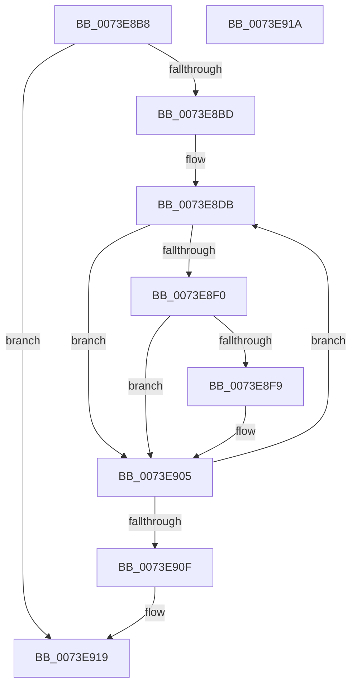

# PnpFreeResourceRequirementsForAssignTable

- RVA: `0x0073E8B8`–`0x0073E91B` (길이 `99` bytes)
- VA: `0x000000014073E8B8`
- 실행 섹션: `PAGE`
- PDB 이름 있음: `예`; PDB Function 태그: `아니요`
- unwind 정보 RVA: `0x00084918`
- 디코드: `30`개 명령, `99/99` bytes 표시
- 미해석 바이트: `0` (있으면 어셈블리에 `.byte`로 보존)

> 이 문서는 커널 이미지의 기계어와 PDB 기호를 분석해 생성했습니다. 4번과 5번은 함수 원형과 자료형을 바이너리 사용 방식에서 추정한 C 해석이며 원본 소스 복구 결과는 아닙니다.

## 1. Dependencies

- 직접 호출 지점: **2**; 고유 호출 대상: **2**
- 직접 호출자로 확인된 함수: **5**
- RIP 상대 이미지 참조: **0**

### Outgoing calls
- `0x0073E8DE` → [IopFreeReqList](../72/IopFreeReqList_function_0072ADAC.md) (function, `0x0072ADAC`)
- `0x0073E8FB` → [ExFreePoolWithTag](../../poolcode/B8/ExFreePoolWithTag_function_00B82870.md) (function, `0x00B82870`)

### Direct callers
- [PnpReallocateResources](PnpReallocateResources_function_0073E924.md) at `0x0073EA9F`
- [PnpRestoreResourcesInternal](PnpRestoreResourcesInternal_function_0073EB10.md) at `0x0073EBBB`
- [PnpRestoreResourcesInternal](PnpRestoreResourcesInternal_function_0073EB10.md) at `0x0073EBDF`
- [PnpRebalance](PnpRebalance_function_0073F508.md) at `0x0073F711`
- [sub_00B38CDE](../B3/Unknown_function_00B38CDE.md) at `0x00B39014`
- [sub_00B39020](../B3/Unknown_function_00B39020.md) at `0x00B3908D`

### Static image references
- 디코드된 RIP-relative 메모리 참조가 없습니다.

## 2. Other-region calls and transfers

- 다른 실행 섹션으로 향하는 call: **1**
  - `0x0073E8FB` → [ExFreePoolWithTag](../../poolcode/B8/ExFreePoolWithTag_function_00B82870.md) (`PAGE` → `POOLCODE`)
- 별도 외부 분기/꼬리 이동을 확인하지 못했습니다.

## 3. Assembly (complete function range)

```asm
0073E8B8  48 3B CA                        cmp rcx, rdx
0073E8BB  73 5C                           jae 0x14073e919
0073E8BD  48 89 5C 24 08                  mov qword ptr [rsp + 8], rbx
0073E8C2  57                              push rdi
0073E8C3  48 83 EC 20                     sub rsp, 0x20
0073E8C7  48 8B DA                        mov rbx, rdx
0073E8CA  48 8D 79 20                     lea rdi, [rcx + 0x20]
0073E8CE  48 2B D9                        sub rbx, rcx
0073E8D1  48 FF CB                        dec rbx
0073E8D4  48 C1 EB 06                     shr rbx, 6
0073E8D8  48 FF C3                        inc rbx
0073E8DB  48 8B 0F                        mov rcx, qword ptr [rdi]
0073E8DE  E8 C9 C4 FE FF                  call 0x14072adac
0073E8E3  48 83 27 00                     and qword ptr [rdi], 0
0073E8E7  F7 47 E8 00 02 00 00            test dword ptr [rdi - 0x18], 0x200
0073E8EE  74 15                           je 0x14073e905
0073E8F0  48 8B 4F F8                     mov rcx, qword ptr [rdi - 8]
0073E8F4  48 85 C9                        test rcx, rcx
0073E8F7  74 0C                           je 0x14073e905
0073E8F9  33 D2                           xor edx, edx
0073E8FB  E8 70 3F 44 00                  call 0x140b82870
0073E900  48 83 67 F8 00                  and qword ptr [rdi - 8], 0
0073E905  48 83 C7 40                     add rdi, 0x40
0073E909  48 83 EB 01                     sub rbx, 1
0073E90D  75 CC                           jne 0x14073e8db
0073E90F  48 8B 5C 24 30                  mov rbx, qword ptr [rsp + 0x30]
0073E914  48 83 C4 20                     add rsp, 0x20
0073E918  5F                              pop rdi
0073E919  C3                              ret
0073E91A  CC                              int3
```

## 4. C-style interpretation (structured pseudocode)

```c
__int64 __fastcall PnpFreeResourceRequirementsForAssignTable(__int64 a1, __int64 a2)
{
    __int64 result;
    __int64 v_rbx;
    __int64 v_rdi;
    __int64 v_rsp;
    unsigned __int64 v_stack_p8;

    if (a1 >= a2) goto loc_0073E919;
    v_stack_p8 = v_rbx;
    v_rsp = (v_rsp) - (32);
    v_rbx = (a2) - (a1);
    v_rbx = (v_rbx) - 1;
    v_rbx = (v_rbx) >> (6);
    v_rbx = (v_rbx) + 1;
loc_0073E8DB:
    result = IopFreeReqList(*(unsigned __int64 *)(a1 + 32), a2, a3, a4);
    if (((*(unsigned int *)(a1 + 32 - 24)) & (512)) == 0) goto loc_0073E905;
    if (*(unsigned __int64 *)(a1 + 32 - 8) != 0) {
        a2 = 0;
        result = ExFreePoolWithTag(*(unsigned __int64 *)(a1 + 32 - 8), a2, a3, a4);
    }
    v_rdi = (a1 + 32) + (64);
    v_rbx = (v_rbx) - (1);
    if (condition_is_not_equal) goto loc_0073E8DB;
    v_rsp = (v_rsp) + (32);
loc_0073E919:
    return result;
}
```

## 5. (Beta) C Style

```c
int64_t PnpFreeResourceRequirementsForAssignTable(int64_t Arg1, int64_t Arg2)
{
    int64_t result;
    int64_t local_rbx;
    int64_t local_rdi;
    int64_t local_rsp;
    uint64_t v_stack_p8;

    if (Arg1 >= Arg2) goto loc_0073E919;
    v_stack_p8 = local_rbx;
    local_rsp = (local_rsp) - (32);
    local_rbx = (Arg2) - (Arg1);
    local_rbx = (local_rbx) - 1;
    local_rbx = (local_rbx) >> (6);
    local_rbx = (local_rbx) + 1;
loc_0073E8DB:
    result = IopFreeReqList(*(uint64_t *)(Arg1 + 0x20), Arg2, a3, a4);
    if (((*(uint32_t *)(Arg1 + 0x20 - 0x18)) & (512)) == 0) goto loc_0073E905;
    if (*(uint64_t *)(Arg1 + 0x20 - 0x8) != 0) {
        Arg2 = 0;
        result = ExFreePoolWithTag(*(uint64_t *)(Arg1 + 0x20 - 0x8), Arg2, a3, a4);
    }
    local_rdi = (Arg1 + 32) + (64);
    local_rbx = (local_rbx) - (1);
    if (condition_is_not_equal) goto loc_0073E8DB;
    local_rsp = (local_rsp) + (32);
loc_0073E919:
    return result;
}
```

## 6. Execution-region graph

[열기: 2D/3D 그래프와 함수 탐색 컨트롤 패널](../../../control-panel.html?section=page&rva=0x0073E8B8&view=graph)

- 2D 그래프는 위에서 아래로 흐르고, 3D 그래프는 빈 공간을 드래그해 회전합니다. Shift+드래그는 이동, 휠은 확대·축소, 함수 노드 선택은 대상 보고서 이동입니다.

### Static fallback


