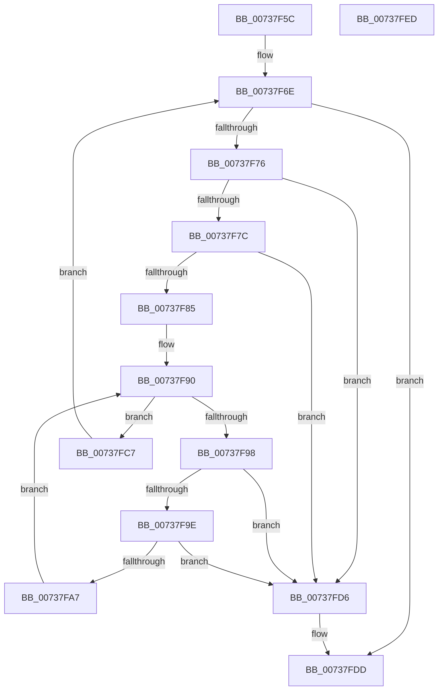

# PnpFreeVetoInformation

- RVA: `0x00737F5C`–`0x00737FEE` (길이 `146` bytes)
- VA: `0x0000000140737F5C`
- 실행 섹션: `PAGE`
- PDB 이름 있음: `예`; PDB Function 태그: `아니요`
- unwind 정보 RVA: `0x00060BC4`
- 디코드: `44`개 명령, `146/146` bytes 표시
- 미해석 바이트: `0` (있으면 어셈블리에 `.byte`로 보존)

> 이 문서는 커널 이미지의 기계어와 PDB 기호를 분석해 생성했습니다. 4번과 5번은 함수 원형과 자료형을 바이너리 사용 방식에서 추정한 C 해석이며 원본 소스 복구 결과는 아닙니다.

## 1. Dependencies

- 직접 호출 지점: **3**; 고유 호출 대상: **2**
- 직접 호출자로 확인된 함수: **1**
- RIP 상대 이미지 참조: **0**

### Outgoing calls
- `0x00737FB2` → [ObfDereferenceObject](../../text/2F/ObfDereferenceObject_function_002F9350.md) (function, `0x002F9350`)
- `0x00737FC0` → [ExFreePoolWithTag](../../poolcode/B8/ExFreePoolWithTag_function_00B82870.md) (function, `0x00B82870`)
- `0x00737FCF` → [ExFreePoolWithTag](../../poolcode/B8/ExFreePoolWithTag_function_00B82870.md) (function, `0x00B82870`)

### Direct callers
- [PipSendQueryRemoveIrpAndCheckOpenHandles](../74/PipSendQueryRemoveIrpAndCheckOpenHandles_function_007443E8.md) at `0x007445C4`

### Static image references
- 디코드된 RIP-relative 메모리 참조가 없습니다.

## 2. Other-region calls and transfers

- 다른 실행 섹션으로 향하는 call: **3**
  - `0x00737FB2` → [ObfDereferenceObject](../../text/2F/ObfDereferenceObject_function_002F9350.md) (`PAGE` → `.text`)
  - `0x00737FC0` → [ExFreePoolWithTag](../../poolcode/B8/ExFreePoolWithTag_function_00B82870.md) (`PAGE` → `POOLCODE`)
  - `0x00737FCF` → [ExFreePoolWithTag](../../poolcode/B8/ExFreePoolWithTag_function_00B82870.md) (`PAGE` → `POOLCODE`)
- 별도 외부 분기/꼬리 이동을 확인하지 못했습니다.

## 3. Assembly (complete function range)

```asm
00737F5C  48 89 5C 24 08                  mov qword ptr [rsp + 8], rbx
00737F61  48 89 74 24 10                  mov qword ptr [rsp + 0x10], rsi
00737F66  57                              push rdi
00737F67  48 83 EC 20                     sub rsp, 0x20
00737F6B  48 8B F9                        mov rdi, rcx
00737F6E  48 8B 07                        mov rax, qword ptr [rdi]
00737F71  48 3B C7                        cmp rax, rdi
00737F74  74 67                           je 0x140737fdd
00737F76  48 39 78 08                     cmp qword ptr [rax + 8], rdi
00737F7A  75 5A                           jne 0x140737fd6
00737F7C  48 8B 08                        mov rcx, qword ptr [rax]
00737F7F  48 39 41 08                     cmp qword ptr [rcx + 8], rax
00737F83  75 51                           jne 0x140737fd6
00737F85  48 89 0F                        mov qword ptr [rdi], rcx
00737F88  48 8D 70 E8                     lea rsi, [rax - 0x18]
00737F8C  48 89 79 08                     mov qword ptr [rcx + 8], rdi
00737F90  48 8B 1E                        mov rbx, qword ptr [rsi]
00737F93  48 3B DE                        cmp rbx, rsi
00737F96  74 2F                           je 0x140737fc7
00737F98  48 39 73 08                     cmp qword ptr [rbx + 8], rsi
00737F9C  75 38                           jne 0x140737fd6
00737F9E  48 8B 03                        mov rax, qword ptr [rbx]
00737FA1  48 39 58 08                     cmp qword ptr [rax + 8], rbx
00737FA5  75 2F                           jne 0x140737fd6
00737FA7  48 89 06                        mov qword ptr [rsi], rax
00737FAA  48 89 70 08                     mov qword ptr [rax + 8], rsi
00737FAE  48 8B 4B F8                     mov rcx, qword ptr [rbx - 8]
00737FB2  E8 99 13 BC FF                  call 0x1402f9350
00737FB7  BA 50 6E 70 50                  mov edx, 0x50706e50
00737FBC  48 8D 4B F8                     lea rcx, [rbx - 8]
00737FC0  E8 AB A8 44 00                  call 0x140b82870
00737FC5  EB C9                           jmp 0x140737f90
00737FC7  BA 50 6E 70 4F                  mov edx, 0x4f706e50
00737FCC  48 8B CE                        mov rcx, rsi
00737FCF  E8 9C A8 44 00                  call 0x140b82870
00737FD4  EB 98                           jmp 0x140737f6e
00737FD6  B9 03 00 00 00                  mov ecx, 3
00737FDB  CD 29                           int 0x29
00737FDD  48 8B 5C 24 30                  mov rbx, qword ptr [rsp + 0x30]
00737FE2  48 8B 74 24 38                  mov rsi, qword ptr [rsp + 0x38]
00737FE7  48 83 C4 20                     add rsp, 0x20
00737FEB  5F                              pop rdi
00737FEC  C3                              ret
00737FED  CC                              int3
```

## 4. C-style interpretation (structured pseudocode)

```c
__int64 __fastcall PnpFreeVetoInformation(__int64 a1)
{
    __int64 result;
    __int64 v_rsp;
    unsigned __int64 v_stack_p10;
    unsigned __int64 v_stack_p8;

    v_stack_p8 = v_rbx;
    v_stack_p10 = v_rsi;
    v_rsp = (v_rsp) - (32);
loc_00737F6E:
    if ((*(unsigned __int64 *)(a1)) == a1) goto loc_00737FDD;
    if ((*(unsigned __int64 *)(*(unsigned __int64 *)(a1) + 8)) != a1) goto loc_00737FD6;
    if ((*(unsigned __int64 *)(*(unsigned __int64 *)(*(unsigned __int64 *)(a1)) + 8)) != (*(unsigned __int64 *)(a1))) goto loc_00737FD6;
    *(unsigned __int64 *)(a1) = *(unsigned __int64 *)(*(unsigned __int64 *)(a1));
    *(unsigned __int64 *)(*(unsigned __int64 *)(*(unsigned __int64 *)(a1)) + 8) = a1;
loc_00737F90:
    if ((*(unsigned __int64 *)(*(unsigned __int64 *)(a1) - 24)) == (*(unsigned __int64 *)(a1) - 24)) goto loc_00737FC7;
    if ((*(unsigned __int64 *)(*(unsigned __int64 *)(*(unsigned __int64 *)(a1) - 24) + 8)) != (*(unsigned __int64 *)(a1) - 24)) goto loc_00737FD6;
    if ((*(unsigned __int64 *)(*(unsigned __int64 *)(*(unsigned __int64 *)(*(unsigned __int64 *)(a1) - 24)) + 8)) != (*(unsigned __int64 *)(*(unsigned __int64 *)(a1) - 24))) goto loc_00737FD6;
    *(unsigned __int64 *)(*(unsigned __int64 *)(a1) - 24) = *(unsigned __int64 *)(*(unsigned __int64 *)(*(unsigned __int64 *)(a1) - 24));
    *(unsigned __int64 *)(*(unsigned __int64 *)(*(unsigned __int64 *)(*(unsigned __int64 *)(a1) - 24)) + 8) = *(unsigned __int64 *)(a1) - 24;
    result = ObfDereferenceObject(*(unsigned __int64 *)(*(unsigned __int64 *)(*(unsigned __int64 *)(a1) - 24) - 8), a2, a3, a4);
    result = ExFreePoolWithTag(*(unsigned __int64 *)(*(unsigned __int64 *)(a1) - 24) - 8, (unsigned int)(0x50706E50ULL), a3, a4);
    goto loc_00737F90;
loc_00737FC7:
    result = ExFreePoolWithTag(*(unsigned __int64 *)(a1) - 24, (unsigned int)(0x4F706E50ULL), a3, a4);
    goto loc_00737F6E;
loc_00737FD6:
loc_00737FDD:
    v_rsp = (v_rsp) + (32);
    return result;
}
```

## 5. (Beta) C Style

```c
int64_t PnpFreeVetoInformation(void *Arg1)
{
    uint8_t *arg1 = (uint8_t *)Arg1;

    int64_t result;
    int64_t local_rsp;
    uint64_t v_stack_p10;
    uint64_t v_stack_p8;

    v_stack_p8 = local_rbx;
    v_stack_p10 = local_rsi;
    local_rsp = (local_rsp) - (32);
loc_00737F6E:
    if ((*(uint64_t *)(arg1)) == Arg1) goto loc_00737FDD;
    if ((*(uint64_t *)(*(uint64_t *)(arg1) + 0x8)) != Arg1) goto loc_00737FD6;
    if ((*(uint64_t *)(*(uint64_t *)(*(uint64_t *)(arg1)) + 0x8)) != (*(uint64_t *)(arg1))) goto loc_00737FD6;
    *(uint64_t *)(arg1) = *(uint64_t *)(*(uint64_t *)(arg1));
    *(void **)(*(uint64_t *)(*(uint64_t *)(arg1)) + 0x8) = Arg1;
loc_00737F90:
    if ((*(uint64_t *)(*(uint64_t *)(arg1) - 0x18)) == (*(uint64_t *)(arg1) - 24)) goto loc_00737FC7;
    if ((*(uint64_t *)(*(uint64_t *)(*(uint64_t *)(arg1) - 0x18) + 0x8)) != (*(uint64_t *)(arg1) - 24)) goto loc_00737FD6;
    if ((*(uint64_t *)(*(uint64_t *)(*(uint64_t *)(*(uint64_t *)(arg1) - 0x18)) + 0x8)) != (*(uint64_t *)(*(uint64_t *)(arg1) - 0x18))) goto loc_00737FD6;
    *(uint64_t *)(*(uint64_t *)(arg1) - 0x18) = *(uint64_t *)(*(uint64_t *)(*(uint64_t *)(arg1) - 0x18));
    *(uint64_t *)(*(uint64_t *)(*(uint64_t *)(*(uint64_t *)(arg1) - 0x18)) + 0x8) = *(uint64_t *)(arg1) - 24;
    result = ObfDereferenceObject(*(uint64_t *)(*(uint64_t *)(*(uint64_t *)(arg1) - 0x18) - 0x8), a2, a3, a4);
    result = ExFreePoolWithTag(*(uint64_t *)(*(uint64_t *)(arg1) - 0x18) - 8, (uint32_t)(0x50706E50ULL), a3, a4);
    goto loc_00737F90;
loc_00737FC7:
    result = ExFreePoolWithTag(*(uint64_t *)(arg1) - 24, (uint32_t)(0x4F706E50ULL), a3, a4);
    goto loc_00737F6E;
loc_00737FD6:
loc_00737FDD:
    local_rsp = (local_rsp) + (32);
    return result;
}
```

### 관측된 메모리 오프셋

구조체 형식이 확인되지 않은 접근은 인자 기준의 오프셋으로만 기록했습니다.

| 기준 인자 | 오프셋 표현 | 폭 (bit) | 접근 |
|---|---:|---:|---|
| `Arg1` | `+ 0x0` | `64` | `R` |
| `Arg1` | `+ 0x0` | `64` | `W` |

## 6. Execution-region graph

[열기: 2D/3D 그래프와 함수 탐색 컨트롤 패널](../../../control-panel.html?section=page&rva=0x00737F5C&view=graph)

- 2D 그래프는 위에서 아래로 흐르고, 3D 그래프는 빈 공간을 드래그해 회전합니다. Shift+드래그는 이동, 휠은 확대·축소, 함수 노드 선택은 대상 보고서 이동입니다.

### Static fallback


