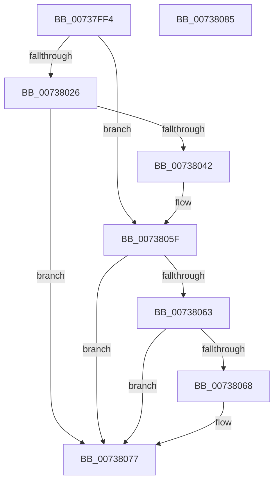

# PnpGetProcessCommandLine

- RVA: `0x00737FF4`–`0x00738086` (길이 `146` bytes)
- VA: `0x0000000140737FF4`
- 실행 섹션: `PAGE`
- PDB 이름 있음: `예`; PDB Function 태그: `아니요`
- unwind 정보 RVA: `0x0006E5F8`
- 디코드: `42`개 명령, `146/146` bytes 표시
- 미해석 바이트: `0` (있으면 어셈블리에 `.byte`로 보존)

> 이 문서는 커널 이미지의 기계어와 PDB 기호를 분석해 생성했습니다. 4번과 5번은 함수 원형과 자료형을 바이너리 사용 방식에서 추정한 C 해석이며 원본 소스 복구 결과는 아닙니다.

## 1. Dependencies

- 직접 호출 지점: **4**; 고유 호출 대상: **3**
- 직접 호출자로 확인된 함수: **1**
- RIP 상대 이미지 참조: **0**

### Outgoing calls
- `0x0073801A` → [PsQueryProcessCommandLine](../../text/46/PsQueryProcessCommandLine_function_00469810.md) (function, `0x00469810`)
- `0x00738035` → [ExAllocatePool2](../../poolcode/B8/ExAllocatePool2_function_00B820F0.md) (function, `0x00B820F0`)
- `0x0073805A` → [PsQueryProcessCommandLine](../../text/46/PsQueryProcessCommandLine_function_00469810.md) (function, `0x00469810`)
- `0x00738070` → [ExFreePoolWithTag](../../poolcode/B8/ExFreePoolWithTag_function_00B82870.md) (function, `0x00B82870`)

### Direct callers
- [PnpLogVetoInformation](../AB/PnpLogVetoInformation_function_00AB6BE8.md) at `0x00AB6D09`

### Static image references
- 디코드된 RIP-relative 메모리 참조가 없습니다.

## 2. Other-region calls and transfers

- 다른 실행 섹션으로 향하는 call: **4**
  - `0x0073801A` → [PsQueryProcessCommandLine](../../text/46/PsQueryProcessCommandLine_function_00469810.md) (`PAGE` → `.text`)
  - `0x00738035` → [ExAllocatePool2](../../poolcode/B8/ExAllocatePool2_function_00B820F0.md) (`PAGE` → `POOLCODE`)
  - `0x0073805A` → [PsQueryProcessCommandLine](../../text/46/PsQueryProcessCommandLine_function_00469810.md) (`PAGE` → `.text`)
  - `0x00738070` → [ExFreePoolWithTag](../../poolcode/B8/ExFreePoolWithTag_function_00B82870.md) (`PAGE` → `POOLCODE`)
- 별도 외부 분기/꼬리 이동을 확인하지 못했습니다.

## 3. Assembly (complete function range)

```asm
00737FF4  48 89 5C 24 08                  mov qword ptr [rsp + 8], rbx
00737FF9  57                              push rdi
00737FFA  48 83 EC 30                     sub rsp, 0x30
00737FFE  83 64 24 48 00                  and dword ptr [rsp + 0x48], 0
00738003  48 8D 44 24 48                  lea rax, [rsp + 0x48]
00738008  45 33 C9                        xor r9d, r9d
0073800B  48 89 44 24 20                  mov qword ptr [rsp + 0x20], rax
00738010  45 33 C0                        xor r8d, r8d
00738013  33 D2                           xor edx, edx
00738015  48 8B F9                        mov rdi, rcx
00738018  33 DB                           xor ebx, ebx
0073801A  E8 F1 17 D3 FF                  call 0x140469810
0073801F  3D 04 00 00 C0                  cmp eax, 0xc0000004
00738024  75 39                           jne 0x14073805f
00738026  8B 54 24 48                     mov edx, dword ptr [rsp + 0x48]
0073802A  B9 00 01 00 00                  mov ecx, 0x100
0073802F  41 B8 50 6E 70 4F               mov r8d, 0x4f706e50
00738035  E8 B6 A0 44 00                  call 0x140b820f0
0073803A  48 8B D8                        mov rbx, rax
0073803D  48 85 C0                        test rax, rax
00738040  74 35                           je 0x140738077
00738042  44 8B 44 24 48                  mov r8d, dword ptr [rsp + 0x48]
00738047  48 8D 44 24 48                  lea rax, [rsp + 0x48]
0073804C  45 33 C9                        xor r9d, r9d
0073804F  48 89 44 24 20                  mov qword ptr [rsp + 0x20], rax
00738054  48 8B D3                        mov rdx, rbx
00738057  48 8B CF                        mov rcx, rdi
0073805A  E8 B1 17 D3 FF                  call 0x140469810
0073805F  85 C0                           test eax, eax
00738061  79 14                           jns 0x140738077
00738063  48 85 DB                        test rbx, rbx
00738066  74 0F                           je 0x140738077
00738068  BA 50 6E 70 4F                  mov edx, 0x4f706e50
0073806D  48 8B CB                        mov rcx, rbx
00738070  E8 FB A7 44 00                  call 0x140b82870
00738075  33 DB                           xor ebx, ebx
00738077  48 8B C3                        mov rax, rbx
0073807A  48 8B 5C 24 40                  mov rbx, qword ptr [rsp + 0x40]
0073807F  48 83 C4 30                     add rsp, 0x30
00738083  5F                              pop rdi
00738084  C3                              ret
00738085  CC                              int3
```

## 4. C-style interpretation (structured pseudocode)

```c
__int64 __fastcall PnpGetProcessCommandLine(__int64 a1, int a2, int a3, int a4)
{
    __int64 result;
    __int64 v_rbx;
    __int64 v_rsp;
    unsigned __int64 v_stack_m18;
    unsigned int v_stack_p10;
    unsigned __int64 v_stack_p8;

    v_stack_p8 = v_rbx;
    v_rsp = (v_rsp) - (48);
    a4 = 0;
    v_stack_m18 = v_stack_p10;
    a3 = 0;
    a2 = 0;
    v_rbx = 0;
    result = PsQueryProcessCommandLine(a1, a2, a3, a4);
    if (((unsigned int)(result)) != 0xC0000004ULL) goto loc_0073805F;
    result = ExAllocatePool2(256, (unsigned int)(v_stack_p10), (unsigned int)(0x4F706E50ULL), a4);
    if (result == 0) goto loc_00738077;
    a4 = 0;
    v_stack_m18 = v_stack_p10;
    result = PsQueryProcessCommandLine(a1, result, (unsigned int)(v_stack_p10), a4);
loc_0073805F:
    if (!sign_flag) goto loc_00738077;
    v_rbx = result;
    if (result != 0) {
        a2 = 0x4F706E50ULL;
        a1 = result;
        result = ExFreePoolWithTag(a1, a2, (unsigned int)(v_stack_p10), a4);
        v_rbx = 0;
    }
    v_rsp = (v_rsp) + (48);
    return 0;
}
```

## 5. (Beta) C Style

```c
int64_t PnpGetProcessCommandLine(int64_t Arg1, int32_t Arg2, int32_t Arg3, int32_t Arg4)
{
    int64_t result;
    int64_t local_rbx;
    int64_t local_rsp;
    uint64_t v_stack_m18;
    uint32_t v_stack_p10;
    uint64_t v_stack_p8;

    v_stack_p8 = local_rbx;
    local_rsp = (local_rsp) - (48);
    Arg4 = 0;
    v_stack_m18 = v_stack_p10;
    Arg3 = 0;
    Arg2 = 0;
    local_rbx = 0;
    result = PsQueryProcessCommandLine(Arg1, Arg2, Arg3, Arg4);
    if (((uint32_t)(result)) != 0xC0000004ULL) goto loc_0073805F;
    result = ExAllocatePool2(256, (uint32_t)(v_stack_p10), (uint32_t)(0x4F706E50ULL), Arg4);
    if (result == 0) goto loc_00738077;
    Arg4 = 0;
    v_stack_m18 = v_stack_p10;
    result = PsQueryProcessCommandLine(Arg1, result, (uint32_t)(v_stack_p10), Arg4);
loc_0073805F:
    if (!sign_flag) goto loc_00738077;
    local_rbx = result;
    if (result != 0) {
        Arg2 = 0x4F706E50ULL;
        Arg1 = result;
        result = ExFreePoolWithTag(Arg1, Arg2, (uint32_t)(v_stack_p10), Arg4);
        local_rbx = 0;
    }
    local_rsp = (local_rsp) + (48);
    return 0;
}
```

## 6. Execution-region graph

[열기: 2D/3D 그래프와 함수 탐색 컨트롤 패널](../../../control-panel.html?section=page&rva=0x00737FF4&view=graph)

- 2D 그래프는 위에서 아래로 흐르고, 3D 그래프는 빈 공간을 드래그해 회전합니다. Shift+드래그는 이동, 휠은 확대·축소, 함수 노드 선택은 대상 보고서 이동입니다.

### Static fallback


