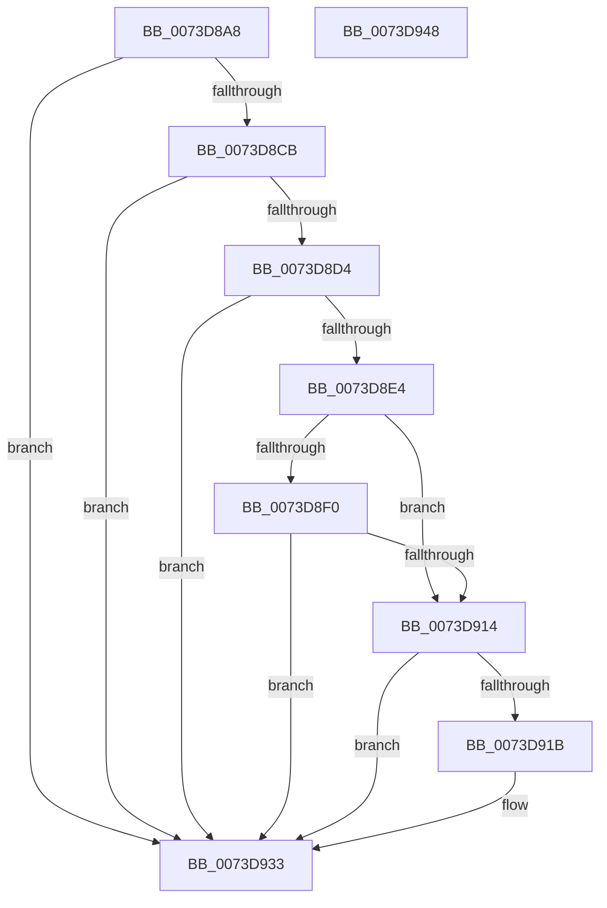

# PnpLogDeviceConflictingResource

- RVA: `0x0073D8A8`–`0x0073D949` (길이 `161` bytes)
- VA: `0x000000014073D8A8`
- 실행 섹션: `PAGE`
- PDB 이름 있음: `예`; PDB Function 태그: `아니요`
- unwind 정보 RVA: `0x0005C954`
- 디코드: `44`개 명령, `161/161` bytes 표시
- 미해석 바이트: `0` (있으면 어셈블리에 `.byte`로 보존)

> 이 문서는 커널 이미지의 기계어와 PDB 기호를 분석해 생성했습니다. 4번과 5번은 함수 원형과 자료형을 바이너리 사용 방식에서 추정한 C 해석이며 원본 소스 복구 결과는 아닙니다.

## 1. Dependencies

- 직접 호출 지점: **1**; 고유 호출 대상: **1**
- 직접 호출자로 확인된 함수: **1**
- RIP 상대 이미지 참조: **0**

### Outgoing calls
- `0x0073D900` → [ExAllocatePool2](../../poolcode/B8/ExAllocatePool2_function_00B820F0.md) (function, `0x00B820F0`)

### Direct callers
- [IopTestConfiguration](../72/IopTestConfiguration_function_0072B1AC.md) at `0x0072B27A`

### Static image references
- 디코드된 RIP-relative 메모리 참조가 없습니다.

## 2. Other-region calls and transfers

- 다른 실행 섹션으로 향하는 call: **1**
  - `0x0073D900` → [ExAllocatePool2](../../poolcode/B8/ExAllocatePool2_function_00B820F0.md) (`PAGE` → `POOLCODE`)
- 별도 외부 분기/꼬리 이동을 확인하지 못했습니다.

## 3. Assembly (complete function range)

```asm
0073D8A8  48 89 5C 24 08                  mov qword ptr [rsp + 8], rbx
0073D8AD  48 89 6C 24 10                  mov qword ptr [rsp + 0x10], rbp
0073D8B2  48 89 74 24 18                  mov qword ptr [rsp + 0x18], rsi
0073D8B7  57                              push rdi
0073D8B8  48 83 EC 20                     sub rsp, 0x20
0073D8BC  48 8B 59 28                     mov rbx, qword ptr [rcx + 0x28]
0073D8C0  48 8B EA                        mov rbp, rdx
0073D8C3  48 8B F1                        mov rsi, rcx
0073D8C6  48 85 DB                        test rbx, rbx
0073D8C9  74 68                           je 0x14073d933
0073D8CB  48 8B 43 20                     mov rax, qword ptr [rbx + 0x20]
0073D8CF  48 85 C0                        test rax, rax
0073D8D2  74 5F                           je 0x14073d933
0073D8D4  48 8B 80 38 01 00 00            mov rax, qword ptr [rax + 0x138]
0073D8DB  48 8B 78 28                     mov rdi, qword ptr [rax + 0x28]
0073D8DF  48 85 FF                        test rdi, rdi
0073D8E2  74 4F                           je 0x14073d933
0073D8E4  48 8B 97 C8 02 00 00            mov rdx, qword ptr [rdi + 0x2c8]
0073D8EB  48 85 D2                        test rdx, rdx
0073D8EE  75 24                           jne 0x14073d914
0073D8F0  BA 80 00 00 00                  mov edx, 0x80
0073D8F5  B9 00 01 00 00                  mov ecx, 0x100
0073D8FA  41 B8 50 52 65 62               mov r8d, 0x62655250
0073D900  E8 EB 47 44 00                  call 0x140b820f0
0073D905  48 89 87 C8 02 00 00            mov qword ptr [rdi + 0x2c8], rax
0073D90C  48 8B D0                        mov rdx, rax
0073D90F  48 85 C0                        test rax, rax
0073D912  74 1F                           je 0x14073d933
0073D914  48 83 7A 70 00                  cmp qword ptr [rdx + 0x70], 0
0073D919  75 18                           jne 0x14073d933
0073D91B  8A 4E 10                        mov cl, byte ptr [rsi + 0x10]
0073D91E  88 4A 68                        mov byte ptr [rdx + 0x68], cl
0073D921  8B 43 10                        mov eax, dword ptr [rbx + 0x10]
0073D924  89 42 6C                        mov dword ptr [rdx + 0x6c], eax
0073D927  48 8B 43 18                     mov rax, qword ptr [rbx + 0x18]
0073D92B  48 89 42 70                     mov qword ptr [rdx + 0x70], rax
0073D92F  48 89 6A 78                     mov qword ptr [rdx + 0x78], rbp
0073D933  48 8B 5C 24 30                  mov rbx, qword ptr [rsp + 0x30]
0073D938  48 8B 6C 24 38                  mov rbp, qword ptr [rsp + 0x38]
0073D93D  48 8B 74 24 40                  mov rsi, qword ptr [rsp + 0x40]
0073D942  48 83 C4 20                     add rsp, 0x20
0073D946  5F                              pop rdi
0073D947  C3                              ret
0073D948  CC                              int3
```

## 4. C-style interpretation (structured pseudocode)

```c
__int64 __fastcall PnpLogDeviceConflictingResource(__int64 a1, __int64 a2)
{
    __int64 result;
    __int64 v_rsp;
    unsigned __int64 v_stack_p10;
    unsigned __int64 v_stack_p18;
    unsigned __int64 v_stack_p8;

    v_stack_p8 = v_rbx;
    v_stack_p10 = v_rbp;
    v_stack_p18 = v_rsi;
    v_rsp = (v_rsp) - (32);
    if (*(unsigned __int64 *)(a1 + 40) == 0) goto loc_0073D933;
    if (*(unsigned __int64 *)(*(unsigned __int64 *)(a1 + 40) + 32) == 0) goto loc_0073D933;
    if (*(unsigned __int64 *)(*(unsigned __int64 *)(*(unsigned __int64 *)(*(unsigned __int64 *)(a1 + 40) + 32) + 312) + 40) == 0) goto loc_0073D933;
    if (*(unsigned __int64 *)(*(unsigned __int64 *)(*(unsigned __int64 *)(*(unsigned __int64 *)(*(unsigned __int64 *)(a1 + 40) + 32) + 312) + 40) + 712) != 0) goto loc_0073D914;
    result = ExAllocatePool2(256, 128, (unsigned int)(0x62655250ULL), a4);
    *(unsigned __int64 *)(*(unsigned __int64 *)(*(unsigned __int64 *)(*(unsigned __int64 *)(*(unsigned __int64 *)(a1 + 40) + 32) + 312) + 40) + 712) = result;
    if (result == 0) goto loc_0073D933;
loc_0073D914:
    if ((*(unsigned __int64 *)(result + 112)) == 0) {
        a1 = *(unsigned __int8 *)(a1 + 16);
        *(unsigned __int8 *)(result + 104) = (unsigned __int8)(a1);
        result = *(unsigned int *)(*(unsigned __int64 *)(a1 + 40) + 16);
        *(unsigned int *)(result + 108) = (unsigned int)(result);
        result = *(unsigned __int64 *)(*(unsigned __int64 *)(a1 + 40) + 24);
        *(unsigned __int64 *)(result + 112) = result;
        *(unsigned __int64 *)(result + 120) = a2;
    }
    v_rsp = (v_rsp) + (32);
    return result;
}
```

## 5. (Beta) C Style

```c
int64_t PnpLogDeviceConflictingResource(void *Arg1, int64_t Arg2)
{
    uint8_t *arg1 = (uint8_t *)Arg1;

    int64_t result;
    int64_t local_rsp;
    uint64_t v_stack_p10;
    uint64_t v_stack_p18;
    uint64_t v_stack_p8;

    v_stack_p8 = local_rbx;
    v_stack_p10 = local_rbp;
    v_stack_p18 = local_rsi;
    local_rsp = (local_rsp) - (32);
    if (*(uint64_t *)(arg1 + 0x28) == 0) goto loc_0073D933;
    if (*(uint64_t *)(*(uint64_t *)(arg1 + 0x28) + 0x20) == 0) goto loc_0073D933;
    if (*(uint64_t *)(*(uint64_t *)(*(uint64_t *)(*(uint64_t *)(arg1 + 0x28) + 0x20) + 0x138) + 0x28) == 0) goto loc_0073D933;
    if (*(uint64_t *)(*(uint64_t *)(*(uint64_t *)(*(uint64_t *)(*(uint64_t *)(arg1 + 0x28) + 0x20) + 0x138) + 0x28) + 0x2C8) != 0) goto loc_0073D914;
    result = ExAllocatePool2(256, 128, (uint32_t)(0x62655250ULL), a4);
    *(uint64_t *)(*(uint64_t *)(*(uint64_t *)(*(uint64_t *)(*(uint64_t *)(arg1 + 0x28) + 0x20) + 0x138) + 0x28) + 0x2C8) = result;
    if (result == 0) goto loc_0073D933;
loc_0073D914:
    if ((*(uint64_t *)(result + 0x70)) == 0) {
        Arg1 = *(uint8_t *)(arg1 + 0x10);
        *(uint8_t *)(result + 0x68) = (uint8_t)(Arg1);
        result = *(uint32_t *)(*(uint64_t *)(arg1 + 0x28) + 0x10);
        *(uint32_t *)(result + 0x6C) = (uint32_t)(result);
        result = *(uint64_t *)(*(uint64_t *)(arg1 + 0x28) + 0x18);
        *(uint64_t *)(result + 0x70) = result;
        *(uint64_t *)(result + 0x78) = Arg2;
    }
    local_rsp = (local_rsp) + (32);
    return result;
}
```

### 관측된 메모리 오프셋

구조체 형식이 확인되지 않은 접근은 인자 기준의 오프셋으로만 기록했습니다.

| 기준 인자 | 오프셋 표현 | 폭 (bit) | 접근 |
|---|---:|---:|---|
| `Arg1` | `+ 0x10` | `8` | `R` |
| `Arg1` | `+ 0x28` | `64` | `R` |

## 6. Execution-region graph

[열기: 2D/3D 그래프와 함수 탐색 컨트롤 패널](../../../control-panel.html?section=page&rva=0x0073D8A8&view=graph)

- 2D 그래프는 위에서 아래로 흐르고, 3D 그래프는 빈 공간을 드래그해 회전합니다. Shift+드래그는 이동, 휠은 확대·축소, 함수 노드 선택은 대상 보고서 이동입니다.

### Static fallback


