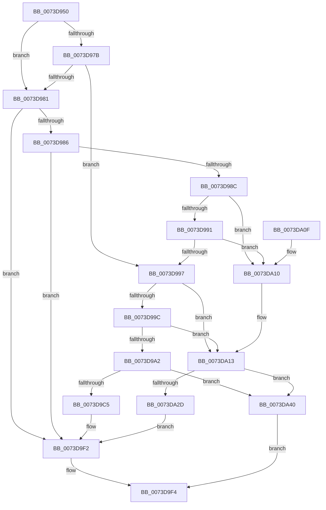

# PnpMergeFilteredResourceRequirementsList

- RVA: `0x0073D950`–`0x0073DA47` (길이 `247` bytes)
- VA: `0x000000014073D950`
- 실행 섹션: `PAGE`
- PDB 이름 있음: `예`; PDB Function 태그: `아니요`
- unwind 정보 RVA: `0x00092B0C`
- 디코드: `77`개 명령, `247/247` bytes 표시
- 미해석 바이트: `0` (있으면 어셈블리에 `.byte`로 보존)

> 이 문서는 커널 이미지의 기계어와 PDB 기호를 분석해 생성했습니다. 4번과 5번은 함수 원형과 자료형을 바이너리 사용 방식에서 추정한 C 해석이며 원본 소스 복구 결과는 아닙니다.

## 1. Dependencies

- 직접 호출 지점: **5**; 고유 호출 대상: **2**
- 직접 호출자로 확인된 함수: **1**
- RIP 상대 이미지 참조: **0**

### Outgoing calls
- `0x0073D9B8` → [ExAllocatePool2](../../poolcode/B8/ExAllocatePool2_function_00B820F0.md) (function, `0x00B820F0`)
- `0x0073D9CE` → [memcpy](../../text/6C/memcpy_function_006C6840.md) (function, `0x006C6840`)
- `0x0073D9E2` → [memcpy](../../text/6C/memcpy_function_006C6840.md) (function, `0x006C6840`)
- `0x0073DA20` → [ExAllocatePool2](../../poolcode/B8/ExAllocatePool2_function_00B820F0.md) (function, `0x00B820F0`)
- `0x0073DA36` → [memcpy](../../text/6C/memcpy_function_006C6840.md) (function, `0x006C6840`)

### Direct callers
- [sub_00B1FB42](../B1/Unknown_function_00B1FB42.md) at `0x00B1FB57`

### Static image references
- 디코드된 RIP-relative 메모리 참조가 없습니다.

## 2. Other-region calls and transfers

- 다른 실행 섹션으로 향하는 call: **5**
  - `0x0073D9B8` → [ExAllocatePool2](../../poolcode/B8/ExAllocatePool2_function_00B820F0.md) (`PAGE` → `POOLCODE`)
  - `0x0073D9CE` → [memcpy](../../text/6C/memcpy_function_006C6840.md) (`PAGE` → `.text`)
  - `0x0073D9E2` → [memcpy](../../text/6C/memcpy_function_006C6840.md) (`PAGE` → `.text`)
  - `0x0073DA20` → [ExAllocatePool2](../../poolcode/B8/ExAllocatePool2_function_00B820F0.md) (`PAGE` → `POOLCODE`)
  - `0x0073DA36` → [memcpy](../../text/6C/memcpy_function_006C6840.md) (`PAGE` → `.text`)
- 별도 외부 분기/꼬리 이동을 확인하지 못했습니다.

## 3. Assembly (complete function range)

```asm
0073D950  48 8B C4                        mov rax, rsp
0073D953  48 89 58 08                     mov qword ptr [rax + 8], rbx
0073D957  48 89 68 10                     mov qword ptr [rax + 0x10], rbp
0073D95B  48 89 70 18                     mov qword ptr [rax + 0x18], rsi
0073D95F  48 89 78 20                     mov qword ptr [rax + 0x20], rdi
0073D963  41 56                           push r14
0073D965  48 83 EC 20                     sub rsp, 0x20
0073D969  49 83 20 00                     and qword ptr [r8], 0
0073D96D  4D 8B F0                        mov r14, r8
0073D970  48 8B FA                        mov rdi, rdx
0073D973  48 8B D9                        mov rbx, rcx
0073D976  48 85 C9                        test rcx, rcx
0073D979  74 06                           je 0x14073d981
0073D97B  83 79 1C 00                     cmp dword ptr [rcx + 0x1c], 0
0073D97F  75 16                           jne 0x14073d997
0073D981  48 85 FF                        test rdi, rdi
0073D984  74 6C                           je 0x14073d9f2
0073D986  83 7A 1C 00                     cmp dword ptr [rdx + 0x1c], 0
0073D98A  74 66                           je 0x14073d9f2
0073D98C  48 85 DB                        test rbx, rbx
0073D98F  74 7F                           je 0x14073da10
0073D991  83 79 1C 00                     cmp dword ptr [rcx + 0x1c], 0
0073D995  74 79                           je 0x14073da10
0073D997  48 85 FF                        test rdi, rdi
0073D99A  74 77                           je 0x14073da13
0073D99C  83 7A 1C 00                     cmp dword ptr [rdx + 0x1c], 0
0073D9A0  74 71                           je 0x14073da13
0073D9A2  8B 09                           mov ecx, dword ptr [rcx]
0073D9A4  41 B8 50 6E 70 36               mov r8d, 0x36706e50
0073D9AA  8B 2A                           mov ebp, dword ptr [rdx]
0073D9AC  83 C1 E0                        add ecx, -0x20
0073D9AF  03 E9                           add ebp, ecx
0073D9B1  B9 00 01 00 00                  mov ecx, 0x100
0073D9B6  8B D5                           mov edx, ebp
0073D9B8  E8 33 47 44 00                  call 0x140b820f0
0073D9BD  48 8B F0                        mov rsi, rax
0073D9C0  48 85 C0                        test rax, rax
0073D9C3  74 7B                           je 0x14073da40
0073D9C5  44 8B 03                        mov r8d, dword ptr [rbx]
0073D9C8  48 8B D3                        mov rdx, rbx
0073D9CB  48 8B C8                        mov rcx, rax
0073D9CE  E8 6D 8E F8 FF                  call 0x1406c6840
0073D9D3  8B 0B                           mov ecx, dword ptr [rbx]
0073D9D5  48 8D 57 20                     lea rdx, [rdi + 0x20]
0073D9D9  44 8B C5                        mov r8d, ebp
0073D9DC  44 2B C1                        sub r8d, ecx
0073D9DF  48 03 CE                        add rcx, rsi
0073D9E2  E8 59 8E F8 FF                  call 0x1406c6840
0073D9E7  89 2E                           mov dword ptr [rsi], ebp
0073D9E9  8B 47 1C                        mov eax, dword ptr [rdi + 0x1c]
0073D9EC  01 46 1C                        add dword ptr [rsi + 0x1c], eax
0073D9EF  49 89 36                        mov qword ptr [r14], rsi
0073D9F2  33 C0                           xor eax, eax
0073D9F4  48 8B 5C 24 30                  mov rbx, qword ptr [rsp + 0x30]
0073D9F9  48 8B 6C 24 38                  mov rbp, qword ptr [rsp + 0x38]
0073D9FE  48 8B 74 24 40                  mov rsi, qword ptr [rsp + 0x40]
0073DA03  48 8B 7C 24 48                  mov rdi, qword ptr [rsp + 0x48]
0073DA08  48 83 C4 20                     add rsp, 0x20
0073DA0C  41 5E                           pop r14
0073DA0E  C3                              ret
0073DA0F  CC                              int3
0073DA10  48 8B DF                        mov rbx, rdi
0073DA13  8B 13                           mov edx, dword ptr [rbx]
0073DA15  B9 00 01 00 00                  mov ecx, 0x100
0073DA1A  41 B8 50 6E 70 36               mov r8d, 0x36706e50
0073DA20  E8 CB 46 44 00                  call 0x140b820f0
0073DA25  48 8B F8                        mov rdi, rax
0073DA28  48 85 C0                        test rax, rax
0073DA2B  74 13                           je 0x14073da40
0073DA2D  44 8B 03                        mov r8d, dword ptr [rbx]
0073DA30  48 8B D3                        mov rdx, rbx
0073DA33  48 8B C8                        mov rcx, rax
0073DA36  E8 05 8E F8 FF                  call 0x1406c6840
0073DA3B  49 89 3E                        mov qword ptr [r14], rdi
0073DA3E  EB B2                           jmp 0x14073d9f2
0073DA40  B8 9A 00 00 C0                  mov eax, 0xc000009a
0073DA45  EB AD                           jmp 0x14073d9f4
```

## 4. C-style interpretation (structured pseudocode)

```c
__int64 __fastcall PnpMergeFilteredResourceRequirementsList(__int64 a1, __int64 a2, __int64 a3)
{
    __int64 result;
    __int64 v_rbp;
    __int64 v_rsp;
    unsigned __int64 v_stack_p10;
    unsigned __int64 v_stack_p18;
    unsigned __int64 v_stack_p20;
    unsigned __int64 v_stack_p8;

    *(unsigned __int64 *)(v_rsp + 8) = v_rbx;
    *(unsigned __int64 *)(v_rsp + 16) = v_rbp;
    *(unsigned __int64 *)(v_rsp + 24) = v_rsi;
    *(unsigned __int64 *)(v_rsp + 32) = v_rdi;
    v_rsp = (v_rsp) - (32);
    if (a1 == 0) goto loc_0073D981;
    if ((*(unsigned int *)(a1 + 28)) != 0) goto loc_0073D997;
loc_0073D981:
    if (a2 == 0) goto loc_0073D9F2;
    if ((*(unsigned int *)(a2 + 28)) == 0) goto loc_0073D9F2;
    if (a1 == 0) goto loc_0073DA10;
    if ((*(unsigned int *)(a1 + 28)) == 0) goto loc_0073DA10;
loc_0073D997:
    if (a2 == 0) goto loc_0073DA13;
    if ((*(unsigned int *)(a2 + 28)) == 0) goto loc_0073DA13;
    a1 = (unsigned int)(((unsigned int)(*(unsigned int *)(a1))) + (-32));
    v_rbp = (unsigned int)(((unsigned int)(*(unsigned int *)(a2))) + ((unsigned int)(a1)));
    result = ExAllocatePool2(256, (unsigned int)((unsigned int)(v_rbp)), (unsigned int)(0x36706E50ULL), a4);
    if (result == 0) goto loc_0073DA40;
    result = memcpy(result, a1, (unsigned int)(*(unsigned int *)(a1)), a4);
    a3 = (unsigned int)(((unsigned int)((unsigned int)(v_rbp))) - ((unsigned int)((unsigned int)(*(unsigned int *)(a1)))));
    a1 = ((unsigned int)(*(unsigned int *)(a1))) + (result);
    result = memcpy(a1, a2 + 32, a3, a4);
    *(unsigned int *)(result) = (unsigned int)(v_rbp);
    *(unsigned __int64 *)(a3) = result;
loc_0073D9F2:
    result = 0;
loc_0073D9F4:
    v_rsp = (v_rsp) + (32);
    return result;
loc_0073DA10:
loc_0073DA13:
    result = ExAllocatePool2(256, (unsigned int)(*(unsigned int *)(v_stack_p20)), (unsigned int)(0x36706E50ULL), a4);
    if (result == 0) goto loc_0073DA40;
    result = memcpy(result, v_stack_p20, (unsigned int)(*(unsigned int *)(v_stack_p20)), a4);
    *(unsigned __int64 *)(a3) = result;
    goto loc_0073D9F2;
loc_0073DA40:
    goto loc_0073D9F4;
}
```

## 5. (Beta) C Style

```c
int64_t PnpMergeFilteredResourceRequirementsList(int64_t Arg1, void *Arg2, void *Arg3)
{
    uint8_t *arg2 = (uint8_t *)Arg2;
    uint8_t *arg3 = (uint8_t *)Arg3;

    int64_t result;
    int64_t local_rbp;
    int64_t local_rsp;
    uint64_t v_stack_p10;
    uint64_t v_stack_p18;
    uint64_t v_stack_p20;
    uint64_t v_stack_p8;

    *(uint64_t *)(local_rsp + 0x8) = local_rbx;
    *(uint64_t *)(local_rsp + 0x10) = local_rbp;
    *(uint64_t *)(local_rsp + 0x18) = local_rsi;
    *(uint64_t *)(local_rsp + 0x20) = local_rdi;
    local_rsp = (local_rsp) - (32);
    if (Arg1 == 0) goto loc_0073D981;
    if ((*(uint32_t *)(Arg1 + 0x1C)) != 0) goto loc_0073D997;
loc_0073D981:
    if (Arg2 == NULL) goto loc_0073D9F2;
    if ((*(uint32_t *)(arg2 + 0x1C)) == 0) goto loc_0073D9F2;
    if (Arg1 == 0) goto loc_0073DA10;
    if ((*(uint32_t *)(Arg1 + 0x1C)) == 0) goto loc_0073DA10;
loc_0073D997:
    if (Arg2 == NULL) goto loc_0073DA13;
    if ((*(uint32_t *)(arg2 + 0x1C)) == 0) goto loc_0073DA13;
    Arg1 = (uint32_t)(((uint32_t)(*(uint32_t *)(Arg1))) + (-32));
    local_rbp = (uint32_t)(((uint32_t)(*(uint32_t *)(arg2))) + ((uint32_t)(Arg1)));
    result = ExAllocatePool2(256, (uint32_t)((uint32_t)(local_rbp)), (uint32_t)(0x36706E50ULL), a4);
    if (result == 0) goto loc_0073DA40;
    result = memcpy(result, Arg1, (uint32_t)(*(uint32_t *)(Arg1)), a4);
    Arg3 = (uint32_t)(((uint32_t)((uint32_t)(local_rbp))) - ((uint32_t)((uint32_t)(*(uint32_t *)(Arg1)))));
    Arg1 = ((uint32_t)(*(uint32_t *)(Arg1))) + (result);
    result = memcpy(Arg1, Arg2 + 32, Arg3, a4);
    *(uint32_t *)(result) = (uint32_t)(local_rbp);
    *(uint64_t *)(arg3) = result;
loc_0073D9F2:
    result = 0;
loc_0073D9F4:
    local_rsp = (local_rsp) + (32);
    return result;
loc_0073DA10:
loc_0073DA13:
    result = ExAllocatePool2(256, (uint32_t)(*(uint32_t *)(v_stack_p20)), (uint32_t)(0x36706E50ULL), a4);
    if (result == 0) goto loc_0073DA40;
    result = memcpy(result, v_stack_p20, (uint32_t)(*(uint32_t *)(v_stack_p20)), a4);
    *(uint64_t *)(arg3) = result;
    goto loc_0073D9F2;
loc_0073DA40:
    goto loc_0073D9F4;
}
```

### 관측된 메모리 오프셋

구조체 형식이 확인되지 않은 접근은 인자 기준의 오프셋으로만 기록했습니다.

| 기준 인자 | 오프셋 표현 | 폭 (bit) | 접근 |
|---|---:|---:|---|
| `Arg2` | `+ 0x0` | `32` | `R` |
| `Arg2` | `+ 0x1C` | `32` | `R` |
| `Arg3` | `+ 0x0` | `64` | `R/W` |
| `Arg3` | `+ 0x0` | `64` | `W` |

## 6. Execution-region graph

[열기: 2D/3D 그래프와 함수 탐색 컨트롤 패널](../../../control-panel.html?section=page&rva=0x0073D950&view=graph)

- 2D 그래프는 위에서 아래로 흐르고, 3D 그래프는 빈 공간을 드래그해 회전합니다. Shift+드래그는 이동, 휠은 확대·축소, 함수 노드 선택은 대상 보고서 이동입니다.

### Static fallback


