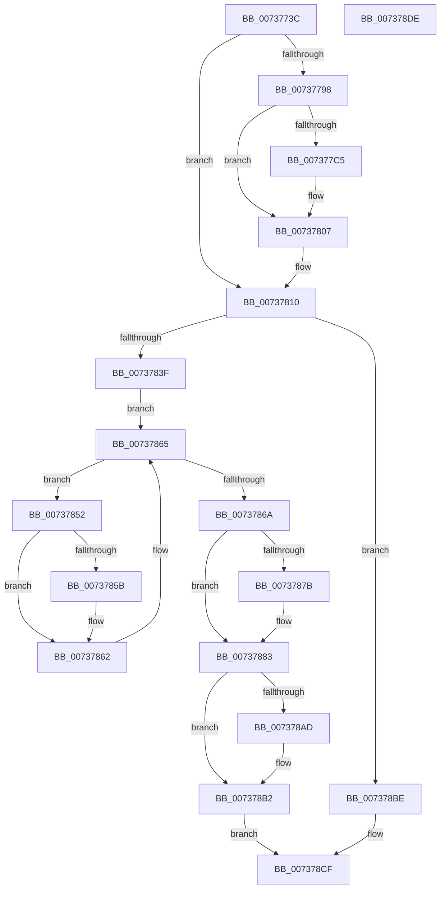

# PnpProfileUpdateHardwareProfile

- RVA: `0x0073773C`–`0x007378DF` (길이 `419` bytes)
- VA: `0x000000014073773C`
- 실행 섹션: `PAGE`
- PDB 이름 있음: `예`; PDB Function 태그: `아니요`
- unwind 정보 RVA: `0x000C8D78`
- 디코드: `105`개 명령, `419/419` bytes 표시
- 미해석 바이트: `0` (있으면 어셈블리에 `.byte`로 보존)

> 이 문서는 커널 이미지의 기계어와 PDB 기호를 분석해 생성했습니다. 4번과 5번은 함수 원형과 자료형을 바이너리 사용 방식에서 추정한 C 해석이며 원본 소스 복구 결과는 아닙니다.

## 1. Dependencies

- 직접 호출 지점: **12**; 고유 호출 대상: **8**
- 직접 호출자로 확인된 함수: **2**
- RIP 상대 이미지 참조: **6**

### Outgoing calls
- `0x00737768` → [ExAcquireFastMutex](../../text/20/ExAcquireFastMutex_function_0020E5A0.md) (function, `0x0020E5A0`)
- `0x0073778F` → [IopOpenRegistryKeyEx](../A5/IopOpenRegistryKeyEx_function_00A51B44.md) (function, `0x00A51B44`)
- `0x007377BC` → [IopOpenRegistryKeyEx](../A5/IopOpenRegistryKeyEx_function_00A51B44.md) (function, `0x00A51B44`)
- `0x007377F9` → [ZwSetValueKey](../../text/6A/ZwSetValueKey_function_006ADCD0.md) (function, `0x006ADCD0`)
- `0x00737802` → [ZwClose](../../text/6A/ZwClose_function_006AD2B0.md) (function, `0x006AD2B0`)
- `0x0073780B` → [ZwClose](../../text/6A/ZwClose_function_006AD2B0.md) (function, `0x006AD2B0`)
- `0x00737832` → [ExAllocatePool2](../../poolcode/B8/ExAllocatePool2_function_00B820F0.md) (function, `0x00B820F0`)
- `0x00737871` → [ExReleaseFastMutex](../../text/25/ExReleaseFastMutex_function_002519C0.md) (function, `0x002519C0`)
- `0x0073789D` → [IopExecuteHardwareProfileChange](../74/IopExecuteHardwareProfileChange_function_00744024.md) (function, `0x00744024`)
- `0x007378AD` → [ZwClose](../../text/6A/ZwClose_function_006AD2B0.md) (function, `0x006AD2B0`)
- `0x007378B7` → [ExFreePoolWithTag](../../poolcode/B8/ExFreePoolWithTag_function_00B82870.md) (function, `0x00B82870`)
- `0x007378C5` → [ExReleaseFastMutex](../../text/25/ExReleaseFastMutex_function_002519C0.md) (function, `0x002519C0`)

### Direct callers
- [PpProfileCancelTransitioningDock](PpProfileCancelTransitioningDock_function_007379A0.md) at `0x007379E8`
- [PpProfileCommitTransitioningDock](PpProfileCommitTransitioningDock_function_00737A4C.md) at `0x00737B27`

### Static image references
- `0x00737758` → RVA `0x00F8ACA0` (`.data`; read)
- `0x0073776D` → RVA `0x00AFF640` (` ?? ::NNGAKEGL::`string'`; read)
- `0x0073779C` → RVA `0x00AFF6C0` (` ?? ::NNGAKEGL::`string'`; read)
- `0x007377C9` → RVA `0x00AFF6E0` (` ?? ::NNGAKEGL::`string'`; read)
- `0x007377E5` → RVA `0x00F8ACD8` (`.data`; read)
- `0x0073783F` → RVA `0x00F8ACE0` (`.data`; read)

## 2. Other-region calls and transfers

- 다른 실행 섹션으로 향하는 call: **9**
  - `0x00737768` → [ExAcquireFastMutex](../../text/20/ExAcquireFastMutex_function_0020E5A0.md) (`PAGE` → `.text`)
  - `0x007377F9` → [ZwSetValueKey](../../text/6A/ZwSetValueKey_function_006ADCD0.md) (`PAGE` → `.text`)
  - `0x00737802` → [ZwClose](../../text/6A/ZwClose_function_006AD2B0.md) (`PAGE` → `.text`)
  - `0x0073780B` → [ZwClose](../../text/6A/ZwClose_function_006AD2B0.md) (`PAGE` → `.text`)
  - `0x00737832` → [ExAllocatePool2](../../poolcode/B8/ExAllocatePool2_function_00B820F0.md) (`PAGE` → `POOLCODE`)
  - `0x00737871` → [ExReleaseFastMutex](../../text/25/ExReleaseFastMutex_function_002519C0.md) (`PAGE` → `.text`)
  - `0x007378AD` → [ZwClose](../../text/6A/ZwClose_function_006AD2B0.md) (`PAGE` → `.text`)
  - `0x007378B7` → [ExFreePoolWithTag](../../poolcode/B8/ExFreePoolWithTag_function_00B82870.md) (`PAGE` → `POOLCODE`)
  - `0x007378C5` → [ExReleaseFastMutex](../../text/25/ExReleaseFastMutex_function_002519C0.md) (`PAGE` → `.text`)
- 별도 외부 분기/꼬리 이동을 확인하지 못했습니다.

## 3. Assembly (complete function range)

```asm
0073773C  48 89 5C 24 08                  mov qword ptr [rsp + 8], rbx
00737741  55                              push rbp
00737742  56                              push rsi
00737743  57                              push rdi
00737744  48 8B EC                        mov rbp, rsp
00737747  48 83 EC 40                     sub rsp, 0x40
0073774B  48 83 65 38 00                  and qword ptr [rbp + 0x38], 0
00737750  48 8B F1                        mov rsi, rcx
00737753  48 83 65 28 00                  and qword ptr [rbp + 0x28], 0
00737758  48 8D 0D 41 35 85 00            lea rcx, [rip + 0x853541]
0073775F  48 83 65 30 00                  and qword ptr [rbp + 0x30], 0
00737764  83 65 F4 00                     and dword ptr [rbp - 0xc], 0
00737768  E8 33 6E AD FF                  call 0x14020e5a0
0073776D  48 8D 05 CC 7E 3C 00            lea rax, [rip + 0x3c7ecc]
00737774  C7 45 F0 7A 00 7C 00            mov dword ptr [rbp - 0x10], 0x7c007a
0073777B  41 B9 19 00 02 00               mov r9d, 0x20019
00737781  48 89 45 F8                     mov qword ptr [rbp - 8], rax
00737785  4C 8D 45 F0                     lea r8, [rbp - 0x10]
00737789  33 D2                           xor edx, edx
0073778B  48 8D 4D 30                     lea rcx, [rbp + 0x30]
0073778F  E8 B0 A3 31 00                  call 0x140a51b44
00737794  85 C0                           test eax, eax
00737796  78 78                           js 0x140737810
00737798  48 8B 55 30                     mov rdx, qword ptr [rbp + 0x30]
0073779C  48 8D 05 1D 7F 3C 00            lea rax, [rip + 0x3c7f1d]
007377A3  41 B9 1F 00 02 00               mov r9d, 0x2001f
007377A9  48 89 45 F8                     mov qword ptr [rbp - 8], rax
007377AD  4C 8D 45 F0                     lea r8, [rbp - 0x10]
007377B1  C7 45 F0 1E 00 20 00            mov dword ptr [rbp - 0x10], 0x20001e
007377B8  48 8D 4D 28                     lea rcx, [rbp + 0x28]
007377BC  E8 83 A3 31 00                  call 0x140a51b44
007377C1  85 C0                           test eax, eax
007377C3  78 42                           js 0x140737807
007377C5  48 8B 4D 28                     mov rcx, qword ptr [rbp + 0x28]
007377C9  48 8D 05 10 7F 3C 00            lea rax, [rip + 0x3c7f10]
007377D0  48 89 45 F8                     mov qword ptr [rbp - 8], rax
007377D4  48 8D 55 F0                     lea rdx, [rbp - 0x10]
007377D8  41 B9 04 00 00 00               mov r9d, 4
007377DE  C7 45 F0 1C 00 1E 00            mov dword ptr [rbp - 0x10], 0x1e001c
007377E5  48 8D 05 EC 34 85 00            lea rax, [rip + 0x8534ec]
007377EC  44 89 4C 24 28                  mov dword ptr [rsp + 0x28], r9d
007377F1  45 33 C0                        xor r8d, r8d
007377F4  48 89 44 24 20                  mov qword ptr [rsp + 0x20], rax
007377F9  E8 D2 64 F7 FF                  call 0x1406adcd0
007377FE  48 8B 4D 28                     mov rcx, qword ptr [rbp + 0x28]
00737802  E8 A9 5A F7 FF                  call 0x1406ad2b0
00737807  48 8B 4D 30                     mov rcx, qword ptr [rbp + 0x30]
0073780B  E8 A0 5A F7 FF                  call 0x1406ad2b0
00737810  8B 05 C2 34 85 00               mov eax, dword ptr [rip + 0x8534c2]
00737816  B9 01 00 00 00                  mov ecx, 1
0073781B  85 C0                           test eax, eax
0073781D  41 B8 50 70 20 20               mov r8d, 0x20207050
00737823  0F 44 C1                        cmove eax, ecx
00737826  B9 40 00 00 00                  mov ecx, 0x40
0073782B  8D 14 C5 08 00 00 00            lea edx, [rax*8 + 8]
00737832  E8 B9 A8 44 00                  call 0x140b820f0
00737837  48 8B F8                        mov rdi, rax
0073783A  48 85 C0                        test rax, rax
0073783D  74 7F                           je 0x1407378be
0073783F  48 8B 15 9A 34 85 00            mov rdx, qword ptr [rip + 0x85349a]
00737846  4C 8D 05 93 34 85 00            lea r8, [rip + 0x853493]
0073784D  48 8B D8                        mov rbx, rax
00737850  EB 13                           jmp 0x140737865
00737852  48 8B 42 10                     mov rax, qword ptr [rdx + 0x10]
00737856  48 85 C0                        test rax, rax
00737859  74 07                           je 0x140737862
0073785B  48 89 03                        mov qword ptr [rbx], rax
0073785E  48 83 C3 08                     add rbx, 8
00737862  48 8B 12                        mov rdx, qword ptr [rdx]
00737865  49 3B D0                        cmp rdx, r8
00737868  75 E8                           jne 0x140737852
0073786A  48 8D 0D 2F 34 85 00            lea rcx, [rip + 0x85342f]
00737871  E8 4A A1 B1 FF                  call 0x1402519c0
00737876  48 3B DF                        cmp rbx, rdi
00737879  75 08                           jne 0x140737883
0073787B  48 83 23 00                     and qword ptr [rbx], 0
0073787F  48 83 C3 08                     add rbx, 8
00737883  48 83 23 00                     and qword ptr [rbx], 0
00737887  4C 8D 4D 38                     lea r9, [rbp + 0x38]
0073788B  48 2B DF                        sub rbx, rdi
0073788E  48 89 74 24 20                  mov qword ptr [rsp + 0x20], rsi
00737893  48 C1 FB 03                     sar rbx, 3
00737897  48 8B D7                        mov rdx, rdi
0073789A  44 8B C3                        mov r8d, ebx
0073789D  E8 82 C7 00 00                  call 0x140744024
007378A2  48 8B 4D 38                     mov rcx, qword ptr [rbp + 0x38]
007378A6  8B D8                           mov ebx, eax
007378A8  48 85 C9                        test rcx, rcx
007378AB  74 05                           je 0x1407378b2
007378AD  E8 FE 59 F7 FF                  call 0x1406ad2b0
007378B2  33 D2                           xor edx, edx
007378B4  48 8B CF                        mov rcx, rdi
007378B7  E8 B4 AF 44 00                  call 0x140b82870
007378BC  EB 11                           jmp 0x1407378cf
007378BE  48 8D 0D DB 33 85 00            lea rcx, [rip + 0x8533db]
007378C5  E8 F6 A0 B1 FF                  call 0x1402519c0
007378CA  BB 9A 00 00 C0                  mov ebx, 0xc000009a
007378CF  8B C3                           mov eax, ebx
007378D1  48 8B 5C 24 60                  mov rbx, qword ptr [rsp + 0x60]
007378D6  48 83 C4 40                     add rsp, 0x40
007378DA  5F                              pop rdi
007378DB  5E                              pop rsi
007378DC  5D                              pop rbp
007378DD  C3                              ret
007378DE  CC                              int3
```

## 4. C-style interpretation (structured pseudocode)

```c
__int64 __fastcall PnpProfileUpdateHardwareProfile(__int64 a1, int a2)
{
    __int64 result;
    __int64 v_rbx;
    __int64 v_rsp;
    unsigned __int64 v_stack_m20;
    unsigned int v_stack_m24;
    unsigned int v_stack_m28;
    unsigned int v_stack_m30;
    unsigned __int64 v_stack_m38;
    unsigned __int64 v_stack_p10;
    unsigned __int64 v_stack_p18;
    unsigned __int64 v_stack_p20;
    unsigned __int64 v_stack_p8;

    v_stack_p8 = v_rbx;
    v_rsp = (v_rsp) - (64);
    result = ExAcquireFastMutex(v_rip + 8729921, a2, a3, a4);
    v_stack_m28 = 0x7C007AULL;
    v_stack_m20 = v_rip + 3964620;
    a2 = 0;
    result = IopOpenRegistryKeyEx(v_stack_p18, a2, v_stack_m28, (unsigned int)(0x20019ULL));
    if (sign_flag) goto loc_00737810;
    v_stack_m20 = v_rip + 3964701;
    v_stack_m28 = 0x20001EULL;
    result = IopOpenRegistryKeyEx(v_stack_p10, v_stack_p18, v_stack_m28, (unsigned int)(0x2001FULL));
    if (!(sign_flag)) {
        a1 = v_stack_p10;
        result = v_rip + 3964688;
        v_stack_m20 = result;
        a2 = v_stack_m28;
        a4 = 4;
        v_stack_m28 = 0x1E001CULL;
        result = v_rip + 8729836;
        v_stack_m30 = (unsigned int)(a4);
        a3 = 0;
        v_stack_m38 = result;
        result = ZwSetValueKey(a1, a2, a3, a4);
        a1 = v_stack_p10;
        result = ZwClose(a1, a2, a3, a4);
    }
    result = ZwClose(v_stack_p18, a2, a3, a4);
loc_00737810:
    result = (unsigned int)(*(unsigned int *)(v_rip + 8729794));
    if ((unsigned int)((unsigned int)(*(unsigned int *)(v_rip + 8729794))) == 0) { result = 1; }
    result = ExAllocatePool2(64, result * 8 + 8, (unsigned int)(0x20207050ULL), a4);
    if (result == 0) goto loc_007378BE;
    goto loc_00737865;
loc_00737852:
    v_rbx = result;
    if (*(unsigned __int64 *)(*(unsigned __int64 *)(v_rip + 8729754) + 16) != 0) {
        *(unsigned __int64 *)(result) = *(unsigned __int64 *)(*(unsigned __int64 *)(v_rip + 8729754) + 16);
        v_rbx = (result) + (8);
    }
loc_00737865:
    if ((*(unsigned __int64 *)(*(unsigned __int64 *)(v_rip + 8729754))) != (v_rip + 8729747)) goto loc_00737852;
    result = ExReleaseFastMutex(v_rip + 8729647, *(unsigned __int64 *)(*(unsigned __int64 *)(v_rip + 8729754)), v_rip + 8729747, a4);
    if (v_rbx == result) {
        v_rbx = (v_rbx) + (8);
    }
    v_rbx = (v_rbx) - (result);
    v_stack_m38 = a1;
    v_rbx = (v_rbx) >> (3);
    result = IopExecuteHardwareProfileChange(v_rip + 8729647, result, (unsigned int)((unsigned int)(v_rbx)), v_stack_p20);
    if (v_stack_p20 != 0) {
        result = ZwClose(v_stack_p20, result, (unsigned int)((unsigned int)(v_rbx)), v_stack_p20);
    }
    a2 = 0;
    result = ExFreePoolWithTag(result, a2, (unsigned int)((unsigned int)(v_rbx)), v_stack_p20);
    goto loc_007378CF;
loc_007378BE:
    result = ExReleaseFastMutex(v_rip + 8729563, a2, (unsigned int)((unsigned int)(v_rbx)), v_stack_p20);
loc_007378CF:
    v_rsp = (v_rsp) + (64);
    return (unsigned int)((unsigned int)((unsigned int)(0xC000009AULL)));
}
```

## 5. (Beta) C Style

```c
int64_t PnpProfileUpdateHardwareProfile(int64_t Arg1, int32_t Arg2)
{
    int64_t result;
    int64_t local_rbx;
    int64_t local_rsp;
    uint64_t v_stack_m20;
    uint32_t v_stack_m24;
    uint32_t v_stack_m28;
    uint32_t v_stack_m30;
    uint64_t v_stack_m38;
    uint64_t v_stack_p10;
    uint64_t v_stack_p18;
    uint64_t v_stack_p20;
    uint64_t v_stack_p8;

    v_stack_p8 = local_rbx;
    local_rsp = (local_rsp) - (64);
    result = ExAcquireFastMutex(v_rip + 8729921, Arg2, a3, a4);
    v_stack_m28 = 0x7C007AULL;
    v_stack_m20 = v_rip + 3964620;
    Arg2 = 0;
    result = IopOpenRegistryKeyEx(v_stack_p18, Arg2, v_stack_m28, (uint32_t)(0x20019ULL));
    if (sign_flag) goto loc_00737810;
    v_stack_m20 = v_rip + 3964701;
    v_stack_m28 = 0x20001EULL;
    result = IopOpenRegistryKeyEx(v_stack_p10, v_stack_p18, v_stack_m28, (uint32_t)(0x2001FULL));
    if (!(sign_flag)) {
        Arg1 = v_stack_p10;
        result = v_rip + 3964688;
        v_stack_m20 = result;
        Arg2 = v_stack_m28;
        a4 = 4;
        v_stack_m28 = 0x1E001CULL;
        result = v_rip + 8729836;
        v_stack_m30 = (uint32_t)(a4);
        a3 = 0;
        v_stack_m38 = result;
        result = ZwSetValueKey(Arg1, Arg2, a3, a4);
        Arg1 = v_stack_p10;
        result = ZwClose(Arg1, Arg2, a3, a4);
    }
    result = ZwClose(v_stack_p18, Arg2, a3, a4);
loc_00737810:
    result = (uint32_t)(*(uint32_t *)(v_rip + 0x8534C2));
    if ((uint32_t)((uint32_t)(*(uint32_t *)(v_rip + 0x8534C2))) == 0) { result = 1; }
    result = ExAllocatePool2(64, result * 8 + 8, (uint32_t)(0x20207050ULL), a4);
    if (result == 0) goto loc_007378BE;
    goto loc_00737865;
loc_00737852:
    local_rbx = result;
    if (*(uint64_t *)(*(uint64_t *)(v_rip + 0x85349A) + 0x10) != 0) {
        *(uint64_t *)(result) = *(uint64_t *)(*(uint64_t *)(v_rip + 0x85349A) + 0x10);
        local_rbx = (result) + (8);
    }
loc_00737865:
    if ((*(uint64_t *)(*(uint64_t *)(v_rip + 0x85349A))) != (v_rip + 8729747)) goto loc_00737852;
    result = ExReleaseFastMutex(v_rip + 8729647, *(uint64_t *)(*(uint64_t *)(v_rip + 0x85349A)), v_rip + 8729747, a4);
    if (local_rbx == result) {
        local_rbx = (local_rbx) + (8);
    }
    local_rbx = (local_rbx) - (result);
    v_stack_m38 = Arg1;
    local_rbx = (local_rbx) >> (3);
    result = IopExecuteHardwareProfileChange(v_rip + 8729647, result, (uint32_t)((uint32_t)(local_rbx)), v_stack_p20);
    if (v_stack_p20 != 0) {
        result = ZwClose(v_stack_p20, result, (uint32_t)((uint32_t)(local_rbx)), v_stack_p20);
    }
    Arg2 = 0;
    result = ExFreePoolWithTag(result, Arg2, (uint32_t)((uint32_t)(local_rbx)), v_stack_p20);
    goto loc_007378CF;
loc_007378BE:
    result = ExReleaseFastMutex(v_rip + 8729563, Arg2, (uint32_t)((uint32_t)(local_rbx)), v_stack_p20);
loc_007378CF:
    local_rsp = (local_rsp) + (64);
    return (uint32_t)((uint32_t)((uint32_t)(0xC000009AULL)));
}
```

## 6. Execution-region graph

[열기: 2D/3D 그래프와 함수 탐색 컨트롤 패널](../../../control-panel.html?section=page&rva=0x0073773C&view=graph)

- 2D 그래프는 위에서 아래로 흐르고, 3D 그래프는 빈 공간을 드래그해 회전합니다. Shift+드래그는 이동, 휠은 확대·축소, 함수 노드 선택은 대상 보고서 이동입니다.

### Static fallback


