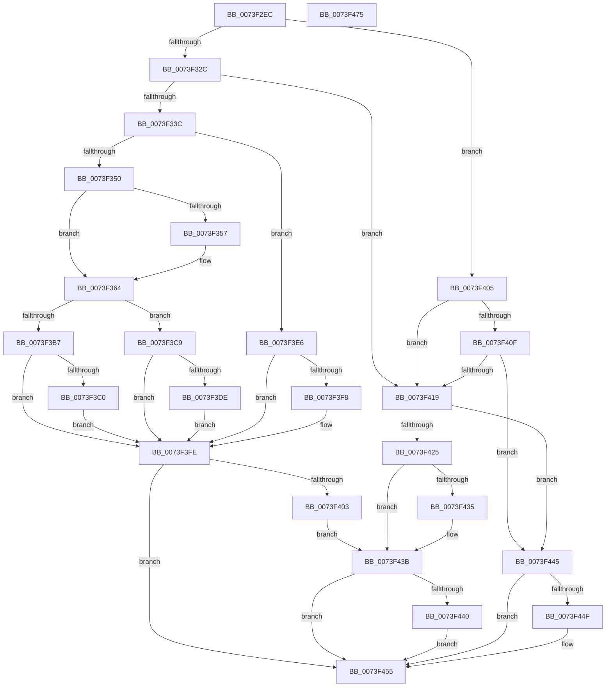

# PnpQueryRebalanceWorker

- RVA: `0x0073F2EC`–`0x0073F476` (길이 `394` bytes)
- VA: `0x000000014073F2EC`
- 실행 섹션: `PAGE`
- PDB 이름 있음: `예`; PDB Function 태그: `아니요`
- unwind 정보 RVA: `0x0005D79C`
- 디코드: `110`개 명령, `394/394` bytes 표시
- 미해석 바이트: `0` (있으면 어셈블리에 `.byte`로 보존)

> 이 문서는 커널 이미지의 기계어와 PDB 기호를 분석해 생성했습니다. 4번과 5번은 함수 원형과 자료형을 바이너리 사용 방식에서 추정한 C 해석이며 원본 소스 복구 결과는 아닙니다.

## 1. Dependencies

- 직접 호출 지점: **6**; 고유 호출 대상: **5**
- 직접 호출자로 확인된 함수: **1**
- RIP 상대 이미지 참조: **0**

### Outgoing calls
- `0x0073F340` → [PnpQueryStopDeviceNode](PnpQueryStopDeviceNode_function_0073F47C.md) (function, `0x0073F47C`)
- `0x0073F35F` → [PipSetDevNodeFlags](../8F/PipSetDevNodeFlags_function_008FC048.md) (function, `0x008FC048`)
- `0x0073F37E` → [memset](../../text/6C/memset_function_006C6C40.md) (function, `0x006C6C40`)
- `0x0073F39F` → [PnpGetResourceRequirementsForAssignTable](../A2/PnpGetResourceRequirementsForAssignTable_function_00A2ADBC.md) (function, `0x00A2ADBC`)
- `0x0073F3CF` → [PnpCancelStopDeviceNode](PnpCancelStopDeviceNode_function_0073F048.md) (function, `0x0073F048`)
- `0x0073F3E9` → [PnpCancelStopDeviceNode](PnpCancelStopDeviceNode_function_0073F048.md) (function, `0x0073F048`)

### Direct callers
- [PnpQueryRebalance](PnpQueryRebalance_function_0073F238.md) at `0x0073F2BF`

### Static image references
- 디코드된 RIP-relative 메모리 참조가 없습니다.

## 2. Other-region calls and transfers

- 다른 실행 섹션으로 향하는 call: **1**
  - `0x0073F37E` → [memset](../../text/6C/memset_function_006C6C40.md) (`PAGE` → `.text`)
- 별도 외부 분기/꼬리 이동을 확인하지 못했습니다.

## 3. Assembly (complete function range)

```asm
0073F2EC  48 8B C4                        mov rax, rsp
0073F2EF  48 89 58 10                     mov qword ptr [rax + 0x10], rbx
0073F2F3  48 89 68 18                     mov qword ptr [rax + 0x18], rbp
0073F2F7  48 89 70 20                     mov qword ptr [rax + 0x20], rsi
0073F2FB  57                              push rdi
0073F2FC  41 54                           push r12
0073F2FE  41 55                           push r13
0073F300  41 56                           push r14
0073F302  41 57                           push r15
0073F304  48 83 EC 20                     sub rsp, 0x20
0073F308  83 60 08 00                     and dword ptr [rax + 8], 0
0073F30C  45 33 F6                        xor r14d, r14d
0073F30F  8B 81 2C 01 00 00               mov eax, dword ptr [rcx + 0x12c]
0073F315  4D 8B F9                        mov r15, r9
0073F318  4D 8B E8                        mov r13, r8
0073F31B  4C 8B E2                        mov r12, rdx
0073F31E  48 8B E9                        mov rbp, rcx
0073F321  3D 0A 03 00 00                  cmp eax, 0x30a
0073F326  0F 85 D9 00 00 00               jne 0x14073f405
0073F32C  F7 81 8C 01 00 00 00 10 00 00   test dword ptr [rcx + 0x18c], 0x1000
0073F336  0F 85 DD 00 00 00               jne 0x14073f419
0073F33C  8B 54 24 78                     mov edx, dword ptr [rsp + 0x78]
0073F340  E8 37 01 00 00                  call 0x14073f47c
0073F345  44 8B F0                        mov r14d, eax
0073F348  85 C0                           test eax, eax
0073F34A  0F 88 96 00 00 00               js 0x14073f3e6
0073F350  3D 19 01 00 00                  cmp eax, 0x119
0073F355  75 0D                           jne 0x14073f364
0073F357  BA 00 04 00 00                  mov edx, 0x400
0073F35C  48 8B CD                        mov rcx, rbp
0073F35F  E8 E4 CC 1B 00                  call 0x1408fc048
0073F364  41 8B 7D 00                     mov edi, dword ptr [r13]
0073F368  33 D2                           xor edx, edx
0073F36A  48 8B 5D 20                     mov rbx, qword ptr [rbp + 0x20]
0073F36E  8B F7                           mov esi, edi
0073F370  48 C1 E6 06                     shl rsi, 6
0073F374  49 03 F4                        add rsi, r12
0073F377  48 8B CE                        mov rcx, rsi
0073F37A  44 8D 42 40                     lea r8d, [rdx + 0x40]
0073F37E  E8 BD 78 F8 FF                  call 0x1406c6c40
0073F383  8D 57 01                        lea edx, [rdi + 1]
0073F386  48 89 1E                        mov qword ptr [rsi], rbx
0073F389  48 C1 E2 06                     shl rdx, 6
0073F38D  4C 8D 44 24 50                  lea r8, [rsp + 0x50]
0073F392  49 03 D4                        add rdx, r12
0073F395  C7 46 0C 04 00 00 00            mov dword ptr [rsi + 0xc], 4
0073F39C  48 8B CE                        mov rcx, rsi
0073F39F  E8 18 BA 2E 00                  call 0x140a2adbc
0073F3A4  41 8B 55 00                     mov edx, dword ptr [r13]
0073F3A8  8B C2                           mov eax, edx
0073F3AA  48 C1 E0 06                     shl rax, 6
0073F3AE  42 8B 4C 20 38                  mov ecx, dword ptr [rax + r12 + 0x38]
0073F3B3  85 C9                           test ecx, ecx
0073F3B5  78 12                           js 0x14073f3c9
0073F3B7  42 8B 44 20 08                  mov eax, dword ptr [rax + r12 + 8]
0073F3BC  A8 20                           test al, 0x20
0073F3BE  75 3E                           jne 0x14073f3fe
0073F3C0  8D 42 01                        lea eax, [rdx + 1]
0073F3C3  41 89 45 00                     mov dword ptr [r13], eax
0073F3C7  EB 35                           jmp 0x14073f3fe
0073F3C9  44 8B F1                        mov r14d, ecx
0073F3CC  48 8B CD                        mov rcx, rbp
0073F3CF  E8 74 FC FF FF                  call 0x14073f048
0073F3D4  48 8B 44 24 70                  mov rax, qword ptr [rsp + 0x70]
0073F3D9  48 85 C0                        test rax, rax
0073F3DC  74 20                           je 0x14073f3fe
0073F3DE  C7 00 02 00 00 00               mov dword ptr [rax], 2
0073F3E4  EB 18                           jmp 0x14073f3fe
0073F3E6  48 8B CD                        mov rcx, rbp
0073F3E9  E8 5A FC FF FF                  call 0x14073f048
0073F3EE  48 8B 44 24 70                  mov rax, qword ptr [rsp + 0x70]
0073F3F3  48 85 C0                        test rax, rax
0073F3F6  74 06                           je 0x14073f3fe
0073F3F8  C7 00 01 00 00 00               mov dword ptr [rax], 1
0073F3FE  45 85 F6                        test r14d, r14d
0073F401  79 52                           jns 0x14073f455
0073F403  EB 36                           jmp 0x14073f43b
0073F405  05 FF FC FF FF                  add eax, 0xfffffcff
0073F40A  83 F8 13                        cmp eax, 0x13
0073F40D  77 0A                           ja 0x14073f419
0073F40F  B9 1F 04 0C 00                  mov ecx, 0xc041f
0073F414  0F A3 C1                        bt ecx, eax
0073F417  72 2C                           jb 0x14073f445
0073F419  F7 85 8C 01 00 00 00 00 04 00   test dword ptr [rbp + 0x18c], 0x40000
0073F423  75 20                           jne 0x14073f445
0073F425  48 8B 44 24 70                  mov rax, qword ptr [rsp + 0x70]
0073F42A  41 BE 01 00 00 C0               mov r14d, 0xc0000001
0073F430  48 85 C0                        test rax, rax
0073F433  74 06                           je 0x14073f43b
0073F435  C7 00 03 00 00 00               mov dword ptr [rax], 3
0073F43B  4D 85 FF                        test r15, r15
0073F43E  74 15                           je 0x14073f455
0073F440  49 89 2F                        mov qword ptr [r15], rbp
0073F443  EB 10                           jmp 0x14073f455
0073F445  48 8B 44 24 70                  mov rax, qword ptr [rsp + 0x70]
0073F44A  48 85 C0                        test rax, rax
0073F44D  74 06                           je 0x14073f455
0073F44F  C7 00 04 00 00 00               mov dword ptr [rax], 4
0073F455  48 8B 5C 24 58                  mov rbx, qword ptr [rsp + 0x58]
0073F45A  41 8B C6                        mov eax, r14d
0073F45D  48 8B 6C 24 60                  mov rbp, qword ptr [rsp + 0x60]
0073F462  48 8B 74 24 68                  mov rsi, qword ptr [rsp + 0x68]
0073F467  48 83 C4 20                     add rsp, 0x20
0073F46B  41 5F                           pop r15
0073F46D  41 5E                           pop r14
0073F46F  41 5D                           pop r13
0073F471  41 5C                           pop r12
0073F473  5F                              pop rdi
0073F474  C3                              ret
0073F475  CC                              int3
```

## 4. C-style interpretation (structured pseudocode)

```c
__int64 __fastcall PnpQueryRebalanceWorker(__int64 a1, __int64 a2, __int64 a3, __int64 a4, __int64 a5, unsigned int a6)
{
    __int64 result;
    __int64 v_r14;
    __int64 v_rsi;
    __int64 v_rsp;
    unsigned __int64 v_stack_p10;
    unsigned __int64 v_stack_p18;
    unsigned __int64 v_stack_p20;
    unsigned __int64 v_stack_p8;

    *(unsigned __int64 *)(v_rsp + 16) = v_rbx;
    *(unsigned __int64 *)(v_rsp + 24) = v_rbp;
    *(unsigned __int64 *)(v_rsp + 32) = v_rsi;
    v_rsp = (v_rsp) - (32);
    v_r14 = 0;
    if (((unsigned int)((unsigned int)(*(unsigned int *)(a1 + 300)))) != 778) goto loc_0073F405;
    if (((*(unsigned int *)(a1 + 396)) & (0x1000ULL)) != 0) goto loc_0073F419;
    result = PnpQueryStopDeviceNode(a1, (unsigned int)(a6), a3, a4);
    if (sign_flag) goto loc_0073F3E6;
    if (((unsigned int)(result)) == 281) {
        a2 = 0x400ULL;
        a1 = a1;
        result = PipSetDevNodeFlags(a1, a2, a3, a4);
    }
    a2 = 0;
    v_rsi = ((unsigned int)((unsigned int)((unsigned int)(*(unsigned int *)(a3))))) << (6);
    v_rsi = (v_rsi) + (0);
    result = memset(v_rsi, a2, a2 + 64, a4);
    *(unsigned __int64 *)(v_rsi) = *(unsigned __int64 *)(a1 + 32);
    a2 = ((unsigned int)(*(unsigned int *)(a3)) + 1) << (6);
    a2 = (a2) + (a2);
    *(unsigned int *)(v_rsi + 12) = 4;
    result = PnpGetResourceRequirementsForAssignTable(v_rsi, a2, v_stack_p8, a4);
    result = ((unsigned int)((unsigned int)((unsigned int)(*(unsigned int *)(a3))))) << (6);
    if (sign_flag) goto loc_0073F3C9;
    if ((((unsigned __int8)((unsigned int)(*(unsigned int *)(result + a2 * 1 + 8)))) & (32)) != 0) goto loc_0073F3FE;
    *(unsigned int *)(a3) = (unsigned int)((unsigned int)(*(unsigned int *)(a3)) + 1);
    goto loc_0073F3FE;
loc_0073F3C9:
    result = PnpCancelStopDeviceNode(a1, (unsigned int)(*(unsigned int *)(a3)), v_stack_p8, a4);
    if (a5 == 0) goto loc_0073F3FE;
    *(unsigned int *)(a5) = 2;
    goto loc_0073F3FE;
loc_0073F3E6:
    result = PnpCancelStopDeviceNode(a1, (unsigned int)(*(unsigned int *)(a3)), v_stack_p8, a4);
    if (a5 != 0) {
        *(unsigned int *)(a5) = 1;
    }
    if (!sign_flag) goto loc_0073F455;
    goto loc_0073F43B;
loc_0073F405:
    result = (unsigned int)((a5) + (0xFFFFFCFFULL));
    if (((unsigned int)(result)) > 19) goto loc_0073F419;
    if (((unsigned int)(result)) < 19) goto loc_0073F445;
loc_0073F419:
    if (((*(unsigned int *)(a1 + 396)) & (0x40000ULL)) != 0) goto loc_0073F445;
    if (a5 != 0) {
        *(unsigned int *)(a5) = 3;
    }
    if (a4 == 0) goto loc_0073F455;
    *(unsigned __int64 *)(a4) = a1;
    goto loc_0073F455;
loc_0073F445:
    if (a5 != 0) {
        *(unsigned int *)(a5) = 4;
    }
    v_rsp = (v_rsp) + (32);
    return (unsigned int)((unsigned int)((unsigned int)(0xC0000001ULL)));
}
```

## 5. (Beta) C Style

```c
int64_t PnpQueryRebalanceWorker(void *Arg1, int64_t Arg2, void *Arg3, int64_t Arg4, int64_t Arg5, uint32_t Arg6)
{
    uint8_t *arg1 = (uint8_t *)Arg1;
    uint8_t *arg3 = (uint8_t *)Arg3;

    int64_t result;
    int64_t local_r14;
    int64_t local_rsi;
    int64_t local_rsp;
    uint64_t v_stack_p10;
    uint64_t v_stack_p18;
    uint64_t v_stack_p20;
    uint64_t v_stack_p8;

    *(uint64_t *)(local_rsp + 0x10) = local_rbx;
    *(uint64_t *)(local_rsp + 0x18) = local_rbp;
    *(uint64_t *)(local_rsp + 0x20) = local_rsi;
    local_rsp = (local_rsp) - (32);
    local_r14 = 0;
    if (((uint32_t)((uint32_t)(*(uint32_t *)(arg1 + 0x12C)))) != 778) goto loc_0073F405;
    if (((*(uint32_t *)(arg1 + 0x18C)) & (0x1000ULL)) != 0) goto loc_0073F419;
    result = PnpQueryStopDeviceNode(Arg1, (uint32_t)(Arg6), Arg3, Arg4);
    if (sign_flag) goto loc_0073F3E6;
    if (((uint32_t)(result)) == 281) {
        Arg2 = 0x400ULL;
        Arg1 = Arg1;
        result = PipSetDevNodeFlags(Arg1, Arg2, Arg3, Arg4);
    }
    Arg2 = 0;
    local_rsi = ((uint32_t)((uint32_t)((uint32_t)(*(uint32_t *)(arg3))))) << (6);
    local_rsi = (local_rsi) + (0);
    result = memset(local_rsi, Arg2, Arg2 + 64, Arg4);
    *(uint64_t *)(local_rsi) = *(uint64_t *)(arg1 + 0x20);
    Arg2 = ((uint32_t)(*(uint32_t *)(arg3)) + 1) << (6);
    Arg2 = (Arg2) + (Arg2);
    *(uint32_t *)(local_rsi + 0xC) = 4;
    result = PnpGetResourceRequirementsForAssignTable(local_rsi, Arg2, v_stack_p8, Arg4);
    result = ((uint32_t)((uint32_t)((uint32_t)(*(uint32_t *)(arg3))))) << (6);
    if (sign_flag) goto loc_0073F3C9;
    if ((((uint8_t)((uint32_t)(*(uint32_t *)(result + Arg2 * 1 + 0x8)))) & (32)) != 0) goto loc_0073F3FE;
    *(uint32_t *)(arg3) = (uint32_t)((uint32_t)(*(uint32_t *)(arg3)) + 1);
    goto loc_0073F3FE;
loc_0073F3C9:
    result = PnpCancelStopDeviceNode(Arg1, (uint32_t)(*(uint32_t *)(arg3)), v_stack_p8, Arg4);
    if (Arg5 == 0) goto loc_0073F3FE;
    *(uint32_t *)(Arg5) = 2;
    goto loc_0073F3FE;
loc_0073F3E6:
    result = PnpCancelStopDeviceNode(Arg1, (uint32_t)(*(uint32_t *)(arg3)), v_stack_p8, Arg4);
    if (Arg5 != 0) {
        *(uint32_t *)(Arg5) = 1;
    }
    if (!sign_flag) goto loc_0073F455;
    goto loc_0073F43B;
loc_0073F405:
    result = (uint32_t)((Arg5) + (0xFFFFFCFFULL));
    if (((uint32_t)(result)) > 19) goto loc_0073F419;
    if (((uint32_t)(result)) < 19) goto loc_0073F445;
loc_0073F419:
    if (((*(uint32_t *)(arg1 + 0x18C)) & (0x40000ULL)) != 0) goto loc_0073F445;
    if (Arg5 != 0) {
        *(uint32_t *)(Arg5) = 3;
    }
    if (Arg4 == 0) goto loc_0073F455;
    *(void **)(Arg4) = Arg1;
    goto loc_0073F455;
loc_0073F445:
    if (Arg5 != 0) {
        *(uint32_t *)(Arg5) = 4;
    }
    local_rsp = (local_rsp) + (32);
    return (uint32_t)((uint32_t)((uint32_t)(0xC0000001ULL)));
}
```

### 관측된 메모리 오프셋

구조체 형식이 확인되지 않은 접근은 인자 기준의 오프셋으로만 기록했습니다.

| 기준 인자 | 오프셋 표현 | 폭 (bit) | 접근 |
|---|---:|---:|---|
| `Arg1` | `+ 0x20` | `64` | `R` |
| `Arg1` | `+ 0x12C` | `32` | `R` |
| `Arg1` | `+ 0x18C` | `32` | `R` |
| `Arg3` | `+ 0x0` | `32` | `R` |
| `Arg3` | `+ 0x0` | `32` | `W` |

## 6. Execution-region graph

[열기: 2D/3D 그래프와 함수 탐색 컨트롤 패널](../../../control-panel.html?section=page&rva=0x0073F2EC&view=graph)

- 2D 그래프는 위에서 아래로 흐르고, 3D 그래프는 빈 공간을 드래그해 회전합니다. Shift+드래그는 이동, 휠은 확대·축소, 함수 노드 선택은 대상 보고서 이동입니다.

### Static fallback


