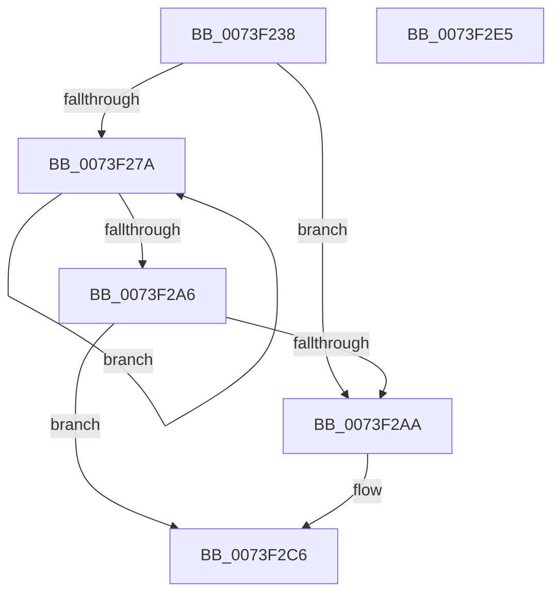

# PnpQueryRebalance

- RVA: `0x0073F238`–`0x0073F2E6` (길이 `174` bytes)
- VA: `0x000000014073F238`
- 실행 섹션: `PAGE`
- PDB 이름 있음: `예`; PDB Function 태그: `아니요`
- unwind 정보 RVA: `0x0008C20C`
- 디코드: `54`개 명령, `174/174` bytes 표시
- 미해석 바이트: `0` (있으면 어셈블리에 `.byte`로 보존)

> 이 문서는 커널 이미지의 기계어와 PDB 기호를 분석해 생성했습니다. 4번과 5번은 함수 원형과 자료형을 바이너리 사용 방식에서 추정한 C 해석이며 원본 소스 복구 결과는 아닙니다.

## 1. Dependencies

- 직접 호출 지점: **2**; 고유 호출 대상: **2**
- 직접 호출자로 확인된 함수: **2**
- RIP 상대 이미지 참조: **0**

### Outgoing calls
- `0x0073F28F` → [PnpQueryRebalance](PnpQueryRebalance_function_0073F238.md) (function, `0x0073F238`)
- `0x0073F2BF` → [PnpQueryRebalanceWorker](PnpQueryRebalanceWorker_function_0073F2EC.md) (function, `0x0073F2EC`)

### Direct callers
- [PnpFindRebalanceCandidates](PnpFindRebalanceCandidates_function_0073F10C.md) at `0x0073F192`
- [PnpFindRebalanceCandidates](PnpFindRebalanceCandidates_function_0073F10C.md) at `0x0073F1F7`
- [PnpQueryRebalance](PnpQueryRebalance_function_0073F238.md) at `0x0073F28F`

### Static image references
- 디코드된 RIP-relative 메모리 참조가 없습니다.

## 2. Other-region calls and transfers

- 다른 실행 섹션으로 향하는 call: **0**
- 별도 외부 분기/꼬리 이동을 확인하지 못했습니다.

## 3. Assembly (complete function range)

```asm
0073F238  48 89 5C 24 08                  mov qword ptr [rsp + 8], rbx
0073F23D  48 89 6C 24 10                  mov qword ptr [rsp + 0x10], rbp
0073F242  48 89 74 24 18                  mov qword ptr [rsp + 0x18], rsi
0073F247  57                              push rdi
0073F248  41 54                           push r12
0073F24A  41 55                           push r13
0073F24C  41 56                           push r14
0073F24E  41 57                           push r15
0073F250  48 83 EC 30                     sub rsp, 0x30
0073F254  48 8B 71 08                     mov rsi, qword ptr [rcx + 8]
0073F258  33 FF                           xor edi, edi
0073F25A  8B 9C 24 88 00 00 00            mov ebx, dword ptr [rsp + 0x88]
0073F261  4D 8B F1                        mov r14, r9
0073F264  4C 8B AC 24 80 00 00 00         mov r13, qword ptr [rsp + 0x80]
0073F26C  4D 8B F8                        mov r15, r8
0073F26F  4C 8B E2                        mov r12, rdx
0073F272  48 8B E9                        mov rbp, rcx
0073F275  48 85 F6                        test rsi, rsi
0073F278  74 30                           je 0x14073f2aa
0073F27A  89 5C 24 28                     mov dword ptr [rsp + 0x28], ebx
0073F27E  4D 8B CE                        mov r9, r14
0073F281  4D 8B C7                        mov r8, r15
0073F284  4C 89 6C 24 20                  mov qword ptr [rsp + 0x20], r13
0073F289  49 8B D4                        mov rdx, r12
0073F28C  48 8B CE                        mov rcx, rsi
0073F28F  E8 A4 FF FF FF                  call 0x14073f238
0073F294  48 8B 36                        mov rsi, qword ptr [rsi]
0073F297  85 C0                           test eax, eax
0073F299  B9 01 00 00 C0                  mov ecx, 0xc0000001
0073F29E  0F 48 F9                        cmovs edi, ecx
0073F2A1  48 85 F6                        test rsi, rsi
0073F2A4  75 D4                           jne 0x14073f27a
0073F2A6  85 FF                           test edi, edi
0073F2A8  78 1C                           js 0x14073f2c6
0073F2AA  89 5C 24 28                     mov dword ptr [rsp + 0x28], ebx
0073F2AE  4D 8B CE                        mov r9, r14
0073F2B1  4D 8B C7                        mov r8, r15
0073F2B4  4C 89 6C 24 20                  mov qword ptr [rsp + 0x20], r13
0073F2B9  49 8B D4                        mov rdx, r12
0073F2BC  48 8B CD                        mov rcx, rbp
0073F2BF  E8 28 00 00 00                  call 0x14073f2ec
0073F2C4  8B F8                           mov edi, eax
0073F2C6  48 8B 5C 24 60                  mov rbx, qword ptr [rsp + 0x60]
0073F2CB  8B C7                           mov eax, edi
0073F2CD  48 8B 6C 24 68                  mov rbp, qword ptr [rsp + 0x68]
0073F2D2  48 8B 74 24 70                  mov rsi, qword ptr [rsp + 0x70]
0073F2D7  48 83 C4 30                     add rsp, 0x30
0073F2DB  41 5F                           pop r15
0073F2DD  41 5E                           pop r14
0073F2DF  41 5D                           pop r13
0073F2E1  41 5C                           pop r12
0073F2E3  5F                              pop rdi
0073F2E4  C3                              ret
0073F2E5  CC                              int3
```

## 4. C-style interpretation (structured pseudocode)

```c
__int64 __fastcall PnpQueryRebalance(__int64 a1, __int64 a2, __int64 a3, __int64 a4, __int64 a5, unsigned int a6)
{
    __int64 result;
    __int64 v_rdi;
    __int64 v_rsp;
    unsigned int v_stack_m30;
    unsigned __int64 v_stack_m38;
    unsigned __int64 v_stack_p10;
    unsigned __int64 v_stack_p18;
    unsigned __int64 v_stack_p8;

    v_stack_p8 = v_rbx;
    v_stack_p10 = v_rbp;
    v_stack_p18 = v_rsi;
    v_rsp = (v_rsp) - (48);
    v_rdi = 0;
    if (*(unsigned __int64 *)(a1 + 8) == 0) goto loc_0073F2AA;
loc_0073F27A:
    v_stack_m30 = (unsigned int)((unsigned int)(a6));
    v_stack_m38 = a5;
    result = PnpQueryRebalance(*(unsigned __int64 *)(a1 + 8), a2, a3, a4);
    if (sign_flag) { v_rdi = (unsigned int)((unsigned int)(0xC0000001ULL)); }
    if (*(unsigned __int64 *)(*(unsigned __int64 *)(a1 + 8)) != 0) goto loc_0073F27A;
    if (!(sign_flag)) {
        v_stack_m30 = (unsigned int)((unsigned int)(a6));
        a4 = a4;
        a3 = a3;
        v_stack_m38 = a5;
        a2 = a2;
        a1 = a1;
        result = PnpQueryRebalanceWorker(a1, a2, a3, a4);
        v_rdi = (unsigned int)(result);
    }
    v_rsp = (v_rsp) + (48);
    return (unsigned int)((unsigned int)(v_rdi));
}
```

## 5. (Beta) C Style

```c
int64_t PnpQueryRebalance(void *Arg1, int64_t Arg2, int64_t Arg3, int64_t Arg4, int64_t Arg5, uint32_t Arg6)
{
    uint8_t *arg1 = (uint8_t *)Arg1;

    int64_t result;
    int64_t local_rdi;
    int64_t local_rsp;
    uint32_t v_stack_m30;
    uint64_t v_stack_m38;
    uint64_t v_stack_p10;
    uint64_t v_stack_p18;
    uint64_t v_stack_p8;

    v_stack_p8 = local_rbx;
    v_stack_p10 = local_rbp;
    v_stack_p18 = local_rsi;
    local_rsp = (local_rsp) - (48);
    local_rdi = 0;
    if (*(uint64_t *)(arg1 + 0x8) == 0) goto loc_0073F2AA;
loc_0073F27A:
    v_stack_m30 = (uint32_t)((uint32_t)(Arg6));
    v_stack_m38 = Arg5;
    result = PnpQueryRebalance(*(uint64_t *)(arg1 + 0x8), Arg2, Arg3, Arg4);
    if (sign_flag) { local_rdi = (uint32_t)((uint32_t)(0xC0000001ULL)); }
    if (*(uint64_t *)(*(uint64_t *)(arg1 + 0x8)) != 0) goto loc_0073F27A;
    if (!(sign_flag)) {
        v_stack_m30 = (uint32_t)((uint32_t)(Arg6));
        Arg4 = Arg4;
        Arg3 = Arg3;
        v_stack_m38 = Arg5;
        Arg2 = Arg2;
        Arg1 = Arg1;
        result = PnpQueryRebalanceWorker(Arg1, Arg2, Arg3, Arg4);
        local_rdi = (uint32_t)(result);
    }
    local_rsp = (local_rsp) + (48);
    return (uint32_t)((uint32_t)(local_rdi));
}
```

### 관측된 메모리 오프셋

구조체 형식이 확인되지 않은 접근은 인자 기준의 오프셋으로만 기록했습니다.

| 기준 인자 | 오프셋 표현 | 폭 (bit) | 접근 |
|---|---:|---:|---|
| `Arg1` | `+ 0x8` | `64` | `R` |

## 6. Execution-region graph

[열기: 2D/3D 그래프와 함수 탐색 컨트롤 패널](../../../control-panel.html?section=page&rva=0x0073F238&view=graph)

- 2D 그래프는 위에서 아래로 흐르고, 3D 그래프는 빈 공간을 드래그해 회전합니다. Shift+드래그는 이동, 휠은 확대·축소, 함수 노드 선택은 대상 보고서 이동입니다.

### Static fallback


