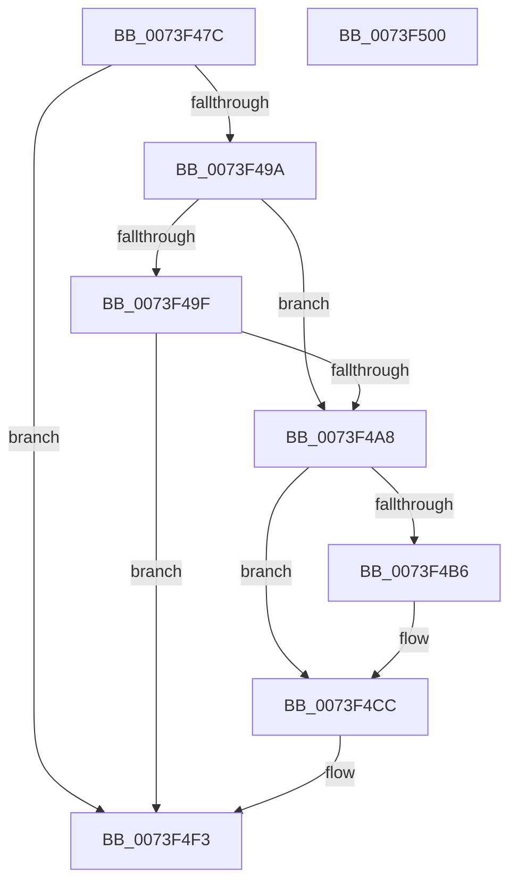

# PnpQueryStopDeviceNode

- RVA: `0x0073F47C`–`0x0073F501` (길이 `133` bytes)
- VA: `0x000000014073F47C`
- 실행 섹션: `PAGE`
- PDB 이름 있음: `예`; PDB Function 태그: `아니요`
- unwind 정보 RVA: `0x0005CAAC`
- 디코드: `37`개 명령, `133/133` bytes 표시
- 미해석 바이트: `0` (있으면 어셈블리에 `.byte`로 보존)

> 이 문서는 커널 이미지의 기계어와 PDB 기호를 분석해 생성했습니다. 4번과 5번은 함수 원형과 자료형을 바이너리 사용 방식에서 추정한 C 해석이며 원본 소스 복구 결과는 아닙니다.

## 1. Dependencies

- 직접 호출 지점: **7**; 고유 호출 대상: **7**
- 직접 호출자로 확인된 함수: **1**
- RIP 상대 이미지 참조: **0**

### Outgoing calls
- `0x0073F49F` → [PiRebalanceOptOut](../../text/5A/PiRebalanceOptOut_function_005AA664.md) (function, `0x005AA664`)
- `0x0073F4AC` → [PnpFindMountableDevice](../../text/4B/PnpFindMountableDevice_function_004B1418.md) (function, `0x004B1418`)
- `0x0073F4BA` → [PnpLockMountableDevice](../../text/4C/PnpLockMountableDevice_function_004CFFAC.md) (function, `0x004CFFAC`)
- `0x0073F4C7` → [PipSetDevNodeFlags](../8F/PipSetDevNodeFlags_function_008FC048.md) (function, `0x008FC048`)
- `0x0073F4D4` → [PnpPoFxActivateDevice](../8F/PnpPoFxActivateDevice_function_008FB29C.md) (function, `0x008FB29C`)
- `0x0073F4DF` → [IopQueryReconfiguration](IopQueryReconfiguration_function_0073DFD0.md) (function, `0x0073DFD0`)
- `0x0073F4EE` → [PipSetDevNodeState](../../text/47/PipSetDevNodeState_function_00470708.md) (function, `0x00470708`)

### Direct callers
- [PnpQueryRebalanceWorker](PnpQueryRebalanceWorker_function_0073F2EC.md) at `0x0073F340`

### Static image references
- 디코드된 RIP-relative 메모리 참조가 없습니다.

## 2. Other-region calls and transfers

- 다른 실행 섹션으로 향하는 call: **4**
  - `0x0073F49F` → [PiRebalanceOptOut](../../text/5A/PiRebalanceOptOut_function_005AA664.md) (`PAGE` → `.text`)
  - `0x0073F4AC` → [PnpFindMountableDevice](../../text/4B/PnpFindMountableDevice_function_004B1418.md) (`PAGE` → `.text`)
  - `0x0073F4BA` → [PnpLockMountableDevice](../../text/4C/PnpLockMountableDevice_function_004CFFAC.md) (`PAGE` → `.text`)
  - `0x0073F4EE` → [PipSetDevNodeState](../../text/47/PipSetDevNodeState_function_00470708.md) (`PAGE` → `.text`)
- 별도 외부 분기/꼬리 이동을 확인하지 못했습니다.

## 3. Assembly (complete function range)

```asm
0073F47C  48 89 5C 24 08                  mov qword ptr [rsp + 8], rbx
0073F481  57                              push rdi
0073F482  48 83 EC 20                     sub rsp, 0x20
0073F486  81 B9 2C 01 00 00 0A 03 00 00   cmp dword ptr [rcx + 0x12c], 0x30a
0073F490  48 8B D9                        mov rbx, rcx
0073F493  BF 01 00 00 C0                  mov edi, 0xc0000001
0073F498  75 59                           jne 0x14073f4f3
0073F49A  F6 C2 01                        test dl, 1
0073F49D  74 09                           je 0x14073f4a8
0073F49F  E8 C0 B1 E6 FF                  call 0x1405aa664
0073F4A4  84 C0                           test al, al
0073F4A6  75 4B                           jne 0x14073f4f3
0073F4A8  48 8B 4B 20                     mov rcx, qword ptr [rbx + 0x20]
0073F4AC  E8 67 1F D7 FF                  call 0x1404b1418
0073F4B1  48 85 C0                        test rax, rax
0073F4B4  74 16                           je 0x14073f4cc
0073F4B6  48 8B 4B 20                     mov rcx, qword ptr [rbx + 0x20]
0073F4BA  E8 ED 0A D9 FF                  call 0x1404cffac
0073F4BF  BA 00 00 00 01                  mov edx, 0x1000000
0073F4C4  48 8B CB                        mov rcx, rbx
0073F4C7  E8 7C CB 1B 00                  call 0x1408fc048
0073F4CC  BA 20 00 00 00                  mov edx, 0x20
0073F4D1  48 8B CB                        mov rcx, rbx
0073F4D4  E8 C3 BD 1B 00                  call 0x1408fb29c
0073F4D9  48 8B 53 20                     mov rdx, qword ptr [rbx + 0x20]
0073F4DD  B1 05                           mov cl, 5
0073F4DF  E8 EC EA FF FF                  call 0x14073dfd0
0073F4E4  BA 0B 03 00 00                  mov edx, 0x30b
0073F4E9  48 8B CB                        mov rcx, rbx
0073F4EC  8B F8                           mov edi, eax
0073F4EE  E8 15 12 D3 FF                  call 0x140470708
0073F4F3  48 8B 5C 24 30                  mov rbx, qword ptr [rsp + 0x30]
0073F4F8  8B C7                           mov eax, edi
0073F4FA  48 83 C4 20                     add rsp, 0x20
0073F4FE  5F                              pop rdi
0073F4FF  C3                              ret
0073F500  CC                              int3
```

## 4. C-style interpretation (structured pseudocode)

```c
__int64 __fastcall PnpQueryStopDeviceNode(__int64 a1, unsigned __int8 a2)
{
    __int64 result;
    __int64 v_rsp;
    unsigned __int64 v_stack_p8;

    v_stack_p8 = v_rbx;
    v_rsp = (v_rsp) - (32);
    if ((*(unsigned int *)(a1 + 300)) != 778) goto loc_0073F4F3;
    if (((a2) & (1)) == 0) goto loc_0073F4A8;
    result = PiRebalanceOptOut(a1, a2, a3, a4);
    if ((unsigned __int8)(result) != 0) goto loc_0073F4F3;
loc_0073F4A8:
    result = PnpFindMountableDevice(*(unsigned __int64 *)(a1 + 32), a2, a3, a4);
    if (result != 0) {
        a1 = *(unsigned __int64 *)(a1 + 32);
        result = PnpLockMountableDevice(a1, a2, a3, a4);
        a2 = 0x1000000ULL;
        a1 = a1;
        result = PipSetDevNodeFlags(a1, a2, a3, a4);
    }
    result = PnpPoFxActivateDevice(a1, 32, a3, a4);
    result = IopQueryReconfiguration(5, *(unsigned __int64 *)(a1 + 32), a3, a4);
    result = PipSetDevNodeState(a1, 779, a3, a4);
loc_0073F4F3:
    v_rsp = (v_rsp) + (32);
    return (unsigned int)((unsigned int)((unsigned int)((unsigned int)(result))));
}
```

## 5. (Beta) C Style

```c
int64_t PnpQueryStopDeviceNode(void *Arg1, uint8_t Arg2)
{
    uint8_t *arg1 = (uint8_t *)Arg1;

    int64_t result;
    int64_t local_rsp;
    uint64_t v_stack_p8;

    v_stack_p8 = local_rbx;
    local_rsp = (local_rsp) - (32);
    if ((*(uint32_t *)(arg1 + 0x12C)) != 778) goto loc_0073F4F3;
    if (((Arg2) & (1)) == 0) goto loc_0073F4A8;
    result = PiRebalanceOptOut(Arg1, Arg2, a3, a4);
    if ((uint8_t)(result) != 0) goto loc_0073F4F3;
loc_0073F4A8:
    result = PnpFindMountableDevice(*(uint64_t *)(arg1 + 0x20), Arg2, a3, a4);
    if (result != 0) {
        Arg1 = *(uint64_t *)(arg1 + 0x20);
        result = PnpLockMountableDevice(Arg1, Arg2, a3, a4);
        Arg2 = 0x1000000ULL;
        Arg1 = Arg1;
        result = PipSetDevNodeFlags(Arg1, Arg2, a3, a4);
    }
    result = PnpPoFxActivateDevice(Arg1, 32, a3, a4);
    result = IopQueryReconfiguration(5, *(uint64_t *)(arg1 + 0x20), a3, a4);
    result = PipSetDevNodeState(Arg1, 779, a3, a4);
loc_0073F4F3:
    local_rsp = (local_rsp) + (32);
    return (uint32_t)((uint32_t)((uint32_t)((uint32_t)(result))));
}
```

### 관측된 메모리 오프셋

구조체 형식이 확인되지 않은 접근은 인자 기준의 오프셋으로만 기록했습니다.

| 기준 인자 | 오프셋 표현 | 폭 (bit) | 접근 |
|---|---:|---:|---|
| `Arg1` | `+ 0x20` | `64` | `R` |
| `Arg1` | `+ 0x12C` | `32` | `R` |

## 6. Execution-region graph

[열기: 2D/3D 그래프와 함수 탐색 컨트롤 패널](../../../control-panel.html?section=page&rva=0x0073F47C&view=graph)

- 2D 그래프는 위에서 아래로 흐르고, 3D 그래프는 빈 공간을 드래그해 회전합니다. Shift+드래그는 이동, 휠은 확대·축소, 함수 노드 선택은 대상 보고서 이동입니다.

### Static fallback


