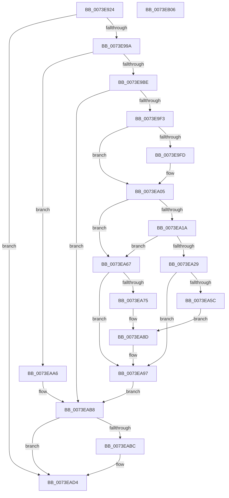

# PnpReallocateResources

- RVA: `0x0073E924`–`0x0073EB07` (길이 `483` bytes)
- VA: `0x000000014073E924`
- 실행 섹션: `PAGE`
- PDB 이름 있음: `예`; PDB Function 태그: `아니요`
- unwind 정보 RVA: `0x000C9170`
- 디코드: `126`개 명령, `483/483` bytes 표시
- 미해석 바이트: `0` (있으면 어셈블리에 `.byte`로 보존)

> 이 문서는 커널 이미지의 기계어와 PDB 기호를 분석해 생성했습니다. 4번과 5번은 함수 원형과 자료형을 바이너리 사용 방식에서 추정한 C 해석이며 원본 소스 복구 결과는 아닙니다.

## 1. Dependencies

- 직접 호출 지점: **19**; 고유 호출 대상: **17**
- 직접 호출자로 확인된 함수: **1**
- RIP 상대 이미지 참조: **1**

### Outgoing calls
- `0x0073E949` → [memset](../../text/6C/memset_function_006C6C40.md) (function, `0x006C6C40`)
- `0x0073E983` → [KeWaitForSingleObject](../../text/20/KeWaitForSingleObject_function_0020E6B0.md) (function, `0x0020E6B0`)
- `0x0073E9A9` → [PipClearDevNodeFlags](../8F/PipClearDevNodeFlags_function_008F9F54.md) (function, `0x008F9F54`)
- `0x0073E9E1` → [PnpGetResourceRequirementsForAssignTable](../A2/PnpGetResourceRequirementsForAssignTable_function_00A2ADBC.md) (function, `0x00A2ADBC`)
- `0x0073EA00` → [PnpReleaseResourcesInternal](../AA/PnpReleaseResourcesInternal_function_00AA5140.md) (function, `0x00AA5140`)
- `0x0073EA0F` → [PnpFindBestConfiguration](../72/PnpFindBestConfiguration_function_0072B630.md) (function, `0x0072B630`)
- `0x0073EA1E` → [IopCommitConfiguration](../AB/IopCommitConfiguration_function_00ABF3D4.md) (function, `0x00ABF3D4`)
- `0x0073EA31` → [PipClearDevNodeFlags](../8F/PipClearDevNodeFlags_function_008F9F54.md) (function, `0x008F9F54`)
- `0x0073EA41` → [PnpBuildCmResourceLists](PnpBuildCmResourceLists_function_0073E684.md) (function, `0x0073E684`)
- `0x0073EA51` → [PnpStartDeviceNode](../8F/PnpStartDeviceNode_function_008FE38C.md) (function, `0x008FE38C`)
- `0x0073EA6A` → [PnpRestoreResourcesInternal](PnpRestoreResourcesInternal_function_0073EB10.md) (function, `0x0073EB10`)
- `0x0073EA7F` → [PnpUpdateRebootRequiredReason](../72/PnpUpdateRebootRequiredReason_function_0072CE64.md) (function, `0x0072CE64`)
- `0x0073EA92` → [PnpRequestDeviceRemoval](../8F/PnpRequestDeviceRemoval_function_008FC294.md) (function, `0x008FC294`)
- `0x0073EA9F` → [PnpFreeResourceRequirementsForAssignTable](PnpFreeResourceRequirementsForAssignTable_function_0073E8B8.md) (function, `0x0073E8B8`)
- `0x0073EAB1` → [PnpRebalance](PnpRebalance_function_0073F508.md) (function, `0x0073F508`)
- `0x0073EAC4` → [PipClearDevNodeFlags](../8F/PipClearDevNodeFlags_function_008F9F54.md) (function, `0x008F9F54`)
- `0x0073EACF` → [PipSetDevNodeFlags](../8F/PipSetDevNodeFlags_function_008FC048.md) (function, `0x008FC048`)
- `0x0073EAE4` → [KeReleaseSemaphore](../../text/39/KeReleaseSemaphore_function_00397080.md) (function, `0x00397080`)
- `0x0073EAE9` → [KeLeaveCriticalRegion](../../text/25/KeLeaveCriticalRegion_function_0025D8B0.md) (function, `0x0025D8B0`)

### Direct callers
- [PiProcessResourceRequirementsChanged](../72/PiProcessResourceRequirementsChanged_function_0072D504.md) at `0x0072D5B6`

### Static image references
- `0x0073E952` → RVA `0x00F8C360` (`.data`; read)

## 2. Other-region calls and transfers

- 다른 실행 섹션으로 향하는 call: **4**
  - `0x0073E949` → [memset](../../text/6C/memset_function_006C6C40.md) (`PAGE` → `.text`)
  - `0x0073E983` → [KeWaitForSingleObject](../../text/20/KeWaitForSingleObject_function_0020E6B0.md) (`PAGE` → `.text`)
  - `0x0073EAE4` → [KeReleaseSemaphore](../../text/39/KeReleaseSemaphore_function_00397080.md) (`PAGE` → `.text`)
  - `0x0073EAE9` → [KeLeaveCriticalRegion](../../text/25/KeLeaveCriticalRegion_function_0025D8B0.md) (`PAGE` → `.text`)
- 별도 외부 분기/꼬리 이동을 확인하지 못했습니다.

## 3. Assembly (complete function range)

```asm
0073E924  48 89 5C 24 10                  mov qword ptr [rsp + 0x10], rbx
0073E929  48 89 74 24 18                  mov qword ptr [rsp + 0x18], rsi
0073E92E  55                              push rbp
0073E92F  57                              push rdi
0073E930  41 56                           push r14
0073E932  48 8B EC                        mov rbp, rsp
0073E935  48 81 EC 80 00 00 00            sub rsp, 0x80
0073E93C  33 D2                           xor edx, edx
0073E93E  48 8B D9                        mov rbx, rcx
0073E941  48 8D 4D C0                     lea rcx, [rbp - 0x40]
0073E945  44 8D 42 40                     lea r8d, [rdx + 0x40]
0073E949  E8 F2 82 F8 FF                  call 0x1406c6c40
0073E94E  83 65 20 00                     and dword ptr [rbp + 0x20], 0
0073E952  48 8D 0D 07 DA 84 00            lea rcx, [rip + 0x84da07]
0073E959  48 83 64 24 20 00               and qword ptr [rsp + 0x20], 0
0073E95F  0F 57 C0                        xorps xmm0, xmm0
0073E962  0F 11 45 B0                     movups xmmword ptr [rbp - 0x50], xmm0
0073E966  65 48 8B 04 25 88 01 00 00      mov rax, qword ptr gs:[0x188]
0073E96F  45 33 C9                        xor r9d, r9d
0073E972  45 33 C0                        xor r8d, r8d
0073E975  66 FF 88 E4 01 00 00            dec word ptr [rax + 0x1e4]
0073E97C  41 8D 79 04                     lea edi, [r9 + 4]
0073E980  8B D7                           mov edx, edi
0073E982  90                              nop
0073E983  E8 28 FD AC FF                  call 0x14020e6b0
0073E988  44 8B B3 8C 01 00 00            mov r14d, dword ptr [rbx + 0x18c]
0073E98F  41 0F BA E6 0A                  bt r14d, 0xa
0073E994  0F 83 3A 01 00 00               jae 0x14073ead4
0073E99A  BA 00 01 00 00                  mov edx, 0x100
0073E99F  48 8B CB                        mov rcx, rbx
0073E9A2  41 81 E6 00 01 00 00            and r14d, 0x100
0073E9A9  E8 A6 B5 1B 00                  call 0x1408f9f54
0073E9AE  F7 83 8C 01 00 00 00 08 00 00   test dword ptr [rbx + 0x18c], 0x800
0073E9B8  0F 84 E8 00 00 00               je 0x14073eaa6
0073E9BE  48 8B 43 20                     mov rax, qword ptr [rbx + 0x20]
0073E9C2  4C 8D 45 20                     lea r8, [rbp + 0x20]
0073E9C6  48 83 65 D8 00                  and qword ptr [rbp - 0x28], 0
0073E9CB  48 8D 55 00                     lea rdx, [rbp]
0073E9CF  81 4D C8 80 02 00 00            or dword ptr [rbp - 0x38], 0x280
0073E9D6  48 8D 4D C0                     lea rcx, [rbp - 0x40]
0073E9DA  48 89 45 C0                     mov qword ptr [rbp - 0x40], rax
0073E9DE  89 7D CC                        mov dword ptr [rbp - 0x34], edi
0073E9E1  E8 D6 C3 2E 00                  call 0x140a2adbc
0073E9E6  8B 75 20                        mov esi, dword ptr [rbp + 0x20]
0073E9E9  8B F8                           mov edi, eax
0073E9EB  85 F6                           test esi, esi
0073E9ED  0F 84 C5 00 00 00               je 0x14073eab8
0073E9F3  48 83 BB A0 01 00 00 00         cmp qword ptr [rbx + 0x1a0], 0
0073E9FB  74 08                           je 0x14073ea05
0073E9FD  48 8B CB                        mov rcx, rbx
0073EA00  E8 3B 67 36 00                  call 0x140aa5140
0073EA05  4C 8D 45 B0                     lea r8, [rbp - 0x50]
0073EA09  8B D6                           mov edx, esi
0073EA0B  48 8D 4D C0                     lea rcx, [rbp - 0x40]
0073EA0F  E8 1C CC FE FF                  call 0x14072b630
0073EA14  8B F8                           mov edi, eax
0073EA16  85 C0                           test eax, eax
0073EA18  78 4D                           js 0x14073ea67
0073EA1A  48 8D 4D B0                     lea rcx, [rbp - 0x50]
0073EA1E  E8 B1 09 38 00                  call 0x140abf3d4
0073EA23  8B F8                           mov edi, eax
0073EA25  85 C0                           test eax, eax
0073EA27  78 3E                           js 0x14073ea67
0073EA29  BA 00 0C 00 00                  mov edx, 0xc00
0073EA2E  48 8B CB                        mov rcx, rbx
0073EA31  E8 1E B5 1B 00                  call 0x1408f9f54
0073EA36  41 B0 01                        mov r8b, 1
0073EA39  48 8D 55 00                     lea rdx, [rbp]
0073EA3D  48 8D 4D C0                     lea rcx, [rbp - 0x40]
0073EA41  E8 3E FC FF FF                  call 0x14073e684
0073EA46  BA 01 00 00 00                  mov edx, 1
0073EA4B  48 8B CB                        mov rcx, rbx
0073EA4E  44 8B C2                        mov r8d, edx
0073EA51  E8 36 F9 1B 00                  call 0x1408fe38c
0073EA56  8B F8                           mov edi, eax
0073EA58  85 C0                           test eax, eax
0073EA5A  79 3B                           jns 0x14073ea97
0073EA5C  44 8B C8                        mov r9d, eax
0073EA5F  41 B8 0C 00 00 00               mov r8d, 0xc
0073EA65  EB 26                           jmp 0x14073ea8d
0073EA67  48 8B CB                        mov rcx, rbx
0073EA6A  E8 A1 00 00 00                  call 0x14073eb10
0073EA6F  8B F0                           mov esi, eax
0073EA71  85 C0                           test eax, eax
0073EA73  79 22                           jns 0x14073ea97
0073EA75  48 8B 4B 30                     mov rcx, qword ptr [rbx + 0x30]
0073EA79  41 B8 00 40 00 00               mov r8d, 0x4000
0073EA7F  E8 E0 E3 FE FF                  call 0x14072ce64
0073EA84  44 8B CE                        mov r9d, esi
0073EA87  41 B8 0E 00 00 00               mov r8d, 0xe
0073EA8D  33 D2                           xor edx, edx
0073EA8F  48 8B CB                        mov rcx, rbx
0073EA92  E8 FD D7 1B 00                  call 0x1408fc294
0073EA97  48 8D 55 00                     lea rdx, [rbp]
0073EA9B  48 8D 4D C0                     lea rcx, [rbp - 0x40]
0073EA9F  E8 14 FE FF FF                  call 0x14073e8b8
0073EAA4  EB 12                           jmp 0x14073eab8
0073EAA6  45 33 C9                        xor r9d, r9d
0073EAA9  45 33 C0                        xor r8d, r8d
0073EAAC  33 D2                           xor edx, edx
0073EAAE  48 8B CB                        mov rcx, rbx
0073EAB1  E8 52 0A 00 00                  call 0x14073f508
0073EAB6  8B F8                           mov edi, eax
0073EAB8  85 FF                           test edi, edi
0073EABA  79 18                           jns 0x14073ead4
0073EABC  BA 00 01 00 00                  mov edx, 0x100
0073EAC1  48 8B CB                        mov rcx, rbx
0073EAC4  E8 8B B4 1B 00                  call 0x1408f9f54
0073EAC9  41 8B D6                        mov edx, r14d
0073EACC  48 8B CB                        mov rcx, rbx
0073EACF  E8 74 D5 1B 00                  call 0x1408fc048
0073EAD4  45 33 C9                        xor r9d, r9d
0073EAD7  48 8D 0D 82 D8 84 00            lea rcx, [rip + 0x84d882]
0073EADE  33 D2                           xor edx, edx
0073EAE0  45 8D 41 01                     lea r8d, [r9 + 1]
0073EAE4  E8 97 85 C5 FF                  call 0x140397080
0073EAE9  E8 C2 ED B1 FF                  call 0x14025d8b0
0073EAEE  4C 8D 9C 24 80 00 00 00         lea r11, [rsp + 0x80]
0073EAF6  49 8B 5B 28                     mov rbx, qword ptr [r11 + 0x28]
0073EAFA  49 8B 73 30                     mov rsi, qword ptr [r11 + 0x30]
0073EAFE  49 8B E3                        mov rsp, r11
0073EB01  41 5E                           pop r14
0073EB03  5F                              pop rdi
0073EB04  5D                              pop rbp
0073EB05  C3                              ret
0073EB06  CC                              int3
```

## 4. C-style interpretation (structured pseudocode)

```c
__int64 __fastcall PnpReallocateResources(__int64 a1, int a2, __int64 a3, int a4)
{
    __int64 result;
    __int64 v_r14;
    __int64 v_rsp;
    unsigned __int64 v_stack_m18;
    unsigned __int64 v_stack_m40;
    unsigned int v_stack_m4C;
    unsigned int v_stack_m50;
    unsigned __int64 v_stack_m58;
    unsigned __int64 v_stack_m68;
    unsigned __int64 v_stack_m78;
    unsigned __int64 v_stack_p10;
    unsigned __int64 v_stack_p18;
    unsigned int v_stack_p8;

    v_stack_p10 = v_rbx;
    v_stack_p18 = v_rsi;
    v_rsp = (v_rsp) - (128);
    a2 = 0;
    result = memset(v_stack_m58, a2, a2 + 64, a4);
    v_stack_m68 = v_xmm0;
    a4 = 0;
    a3 = 0;
    result = KeWaitForSingleObject(v_rip + 8706567, (unsigned int)((unsigned int)(a4 + 4)), a3, a4);
    if (condition_is_above_or_equal) goto loc_0073EAD4;
    v_r14 = (unsigned int)(((unsigned int)(*(unsigned int *)(a1 + 396))) & (256));
    result = PipClearDevNodeFlags(a1, 256, a3, a4);
    if (((*(unsigned int *)(a1 + 396)) & (0x800ULL)) == 0) goto loc_0073EAA6;
    v_stack_m58 = *(unsigned __int64 *)(a1 + 32);
    v_stack_m4C = (unsigned int)(a4 + 4);
    result = PnpGetResourceRequirementsForAssignTable(v_stack_m58, v_stack_m18, v_stack_p8, a4);
    if ((unsigned int)((unsigned int)(v_stack_p8)) == 0) goto loc_0073EAB8;
    if ((*(unsigned __int64 *)(a1 + 416)) != 0) {
        a1 = a1;
        result = PnpReleaseResourcesInternal(a1, v_stack_m18, v_stack_p8, a4);
    }
    result = PnpFindBestConfiguration(v_stack_m58, (unsigned int)((unsigned int)((unsigned int)(v_stack_p8))), v_stack_m68, a4);
    if (sign_flag) goto loc_0073EA67;
    result = IopCommitConfiguration(v_stack_m68, (unsigned int)((unsigned int)((unsigned int)(v_stack_p8))), v_stack_m68, a4);
    if (sign_flag) goto loc_0073EA67;
    result = PipClearDevNodeFlags(a1, (unsigned int)(0xC00ULL), v_stack_m68, a4);
    result = PnpBuildCmResourceLists(v_stack_m58, v_stack_m18, 1, a4);
    result = PnpStartDeviceNode(a1, 1, 1, a4);
    if (!sign_flag) goto loc_0073EA97;
    goto loc_0073EA8D;
loc_0073EA67:
    result = PnpRestoreResourcesInternal(a1, 1, 12, (unsigned int)((unsigned int)(result)));
    if (!sign_flag) goto loc_0073EA97;
    result = PnpUpdateRebootRequiredReason(*(unsigned __int64 *)(a1 + 48), 1, (unsigned int)(0x4000ULL), (unsigned int)((unsigned int)(result)));
loc_0073EA8D:
    a2 = 0;
    result = PnpRequestDeviceRemoval(a1, a2, 14, (unsigned int)((unsigned int)((unsigned int)((unsigned int)(result)))));
loc_0073EA97:
    result = PnpFreeResourceRequirementsForAssignTable(v_stack_m58, v_stack_m18, 14, (unsigned int)((unsigned int)((unsigned int)((unsigned int)(result)))));
    goto loc_0073EAB8;
loc_0073EAA6:
    a4 = 0;
    a3 = 0;
    a2 = 0;
    result = PnpRebalance(a1, a2, a3, a4);
loc_0073EAB8:
    if (sign_flag) {
        a2 = 256;
        a1 = a1;
        result = PipClearDevNodeFlags(a1, a2, a3, a4);
        a2 = (unsigned int)(v_r14);
        a1 = a1;
        result = PipSetDevNodeFlags(a1, a2, a3, a4);
    }
    a4 = 0;
    a2 = 0;
    result = KeReleaseSemaphore(v_rip + 8706178, a2, a4 + 1, a4);
    result = KeLeaveCriticalRegion(v_rip + 8706178, a2, a4 + 1, a4);
    return result;
}
```

## 5. (Beta) C Style

```c
int64_t PnpReallocateResources(void *Arg1, int32_t Arg2, int64_t Arg3, int32_t Arg4)
{
    uint8_t *arg1 = (uint8_t *)Arg1;

    int64_t result;
    int64_t local_r14;
    int64_t local_rsp;
    uint64_t v_stack_m18;
    uint64_t v_stack_m40;
    uint32_t v_stack_m4C;
    uint32_t v_stack_m50;
    uint64_t v_stack_m58;
    uint64_t v_stack_m68;
    uint64_t v_stack_m78;
    uint64_t v_stack_p10;
    uint64_t v_stack_p18;
    uint32_t v_stack_p8;

    v_stack_p10 = local_rbx;
    v_stack_p18 = local_rsi;
    local_rsp = (local_rsp) - (128);
    Arg2 = 0;
    result = memset(v_stack_m58, Arg2, Arg2 + 64, Arg4);
    v_stack_m68 = v_xmm0;
    Arg4 = 0;
    Arg3 = 0;
    result = KeWaitForSingleObject(v_rip + 8706567, (uint32_t)((uint32_t)(Arg4 + 4)), Arg3, Arg4);
    if (condition_is_above_or_equal) goto loc_0073EAD4;
    local_r14 = (uint32_t)(((uint32_t)(*(uint32_t *)(arg1 + 0x18C))) & (256));
    result = PipClearDevNodeFlags(Arg1, 256, Arg3, Arg4);
    if (((*(uint32_t *)(arg1 + 0x18C)) & (0x800ULL)) == 0) goto loc_0073EAA6;
    v_stack_m58 = *(uint64_t *)(arg1 + 0x20);
    v_stack_m4C = (uint32_t)(Arg4 + 4);
    result = PnpGetResourceRequirementsForAssignTable(v_stack_m58, v_stack_m18, v_stack_p8, Arg4);
    if ((uint32_t)((uint32_t)(v_stack_p8)) == 0) goto loc_0073EAB8;
    if ((*(uint64_t *)(arg1 + 0x1A0)) != 0) {
        Arg1 = Arg1;
        result = PnpReleaseResourcesInternal(Arg1, v_stack_m18, v_stack_p8, Arg4);
    }
    result = PnpFindBestConfiguration(v_stack_m58, (uint32_t)((uint32_t)((uint32_t)(v_stack_p8))), v_stack_m68, Arg4);
    if (sign_flag) goto loc_0073EA67;
    result = IopCommitConfiguration(v_stack_m68, (uint32_t)((uint32_t)((uint32_t)(v_stack_p8))), v_stack_m68, Arg4);
    if (sign_flag) goto loc_0073EA67;
    result = PipClearDevNodeFlags(Arg1, (uint32_t)(0xC00ULL), v_stack_m68, Arg4);
    result = PnpBuildCmResourceLists(v_stack_m58, v_stack_m18, 1, Arg4);
    result = PnpStartDeviceNode(Arg1, 1, 1, Arg4);
    if (!sign_flag) goto loc_0073EA97;
    goto loc_0073EA8D;
loc_0073EA67:
    result = PnpRestoreResourcesInternal(Arg1, 1, 12, (uint32_t)((uint32_t)(result)));
    if (!sign_flag) goto loc_0073EA97;
    result = PnpUpdateRebootRequiredReason(*(uint64_t *)(arg1 + 0x30), 1, (uint32_t)(0x4000ULL), (uint32_t)((uint32_t)(result)));
loc_0073EA8D:
    Arg2 = 0;
    result = PnpRequestDeviceRemoval(Arg1, Arg2, 14, (uint32_t)((uint32_t)((uint32_t)((uint32_t)(result)))));
loc_0073EA97:
    result = PnpFreeResourceRequirementsForAssignTable(v_stack_m58, v_stack_m18, 14, (uint32_t)((uint32_t)((uint32_t)((uint32_t)(result)))));
    goto loc_0073EAB8;
loc_0073EAA6:
    Arg4 = 0;
    Arg3 = 0;
    Arg2 = 0;
    result = PnpRebalance(Arg1, Arg2, Arg3, Arg4);
loc_0073EAB8:
    if (sign_flag) {
        Arg2 = 256;
        Arg1 = Arg1;
        result = PipClearDevNodeFlags(Arg1, Arg2, Arg3, Arg4);
        Arg2 = (uint32_t)(local_r14);
        Arg1 = Arg1;
        result = PipSetDevNodeFlags(Arg1, Arg2, Arg3, Arg4);
    }
    Arg4 = 0;
    Arg2 = 0;
    result = KeReleaseSemaphore(v_rip + 8706178, Arg2, Arg4 + 1, Arg4);
    result = KeLeaveCriticalRegion(v_rip + 8706178, Arg2, Arg4 + 1, Arg4);
    return result;
}
```

### 관측된 메모리 오프셋

구조체 형식이 확인되지 않은 접근은 인자 기준의 오프셋으로만 기록했습니다.

| 기준 인자 | 오프셋 표현 | 폭 (bit) | 접근 |
|---|---:|---:|---|
| `Arg1` | `+ 0x20` | `64` | `R` |
| `Arg1` | `+ 0x30` | `64` | `R` |
| `Arg1` | `+ 0x18C` | `32` | `R` |
| `Arg1` | `+ 0x1A0` | `64` | `R` |

## 6. Execution-region graph

[열기: 2D/3D 그래프와 함수 탐색 컨트롤 패널](../../../control-panel.html?section=page&rva=0x0073E924&view=graph)

- 2D 그래프는 위에서 아래로 흐르고, 3D 그래프는 빈 공간을 드래그해 회전합니다. Shift+드래그는 이동, 휠은 확대·축소, 함수 노드 선택은 대상 보고서 이동입니다.

### Static fallback


