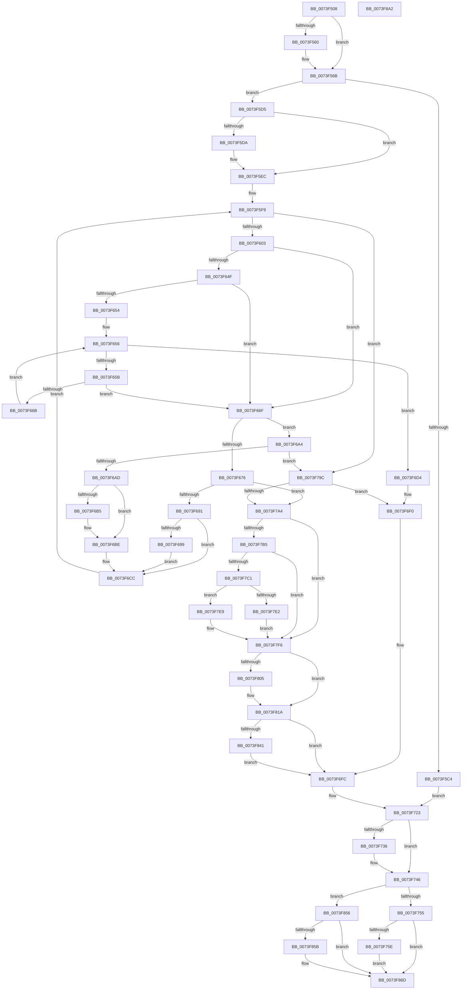

# PnpRebalance

- RVA: `0x0073F508`–`0x0073F8A3` (길이 `923` bytes)
- VA: `0x000000014073F508`
- 실행 섹션: `PAGE`
- PDB 이름 있음: `예`; PDB Function 태그: `아니요`
- unwind 정보 RVA: `0x000BC7B4`
- 디코드: `239`개 명령, `923/923` bytes 표시
- 미해석 바이트: `0` (있으면 어셈블리에 `.byte`로 보존)

> 이 문서는 커널 이미지의 기계어와 PDB 기호를 분석해 생성했습니다. 4번과 5번은 함수 원형과 자료형을 바이너리 사용 방식에서 추정한 C 해석이며 원본 소스 복구 결과는 아닙니다.

## 1. Dependencies

- 직접 호출 지점: **24**; 고유 호출 대상: **19**
- 직접 호출자로 확인된 함수: **3**
- RIP 상대 이미지 참조: **5**

### Outgoing calls
- `0x0073F566` → [memset](../../text/6C/memset_function_006C6C40.md) (function, `0x006C6C40`)
- `0x0073F577` → [memset](../../text/6C/memset_function_006C6C40.md) (function, `0x006C6C40`)
- `0x0073F59D` → [PnpDiagnosticTraceObject](../../text/26/PnpDiagnosticTraceObject_function_0026E834.md) (function, `0x0026E834`)
- `0x0073F5B7` → [ExAllocatePool2](../../poolcode/B8/ExAllocatePool2_function_00B820F0.md) (function, `0x00B820F0`)
- `0x0073F5E7` → [memcpy](../../text/6C/memcpy_function_006C6840.md) (function, `0x006C6840`)
- `0x0073F640` → [PnpFindRebalanceCandidates](PnpFindRebalanceCandidates_function_0073F10C.md) (function, `0x0073F10C`)
- `0x0073F682` → [PnpFindBestConfiguration](../72/PnpFindBestConfiguration_function_0072B630.md) (function, `0x0072B630`)
- `0x0073F6F7` → [PnpCancelStopDeviceSubtree](PnpCancelStopDeviceSubtree_function_0073F0D8.md) (function, `0x0073F0D8`)
- `0x0073F711` → [PnpFreeResourceRequirementsForAssignTable](PnpFreeResourceRequirementsForAssignTable_function_0073E8B8.md) (function, `0x0073E8B8`)
- `0x0073F71E` → [ExFreePoolWithTag](../../poolcode/B8/ExFreePoolWithTag_function_00B82870.md) (function, `0x00B82870`)
- `0x0073F72B` → [PnpTraceRebalanceResult](PnpTraceRebalanceResult_function_0073CD60.md) (function, `0x0073CD60`)
- `0x0073F741` → [PnpTraceRebalanceResult](PnpTraceRebalanceResult_function_0073CD60.md) (function, `0x0073CD60`)
- `0x0073F7AB` → [PnpStopDeviceSubtree](PnpStopDeviceSubtree_function_0073F8AC.md) (function, `0x0073F8AC`)
- `0x0073F7CD` → [PipSetDevNodeProblem](../8F/PipSetDevNodeProblem_function_008FDE0C.md) (function, `0x008FDE0C`)
- `0x0073F7D6` → [IopMarkDeviceToBeReset](../72/IopMarkDeviceToBeReset_function_0072A9A0.md) (function, `0x0072A9A0`)
- `0x0073F7E2` → [PipClearDevNodeProblem](../A2/PipClearDevNodeProblem_function_00A27C8C.md) (function, `0x00A27C8C`)
- `0x0073F7F1` → [PnpRequestDeviceRemoval](../8F/PnpRequestDeviceRemoval_function_008FC294.md) (function, `0x008FC294`)
- `0x0073F7FB` → [IopCommitConfiguration](../AB/IopCommitConfiguration_function_00ABF3D4.md) (function, `0x00ABF3D4`)
- `0x0073F815` → [PnpBuildCmResourceLists](PnpBuildCmResourceLists_function_0073E684.md) (function, `0x0073E684`)
- `0x0073F833` → [PnpBuildCmResourceLists](PnpBuildCmResourceLists_function_0073E684.md) (function, `0x0073E684`)
- `0x0073F84C` → [memcpy](../../text/6C/memcpy_function_006C6840.md) (function, `0x006C6840`)
- `0x0073F860` → [ExFreePoolWithTag](../../poolcode/B8/ExFreePoolWithTag_function_00B82870.md) (function, `0x00B82870`)
- `0x0073F87B` → [PnpDiagnosticTraceObjectWithStatus](../../text/4A/PnpDiagnosticTraceObjectWithStatus_function_004A9F58.md) (function, `0x004A9F58`)
- `0x0073F889` → [_security_check_cookie](../../text/6A/_security_check_cookie_function_006AC640.md) (function, `0x006AC640`)

### Direct callers
- [PnpProcessRebalance](../../text/5A/PnpProcessRebalance_function_005AA7C8.md) at `0x005AA869`
- [PnpReallocateResources](PnpReallocateResources_function_0073E924.md) at `0x0073EAB1`
- [sub_00B38CDE](../B3/Unknown_function_00B38CDE.md) at `0x00B38F75`

### Static image references
- `0x0073F521` → RVA `0x00E0A740` (`.data`; read)
- `0x0073F57C` → RVA `0x00F8C438` (`.data`; read)
- `0x0073F587` → RVA `0x000275C0` (`.rdata`; read)
- `0x0073F5A2` → RVA `0x00F8C668` (`.data`; read)
- `0x0073F874` → RVA `0x00027460` (`.rdata`; read)

## 2. Other-region calls and transfers

- 다른 실행 섹션으로 향하는 call: **10**
  - `0x0073F566` → [memset](../../text/6C/memset_function_006C6C40.md) (`PAGE` → `.text`)
  - `0x0073F577` → [memset](../../text/6C/memset_function_006C6C40.md) (`PAGE` → `.text`)
  - `0x0073F59D` → [PnpDiagnosticTraceObject](../../text/26/PnpDiagnosticTraceObject_function_0026E834.md) (`PAGE` → `.text`)
  - `0x0073F5B7` → [ExAllocatePool2](../../poolcode/B8/ExAllocatePool2_function_00B820F0.md) (`PAGE` → `POOLCODE`)
  - `0x0073F5E7` → [memcpy](../../text/6C/memcpy_function_006C6840.md) (`PAGE` → `.text`)
  - `0x0073F71E` → [ExFreePoolWithTag](../../poolcode/B8/ExFreePoolWithTag_function_00B82870.md) (`PAGE` → `POOLCODE`)
  - `0x0073F84C` → [memcpy](../../text/6C/memcpy_function_006C6840.md) (`PAGE` → `.text`)
  - `0x0073F860` → [ExFreePoolWithTag](../../poolcode/B8/ExFreePoolWithTag_function_00B82870.md) (`PAGE` → `POOLCODE`)
  - `0x0073F87B` → [PnpDiagnosticTraceObjectWithStatus](../../text/4A/PnpDiagnosticTraceObjectWithStatus_function_004A9F58.md) (`PAGE` → `.text`)
  - `0x0073F889` → [_security_check_cookie](../../text/6A/_security_check_cookie_function_006AC640.md) (`PAGE` → `.text`)
- 별도 외부 분기/꼬리 이동을 확인하지 못했습니다.

## 3. Assembly (complete function range)

```asm
0073F508  40 55                           push rbp
0073F50A  53                              push rbx
0073F50B  56                              push rsi
0073F50C  57                              push rdi
0073F50D  41 54                           push r12
0073F50F  41 55                           push r13
0073F511  41 56                           push r14
0073F513  41 57                           push r15
0073F515  48 8D 6C 24 E1                  lea rbp, [rsp - 0x1f]
0073F51A  48 81 EC E8 00 00 00            sub rsp, 0xe8
0073F521  48 8B 05 18 B2 6C 00            mov rax, qword ptr [rip + 0x6cb218]
0073F528  48 33 C4                        xor rax, rsp
0073F52B  48 89 45 07                     mov qword ptr [rbp + 7], rax
0073F52F  48 8D 44 24 38                  lea rax, [rsp + 0x38]
0073F534  45 8B F8                        mov r15d, r8d
0073F537  48 8B F1                        mov rsi, rcx
0073F53A  48 89 44 24 40                  mov qword ptr [rsp + 0x40], rax
0073F53F  48 8B 89 C8 02 00 00            mov rcx, qword ptr [rcx + 0x2c8]
0073F546  48 8D 44 24 38                  lea rax, [rsp + 0x38]
0073F54B  48 89 44 24 38                  mov qword ptr [rsp + 0x38], rax
0073F550  41 8B D9                        mov ebx, r9d
0073F553  48 89 54 24 48                  mov qword ptr [rsp + 0x48], rdx
0073F558  48 8B FA                        mov rdi, rdx
0073F55B  48 85 C9                        test rcx, rcx
0073F55E  74 0B                           je 0x14073f56b
0073F560  33 D2                           xor edx, edx
0073F562  44 8D 42 68                     lea r8d, [rdx + 0x68]
0073F566  E8 D5 76 F8 FF                  call 0x1406c6c40
0073F56B  33 D2                           xor edx, edx
0073F56D  48 8D 4D 87                     lea rcx, [rbp - 0x79]
0073F571  41 B8 80 00 00 00               mov r8d, 0x80
0073F577  E8 C4 76 F8 FF                  call 0x1406c6c40
0073F57C  48 8B 05 B5 CE 84 00            mov rax, qword ptr [rip + 0x84ceb5]
0073F583  48 8D 56 28                     lea rdx, [rsi + 0x28]
0073F587  48 8D 0D 32 80 8E FF            lea rcx, [rip - 0x717fce]
0073F58E  48 89 45 B7                     mov qword ptr [rbp - 0x49], rax
0073F592  48 89 45 9F                     mov qword ptr [rbp - 0x61], rax
0073F596  48 89 45 A7                     mov qword ptr [rbp - 0x59], rax
0073F59A  89 5D BF                        mov dword ptr [rbp - 0x41], ebx
0073F59D  E8 92 F2 B2 FF                  call 0x14026e834
0073F5A2  8B 15 C0 D0 84 00               mov edx, dword ptr [rip + 0x84d0c0]
0073F5A8  B9 00 01 00 00                  mov ecx, 0x100
0073F5AD  48 C1 E2 06                     shl rdx, 6
0073F5B1  41 B8 50 6E 70 30               mov r8d, 0x30706e50
0073F5B7  E8 34 2B 44 00                  call 0x140b820f0
0073F5BC  4C 8B F0                        mov r14, rax
0073F5BF  48 85 C0                        test rax, rax
0073F5C2  75 11                           jne 0x14073f5d5
0073F5C4  C7 45 97 02 00 00 00            mov dword ptr [rbp - 0x69], 2
0073F5CB  BF 9A 00 00 C0                  mov edi, 0xc000009a
0073F5D0  E9 4E 01 00 00                  jmp 0x14073f723
0073F5D5  45 85 FF                        test r15d, r15d
0073F5D8  74 12                           je 0x14073f5ec
0073F5DA  4D 8B C7                        mov r8, r15
0073F5DD  48 8B D7                        mov rdx, rdi
0073F5E0  49 C1 E0 06                     shl r8, 6
0073F5E4  49 8B CE                        mov rcx, r14
0073F5E7  E8 54 72 F8 FF                  call 0x1406c6840
0073F5EC  45 33 ED                        xor r13d, r13d
0073F5EF  33 FF                           xor edi, edi
0073F5F1  44 89 6C 24 30                  mov dword ptr [rsp + 0x30], r13d
0073F5F6  45 33 E4                        xor r12d, r12d
0073F5F9  41 83 FC 02                     cmp r12d, 2
0073F5FD  0F 83 99 01 00 00               jae 0x14073f79c
0073F603  44 89 65 8F                     mov dword ptr [rbp - 0x71], r12d
0073F607  4C 8D 4C 24 30                  lea r9, [rsp + 0x30]
0073F60C  48 A1 08 00 00 00 80 F7 FF FF   movabs rax, qword ptr [0xfffff78000000008]
0073F616  4D 8B C7                        mov r8, r15
0073F619  4A 89 44 E5 C7                  mov qword ptr [rbp + r12*8 - 0x39], rax
0073F61E  48 8B D6                        mov rdx, rsi
0073F621  8B 44 24 30                     mov eax, dword ptr [rsp + 0x30]
0073F625  41 8B CC                        mov ecx, r12d
0073F628  89 44 24 34                     mov dword ptr [rsp + 0x34], eax
0073F62C  48 8D 45 87                     lea rax, [rbp - 0x79]
0073F630  49 C1 E0 06                     shl r8, 6
0073F634  48 89 44 24 28                  mov qword ptr [rsp + 0x28], rax
0073F639  4D 03 C6                        add r8, r14
0073F63C  89 5C 24 20                     mov dword ptr [rsp + 0x20], ebx
0073F640  E8 C7 FA FF FF                  call 0x14073f10c
0073F645  44 8B 6C 24 30                  mov r13d, dword ptr [rsp + 0x30]
0073F64A  45 85 FF                        test r15d, r15d
0073F64D  75 20                           jne 0x14073f66f
0073F64F  F6 C3 03                        test bl, 3
0073F652  75 1B                           jne 0x14073f66f
0073F654  33 D2                           xor edx, edx
0073F656  41 3B D5                        cmp edx, r13d
0073F659  73 79                           jae 0x14073f6d4
0073F65B  48 8B 46 20                     mov rax, qword ptr [rsi + 0x20]
0073F65F  8B CA                           mov ecx, edx
0073F661  48 C1 E1 06                     shl rcx, 6
0073F665  4A 39 04 31                     cmp qword ptr [rcx + r14], rax
0073F669  74 04                           je 0x14073f66f
0073F66B  FF C2                           inc edx
0073F66D  EB E7                           jmp 0x14073f656
0073F66F  44 39 6C 24 34                  cmp dword ptr [rsp + 0x34], r13d
0073F674  74 2E                           je 0x14073f6a4
0073F676  43 8D 14 2F                     lea edx, [r15 + r13]
0073F67A  49 8B CE                        mov rcx, r14
0073F67D  4C 8D 44 24 38                  lea r8, [rsp + 0x38]
0073F682  E8 A9 BF FE FF                  call 0x14072b630
0073F687  8B F8                           mov edi, eax
0073F689  85 C0                           test eax, eax
0073F68B  0F 89 13 01 00 00               jns 0x14073f7a4
0073F691  42 83 7C A5 97 00               cmp dword ptr [rbp + r12*4 - 0x69], 0
0073F697  75 33                           jne 0x14073f6cc
0073F699  42 C7 44 A5 97 06 00 00 00      mov dword ptr [rbp + r12*4 - 0x69], 6
0073F6A2  EB 28                           jmp 0x14073f6cc
0073F6A4  F6 C3 02                        test bl, 2
0073F6A7  0F 85 EF 00 00 00               jne 0x14073f79c
0073F6AD  42 83 7C A5 97 00               cmp dword ptr [rbp + r12*4 - 0x69], 0
0073F6B3  75 09                           jne 0x14073f6be
0073F6B5  42 C7 44 A5 97 05 00 00 00      mov dword ptr [rbp + r12*4 - 0x69], 5
0073F6BE  81 FF 08 09 00 C0               cmp edi, 0xc0000908
0073F6C4  B8 01 00 00 C0                  mov eax, 0xc0000001
0073F6C9  0F 45 F8                        cmovne edi, eax
0073F6CC  41 FF C4                        inc r12d
0073F6CF  E9 25 FF FF FF                  jmp 0x14073f5f9
0073F6D4  8B 86 2C 01 00 00               mov eax, dword ptr [rsi + 0x12c]
0073F6DA  BF 01 00 00 C0                  mov edi, 0xc0000001
0073F6DF  2D 0B 03 00 00                  sub eax, 0x30b
0073F6E4  F7 D8                           neg eax
0073F6E6  1B C0                           sbb eax, eax
0073F6E8  83 C0 04                        add eax, 4
0073F6EB  42 89 44 A5 97                  mov dword ptr [rbp + r12*4 - 0x69], eax
0073F6F0  48 8B 0D 41 CD 84 00            mov rcx, qword ptr [rip + 0x84cd41]
0073F6F7  E8 DC F9 FF FF                  call 0x14073f0d8
0073F6FC  43 8D 14 2F                     lea edx, [r15 + r13]
0073F700  49 8B CF                        mov rcx, r15
0073F703  48 C1 E2 06                     shl rdx, 6
0073F707  48 C1 E1 06                     shl rcx, 6
0073F70B  49 03 D6                        add rdx, r14
0073F70E  49 03 CE                        add rcx, r14
0073F711  E8 A2 F1 FF FF                  call 0x14073e8b8
0073F716  BA 50 6E 70 30                  mov edx, 0x30706e50
0073F71B  49 8B CE                        mov rcx, r14
0073F71E  E8 4D 31 44 00                  call 0x140b82870
0073F723  4C 8D 45 87                     lea r8, [rbp - 0x79]
0073F727  8B D7                           mov edx, edi
0073F729  33 C9                           xor ecx, ecx
0073F72B  E8 30 D6 FF FF                  call 0x14073cd60
0073F730  83 7D 8F 01                     cmp dword ptr [rbp - 0x71], 1
0073F734  75 10                           jne 0x14073f746
0073F736  4C 8D 45 87                     lea r8, [rbp - 0x79]
0073F73A  8B D7                           mov edx, edi
0073F73C  B9 01 00 00 00                  mov ecx, 1
0073F741  E8 1A D6 FF FF                  call 0x14073cd60
0073F746  48 8B 8E C8 02 00 00            mov rcx, qword ptr [rsi + 0x2c8]
0073F74D  85 FF                           test edi, edi
0073F74F  0F 89 01 01 00 00               jns 0x14073f856
0073F755  48 85 C9                        test rcx, rcx
0073F758  0F 84 0F 01 00 00               je 0x14073f86d
0073F75E  0F 28 45 87                     movaps xmm0, xmmword ptr [rbp - 0x79]
0073F762  0F 11 01                        movups xmmword ptr [rcx], xmm0
0073F765  0F 28 4D 97                     movaps xmm1, xmmword ptr [rbp - 0x69]
0073F769  0F 11 49 10                     movups xmmword ptr [rcx + 0x10], xmm1
0073F76D  0F 28 45 A7                     movaps xmm0, xmmword ptr [rbp - 0x59]
0073F771  0F 11 41 20                     movups xmmword ptr [rcx + 0x20], xmm0
0073F775  0F 28 4D B7                     movaps xmm1, xmmword ptr [rbp - 0x49]
0073F779  0F 11 49 30                     movups xmmword ptr [rcx + 0x30], xmm1
0073F77D  0F 28 45 C7                     movaps xmm0, xmmword ptr [rbp - 0x39]
0073F781  0F 11 41 40                     movups xmmword ptr [rcx + 0x40], xmm0
0073F785  0F 28 4D D7                     movaps xmm1, xmmword ptr [rbp - 0x29]
0073F789  0F 11 49 50                     movups xmmword ptr [rcx + 0x50], xmm1
0073F78D  F2 0F 10 45 E7                  movsd xmm0, qword ptr [rbp - 0x19]
0073F792  F2 0F 11 41 60                  movsd qword ptr [rcx + 0x60], xmm0
0073F797  E9 D1 00 00 00                  jmp 0x14073f86d
0073F79C  85 FF                           test edi, edi
0073F79E  0F 88 4C FF FF FF               js 0x14073f6f0
0073F7A4  48 8B 0D 8D CC 84 00            mov rcx, qword ptr [rip + 0x84cc8d]
0073F7AB  E8 FC 00 00 00                  call 0x14073f8ac
0073F7B0  F6 C3 02                        test bl, 2
0073F7B3  74 41                           je 0x14073f7f6
0073F7B5  81 BE 2C 01 00 00 0C 03 00 00   cmp dword ptr [rsi + 0x12c], 0x30c
0073F7BF  75 35                           jne 0x14073f7f6
0073F7C1  45 33 C0                        xor r8d, r8d
0073F7C4  48 8B CE                        mov rcx, rsi
0073F7C7  41 8D 58 36                     lea ebx, [r8 + 0x36]
0073F7CB  8B D3                           mov edx, ebx
0073F7CD  E8 3A E6 1B 00                  call 0x1408fde0c
0073F7D2  48 8B 4E 20                     mov rcx, qword ptr [rsi + 0x20]
0073F7D6  E8 C5 B1 FE FF                  call 0x14072a9a0
0073F7DB  48 8B CE                        mov rcx, rsi
0073F7DE  85 C0                           test eax, eax
0073F7E0  78 07                           js 0x14073f7e9
0073F7E2  E8 A5 84 2E 00                  call 0x140a27c8c
0073F7E7  EB 0D                           jmp 0x14073f7f6
0073F7E9  44 8B C8                        mov r9d, eax
0073F7EC  44 8B C3                        mov r8d, ebx
0073F7EF  33 D2                           xor edx, edx
0073F7F1  E8 9E CA 1B 00                  call 0x1408fc294
0073F7F6  48 8D 4C 24 38                  lea rcx, [rsp + 0x38]
0073F7FB  E8 D4 FB 37 00                  call 0x140abf3d4
0073F800  45 85 FF                        test r15d, r15d
0073F803  74 15                           je 0x14073f81a
0073F805  49 8B D7                        mov rdx, r15
0073F808  45 33 C0                        xor r8d, r8d
0073F80B  48 C1 E2 06                     shl rdx, 6
0073F80F  49 8B CE                        mov rcx, r14
0073F812  49 03 D6                        add rdx, r14
0073F815  E8 6A EE FF FF                  call 0x14073e684
0073F81A  49 8B DF                        mov rbx, r15
0073F81D  43 8D 14 2F                     lea edx, [r15 + r13]
0073F821  48 C1 E2 06                     shl rdx, 6
0073F825  41 B0 01                        mov r8b, 1
0073F828  48 C1 E3 06                     shl rbx, 6
0073F82C  49 03 D6                        add rdx, r14
0073F82F  4A 8D 0C 33                     lea rcx, [rbx + r14]
0073F833  E8 4C EE FF FF                  call 0x14073e684
0073F838  45 85 FF                        test r15d, r15d
0073F83B  0F 84 BB FE FF FF               je 0x14073f6fc
0073F841  48 8B 4C 24 48                  mov rcx, qword ptr [rsp + 0x48]
0073F846  4C 8B C3                        mov r8, rbx
0073F849  49 8B D6                        mov rdx, r14
0073F84C  E8 EF 6F F8 FF                  call 0x1406c6840
0073F851  E9 A6 FE FF FF                  jmp 0x14073f6fc
0073F856  48 85 C9                        test rcx, rcx
0073F859  74 12                           je 0x14073f86d
0073F85B  BA 50 52 65 62                  mov edx, 0x62655250
0073F860  E8 0B 30 44 00                  call 0x140b82870
0073F865  48 83 A6 C8 02 00 00 00         and qword ptr [rsi + 0x2c8], 0
0073F86D  48 8D 56 28                     lea rdx, [rsi + 0x28]
0073F871  44 8B C7                        mov r8d, edi
0073F874  48 8D 0D E5 7B 8E FF            lea rcx, [rip - 0x71841b]
0073F87B  E8 D8 A6 D6 FF                  call 0x1404a9f58
0073F880  8B C7                           mov eax, edi
0073F882  48 8B 4D 07                     mov rcx, qword ptr [rbp + 7]
0073F886  48 33 CC                        xor rcx, rsp
0073F889  E8 B2 CD F6 FF                  call 0x1406ac640
0073F88E  48 81 C4 E8 00 00 00            add rsp, 0xe8
0073F895  41 5F                           pop r15
0073F897  41 5E                           pop r14
0073F899  41 5D                           pop r13
0073F89B  41 5C                           pop r12
0073F89D  5F                              pop rdi
0073F89E  5E                              pop rsi
0073F89F  5B                              pop rbx
0073F8A0  5D                              pop rbp
0073F8A1  C3                              ret
0073F8A2  CC                              int3
```

## 4. C-style interpretation (structured pseudocode)

```c
__int64 __fastcall PnpRebalance(__int64 a1, __int64 a2, int a3, int a4)
{
    __int64 result;
    __int64 v_r12;
    __int64 v_r13;
    __int64 v_rbx;
    __int64 v_rdi;
    __int64 v_rsp;
    unsigned __int64 v_stack_m100;
    unsigned int v_stack_m108;
    unsigned __int64 v_stack_m58;
    unsigned __int64 v_stack_m5F;
    unsigned __int64 v_stack_m78;
    unsigned __int64 v_stack_m88;
    unsigned __int64 v_stack_m98;
    unsigned int v_stack_mA0;
    unsigned __int64 v_stack_mA8;
    unsigned __int64 v_stack_mB8;
    unsigned __int64 v_stack_mC0;
    unsigned int v_stack_mC8;
    unsigned int v_stack_mD0;
    unsigned __int64 v_stack_mD8;
    unsigned __int64 v_stack_mE0;
    unsigned __int64 v_stack_mE8;
    unsigned __int64 v_stack_mF0;
    unsigned int v_stack_mF4;
    unsigned int v_stack_mF8;

    v_rsp = (v_rsp) - (232);
    result = (*(unsigned __int64 *)(v_rip + 7123480)) ^ (v_rsp);
    v_stack_m58 = result;
    v_stack_mE8 = v_stack_mF0;
    v_stack_mF0 = v_stack_mF0;
    v_stack_mE0 = a2;
    result = v_stack_mF0;
    if (*(unsigned __int64 *)(a1 + 712) != 0) {
        a2 = 0;
        a3 = a2 + 104;
        result = memset(*(unsigned __int64 *)(a1 + 712), a2, a3, a4);
    }
    a2 = 0;
    result = memset(v_stack_mD8, a2, 128, a4);
    v_stack_mA8 = *(unsigned __int64 *)(v_rip + 8703669);
    v_stack_mC0 = *(unsigned __int64 *)(v_rip + 8703669);
    v_stack_mB8 = *(unsigned __int64 *)(v_rip + 8703669);
    v_stack_mA0 = (unsigned int)((unsigned int)(a4));
    result = PnpDiagnosticTraceObject(v_rip - 7438286, a1 + 40, 128, a4);
    a2 = ((unsigned int)(*(unsigned int *)(v_rip + 8704192))) << (6);
    result = ExAllocatePool2(256, a2, (unsigned int)(0x30706E50ULL), a4);
    if (result != 0) goto loc_0073F5D5;
    v_stack_mC8 = 2;
    goto loc_0073F723;
loc_0073F5D5:
    if ((unsigned int)((unsigned int)(a3)) != 0) {
        a3 = (unsigned int)(a3);
        a2 = (unsigned int)(0xC000009AULL);
        a3 = (a3) << (6);
        a1 = result;
        result = memcpy(a1, a2, a3, a4);
    }
    v_r13 = 0;
    v_rdi = 0;
    v_stack_mF8 = 0;
    v_r12 = 0;
loc_0073F5F9:
    if (0 >= 2) goto loc_0073F79C;
    v_stack_mD0 = 0;
    *(unsigned __int64 *)(v_stack_m5F + v_r12 * 8 - 57) = result;
    v_stack_mF4 = (unsigned int)((unsigned int)(v_stack_mF8));
    a3 = ((unsigned int)(a3)) << (6);
    v_stack_m100 = v_stack_mD8;
    a3 = (a3) + (result);
    v_stack_m108 = (unsigned int)((unsigned int)(a4));
    result = PnpFindRebalanceCandidates(0, a1, a3, v_stack_mF8);
    if ((unsigned int)((unsigned int)(a3)) != 0) goto loc_0073F66F;
    if ((((unsigned __int8)((unsigned int)(a4))) & (3)) != 0) goto loc_0073F66F;
    a2 = 0;
loc_0073F656:
    if (0 >= ((unsigned int)((unsigned int)(v_stack_mF8)))) goto loc_0073F6D4;
    a1 = (0) << (6);
    if ((*(unsigned __int64 *)(a1 + result * 1)) == (*(unsigned __int64 *)(a1 + 32))) goto loc_0073F66F;
    a2 = (unsigned int)((a2) + 1);
    goto loc_0073F656;
loc_0073F66F:
    if (v_stack_mF4 == ((unsigned int)((unsigned int)(v_stack_mF8)))) goto loc_0073F6A4;
    result = PnpFindBestConfiguration(result, (unsigned int)(a3) + (unsigned int)(v_stack_mF8) * 1, v_stack_mF0, v_stack_mF8);
    if (!sign_flag) goto loc_0073F7A4;
    if ((*(unsigned int *)(v_stack_m5F + v_r12 * 4 - 105)) != 0) goto loc_0073F6CC;
    *(unsigned int *)(v_stack_m5F + v_r12 * 4 - 105) = 6;
    goto loc_0073F6CC;
loc_0073F6A4:
    if ((((unsigned __int8)((unsigned int)(a4))) & (2)) != 0) goto loc_0073F79C;
    if ((*(unsigned int *)(v_stack_m5F + v_r12 * 4 - 105)) == 0) {
        *(unsigned int *)(v_stack_m5F + v_r12 * 4 - 105) = 5;
    }
    v_rdi = (unsigned int)((unsigned int)(result));
    if (((unsigned int)((unsigned int)((unsigned int)(result)))) != 0xC0000908ULL) { v_rdi = (unsigned int)((unsigned int)(0xC0000001ULL)); }
loc_0073F6CC:
    v_r12 = (unsigned int)((v_r12) + 1);
    goto loc_0073F5F9;
loc_0073F6D4:
    result = (unsigned int)(((unsigned int)(*(unsigned int *)(a1 + 300))) - (779));
    result = (unsigned int)(-(result));
    result = (unsigned int)((result) + (4));
    *(unsigned int *)(v_stack_m5F + v_r12 * 4 - 105) = (unsigned int)(result);
loc_0073F6F0:
    result = PnpCancelStopDeviceSubtree(*(unsigned __int64 *)(v_rip + 8703297), (unsigned int)(a3) + (unsigned int)(v_stack_mF8) * 1, v_stack_mF0, v_stack_mF8);
loc_0073F6FC:
    a2 = ((unsigned int)(a3) + (unsigned int)(v_stack_mF8) * 1) << (6);
    a1 = ((unsigned int)(a3)) << (6);
    a2 = (a2) + (result);
    a1 = (a1) + (result);
    result = PnpFreeResourceRequirementsForAssignTable(a1, a2, v_stack_mF0, v_stack_mF8);
    result = ExFreePoolWithTag(result, (unsigned int)(0x30706E50ULL), v_stack_mF0, v_stack_mF8);
loc_0073F723:
    a1 = 0;
    result = PnpTraceRebalanceResult(a1, (unsigned int)((unsigned int)((unsigned int)(0xC0000001ULL))), v_stack_mD8, v_stack_mF8);
    if (v_stack_mD0 == 1) {
        a3 = v_stack_mD8;
        a2 = (unsigned int)((unsigned int)(0xC0000001ULL));
        a1 = 1;
        result = PnpTraceRebalanceResult(a1, a2, a3, v_stack_mF8);
    }
    if (!sign_flag) goto loc_0073F856;
    if (*(unsigned __int64 *)(a1 + 712) == 0) goto loc_0073F86D;
    *(unsigned __int64 *)(*(unsigned __int64 *)(a1 + 712)) = v_xmm0;
    *(unsigned __int64 *)(*(unsigned __int64 *)(a1 + 712) + 16) = v_xmm1;
    *(unsigned __int64 *)(*(unsigned __int64 *)(a1 + 712) + 32) = v_xmm0;
    *(unsigned __int64 *)(*(unsigned __int64 *)(a1 + 712) + 48) = v_xmm1;
    *(unsigned __int64 *)(*(unsigned __int64 *)(a1 + 712) + 64) = v_xmm0;
    *(unsigned __int64 *)(*(unsigned __int64 *)(a1 + 712) + 80) = v_xmm1;
    *(unsigned __int64 *)(*(unsigned __int64 *)(a1 + 712) + 96) = v_xmm0;
    goto loc_0073F86D;
loc_0073F79C:
    if (sign_flag) goto loc_0073F6F0;
loc_0073F7A4:
    result = PnpStopDeviceSubtree(*(unsigned __int64 *)(v_rip + 8703117), a2, a3, v_stack_mF8);
    if ((((unsigned __int8)((unsigned int)(a4))) & (2)) == 0) goto loc_0073F7F6;
    if ((*(unsigned int *)(a1 + 300)) != 780) goto loc_0073F7F6;
    a3 = 0;
    result = PipSetDevNodeProblem(a1, (unsigned int)((unsigned int)(a3 + 54)), a3, v_stack_mF8);
    result = IopMarkDeviceToBeReset(*(unsigned __int64 *)(a1 + 32), (unsigned int)((unsigned int)(a3 + 54)), a3, v_stack_mF8);
    if (sign_flag) goto loc_0073F7E9;
    result = PipClearDevNodeProblem(a1, (unsigned int)((unsigned int)(a3 + 54)), a3, v_stack_mF8);
    goto loc_0073F7F6;
loc_0073F7E9:
    a2 = 0;
    result = PnpRequestDeviceRemoval(a1, a2, (unsigned int)((unsigned int)(a3 + 54)), (unsigned int)((unsigned int)(result)));
loc_0073F7F6:
    result = IopCommitConfiguration(v_stack_mF0, a2, (unsigned int)((unsigned int)(a3 + 54)), (unsigned int)((unsigned int)(result)));
    if ((unsigned int)((unsigned int)(a3)) != 0) {
        a2 = (unsigned int)(a3);
        a3 = 0;
        a2 = (a2) << (6);
        a1 = result;
        a2 = (a2) + (result);
        result = PnpBuildCmResourceLists(a1, a2, a3, (unsigned int)((unsigned int)(result)));
    }
    a2 = ((unsigned int)(a3) + (unsigned int)(v_stack_mF8) * 1) << (6);
    v_rbx = ((unsigned int)(a3)) << (6);
    a2 = (a2) + (result);
    result = PnpBuildCmResourceLists(v_rbx + result * 1, a2, 1, (unsigned int)((unsigned int)(result)));
    if ((unsigned int)((unsigned int)(a3)) == 0) goto loc_0073F6FC;
    result = memcpy(v_stack_mE0, result, v_rbx, (unsigned int)((unsigned int)(result)));
    goto loc_0073F6FC;
loc_0073F856:
    if (v_stack_mE0 != 0) {
        a2 = 0x62655250ULL;
        result = ExFreePoolWithTag(v_stack_mE0, a2, v_rbx, (unsigned int)((unsigned int)(result)));
    }
    result = PnpDiagnosticTraceObjectWithStatus(v_rip - 7439387, a1 + 40, (unsigned int)((unsigned int)((unsigned int)(0xC0000001ULL))), (unsigned int)((unsigned int)(result)));
    a1 = (v_stack_m58) ^ (v_rsp);
    result = _security_check_cookie(a1, a1 + 40, (unsigned int)((unsigned int)((unsigned int)(0xC0000001ULL))), (unsigned int)((unsigned int)(result)));
    v_rsp = (v_rsp) + (232);
    return result;
}
```

## 5. (Beta) C Style

```c
int64_t PnpRebalance(void *Arg1, int64_t Arg2, int32_t Arg3, int32_t Arg4)
{
    uint8_t *arg1 = (uint8_t *)Arg1;

    int64_t result;
    int64_t local_r12;
    int64_t local_r13;
    int64_t local_rbx;
    int64_t local_rdi;
    int64_t local_rsp;
    uint64_t v_stack_m100;
    uint32_t v_stack_m108;
    uint64_t v_stack_m58;
    uint64_t v_stack_m5F;
    uint64_t v_stack_m78;
    uint64_t v_stack_m88;
    uint64_t v_stack_m98;
    uint32_t v_stack_mA0;
    uint64_t v_stack_mA8;
    uint64_t v_stack_mB8;
    uint64_t v_stack_mC0;
    uint32_t v_stack_mC8;
    uint32_t v_stack_mD0;
    uint64_t v_stack_mD8;
    uint64_t v_stack_mE0;
    uint64_t v_stack_mE8;
    uint64_t v_stack_mF0;
    uint32_t v_stack_mF4;
    uint32_t v_stack_mF8;

    local_rsp = (local_rsp) - (232);
    result = (*(uint64_t *)(v_rip + 0x6CB218)) ^ (local_rsp);
    v_stack_m58 = result;
    v_stack_mE8 = v_stack_mF0;
    v_stack_mF0 = v_stack_mF0;
    v_stack_mE0 = Arg2;
    result = v_stack_mF0;
    if (*(uint64_t *)(arg1 + 0x2C8) != 0) {
        Arg2 = 0;
        Arg3 = Arg2 + 104;
        result = memset(*(uint64_t *)(arg1 + 0x2C8), Arg2, Arg3, Arg4);
    }
    Arg2 = 0;
    result = memset(v_stack_mD8, Arg2, 128, Arg4);
    v_stack_mA8 = *(uint64_t *)(v_rip + 0x84CEB5);
    v_stack_mC0 = *(uint64_t *)(v_rip + 0x84CEB5);
    v_stack_mB8 = *(uint64_t *)(v_rip + 0x84CEB5);
    v_stack_mA0 = (uint32_t)((uint32_t)(Arg4));
    result = PnpDiagnosticTraceObject(v_rip - 7438286, Arg1 + 40, 128, Arg4);
    Arg2 = ((uint32_t)(*(uint32_t *)(v_rip + 0x84D0C0))) << (6);
    result = ExAllocatePool2(256, Arg2, (uint32_t)(0x30706E50ULL), Arg4);
    if (result != 0) goto loc_0073F5D5;
    v_stack_mC8 = 2;
    goto loc_0073F723;
loc_0073F5D5:
    if ((uint32_t)((uint32_t)(Arg3)) != 0) {
        Arg3 = (uint32_t)(Arg3);
        Arg2 = (uint32_t)(0xC000009AULL);
        Arg3 = (Arg3) << (6);
        Arg1 = result;
        result = memcpy(Arg1, Arg2, Arg3, Arg4);
    }
    local_r13 = 0;
    local_rdi = 0;
    v_stack_mF8 = 0;
    local_r12 = 0;
loc_0073F5F9:
    if (0 >= 2) goto loc_0073F79C;
    v_stack_mD0 = 0;
    *(uint64_t *)(v_stack_m5F + local_r12 * 8 - 0x39) = result;
    v_stack_mF4 = (uint32_t)((uint32_t)(v_stack_mF8));
    Arg3 = ((uint32_t)(Arg3)) << (6);
    v_stack_m100 = v_stack_mD8;
    Arg3 = (Arg3) + (result);
    v_stack_m108 = (uint32_t)((uint32_t)(Arg4));
    result = PnpFindRebalanceCandidates(0, Arg1, Arg3, v_stack_mF8);
    if ((uint32_t)((uint32_t)(Arg3)) != 0) goto loc_0073F66F;
    if ((((uint8_t)((uint32_t)(Arg4))) & (3)) != 0) goto loc_0073F66F;
    Arg2 = 0;
loc_0073F656:
    if (0 >= ((uint32_t)((uint32_t)(v_stack_mF8)))) goto loc_0073F6D4;
    Arg1 = (0) << (6);
    if ((*(uint64_t *)(arg1 + result * 1)) == (*(uint64_t *)(arg1 + 0x20))) goto loc_0073F66F;
    Arg2 = (uint32_t)((Arg2) + 1);
    goto loc_0073F656;
loc_0073F66F:
    if (v_stack_mF4 == ((uint32_t)((uint32_t)(v_stack_mF8)))) goto loc_0073F6A4;
    result = PnpFindBestConfiguration(result, (uint32_t)(Arg3) + (uint32_t)(v_stack_mF8) * 1, v_stack_mF0, v_stack_mF8);
    if (!sign_flag) goto loc_0073F7A4;
    if ((*(uint32_t *)(v_stack_m5F + local_r12 * 4 - 0x69)) != 0) goto loc_0073F6CC;
    *(uint32_t *)(v_stack_m5F + local_r12 * 4 - 0x69) = 6;
    goto loc_0073F6CC;
loc_0073F6A4:
    if ((((uint8_t)((uint32_t)(Arg4))) & (2)) != 0) goto loc_0073F79C;
    if ((*(uint32_t *)(v_stack_m5F + local_r12 * 4 - 0x69)) == 0) {
        *(uint32_t *)(v_stack_m5F + local_r12 * 4 - 0x69) = 5;
    }
    local_rdi = (uint32_t)((uint32_t)(result));
    if (((uint32_t)((uint32_t)((uint32_t)(result)))) != 0xC0000908ULL) { local_rdi = (uint32_t)((uint32_t)(0xC0000001ULL)); }
loc_0073F6CC:
    local_r12 = (uint32_t)((local_r12) + 1);
    goto loc_0073F5F9;
loc_0073F6D4:
    result = (uint32_t)(((uint32_t)(*(uint32_t *)(arg1 + 0x12C))) - (779));
    result = (uint32_t)(-(result));
    result = (uint32_t)((result) + (4));
    *(uint32_t *)(v_stack_m5F + local_r12 * 4 - 0x69) = (uint32_t)(result);
loc_0073F6F0:
    result = PnpCancelStopDeviceSubtree(*(uint64_t *)(v_rip + 0x84CD41), (uint32_t)(Arg3) + (uint32_t)(v_stack_mF8) * 1, v_stack_mF0, v_stack_mF8);
loc_0073F6FC:
    Arg2 = ((uint32_t)(Arg3) + (uint32_t)(v_stack_mF8) * 1) << (6);
    Arg1 = ((uint32_t)(Arg3)) << (6);
    Arg2 = (Arg2) + (result);
    Arg1 = (Arg1) + (result);
    result = PnpFreeResourceRequirementsForAssignTable(Arg1, Arg2, v_stack_mF0, v_stack_mF8);
    result = ExFreePoolWithTag(result, (uint32_t)(0x30706E50ULL), v_stack_mF0, v_stack_mF8);
loc_0073F723:
    Arg1 = 0;
    result = PnpTraceRebalanceResult(Arg1, (uint32_t)((uint32_t)((uint32_t)(0xC0000001ULL))), v_stack_mD8, v_stack_mF8);
    if (v_stack_mD0 == 1) {
        Arg3 = v_stack_mD8;
        Arg2 = (uint32_t)((uint32_t)(0xC0000001ULL));
        Arg1 = 1;
        result = PnpTraceRebalanceResult(Arg1, Arg2, Arg3, v_stack_mF8);
    }
    if (!sign_flag) goto loc_0073F856;
    if (*(uint64_t *)(arg1 + 0x2C8) == 0) goto loc_0073F86D;
    *(uint64_t *)(*(uint64_t *)(arg1 + 0x2C8)) = v_xmm0;
    *(uint64_t *)(*(uint64_t *)(arg1 + 0x2C8) + 0x10) = v_xmm1;
    *(uint64_t *)(*(uint64_t *)(arg1 + 0x2C8) + 0x20) = v_xmm0;
    *(uint64_t *)(*(uint64_t *)(arg1 + 0x2C8) + 0x30) = v_xmm1;
    *(uint64_t *)(*(uint64_t *)(arg1 + 0x2C8) + 0x40) = v_xmm0;
    *(uint64_t *)(*(uint64_t *)(arg1 + 0x2C8) + 0x50) = v_xmm1;
    *(uint64_t *)(*(uint64_t *)(arg1 + 0x2C8) + 0x60) = v_xmm0;
    goto loc_0073F86D;
loc_0073F79C:
    if (sign_flag) goto loc_0073F6F0;
loc_0073F7A4:
    result = PnpStopDeviceSubtree(*(uint64_t *)(v_rip + 0x84CC8D), Arg2, Arg3, v_stack_mF8);
    if ((((uint8_t)((uint32_t)(Arg4))) & (2)) == 0) goto loc_0073F7F6;
    if ((*(uint32_t *)(arg1 + 0x12C)) != 780) goto loc_0073F7F6;
    Arg3 = 0;
    result = PipSetDevNodeProblem(Arg1, (uint32_t)((uint32_t)(Arg3 + 54)), Arg3, v_stack_mF8);
    result = IopMarkDeviceToBeReset(*(uint64_t *)(arg1 + 0x20), (uint32_t)((uint32_t)(Arg3 + 54)), Arg3, v_stack_mF8);
    if (sign_flag) goto loc_0073F7E9;
    result = PipClearDevNodeProblem(Arg1, (uint32_t)((uint32_t)(Arg3 + 54)), Arg3, v_stack_mF8);
    goto loc_0073F7F6;
loc_0073F7E9:
    Arg2 = 0;
    result = PnpRequestDeviceRemoval(Arg1, Arg2, (uint32_t)((uint32_t)(Arg3 + 54)), (uint32_t)((uint32_t)(result)));
loc_0073F7F6:
    result = IopCommitConfiguration(v_stack_mF0, Arg2, (uint32_t)((uint32_t)(Arg3 + 54)), (uint32_t)((uint32_t)(result)));
    if ((uint32_t)((uint32_t)(Arg3)) != 0) {
        Arg2 = (uint32_t)(Arg3);
        Arg3 = 0;
        Arg2 = (Arg2) << (6);
        Arg1 = result;
        Arg2 = (Arg2) + (result);
        result = PnpBuildCmResourceLists(Arg1, Arg2, Arg3, (uint32_t)((uint32_t)(result)));
    }
    Arg2 = ((uint32_t)(Arg3) + (uint32_t)(v_stack_mF8) * 1) << (6);
    local_rbx = ((uint32_t)(Arg3)) << (6);
    Arg2 = (Arg2) + (result);
    result = PnpBuildCmResourceLists(local_rbx + result * 1, Arg2, 1, (uint32_t)((uint32_t)(result)));
    if ((uint32_t)((uint32_t)(Arg3)) == 0) goto loc_0073F6FC;
    result = memcpy(v_stack_mE0, result, local_rbx, (uint32_t)((uint32_t)(result)));
    goto loc_0073F6FC;
loc_0073F856:
    if (v_stack_mE0 != 0) {
        Arg2 = 0x62655250ULL;
        result = ExFreePoolWithTag(v_stack_mE0, Arg2, local_rbx, (uint32_t)((uint32_t)(result)));
    }
    result = PnpDiagnosticTraceObjectWithStatus(v_rip - 7439387, Arg1 + 40, (uint32_t)((uint32_t)((uint32_t)(0xC0000001ULL))), (uint32_t)((uint32_t)(result)));
    Arg1 = (v_stack_m58) ^ (local_rsp);
    result = _security_check_cookie(Arg1, Arg1 + 40, (uint32_t)((uint32_t)((uint32_t)(0xC0000001ULL))), (uint32_t)((uint32_t)(result)));
    local_rsp = (local_rsp) + (232);
    return result;
}
```

### 관측된 메모리 오프셋

구조체 형식이 확인되지 않은 접근은 인자 기준의 오프셋으로만 기록했습니다.

| 기준 인자 | 오프셋 표현 | 폭 (bit) | 접근 |
|---|---:|---:|---|
| `Arg1` | `+ 0x20` | `64` | `R` |
| `Arg1` | `+ 0x28` | `64` | `R` |
| `Arg1` | `+ 0x12C` | `32` | `R` |
| `Arg1` | `+ 0x2C8` | `64` | `R` |
| `Arg1` | `+ 0x2C8` | `64` | `R/W` |

## 6. Execution-region graph

[열기: 2D/3D 그래프와 함수 탐색 컨트롤 패널](../../../control-panel.html?section=page&rva=0x0073F508&view=graph)

- 2D 그래프는 위에서 아래로 흐르고, 3D 그래프는 빈 공간을 드래그해 회전합니다. Shift+드래그는 이동, 휠은 확대·축소, 함수 노드 선택은 대상 보고서 이동입니다.

### Static fallback


