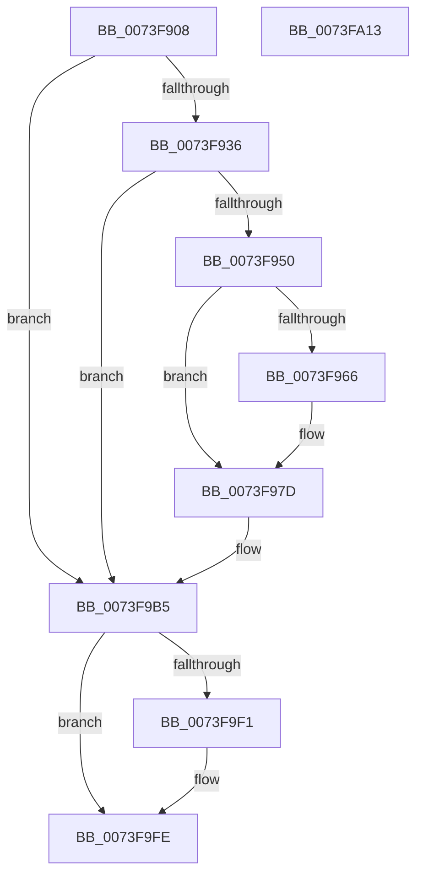

# PnpRecordBlackboxDelayedRemoveWorkerInformation

- RVA: `0x0073F908`–`0x0073FA14` (길이 `268` bytes)
- VA: `0x000000014073F908`
- 실행 섹션: `PAGE`
- PDB 이름 있음: `예`; PDB Function 태그: `아니요`
- unwind 정보 RVA: `0x0006F874`
- 디코드: `66`개 명령, `268/268` bytes 표시
- 미해석 바이트: `0` (있으면 어셈블리에 `.byte`로 보존)

> 이 문서는 커널 이미지의 기계어와 PDB 기호를 분석해 생성했습니다. 4번과 5번은 함수 원형과 자료형을 바이너리 사용 방식에서 추정한 C 해석이며 원본 소스 복구 결과는 아닙니다.

## 1. Dependencies

- 직접 호출 지점: **3**; 고유 호출 대상: **3**
- 직접 호출자로 확인된 함수: **1**
- RIP 상대 이미지 참조: **3**

### Outgoing calls
- `0x0073F943` → [ExAllocatePool2](../../poolcode/B8/ExAllocatePool2_function_00B820F0.md) (function, `0x00B820F0`)
- `0x0073F9E7` → [NtPowerInformation](../95/NtPowerInformation_function_00955D80.md) (function, `0x00955D80`)
- `0x0073F9F9` → [ExFreePoolWithTag](../../poolcode/B8/ExFreePoolWithTag_function_00B82870.md) (function, `0x00B82870`)

### Direct callers
- [PnpRecordBlackbox](../95/PnpRecordBlackbox_function_00955C28.md) at `0x00955C60`

### Static image references
- `0x0073F994` → RVA `0x00E663B8` (`.data`; read)
- `0x0073F99F` → RVA `0x00E663B0` (`.data`; read)
- `0x0073F9AA` → RVA `0x00F8CB20` (`.data`; read)

## 2. Other-region calls and transfers

- 다른 실행 섹션으로 향하는 call: **2**
  - `0x0073F943` → [ExAllocatePool2](../../poolcode/B8/ExAllocatePool2_function_00B820F0.md) (`PAGE` → `POOLCODE`)
  - `0x0073F9F9` → [ExFreePoolWithTag](../../poolcode/B8/ExFreePoolWithTag_function_00B82870.md) (`PAGE` → `POOLCODE`)
- 별도 외부 분기/꼬리 이동을 확인하지 못했습니다.

## 3. Assembly (complete function range)

```asm
0073F908  48 89 5C 24 08                  mov qword ptr [rsp + 8], rbx
0073F90D  48 89 6C 24 10                  mov qword ptr [rsp + 0x10], rbp
0073F912  48 89 74 24 18                  mov qword ptr [rsp + 0x18], rsi
0073F917  57                              push rdi
0073F918  48 83 EC 50                     sub rsp, 0x50
0073F91C  48 BD 08 00 00 00 80 F7 FF FF   movabs rbp, 0xfffff78000000008
0073F926  33 DB                           xor ebx, ebx
0073F928  33 FF                           xor edi, edi
0073F92A  48 8B F1                        mov rsi, rcx
0073F92D  48 8B 6D 00                     mov rbp, qword ptr [rbp]
0073F931  48 85 C9                        test rcx, rcx
0073F934  74 7F                           je 0x14073f9b5
0073F936  8D 7B 40                        lea edi, [rbx + 0x40]
0073F939  41 B8 50 6E 70 4B               mov r8d, 0x4b706e50
0073F93F  8B D7                           mov edx, edi
0073F941  8B CF                           mov ecx, edi
0073F943  E8 A8 27 44 00                  call 0x140b820f0
0073F948  48 8B D8                        mov rbx, rax
0073F94B  48 85 C0                        test rax, rax
0073F94E  74 65                           je 0x14073f9b5
0073F950  C7 00 01 00 00 00               mov dword ptr [rax], 1
0073F956  89 78 04                        mov dword ptr [rax + 4], edi
0073F959  C6 40 08 00                     mov byte ptr [rax + 8], 0
0073F95D  48 8B 46 18                     mov rax, qword ptr [rsi + 0x18]
0073F961  48 85 C0                        test rax, rax
0073F964  74 17                           je 0x14073f97d
0073F966  48 2B 28                        sub rbp, qword ptr [rax]
0073F969  48 B8 4B 59 86 38 D6 C5 6D 34   movabs rax, 0x346dc5d63886594b
0073F973  48 F7 E5                        mul rbp
0073F976  48 C1 EA 0B                     shr rdx, 0xb
0073F97A  89 53 0C                        mov dword ptr [rbx + 0xc], edx
0073F97D  48 8B 46 08                     mov rax, qword ptr [rsi + 8]
0073F981  48 89 43 18                     mov qword ptr [rbx + 0x18], rax
0073F985  48 8B 46 10                     mov rax, qword ptr [rsi + 0x10]
0073F989  48 89 43 20                     mov qword ptr [rbx + 0x20], rax
0073F98D  48 8B 06                        mov rax, qword ptr [rsi]
0073F990  48 89 43 10                     mov qword ptr [rbx + 0x10], rax
0073F994  48 8B 05 1D 6A 72 00            mov rax, qword ptr [rip + 0x726a1d]
0073F99B  48 89 43 28                     mov qword ptr [rbx + 0x28], rax
0073F99F  48 8B 05 0A 6A 72 00            mov rax, qword ptr [rip + 0x726a0a]
0073F9A6  48 89 43 30                     mov qword ptr [rbx + 0x30], rax
0073F9AA  48 8B 05 6F D1 84 00            mov rax, qword ptr [rip + 0x84d16f]
0073F9B1  48 89 43 38                     mov qword ptr [rbx + 0x38], rax
0073F9B5  48 83 64 24 40 00               and qword ptr [rsp + 0x40], 0
0073F9BB  48 8D 54 24 30                  lea rdx, [rsp + 0x30]
0073F9C0  83 64 24 4C 00                  and dword ptr [rsp + 0x4c], 0
0073F9C5  45 33 C9                        xor r9d, r9d
0073F9C8  83 64 24 20 00                  and dword ptr [rsp + 0x20], 0
0073F9CD  C7 44 24 48 0B 00 00 00         mov dword ptr [rsp + 0x48], 0xb
0073F9D5  48 89 5C 24 30                  mov qword ptr [rsp + 0x30], rbx
0073F9DA  45 8D 41 20                     lea r8d, [r9 + 0x20]
0073F9DE  48 89 7C 24 38                  mov qword ptr [rsp + 0x38], rdi
0073F9E3  41 8D 49 5E                     lea ecx, [r9 + 0x5e]
0073F9E7  E8 94 63 21 00                  call 0x140955d80
0073F9EC  48 85 DB                        test rbx, rbx
0073F9EF  74 0D                           je 0x14073f9fe
0073F9F1  BA 50 6E 70 4B                  mov edx, 0x4b706e50
0073F9F6  48 8B CB                        mov rcx, rbx
0073F9F9  E8 72 2E 44 00                  call 0x140b82870
0073F9FE  48 8B 5C 24 60                  mov rbx, qword ptr [rsp + 0x60]
0073FA03  48 8B 6C 24 68                  mov rbp, qword ptr [rsp + 0x68]
0073FA08  48 8B 74 24 70                  mov rsi, qword ptr [rsp + 0x70]
0073FA0D  48 83 C4 50                     add rsp, 0x50
0073FA11  5F                              pop rdi
0073FA12  C3                              ret
0073FA13  CC                              int3
```

## 4. C-style interpretation (structured pseudocode)

```c
__int64 __fastcall PnpRecordBlackboxDelayedRemoveWorkerInformation(__int64 a1, __int64 a2, __int64 a3, int a4)
{
    __int64 result;
    __int64 v_rbp;
    __int64 v_rbx;
    __int64 v_rdi;
    __int64 v_rsp;
    unsigned int v_stack_m10;
    unsigned __int64 v_stack_m18;
    unsigned __int64 v_stack_m20;
    unsigned __int64 v_stack_m28;
    unsigned int v_stack_m38;
    unsigned int v_stack_mC;
    unsigned __int64 v_stack_p10;
    unsigned __int64 v_stack_p18;
    unsigned __int64 v_stack_p8;

    v_stack_p8 = v_rbx;
    v_stack_p10 = v_rbp;
    v_stack_p18 = v_rsi;
    v_rsp = (v_rsp) - (80);
    v_rbx = 0;
    v_rdi = 0;
    if (a1 == 0) goto loc_0073F9B5;
    result = ExAllocatePool2((unsigned int)((unsigned int)(v_rbx + 64)), (unsigned int)((unsigned int)(v_rbx + 64)), (unsigned int)(0x4B706E50ULL), a4);
    if (result == 0) goto loc_0073F9B5;
    *(unsigned int *)(result) = 1;
    *(unsigned int *)(result + 4) = (unsigned int)(v_rbx + 64);
    *(unsigned __int8 *)(result + 8) = 0;
    v_rbp = *(unsigned __int64 *)(v_rbp);
    if (*(unsigned __int64 *)(a1 + 24) != 0) {
        v_rbp = (*(unsigned __int64 *)(v_rbp)) - (*(unsigned __int64 *)(*(unsigned __int64 *)(a1 + 24)));
        a2 = ((unsigned int)((unsigned int)(v_rbx + 64))) >> (11);
        *(unsigned int *)(result + 12) = (unsigned int)(a2);
    }
    *(unsigned __int64 *)(result + 24) = *(unsigned __int64 *)(a1 + 8);
    *(unsigned __int64 *)(result + 32) = *(unsigned __int64 *)(a1 + 16);
    *(unsigned __int64 *)(result + 16) = *(unsigned __int64 *)(a1);
    *(unsigned __int64 *)(result + 40) = *(unsigned __int64 *)(v_rip + 7498269);
    *(unsigned __int64 *)(result + 48) = *(unsigned __int64 *)(v_rip + 7498250);
    *(unsigned __int64 *)(result + 56) = *(unsigned __int64 *)(v_rip + 8704367);
loc_0073F9B5:
    a4 = 0;
    v_stack_m10 = 11;
    v_stack_m28 = result;
    v_stack_m20 = v_rbx + 64;
    result = NtPowerInformation(a4 + 94, v_stack_m28, a4 + 32, a4);
    if (result != 0) {
        a2 = 0x4B706E50ULL;
        a1 = result;
        result = ExFreePoolWithTag(a1, a2, a4 + 32, a4);
    }
    v_rsp = (v_rsp) + (80);
    return result;
}
```

## 5. (Beta) C Style

```c
int64_t PnpRecordBlackboxDelayedRemoveWorkerInformation(void *Arg1, int64_t Arg2, int64_t Arg3, int32_t Arg4)
{
    uint8_t *arg1 = (uint8_t *)Arg1;

    int64_t result;
    int64_t local_rbp;
    int64_t local_rbx;
    int64_t local_rdi;
    int64_t local_rsp;
    uint32_t v_stack_m10;
    uint64_t v_stack_m18;
    uint64_t v_stack_m20;
    uint64_t v_stack_m28;
    uint32_t v_stack_m38;
    uint32_t v_stack_mC;
    uint64_t v_stack_p10;
    uint64_t v_stack_p18;
    uint64_t v_stack_p8;

    v_stack_p8 = local_rbx;
    v_stack_p10 = local_rbp;
    v_stack_p18 = local_rsi;
    local_rsp = (local_rsp) - (80);
    local_rbx = 0;
    local_rdi = 0;
    if (Arg1 == NULL) goto loc_0073F9B5;
    result = ExAllocatePool2((uint32_t)((uint32_t)(local_rbx + 64)), (uint32_t)((uint32_t)(local_rbx + 64)), (uint32_t)(0x4B706E50ULL), Arg4);
    if (result == 0) goto loc_0073F9B5;
    *(uint32_t *)(result) = 1;
    *(uint32_t *)(result + 0x4) = (uint32_t)(local_rbx + 64);
    *(uint8_t *)(result + 0x8) = 0;
    local_rbp = *(uint64_t *)(local_rbp);
    if (*(uint64_t *)(arg1 + 0x18) != 0) {
        local_rbp = (*(uint64_t *)(local_rbp)) - (*(uint64_t *)(*(uint64_t *)(arg1 + 0x18)));
        Arg2 = ((uint32_t)((uint32_t)(local_rbx + 64))) >> (11);
        *(uint32_t *)(result + 0xC) = (uint32_t)(Arg2);
    }
    *(uint64_t *)(result + 0x18) = *(uint64_t *)(arg1 + 0x8);
    *(uint64_t *)(result + 0x20) = *(uint64_t *)(arg1 + 0x10);
    *(uint64_t *)(result + 0x10) = *(uint64_t *)(arg1);
    *(uint64_t *)(result + 0x28) = *(uint64_t *)(v_rip + 0x726A1D);
    *(uint64_t *)(result + 0x30) = *(uint64_t *)(v_rip + 0x726A0A);
    *(uint64_t *)(result + 0x38) = *(uint64_t *)(v_rip + 0x84D16F);
loc_0073F9B5:
    Arg4 = 0;
    v_stack_m10 = 11;
    v_stack_m28 = result;
    v_stack_m20 = local_rbx + 64;
    result = NtPowerInformation(Arg4 + 94, v_stack_m28, Arg4 + 32, Arg4);
    if (result != 0) {
        Arg2 = 0x4B706E50ULL;
        Arg1 = result;
        result = ExFreePoolWithTag(Arg1, Arg2, Arg4 + 32, Arg4);
    }
    local_rsp = (local_rsp) + (80);
    return result;
}
```

### 관측된 메모리 오프셋

구조체 형식이 확인되지 않은 접근은 인자 기준의 오프셋으로만 기록했습니다.

| 기준 인자 | 오프셋 표현 | 폭 (bit) | 접근 |
|---|---:|---:|---|
| `Arg1` | `+ 0x0` | `64` | `R` |
| `Arg1` | `+ 0x8` | `64` | `R` |
| `Arg1` | `+ 0x10` | `64` | `R` |
| `Arg1` | `+ 0x18` | `64` | `R` |

## 6. Execution-region graph

[열기: 2D/3D 그래프와 함수 탐색 컨트롤 패널](../../../control-panel.html?section=page&rva=0x0073F908&view=graph)

- 2D 그래프는 위에서 아래로 흐르고, 3D 그래프는 빈 공간을 드래그해 회전합니다. Shift+드래그는 이동, 휠은 확대·축소, 함수 노드 선택은 대상 보고서 이동입니다.

### Static fallback


