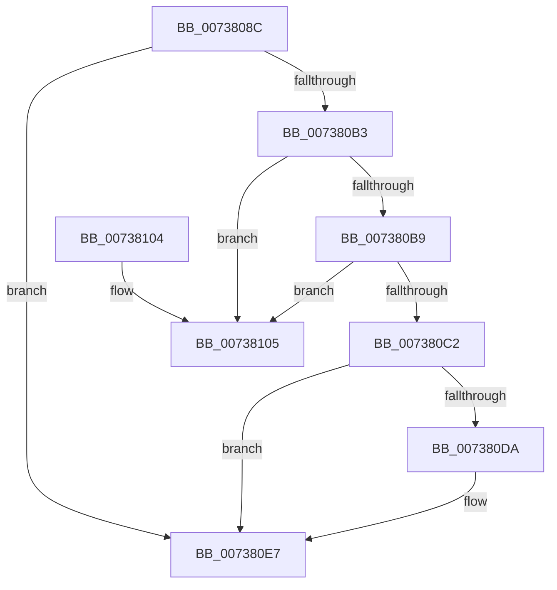

# PnpRemoveEventFromQueue

- RVA: `0x0073808C`–`0x0073810C` (길이 `128` bytes)
- VA: `0x000000014073808C`
- 실행 섹션: `PAGE`
- PDB 이름 있음: `예`; PDB Function 태그: `아니요`
- unwind 정보 RVA: `0x0006CF28`
- 디코드: `37`개 명령, `128/128` bytes 표시
- 미해석 바이트: `0` (있으면 어셈블리에 `.byte`로 보존)

> 이 문서는 커널 이미지의 기계어와 PDB 기호를 분석해 생성했습니다. 4번과 5번은 함수 원형과 자료형을 바이너리 사용 방식에서 추정한 C 해석이며 원본 소스 복구 결과는 아닙니다.

## 1. Dependencies

- 직접 호출 지점: **3**; 고유 호출 대상: **3**
- 직접 호출자로 확인된 함수: **1**
- RIP 상대 이미지 참조: **1**

### Outgoing calls
- `0x007380A6` → [ExAcquireFastMutex](../../text/20/ExAcquireFastMutex_function_0020E5A0.md) (function, `0x0020E5A0`)
- `0x007380E2` → [ExFreePoolWithTag](../../poolcode/B8/ExFreePoolWithTag_function_00B82870.md) (function, `0x00B82870`)
- `0x007380F2` → [ExReleaseFastMutex](../../text/25/ExReleaseFastMutex_function_002519C0.md) (function, `0x002519C0`)

### Direct callers
- [PnpQueueQueryAndRemoveEvent](../94/PnpQueueQueryAndRemoveEvent_function_0094FD2C.md) at `0x00950091`

### Static image references
- `0x0073809B` → RVA `0x00FD8048` (`PAGEDATA`; read)

## 2. Other-region calls and transfers

- 다른 실행 섹션으로 향하는 call: **3**
  - `0x007380A6` → [ExAcquireFastMutex](../../text/20/ExAcquireFastMutex_function_0020E5A0.md) (`PAGE` → `.text`)
  - `0x007380E2` → [ExFreePoolWithTag](../../poolcode/B8/ExFreePoolWithTag_function_00B82870.md) (`PAGE` → `POOLCODE`)
  - `0x007380F2` → [ExReleaseFastMutex](../../text/25/ExReleaseFastMutex_function_002519C0.md) (`PAGE` → `.text`)
- 별도 외부 분기/꼬리 이동을 확인하지 못했습니다.

## 3. Assembly (complete function range)

```asm
0073808C  48 89 5C 24 08                  mov qword ptr [rsp + 8], rbx
00738091  57                              push rdi
00738092  48 83 EC 20                     sub rsp, 0x20
00738096  48 8B D9                        mov rbx, rcx
00738099  33 FF                           xor edi, edi
0073809B  48 8B 0D A6 FF 89 00            mov rcx, qword ptr [rip + 0x89ffa6]
007380A2  48 83 C1 40                     add rcx, 0x40
007380A6  E8 F5 64 AD FF                  call 0x14020e5a0
007380AB  48 8B 03                        mov rax, qword ptr [rbx]
007380AE  48 3B C3                        cmp rax, rbx
007380B1  74 34                           je 0x1407380e7
007380B3  48 39 58 08                     cmp qword ptr [rax + 8], rbx
007380B7  75 4C                           jne 0x140738105
007380B9  48 8B 4B 08                     mov rcx, qword ptr [rbx + 8]
007380BD  48 39 19                        cmp qword ptr [rcx], rbx
007380C0  75 43                           jne 0x140738105
007380C2  48 89 01                        mov qword ptr [rcx], rax
007380C5  BF 01 00 00 00                  mov edi, 1
007380CA  48 89 48 08                     mov qword ptr [rax + 8], rcx
007380CE  83 C8 FF                        or eax, 0xffffffff
007380D1  F0 0F C1 43 40                  lock xadd dword ptr [rbx + 0x40], eax
007380D6  3B C7                           cmp eax, edi
007380D8  75 0D                           jne 0x1407380e7
007380DA  BA 50 6E 70 4B                  mov edx, 0x4b706e50
007380DF  48 8B CB                        mov rcx, rbx
007380E2  E8 89 A7 44 00                  call 0x140b82870
007380E7  48 8B 0D 5A FF 89 00            mov rcx, qword ptr [rip + 0x89ff5a]
007380EE  48 83 C1 40                     add rcx, 0x40
007380F2  E8 C9 98 B1 FF                  call 0x1402519c0
007380F7  48 8B 5C 24 30                  mov rbx, qword ptr [rsp + 0x30]
007380FC  8B C7                           mov eax, edi
007380FE  48 83 C4 20                     add rsp, 0x20
00738102  5F                              pop rdi
00738103  C3                              ret
00738104  CC                              int3
00738105  B9 03 00 00 00                  mov ecx, 3
0073810A  CD 29                           int 0x29
```

## 4. C-style interpretation (structured pseudocode)

```c
__int64 __fastcall PnpRemoveEventFromQueue(__int64 a1)
{
    __int64 result;
    __int64 v_rdi;
    __int64 v_rsp;
    unsigned __int64 v_stack_p8;

    v_stack_p8 = v_rbx;
    v_rsp = (v_rsp) - (32);
    v_rdi = 0;
    a1 = (*(unsigned __int64 *)(v_rip + 9043878)) + (64);
    result = ExAcquireFastMutex(a1, a2, a3, a4);
    if ((*(unsigned __int64 *)(a1)) == a1) goto loc_007380E7;
    if ((*(unsigned __int64 *)(*(unsigned __int64 *)(a1) + 8)) != a1) goto loc_00738105;
    if ((*(unsigned __int64 *)(*(unsigned __int64 *)(a1 + 8))) != a1) goto loc_00738105;
    *(unsigned __int64 *)(*(unsigned __int64 *)(a1 + 8)) = *(unsigned __int64 *)(a1);
    *(unsigned __int64 *)(*(unsigned __int64 *)(a1) + 8) = *(unsigned __int64 *)(a1 + 8);
    result = (unsigned int)((*(unsigned __int64 *)(a1)) | (0xFFFFFFFFULL));
    if (((unsigned int)(result)) == 1) {
        a2 = 0x4B706E50ULL;
        a1 = a1;
        result = ExFreePoolWithTag(a1, a2, a3, a4);
    }
    a1 = (*(unsigned __int64 *)(v_rip + 9043802)) + (64);
    result = ExReleaseFastMutex(a1, a2, a3, a4);
    v_rsp = (v_rsp) + (32);
    return 1;
loc_00738105:
    return 1;
}
```

## 5. (Beta) C Style

```c
int64_t PnpRemoveEventFromQueue(void *Arg1)
{
    uint8_t *arg1 = (uint8_t *)Arg1;

    int64_t result;
    int64_t local_rdi;
    int64_t local_rsp;
    uint64_t v_stack_p8;

    v_stack_p8 = local_rbx;
    local_rsp = (local_rsp) - (32);
    local_rdi = 0;
    Arg1 = (*(uint64_t *)(v_rip + 0x89FFA6)) + (64);
    result = ExAcquireFastMutex(Arg1, a2, a3, a4);
    if ((*(uint64_t *)(arg1)) == Arg1) goto loc_007380E7;
    if ((*(uint64_t *)(*(uint64_t *)(arg1) + 0x8)) != Arg1) goto loc_00738105;
    if ((*(uint64_t *)(*(uint64_t *)(arg1 + 0x8))) != Arg1) goto loc_00738105;
    *(uint64_t *)(*(uint64_t *)(arg1 + 0x8)) = *(uint64_t *)(arg1);
    *(uint64_t *)(*(uint64_t *)(arg1) + 0x8) = *(uint64_t *)(arg1 + 0x8);
    result = (uint32_t)((*(uint64_t *)(arg1)) | (0xFFFFFFFFULL));
    if (((uint32_t)(result)) == 1) {
        a2 = 0x4B706E50ULL;
        Arg1 = Arg1;
        result = ExFreePoolWithTag(Arg1, a2, a3, a4);
    }
    Arg1 = (*(uint64_t *)(v_rip + 0x89FF5A)) + (64);
    result = ExReleaseFastMutex(Arg1, a2, a3, a4);
    local_rsp = (local_rsp) + (32);
    return 1;
loc_00738105:
    return 1;
}
```

### 관측된 메모리 오프셋

구조체 형식이 확인되지 않은 접근은 인자 기준의 오프셋으로만 기록했습니다.

| 기준 인자 | 오프셋 표현 | 폭 (bit) | 접근 |
|---|---:|---:|---|
| `Arg1` | `+ 0x0` | `64` | `R` |
| `Arg1` | `+ 0x8` | `64` | `R` |
| `Arg1` | `+ 0x40` | `32` | `R/W` |

## 6. Execution-region graph

[열기: 2D/3D 그래프와 함수 탐색 컨트롤 패널](../../../control-panel.html?section=page&rva=0x0073808C&view=graph)

- 2D 그래프는 위에서 아래로 흐르고, 3D 그래프는 빈 공간을 드래그해 회전합니다. Shift+드래그는 이동, 휠은 확대·축소, 함수 노드 선택은 대상 보고서 이동입니다.

### Static fallback


