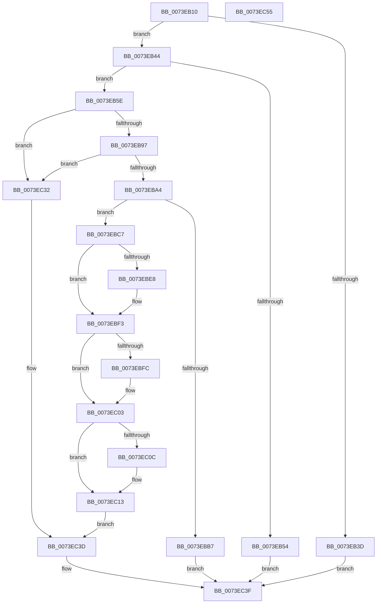

# PnpRestoreResourcesInternal

- RVA: `0x0073EB10`–`0x0073EC56` (길이 `326` bytes)
- VA: `0x000000014073EB10`
- 실행 섹션: `PAGE`
- PDB 이름 있음: `예`; PDB Function 태그: `아니요`
- unwind 정보 RVA: `0x000C7B70`
- 디코드: `89`개 명령, `326/326` bytes 표시
- 미해석 바이트: `0` (있으면 어셈블리에 `.byte`로 보존)

> 이 문서는 커널 이미지의 기계어와 PDB 기호를 분석해 생성했습니다. 4번과 5번은 함수 원형과 자료형을 바이너리 사용 방식에서 추정한 C 해석이며 원본 소스 복구 결과는 아닙니다.

## 1. Dependencies

- 직접 호출 지점: **13**; 고유 호출 대상: **10**
- 직접 호출자로 확인된 함수: **1**
- RIP 상대 이미지 참조: **0**

### Outgoing calls
- `0x0073EB47` → [PnpCmResourcesToIoResources](PnpCmResourcesToIoResources_function_0073D584.md) (function, `0x0073D584`)
- `0x0073EB68` → [memset](../../text/6C/memset_function_006C6C40.md) (function, `0x006C6C40`)
- `0x0073EB88` → [IopResourceRequirementsListToReqList](../A8/IopResourceRequirementsListToReqList_function_00A82954.md) (function, `0x00A82954`)
- `0x0073EBA7` → [IopRearrangeReqList](../AB/IopRearrangeReqList_function_00ABDA24.md) (function, `0x00ABDA24`)
- `0x0073EBBB` → [PnpFreeResourceRequirementsForAssignTable](PnpFreeResourceRequirementsForAssignTable_function_0073E8B8.md) (function, `0x0073E8B8`)
- `0x0073EBD0` → [PnpFindBestConfiguration](../72/PnpFindBestConfiguration_function_0072B630.md) (function, `0x0072B630`)
- `0x0073EBDF` → [PnpFreeResourceRequirementsForAssignTable](PnpFreeResourceRequirementsForAssignTable_function_0073E8B8.md) (function, `0x0073E8B8`)
- `0x0073EBEC` → [IopCommitConfiguration](../AB/IopCommitConfiguration_function_00ABF3D4.md) (function, `0x00ABF3D4`)
- `0x0073EBFE` → [ExFreePoolWithTag](../../poolcode/B8/ExFreePoolWithTag_function_00B82870.md) (function, `0x00B82870`)
- `0x0073EC0E` → [ExFreePoolWithTag](../../poolcode/B8/ExFreePoolWithTag_function_00B82870.md) (function, `0x00B82870`)
- `0x0073EC1D` → [PnpDetermineResourceListSize](../8F/PnpDetermineResourceListSize_function_008FC6F8.md) (function, `0x008FC6F8`)
- `0x0073EC2B` → [IopWriteAllocatedResourcesToRegistry](../AA/IopWriteAllocatedResourcesToRegistry_function_00AA54E4.md) (function, `0x00AA54E4`)
- `0x0073EC38` → [ExFreePoolWithTag](../../poolcode/B8/ExFreePoolWithTag_function_00B82870.md) (function, `0x00B82870`)

### Direct callers
- [PnpReallocateResources](PnpReallocateResources_function_0073E924.md) at `0x0073EA6A`

### Static image references
- 디코드된 RIP-relative 메모리 참조가 없습니다.

## 2. Other-region calls and transfers

- 다른 실행 섹션으로 향하는 call: **4**
  - `0x0073EB68` → [memset](../../text/6C/memset_function_006C6C40.md) (`PAGE` → `.text`)
  - `0x0073EBFE` → [ExFreePoolWithTag](../../poolcode/B8/ExFreePoolWithTag_function_00B82870.md) (`PAGE` → `POOLCODE`)
  - `0x0073EC0E` → [ExFreePoolWithTag](../../poolcode/B8/ExFreePoolWithTag_function_00B82870.md) (`PAGE` → `POOLCODE`)
  - `0x0073EC38` → [ExFreePoolWithTag](../../poolcode/B8/ExFreePoolWithTag_function_00B82870.md) (`PAGE` → `POOLCODE`)
- 별도 외부 분기/꼬리 이동을 확인하지 못했습니다.

## 3. Assembly (complete function range)

```asm
0073EB10  48 89 5C 24 08                  mov qword ptr [rsp + 8], rbx
0073EB15  48 89 74 24 10                  mov qword ptr [rsp + 0x10], rsi
0073EB1A  48 89 7C 24 18                  mov qword ptr [rsp + 0x18], rdi
0073EB1F  55                              push rbp
0073EB20  48 8B EC                        mov rbp, rsp
0073EB23  48 83 EC 70                     sub rsp, 0x70
0073EB27  48 8B 91 A0 01 00 00            mov rdx, qword ptr [rcx + 0x1a0]
0073EB2E  0F 57 C0                        xorps xmm0, xmm0
0073EB31  48 8B F9                        mov rdi, rcx
0073EB34  0F 11 45 B0                     movups xmmword ptr [rbp - 0x50], xmm0
0073EB38  48 85 D2                        test rdx, rdx
0073EB3B  75 07                           jne 0x14073eb44
0073EB3D  33 C0                           xor eax, eax
0073EB3F  E9 FB 00 00 00                  jmp 0x14073ec3f
0073EB44  45 33 C0                        xor r8d, r8d
0073EB47  E8 38 EA FF FF                  call 0x14073d584
0073EB4C  48 8B D8                        mov rbx, rax
0073EB4F  48 85 C0                        test rax, rax
0073EB52  75 0A                           jne 0x14073eb5e
0073EB54  B8 9A 00 00 C0                  mov eax, 0xc000009a
0073EB59  E9 E1 00 00 00                  jmp 0x14073ec3f
0073EB5E  33 D2                           xor edx, edx
0073EB60  48 8D 4D C0                     lea rcx, [rbp - 0x40]
0073EB64  44 8D 42 40                     lea r8d, [rdx + 0x40]
0073EB68  E8 D3 80 F8 FF                  call 0x1406c6c40
0073EB6D  48 8B 47 20                     mov rax, qword ptr [rdi + 0x20]
0073EB71  48 8D 55 E0                     lea rdx, [rbp - 0x20]
0073EB75  48 8D 4D C0                     lea rcx, [rbp - 0x40]
0073EB79  48 89 45 C0                     mov qword ptr [rbp - 0x40], rax
0073EB7D  48 89 5D D8                     mov qword ptr [rbp - 0x28], rbx
0073EB81  C7 45 CC 04 00 00 00            mov dword ptr [rbp - 0x34], 4
0073EB88  E8 C7 3D 34 00                  call 0x140a82954
0073EB8D  8B F0                           mov esi, eax
0073EB8F  85 C0                           test eax, eax
0073EB91  0F 88 9B 00 00 00               js 0x14073ec32
0073EB97  48 8B 5D E0                     mov rbx, qword ptr [rbp - 0x20]
0073EB9B  48 85 DB                        test rbx, rbx
0073EB9E  0F 84 8E 00 00 00               je 0x14073ec32
0073EBA4  48 8B CB                        mov rcx, rbx
0073EBA7  E8 78 EE 37 00                  call 0x140abda24
0073EBAC  48 83 7B 18 00                  cmp qword ptr [rbx + 0x18], 0
0073EBB1  48 8D 4D C0                     lea rcx, [rbp - 0x40]
0073EBB5  75 10                           jne 0x14073ebc7
0073EBB7  48 8D 55 00                     lea rdx, [rbp]
0073EBBB  E8 F8 FC FF FF                  call 0x14073e8b8
0073EBC0  B8 82 01 00 C0                  mov eax, 0xc0000182
0073EBC5  EB 78                           jmp 0x14073ec3f
0073EBC7  4C 8D 45 B0                     lea r8, [rbp - 0x50]
0073EBCB  BA 01 00 00 00                  mov edx, 1
0073EBD0  E8 5B CA FE FF                  call 0x14072b630
0073EBD5  48 8D 55 00                     lea rdx, [rbp]
0073EBD9  8B F0                           mov esi, eax
0073EBDB  48 8D 4D C0                     lea rcx, [rbp - 0x40]
0073EBDF  E8 D4 FC FF FF                  call 0x14073e8b8
0073EBE4  85 F6                           test esi, esi
0073EBE6  78 0B                           js 0x14073ebf3
0073EBE8  48 8D 4D B0                     lea rcx, [rbp - 0x50]
0073EBEC  E8 E3 07 38 00                  call 0x140abf3d4
0073EBF1  8B F0                           mov esi, eax
0073EBF3  48 8B 4D E8                     mov rcx, qword ptr [rbp - 0x18]
0073EBF7  48 85 C9                        test rcx, rcx
0073EBFA  74 07                           je 0x14073ec03
0073EBFC  33 D2                           xor edx, edx
0073EBFE  E8 6D 3C 44 00                  call 0x140b82870
0073EC03  48 8B 4D F0                     mov rcx, qword ptr [rbp - 0x10]
0073EC07  48 85 C9                        test rcx, rcx
0073EC0A  74 07                           je 0x14073ec13
0073EC0C  33 D2                           xor edx, edx
0073EC0E  E8 5D 3C 44 00                  call 0x140b82870
0073EC13  48 8B 9F A0 01 00 00            mov rbx, qword ptr [rdi + 0x1a0]
0073EC1A  48 8B CB                        mov rcx, rbx
0073EC1D  E8 D6 DA 1B 00                  call 0x1408fc6f8
0073EC22  44 8B C0                        mov r8d, eax
0073EC25  48 8B D3                        mov rdx, rbx
0073EC28  48 8B CF                        mov rcx, rdi
0073EC2B  E8 B4 68 36 00                  call 0x140aa54e4
0073EC30  EB 0B                           jmp 0x14073ec3d
0073EC32  48 8B 4D D8                     mov rcx, qword ptr [rbp - 0x28]
0073EC36  33 D2                           xor edx, edx
0073EC38  E8 33 3C 44 00                  call 0x140b82870
0073EC3D  8B C6                           mov eax, esi
0073EC3F  4C 8D 5C 24 70                  lea r11, [rsp + 0x70]
0073EC44  49 8B 5B 10                     mov rbx, qword ptr [r11 + 0x10]
0073EC48  49 8B 73 18                     mov rsi, qword ptr [r11 + 0x18]
0073EC4C  49 8B 7B 20                     mov rdi, qword ptr [r11 + 0x20]
0073EC50  49 8B E3                        mov rsp, r11
0073EC53  5D                              pop rbp
0073EC54  C3                              ret
0073EC55  CC                              int3
```

## 4. C-style interpretation (structured pseudocode)

```c
__int64 __fastcall PnpRestoreResourcesInternal(__int64 a1, __int64 a2, int a3)
{
    __int64 result;
    __int64 v_rsi;
    __int64 v_rsp;
    unsigned __int64 v_stack_m18;
    unsigned __int64 v_stack_m20;
    unsigned __int64 v_stack_m28;
    unsigned __int64 v_stack_m30;
    unsigned int v_stack_m3C;
    unsigned __int64 v_stack_m48;
    unsigned __int64 v_stack_m58;
    unsigned __int64 v_stack_m8;
    unsigned __int64 v_stack_p10;
    unsigned __int64 v_stack_p18;
    unsigned __int64 v_stack_p8;

    v_stack_p8 = v_rbx;
    v_stack_p10 = v_rsi;
    v_stack_p18 = v_rdi;
    v_rsp = (v_rsp) - (112);
    v_stack_m58 = v_xmm0;
    if (*(unsigned __int64 *)(a1 + 416) != 0) goto loc_0073EB44;
    result = 0;
    goto loc_0073EC3F;
loc_0073EB44:
    a3 = 0;
    result = PnpCmResourcesToIoResources(a1, *(unsigned __int64 *)(a1 + 416), a3, a4);
    if (result != 0) goto loc_0073EB5E;
    goto loc_0073EC3F;
loc_0073EB5E:
    a2 = 0;
    result = memset(v_stack_m48, a2, a2 + 64, a4);
    v_stack_m48 = *(unsigned __int64 *)(a1 + 32);
    v_stack_m30 = result;
    v_stack_m3C = 4;
    result = IopResourceRequirementsListToReqList(v_stack_m48, v_stack_m28, a2 + 64, a4);
    if (sign_flag) goto loc_0073EC32;
    if (v_stack_m28 == 0) goto loc_0073EC32;
    result = IopRearrangeReqList(v_stack_m28, v_stack_m28, a2 + 64, a4);
    if ((*(unsigned __int64 *)(v_stack_m28 + 24)) != 0) goto loc_0073EBC7;
    result = PnpFreeResourceRequirementsForAssignTable(v_stack_m48, v_stack_m8, a2 + 64, a4);
    goto loc_0073EC3F;
loc_0073EBC7:
    result = PnpFindBestConfiguration(v_stack_m48, 1, v_stack_m58, a4);
    result = PnpFreeResourceRequirementsForAssignTable(v_stack_m48, v_stack_m8, v_stack_m58, a4);
    v_rsi = (unsigned int)((unsigned int)(result));
    if (!(sign_flag)) {
        a1 = v_stack_m58;
        result = IopCommitConfiguration(a1, v_stack_m8, v_stack_m58, a4);
        v_rsi = (unsigned int)(result);
    }
    if (v_stack_m20 != 0) {
        a2 = 0;
        result = ExFreePoolWithTag(v_stack_m20, a2, v_stack_m58, a4);
    }
    if (v_stack_m18 != 0) {
        a2 = 0;
        result = ExFreePoolWithTag(v_stack_m18, a2, v_stack_m58, a4);
    }
    result = PnpDetermineResourceListSize(*(unsigned __int64 *)(a1 + 416), a2, v_stack_m58, a4);
    result = IopWriteAllocatedResourcesToRegistry(a1, *(unsigned __int64 *)(a1 + 416), (unsigned int)((unsigned int)(result)), a4);
    goto loc_0073EC3D;
loc_0073EC32:
    a2 = 0;
    result = ExFreePoolWithTag(v_stack_m30, a2, (unsigned int)((unsigned int)(result)), a4);
loc_0073EC3D:
loc_0073EC3F:
    return (unsigned int)((unsigned int)(v_rsi));
}
```

## 5. (Beta) C Style

```c
int64_t PnpRestoreResourcesInternal(void *Arg1, int64_t Arg2, int32_t Arg3)
{
    uint8_t *arg1 = (uint8_t *)Arg1;

    int64_t result;
    int64_t local_rsi;
    int64_t local_rsp;
    uint64_t v_stack_m18;
    uint64_t v_stack_m20;
    uint64_t v_stack_m28;
    uint64_t v_stack_m30;
    uint32_t v_stack_m3C;
    uint64_t v_stack_m48;
    uint64_t v_stack_m58;
    uint64_t v_stack_m8;
    uint64_t v_stack_p10;
    uint64_t v_stack_p18;
    uint64_t v_stack_p8;

    v_stack_p8 = local_rbx;
    v_stack_p10 = local_rsi;
    v_stack_p18 = local_rdi;
    local_rsp = (local_rsp) - (112);
    v_stack_m58 = v_xmm0;
    if (*(uint64_t *)(arg1 + 0x1A0) != 0) goto loc_0073EB44;
    result = 0;
    goto loc_0073EC3F;
loc_0073EB44:
    Arg3 = 0;
    result = PnpCmResourcesToIoResources(Arg1, *(uint64_t *)(arg1 + 0x1A0), Arg3, a4);
    if (result != 0) goto loc_0073EB5E;
    goto loc_0073EC3F;
loc_0073EB5E:
    Arg2 = 0;
    result = memset(v_stack_m48, Arg2, Arg2 + 64, a4);
    v_stack_m48 = *(uint64_t *)(arg1 + 0x20);
    v_stack_m30 = result;
    v_stack_m3C = 4;
    result = IopResourceRequirementsListToReqList(v_stack_m48, v_stack_m28, Arg2 + 64, a4);
    if (sign_flag) goto loc_0073EC32;
    if (v_stack_m28 == 0) goto loc_0073EC32;
    result = IopRearrangeReqList(v_stack_m28, v_stack_m28, Arg2 + 64, a4);
    if ((*(uint64_t *)(v_stack_m28 + 0x18)) != 0) goto loc_0073EBC7;
    result = PnpFreeResourceRequirementsForAssignTable(v_stack_m48, v_stack_m8, Arg2 + 64, a4);
    goto loc_0073EC3F;
loc_0073EBC7:
    result = PnpFindBestConfiguration(v_stack_m48, 1, v_stack_m58, a4);
    result = PnpFreeResourceRequirementsForAssignTable(v_stack_m48, v_stack_m8, v_stack_m58, a4);
    local_rsi = (uint32_t)((uint32_t)(result));
    if (!(sign_flag)) {
        Arg1 = v_stack_m58;
        result = IopCommitConfiguration(Arg1, v_stack_m8, v_stack_m58, a4);
        local_rsi = (uint32_t)(result);
    }
    if (v_stack_m20 != 0) {
        Arg2 = 0;
        result = ExFreePoolWithTag(v_stack_m20, Arg2, v_stack_m58, a4);
    }
    if (v_stack_m18 != 0) {
        Arg2 = 0;
        result = ExFreePoolWithTag(v_stack_m18, Arg2, v_stack_m58, a4);
    }
    result = PnpDetermineResourceListSize(*(uint64_t *)(arg1 + 0x1A0), Arg2, v_stack_m58, a4);
    result = IopWriteAllocatedResourcesToRegistry(Arg1, *(uint64_t *)(arg1 + 0x1A0), (uint32_t)((uint32_t)(result)), a4);
    goto loc_0073EC3D;
loc_0073EC32:
    Arg2 = 0;
    result = ExFreePoolWithTag(v_stack_m30, Arg2, (uint32_t)((uint32_t)(result)), a4);
loc_0073EC3D:
loc_0073EC3F:
    return (uint32_t)((uint32_t)(local_rsi));
}
```

### 관측된 메모리 오프셋

구조체 형식이 확인되지 않은 접근은 인자 기준의 오프셋으로만 기록했습니다.

| 기준 인자 | 오프셋 표현 | 폭 (bit) | 접근 |
|---|---:|---:|---|
| `Arg1` | `+ 0x20` | `64` | `R` |
| `Arg1` | `+ 0x1A0` | `64` | `R` |

## 6. Execution-region graph

[열기: 2D/3D 그래프와 함수 탐색 컨트롤 패널](../../../control-panel.html?section=page&rva=0x0073EB10&view=graph)

- 2D 그래프는 위에서 아래로 흐르고, 3D 그래프는 빈 공간을 드래그해 회전합니다. Shift+드래그는 이동, 휠은 확대·축소, 함수 노드 선택은 대상 보고서 이동입니다.

### Static fallback


