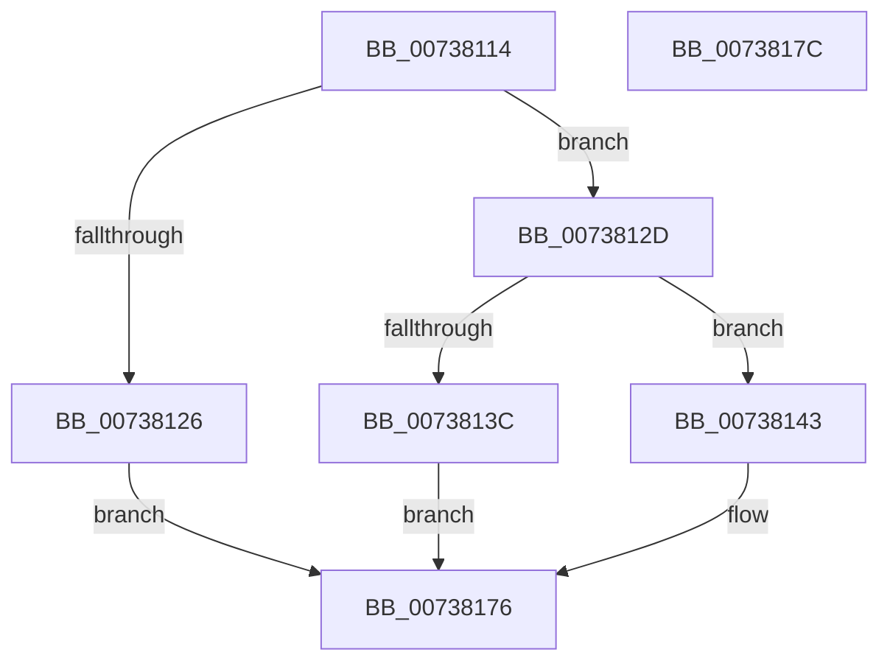

# PnpSetBlockedDriverEvent

- RVA: `0x00738114`–`0x0073817D` (길이 `105` bytes)
- VA: `0x0000000140738114`
- 실행 섹션: `PAGE`
- PDB 이름 있음: `예`; PDB Function 태그: `아니요`
- unwind 정보 RVA: `0x0005CF00`
- 디코드: `25`개 명령, `105/105` bytes 표시
- 미해석 바이트: `0` (있으면 어셈블리에 `.byte`로 보존)

> 이 문서는 커널 이미지의 기계어와 PDB 기호를 분석해 생성했습니다. 4번과 5번은 함수 원형과 자료형을 바이너리 사용 방식에서 추정한 C 해석이며 원본 소스 복구 결과는 아닙니다.

## 1. Dependencies

- 직접 호출 지점: **2**; 고유 호출 대상: **2**
- 직접 호출자로 확인된 함수: **1**
- RIP 상대 이미지 참조: **2**

### Outgoing calls
- `0x00738132` → [PnpCreateDeviceEventEntry](../95/PnpCreateDeviceEventEntry_function_00951B48.md) (function, `0x00951B48`)
- `0x00738171` → [PnpInsertEventInQueue](../95/PnpInsertEventInQueue_function_00951B78.md) (function, `0x00951B78`)

### Direct callers
- [PnpPrepareDriverLoading](../99/PnpPrepareDriverLoading_function_00996CC8.md) at `0x00996E27`

### Static image references
- `0x0073811A` → RVA `0x00F8C5E4` (`.data`; read)
- `0x00738143` → RVA `0x00026B70` (`.rdata`; read)

## 2. Other-region calls and transfers

- 다른 실행 섹션으로 향하는 call: **0**
- 별도 외부 분기/꼬리 이동을 확인하지 못했습니다.

## 3. Assembly (complete function range)

```asm
00738114  40 53                           push rbx
00738116  48 83 EC 20                     sub rsp, 0x20
0073811A  83 3D C3 44 85 00 00            cmp dword ptr [rip + 0x8544c3], 0
00738121  48 8B D9                        mov rbx, rcx
00738124  74 07                           je 0x14073812d
00738126  B8 89 01 00 C0                  mov eax, 0xc0000189
0073812B  EB 49                           jmp 0x140738176
0073812D  B9 C8 00 00 00                  mov ecx, 0xc8
00738132  E8 11 9A 21 00                  call 0x140951b48
00738137  48 85 C0                        test rax, rax
0073813A  75 07                           jne 0x140738143
0073813C  B8 9A 00 00 C0                  mov eax, 0xc000009a
00738141  EB 33                           jmp 0x140738176
00738143  0F 10 05 26 EA 8E FF            movups xmm0, xmmword ptr [rip - 0x7115da]
0073814A  C7 80 88 00 00 00 07 00 00 00   mov dword ptr [rax + 0x88], 7
00738154  48 8B C8                        mov rcx, rax
00738157  C7 80 9C 00 00 00 50 00 00 00   mov dword ptr [rax + 0x9c], 0x50
00738161  F3 0F 7F 40 78                  movdqu xmmword ptr [rax + 0x78], xmm0
00738166  0F 10 03                        movups xmm0, xmmword ptr [rbx]
00738169  F3 0F 7F 80 A8 00 00 00         movdqu xmmword ptr [rax + 0xa8], xmm0
00738171  E8 02 9A 21 00                  call 0x140951b78
00738176  48 83 C4 20                     add rsp, 0x20
0073817A  5B                              pop rbx
0073817B  C3                              ret
0073817C  CC                              int3
```

## 4. C-style interpretation (structured pseudocode)

```c
__int64 __fastcall PnpSetBlockedDriverEvent(__int64 a1)
{
    __int64 result;
    __int64 v_rsp;

    v_rsp = (v_rsp) - (32);
    if ((*(unsigned int *)(v_rip + 8733891)) == 0) goto loc_0073812D;
    goto loc_00738176;
loc_0073812D:
    result = PnpCreateDeviceEventEntry(200, a2, a3, a4);
    if (result != 0) goto loc_00738143;
    goto loc_00738176;
loc_00738143:
    *(unsigned int *)((unsigned int)(0xC000009AULL) + 136) = 7;
    *(unsigned int *)((unsigned int)(0xC000009AULL) + 156) = 80;
    *(unsigned __int64 *)((unsigned int)(0xC000009AULL) + 120) = v_xmm0;
    *(unsigned __int64 *)((unsigned int)(0xC000009AULL) + 168) = v_xmm0;
    result = PnpInsertEventInQueue((unsigned int)(0xC000009AULL), a2, a3, a4);
loc_00738176:
    v_rsp = (v_rsp) + (32);
    return result;
}
```

## 5. (Beta) C Style

```c
int64_t PnpSetBlockedDriverEvent(void *Arg1)
{
    uint8_t *arg1 = (uint8_t *)Arg1;

    int64_t result;
    int64_t local_rsp;

    local_rsp = (local_rsp) - (32);
    if ((*(uint32_t *)(v_rip + 0x8544C3)) == 0) goto loc_0073812D;
    goto loc_00738176;
loc_0073812D:
    result = PnpCreateDeviceEventEntry(200, a2, a3, a4);
    if (result != 0) goto loc_00738143;
    goto loc_00738176;
loc_00738143:
    *(uint32_t *)((uint32_t)(0xC000009AULL) + 0x88) = 7;
    *(uint32_t *)((uint32_t)(0xC000009AULL) + 0x9C) = 80;
    *(uint64_t *)((uint32_t)(0xC000009AULL) + 0x78) = v_xmm0;
    *(uint64_t *)((uint32_t)(0xC000009AULL) + 0xA8) = v_xmm0;
    result = PnpInsertEventInQueue((uint32_t)(0xC000009AULL), a2, a3, a4);
loc_00738176:
    local_rsp = (local_rsp) + (32);
    return result;
}
```

### 관측된 메모리 오프셋

구조체 형식이 확인되지 않은 접근은 인자 기준의 오프셋으로만 기록했습니다.

| 기준 인자 | 오프셋 표현 | 폭 (bit) | 접근 |
|---|---:|---:|---|
| `Arg1` | `+ 0x0` | `128` | `R` |

## 6. Execution-region graph

[열기: 2D/3D 그래프와 함수 탐색 컨트롤 패널](../../../control-panel.html?section=page&rva=0x00738114&view=graph)

- 2D 그래프는 위에서 아래로 흐르고, 3D 그래프는 빈 공간을 드래그해 회전합니다. Shift+드래그는 이동, 휠은 확대·축소, 함수 노드 선택은 대상 보고서 이동입니다.

### Static fallback


