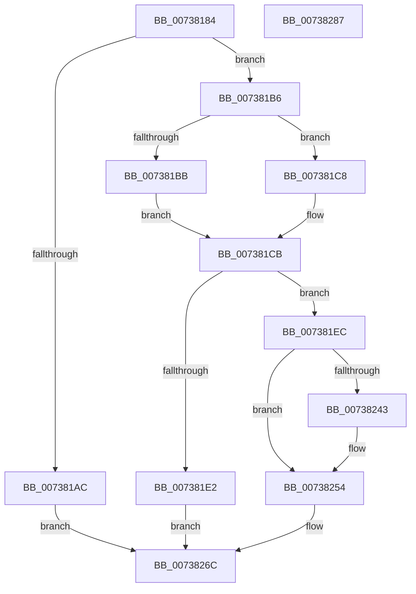

# PnpSetDeviceRemovalSafe

- RVA: `0x00738184`–`0x00738288` (길이 `260` bytes)
- VA: `0x0000000140738184`
- 실행 섹션: `PAGE`
- PDB 이름 있음: `예`; PDB Function 태그: `아니요`
- unwind 정보 RVA: `0x0005E6B4`
- 디코드: `61`개 명령, `260/260` bytes 표시
- 미해석 바이트: `0` (있으면 어셈블리에 `.byte`로 보존)

> 이 문서는 커널 이미지의 기계어와 PDB 기호를 분석해 생성했습니다. 4번과 5번은 함수 원형과 자료형을 바이너리 사용 방식에서 추정한 C 해석이며 원본 소스 복구 결과는 아닙니다.

## 1. Dependencies

- 직접 호출 지점: **4**; 고유 호출 대상: **4**
- 직접 호출자로 확인된 함수: **1**
- RIP 상대 이미지 참조: **2**

### Outgoing calls
- `0x007381D5` → [PnpCreateDeviceEventEntry](../95/PnpCreateDeviceEventEntry_function_00951B48.md) (function, `0x00951B48`)
- `0x007381F4` → [ObfReferenceObjectWithTag](../../text/21/ObfReferenceObjectWithTag_function_00210710.md) (function, `0x00210710`)
- `0x0073824F` → [memcpy](../../text/6C/memcpy_function_006C6840.md) (function, `0x006C6840`)
- `0x00738267` → [PnpInsertEventInQueue](../95/PnpInsertEventInQueue_function_00951B78.md) (function, `0x00951B78`)

### Direct callers
- [PnpProcessCompletedEject](../72/PnpProcessCompletedEject_function_0072D090.md) at `0x0072D1D8`

### Static image references
- `0x007381A3` → RVA `0x00F8C5E4` (`.data`; read)
- `0x00738209` → RVA `0x00026B90` (`.rdata`; read)

## 2. Other-region calls and transfers

- 다른 실행 섹션으로 향하는 call: **2**
  - `0x007381F4` → [ObfReferenceObjectWithTag](../../text/21/ObfReferenceObjectWithTag_function_00210710.md) (`PAGE` → `.text`)
  - `0x0073824F` → [memcpy](../../text/6C/memcpy_function_006C6840.md) (`PAGE` → `.text`)
- 별도 외부 분기/꼬리 이동을 확인하지 못했습니다.

## 3. Assembly (complete function range)

```asm
00738184  48 8B C4                        mov rax, rsp
00738187  48 89 58 08                     mov qword ptr [rax + 8], rbx
0073818B  48 89 68 10                     mov qword ptr [rax + 0x10], rbp
0073818F  48 89 70 18                     mov qword ptr [rax + 0x18], rsi
00738193  48 89 78 20                     mov qword ptr [rax + 0x20], rdi
00738197  41 56                           push r14
00738199  48 83 EC 20                     sub rsp, 0x20
0073819D  45 33 F6                        xor r14d, r14d
007381A0  48 8B F1                        mov rsi, rcx
007381A3  44 39 35 3A 44 85 00            cmp dword ptr [rip + 0x85443a], r14d
007381AA  74 0A                           je 0x1407381b6
007381AC  B8 89 01 00 C0                  mov eax, 0xc0000189
007381B1  E9 B6 00 00 00                  jmp 0x14073826c
007381B6  48 85 F6                        test rsi, rsi
007381B9  74 0D                           je 0x1407381c8
007381BB  48 8B 81 38 01 00 00            mov rax, qword ptr [rcx + 0x138]
007381C2  48 8B 78 28                     mov rdi, qword ptr [rax + 0x28]
007381C6  EB 03                           jmp 0x1407381cb
007381C8  49 8B FE                        mov rdi, r14
007381CB  0F B7 6F 28                     movzx ebp, word ptr [rdi + 0x28]
007381CF  83 C5 52                        add ebp, 0x52
007381D2  8D 4D 78                        lea ecx, [rbp + 0x78]
007381D5  E8 6E 99 21 00                  call 0x140951b48
007381DA  48 8B D8                        mov rbx, rax
007381DD  48 85 C0                        test rax, rax
007381E0  75 0A                           jne 0x1407381ec
007381E2  B8 9A 00 00 C0                  mov eax, 0xc000009a
007381E7  E9 80 00 00 00                  jmp 0x14073826c
007381EC  BA 50 6E 70 56                  mov edx, 0x56706e50
007381F1  48 8B CE                        mov rcx, rsi
007381F4  E8 17 85 AD FF                  call 0x140210710
007381F9  4C 89 73 18                     mov qword ptr [rbx + 0x18], r14
007381FD  4C 89 73 10                     mov qword ptr [rbx + 0x10], r14
00738201  4C 89 73 30                     mov qword ptr [rbx + 0x30], r14
00738205  4C 89 73 38                     mov qword ptr [rbx + 0x38], r14
00738209  0F 10 05 80 E9 8E FF            movups xmm0, xmmword ptr [rip - 0x711680]
00738210  C7 83 88 00 00 00 01 00 00 00   mov dword ptr [rbx + 0x88], 1
0073821A  4C 89 B3 90 00 00 00            mov qword ptr [rbx + 0x90], r14
00738221  F3 0F 7F 43 78                  movdqu xmmword ptr [rbx + 0x78], xmm0
00738226  44 89 B3 98 00 00 00            mov dword ptr [rbx + 0x98], r14d
0073822D  89 AB 9C 00 00 00               mov dword ptr [rbx + 0x9c], ebp
00738233  48 89 B3 A0 00 00 00            mov qword ptr [rbx + 0xa0], rsi
0073823A  48 8B 57 30                     mov rdx, qword ptr [rdi + 0x30]
0073823E  48 85 D2                        test rdx, rdx
00738241  74 11                           je 0x140738254
00738243  44 0F B7 47 28                  movzx r8d, word ptr [rdi + 0x28]
00738248  48 8D 8B A8 00 00 00            lea rcx, [rbx + 0xa8]
0073824F  E8 EC E5 F8 FF                  call 0x1406c6840
00738254  0F B7 47 28                     movzx eax, word ptr [rdi + 0x28]
00738258  48 8B CB                        mov rcx, rbx
0073825B  48 D1 E8                        shr rax, 1
0073825E  66 44 89 B4 43 A8 00 00 00      mov word ptr [rbx + rax*2 + 0xa8], r14w
00738267  E8 0C 99 21 00                  call 0x140951b78
0073826C  48 8B 5C 24 30                  mov rbx, qword ptr [rsp + 0x30]
00738271  48 8B 6C 24 38                  mov rbp, qword ptr [rsp + 0x38]
00738276  48 8B 74 24 40                  mov rsi, qword ptr [rsp + 0x40]
0073827B  48 8B 7C 24 48                  mov rdi, qword ptr [rsp + 0x48]
00738280  48 83 C4 20                     add rsp, 0x20
00738284  41 5E                           pop r14
00738286  C3                              ret
00738287  CC                              int3
```

## 4. C-style interpretation (structured pseudocode)

```c
__int64 __fastcall PnpSetDeviceRemovalSafe(__int64 a1)
{
    __int64 result;
    __int64 v_r14;
    __int64 v_rbp;
    __int64 v_rsp;
    unsigned __int64 v_stack_p10;
    unsigned __int64 v_stack_p18;
    unsigned __int64 v_stack_p20;
    unsigned __int64 v_stack_p8;

    *(unsigned __int64 *)(v_rsp + 8) = v_rbx;
    *(unsigned __int64 *)(v_rsp + 16) = v_rbp;
    *(unsigned __int64 *)(v_rsp + 24) = v_rsi;
    *(unsigned __int64 *)(v_rsp + 32) = v_rdi;
    v_rsp = (v_rsp) - (32);
    v_r14 = 0;
    if ((*(unsigned int *)(v_rip + 8733754)) == 0) goto loc_007381B6;
    goto loc_0073826C;
loc_007381B6:
    if (a1 == 0) goto loc_007381C8;
    goto loc_007381CB;
loc_007381C8:
loc_007381CB:
    v_rbp = (unsigned int)((*(unsigned __int16 *)(0 + 40)) + (82));
    result = PnpCreateDeviceEventEntry(v_rbp + 120, a2, a3, a4);
    if (result != 0) goto loc_007381EC;
    goto loc_0073826C;
loc_007381EC:
    result = ObfReferenceObjectWithTag(a1, (unsigned int)(0x56706E50ULL), a3, a4);
    *(unsigned __int64 *)(result + 24) = 0;
    *(unsigned __int64 *)(result + 16) = 0;
    *(unsigned __int64 *)(result + 48) = 0;
    *(unsigned __int64 *)(result + 56) = 0;
    *(unsigned int *)(result + 136) = 1;
    *(unsigned __int64 *)(result + 144) = 0;
    *(unsigned __int64 *)(result + 120) = v_xmm0;
    *(unsigned int *)(result + 152) = 0;
    *(unsigned int *)(result + 156) = (unsigned int)(v_rbp);
    *(unsigned __int64 *)(result + 160) = a1;
    if (*(unsigned __int64 *)(0 + 48) != 0) {
        a3 = *(unsigned __int16 *)(0 + 40);
        a1 = result + 168;
        result = memcpy(a1, *(unsigned __int64 *)(0 + 48), a3, a4);
    }
    result = (*(unsigned __int16 *)(0 + 40)) >> (1);
    *(unsigned __int16 *)(result + result * 2 + 168) = 0;
    result = PnpInsertEventInQueue(result, *(unsigned __int64 *)(0 + 48), a3, a4);
loc_0073826C:
    v_rsp = (v_rsp) + (32);
    return result;
}
```

## 5. (Beta) C Style

```c
int64_t PnpSetDeviceRemovalSafe(void *Arg1)
{
    uint8_t *arg1 = (uint8_t *)Arg1;

    int64_t result;
    int64_t local_r14;
    int64_t local_rbp;
    int64_t local_rsp;
    uint64_t v_stack_p10;
    uint64_t v_stack_p18;
    uint64_t v_stack_p20;
    uint64_t v_stack_p8;

    *(uint64_t *)(local_rsp + 0x8) = local_rbx;
    *(uint64_t *)(local_rsp + 0x10) = local_rbp;
    *(uint64_t *)(local_rsp + 0x18) = local_rsi;
    *(uint64_t *)(local_rsp + 0x20) = local_rdi;
    local_rsp = (local_rsp) - (32);
    local_r14 = 0;
    if ((*(uint32_t *)(v_rip + 0x85443A)) == 0) goto loc_007381B6;
    goto loc_0073826C;
loc_007381B6:
    if (Arg1 == NULL) goto loc_007381C8;
    goto loc_007381CB;
loc_007381C8:
loc_007381CB:
    local_rbp = (uint32_t)((*(uint16_t *)(0 + 0x28)) + (82));
    result = PnpCreateDeviceEventEntry(local_rbp + 120, a2, a3, a4);
    if (result != 0) goto loc_007381EC;
    goto loc_0073826C;
loc_007381EC:
    result = ObfReferenceObjectWithTag(Arg1, (uint32_t)(0x56706E50ULL), a3, a4);
    *(uint64_t *)(result + 0x18) = 0;
    *(uint64_t *)(result + 0x10) = 0;
    *(uint64_t *)(result + 0x30) = 0;
    *(uint64_t *)(result + 0x38) = 0;
    *(uint32_t *)(result + 0x88) = 1;
    *(uint64_t *)(result + 0x90) = 0;
    *(uint64_t *)(result + 0x78) = v_xmm0;
    *(uint32_t *)(result + 0x98) = 0;
    *(uint32_t *)(result + 0x9C) = (uint32_t)(local_rbp);
    *(void **)(result + 0xA0) = Arg1;
    if (*(uint64_t *)(0 + 0x30) != 0) {
        a3 = *(uint16_t *)(0 + 0x28);
        Arg1 = result + 168;
        result = memcpy(Arg1, *(uint64_t *)(0 + 0x30), a3, a4);
    }
    result = (*(uint16_t *)(0 + 0x28)) >> (1);
    *(uint16_t *)(result + result * 2 + 0xA8) = 0;
    result = PnpInsertEventInQueue(result, *(uint64_t *)(0 + 0x30), a3, a4);
loc_0073826C:
    local_rsp = (local_rsp) + (32);
    return result;
}
```

### 관측된 메모리 오프셋

구조체 형식이 확인되지 않은 접근은 인자 기준의 오프셋으로만 기록했습니다.

| 기준 인자 | 오프셋 표현 | 폭 (bit) | 접근 |
|---|---:|---:|---|
| `Arg1` | `+ 0x138` | `64` | `R` |

## 6. Execution-region graph

[열기: 2D/3D 그래프와 함수 탐색 컨트롤 패널](../../../control-panel.html?section=page&rva=0x00738184&view=graph)

- 2D 그래프는 위에서 아래로 흐르고, 3D 그래프는 빈 공간을 드래그해 회전합니다. Shift+드래그는 이동, 휠은 확대·축소, 함수 노드 선택은 대상 보고서 이동입니다.

### Static fallback


