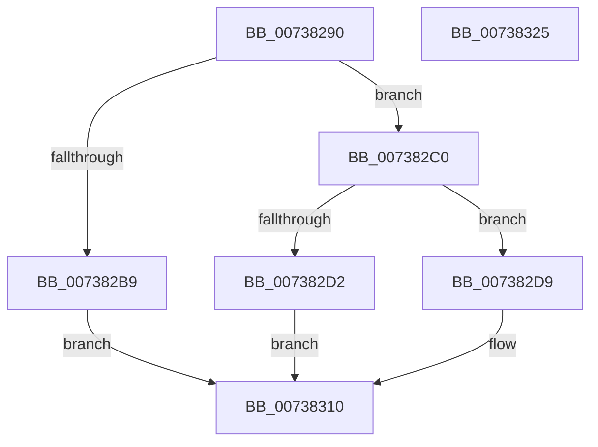

# PnpSetHwProfileChangeEvent

- RVA: `0x00738290`–`0x00738326` (길이 `150` bytes)
- VA: `0x0000000140738290`
- 실행 섹션: `PAGE`
- PDB 이름 있음: `예`; PDB Function 태그: `아니요`
- unwind 정보 RVA: `0x0005C954`
- 디코드: `37`개 명령, `150/150` bytes 표시
- 미해석 바이트: `0` (있으면 어셈블리에 `.byte`로 보존)

> 이 문서는 커널 이미지의 기계어와 PDB 기호를 분석해 생성했습니다. 4번과 5번은 함수 원형과 자료형을 바이너리 사용 방식에서 추정한 C 해석이며 원본 소스 복구 결과는 아닙니다.

## 1. Dependencies

- 직접 호출 지점: **2**; 고유 호출 대상: **2**
- 직접 호출자로 확인된 함수: **1**
- RIP 상대 이미지 참조: **1**

### Outgoing calls
- `0x007382C5` → [PnpCreateDeviceEventEntry](../95/PnpCreateDeviceEventEntry_function_00951B48.md) (function, `0x00951B48`)
- `0x0073830B` → [PnpInsertEventInQueue](../95/PnpInsertEventInQueue_function_00951B78.md) (function, `0x00951B78`)

### Direct callers
- [PnpRequestHwProfileChangeNotification](../72/PnpRequestHwProfileChangeNotification_function_00729E78.md) at `0x00729F38`
- [PnpRequestHwProfileChangeNotification](../72/PnpRequestHwProfileChangeNotification_function_00729E78.md) at `0x00729F68`

### Static image references
- `0x007382A4` → RVA `0x00F8C5E4` (`.data`; read)

## 2. Other-region calls and transfers

- 다른 실행 섹션으로 향하는 call: **0**
- 별도 외부 분기/꼬리 이동을 확인하지 못했습니다.

## 3. Assembly (complete function range)

```asm
00738290  48 89 5C 24 08                  mov qword ptr [rsp + 8], rbx
00738295  48 89 6C 24 10                  mov qword ptr [rsp + 0x10], rbp
0073829A  48 89 74 24 18                  mov qword ptr [rsp + 0x18], rsi
0073829F  57                              push rdi
007382A0  48 83 EC 20                     sub rsp, 0x20
007382A4  83 3D 39 43 85 00 00            cmp dword ptr [rip + 0x854339], 0
007382AB  49 8B D9                        mov rbx, r9
007382AE  49 8B F8                        mov rdi, r8
007382B1  48 8B F2                        mov rsi, rdx
007382B4  48 8B E9                        mov rbp, rcx
007382B7  74 07                           je 0x1407382c0
007382B9  B8 89 01 00 C0                  mov eax, 0xc0000189
007382BE  EB 50                           jmp 0x140738310
007382C0  B9 C8 00 00 00                  mov ecx, 0xc8
007382C5  E8 7E 98 21 00                  call 0x140951b48
007382CA  48 8B C8                        mov rcx, rax
007382CD  48 85 C0                        test rax, rax
007382D0  75 07                           jne 0x1407382d9
007382D2  B8 9A 00 00 C0                  mov eax, 0xc000009a
007382D7  EB 37                           jmp 0x140738310
007382D9  83 A1 88 00 00 00 00            and dword ptr [rcx + 0x88], 0
007382E0  48 89 70 18                     mov qword ptr [rax + 0x18], rsi
007382E4  48 89 58 30                     mov qword ptr [rax + 0x30], rbx
007382E8  48 8B 44 24 50                  mov rax, qword ptr [rsp + 0x50]
007382ED  48 89 41 38                     mov qword ptr [rcx + 0x38], rax
007382F1  0F 10 45 00                     movups xmm0, xmmword ptr [rbp]
007382F5  C7 81 9C 00 00 00 50 00 00 00   mov dword ptr [rcx + 0x9c], 0x50
007382FF  48 89 B9 90 00 00 00            mov qword ptr [rcx + 0x90], rdi
00738306  F3 0F 7F 41 78                  movdqu xmmword ptr [rcx + 0x78], xmm0
0073830B  E8 68 98 21 00                  call 0x140951b78
00738310  48 8B 5C 24 30                  mov rbx, qword ptr [rsp + 0x30]
00738315  48 8B 6C 24 38                  mov rbp, qword ptr [rsp + 0x38]
0073831A  48 8B 74 24 40                  mov rsi, qword ptr [rsp + 0x40]
0073831F  48 83 C4 20                     add rsp, 0x20
00738323  5F                              pop rdi
00738324  C3                              ret
00738325  CC                              int3
```

## 4. C-style interpretation (structured pseudocode)

```c
__int64 __fastcall PnpSetHwProfileChangeEvent(__int64 a1, __int64 a2, __int64 a3, __int64 a4, __int64 a5)
{
    __int64 result;
    __int64 v_rsp;
    unsigned __int64 v_stack_p10;
    unsigned __int64 v_stack_p18;
    unsigned __int64 v_stack_p8;

    v_stack_p8 = v_rbx;
    v_stack_p10 = v_rbp;
    v_stack_p18 = v_rsi;
    v_rsp = (v_rsp) - (32);
    if ((*(unsigned int *)(v_rip + 8733497)) == 0) goto loc_007382C0;
    goto loc_00738310;
loc_007382C0:
    result = PnpCreateDeviceEventEntry(200, a2, a3, a4);
    if (result != 0) goto loc_007382D9;
    goto loc_00738310;
loc_007382D9:
    *(unsigned __int64 *)((unsigned int)(0xC000009AULL) + 24) = a2;
    *(unsigned __int64 *)((unsigned int)(0xC000009AULL) + 48) = a4;
    *(unsigned __int64 *)(result + 56) = a5;
    *(unsigned int *)(result + 156) = 80;
    *(unsigned __int64 *)(result + 144) = a3;
    *(unsigned __int64 *)(result + 120) = v_xmm0;
    result = PnpInsertEventInQueue(result, a2, a3, a4);
loc_00738310:
    v_rsp = (v_rsp) + (32);
    return result;
}
```

## 5. (Beta) C Style

```c
int64_t PnpSetHwProfileChangeEvent(void *Arg1, int64_t Arg2, int64_t Arg3, int64_t Arg4, int64_t Arg5)
{
    uint8_t *arg1 = (uint8_t *)Arg1;

    int64_t result;
    int64_t local_rsp;
    uint64_t v_stack_p10;
    uint64_t v_stack_p18;
    uint64_t v_stack_p8;

    v_stack_p8 = local_rbx;
    v_stack_p10 = local_rbp;
    v_stack_p18 = local_rsi;
    local_rsp = (local_rsp) - (32);
    if ((*(uint32_t *)(v_rip + 0x854339)) == 0) goto loc_007382C0;
    goto loc_00738310;
loc_007382C0:
    result = PnpCreateDeviceEventEntry(200, Arg2, Arg3, Arg4);
    if (result != 0) goto loc_007382D9;
    goto loc_00738310;
loc_007382D9:
    *(uint64_t *)((uint32_t)(0xC000009AULL) + 0x18) = Arg2;
    *(uint64_t *)((uint32_t)(0xC000009AULL) + 0x30) = Arg4;
    *(uint64_t *)(result + 0x38) = Arg5;
    *(uint32_t *)(result + 0x9C) = 80;
    *(uint64_t *)(result + 0x90) = Arg3;
    *(uint64_t *)(result + 0x78) = v_xmm0;
    result = PnpInsertEventInQueue(result, Arg2, Arg3, Arg4);
loc_00738310:
    local_rsp = (local_rsp) + (32);
    return result;
}
```

### 관측된 메모리 오프셋

구조체 형식이 확인되지 않은 접근은 인자 기준의 오프셋으로만 기록했습니다.

| 기준 인자 | 오프셋 표현 | 폭 (bit) | 접근 |
|---|---:|---:|---|
| `Arg1` | `+ 0x0` | `128` | `R` |

## 6. Execution-region graph

[열기: 2D/3D 그래프와 함수 탐색 컨트롤 패널](../../../control-panel.html?section=page&rva=0x00738290&view=graph)

- 2D 그래프는 위에서 아래로 흐르고, 3D 그래프는 빈 공간을 드래그해 회전합니다. Shift+드래그는 이동, 휠은 확대·축소, 함수 노드 선택은 대상 보고서 이동입니다.

### Static fallback


