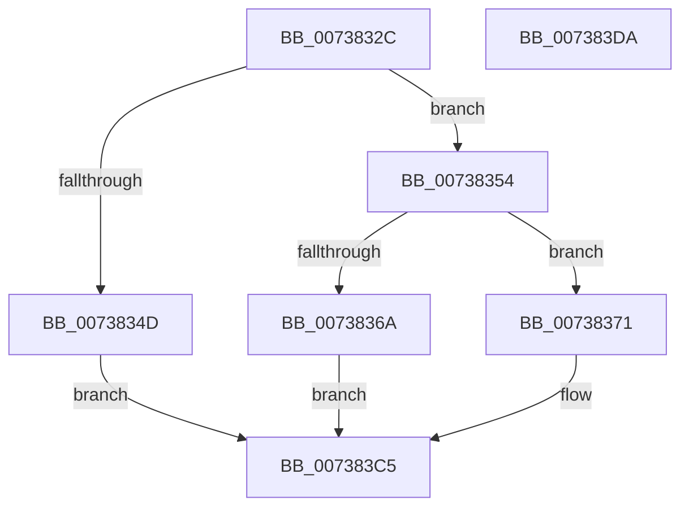

# PnpSetInvalidIDEvent

- RVA: `0x0073832C`–`0x007383DB` (길이 `175` bytes)
- VA: `0x000000014073832C`
- 실행 섹션: `PAGE`
- PDB 이름 있음: `예`; PDB Function 태그: `아니요`
- unwind 정보 RVA: `0x0005C954`
- 디코드: `43`개 명령, `175/175` bytes 표시
- 미해석 바이트: `0` (있으면 어셈블리에 `.byte`로 보존)

> 이 문서는 커널 이미지의 기계어와 PDB 기호를 분석해 생성했습니다. 4번과 5번은 함수 원형과 자료형을 바이너리 사용 방식에서 추정한 C 해석이며 원본 소스 복구 결과는 아닙니다.

## 1. Dependencies

- 직접 호출 지점: **3**; 고유 호출 대상: **3**
- 직접 호출자로 확인된 함수: **3**
- RIP 상대 이미지 참조: **2**

### Outgoing calls
- `0x0073835D` → [PnpCreateDeviceEventEntry](../95/PnpCreateDeviceEventEntry_function_00951B48.md) (function, `0x00951B48`)
- `0x0073839C` → [memcpy](../../text/6C/memcpy_function_006C6840.md) (function, `0x006C6840`)
- `0x007383C0` → [PnpInsertEventInQueue](../95/PnpInsertEventInQueue_function_00951B78.md) (function, `0x00951B78`)

### Direct callers
- [PnpQueryID](../8F/PnpQueryID_function_008FB984.md) at `0x008FBAA0`
- [PiProcessNewDeviceNode](../A2/PiProcessNewDeviceNode_function_00A28F20.md) at `0x00A29188`
- [PiProcessNewDeviceNode](../A2/PiProcessNewDeviceNode_function_00A28F20.md) at `0x00A29227`
- [PiProcessNewDeviceNode](../A2/PiProcessNewDeviceNode_function_00A28F20.md) at `0x00A29BDD`
- [PiProcessNewDeviceNode](../A2/PiProcessNewDeviceNode_function_00A28F20.md) at `0x00A29C8B`
- [PnpQueryDeviceID](../A2/PnpQueryDeviceID_function_00A2B21C.md) at `0x00A2B30D`

### Static image references
- `0x00738345` → RVA `0x00F8C5E4` (`.data`; read)
- `0x00738371` → RVA `0x00026B60` (`.rdata`; read)

## 2. Other-region calls and transfers

- 다른 실행 섹션으로 향하는 call: **1**
  - `0x0073839C` → [memcpy](../../text/6C/memcpy_function_006C6840.md) (`PAGE` → `.text`)
- 별도 외부 분기/꼬리 이동을 확인하지 못했습니다.

## 3. Assembly (complete function range)

```asm
0073832C  48 89 5C 24 08                  mov qword ptr [rsp + 8], rbx
00738331  48 89 6C 24 10                  mov qword ptr [rsp + 0x10], rbp
00738336  48 89 74 24 18                  mov qword ptr [rsp + 0x18], rsi
0073833B  57                              push rdi
0073833C  48 83 EC 20                     sub rsp, 0x20
00738340  33 ED                           xor ebp, ebp
00738342  48 8B F1                        mov rsi, rcx
00738345  39 2D 99 42 85 00               cmp dword ptr [rip + 0x854299], ebp
0073834B  74 07                           je 0x140738354
0073834D  B8 89 01 00 C0                  mov eax, 0xc0000189
00738352  EB 71                           jmp 0x1407383c5
00738354  0F B7 19                        movzx ebx, word ptr [rcx]
00738357  83 C3 52                        add ebx, 0x52
0073835A  8D 4B 78                        lea ecx, [rbx + 0x78]
0073835D  E8 E6 97 21 00                  call 0x140951b48
00738362  48 8B F8                        mov rdi, rax
00738365  48 85 C0                        test rax, rax
00738368  75 07                           jne 0x140738371
0073836A  B8 9A 00 00 C0                  mov eax, 0xc000009a
0073836F  EB 54                           jmp 0x1407383c5
00738371  0F 10 05 E8 E7 8E FF            movups xmm0, xmmword ptr [rip - 0x711818]
00738378  C7 80 88 00 00 00 08 00 00 00   mov dword ptr [rax + 0x88], 8
00738382  48 8D 88 A8 00 00 00            lea rcx, [rax + 0xa8]
00738389  89 98 9C 00 00 00               mov dword ptr [rax + 0x9c], ebx
0073838F  F3 0F 7F 40 78                  movdqu xmmword ptr [rax + 0x78], xmm0
00738394  44 0F B7 06                     movzx r8d, word ptr [rsi]
00738398  48 8B 56 08                     mov rdx, qword ptr [rsi + 8]
0073839C  E8 9F E4 F8 FF                  call 0x1406c6840
007383A1  0F B7 06                        movzx eax, word ptr [rsi]
007383A4  48 8B CF                        mov rcx, rdi
007383A7  48 D1 E8                        shr rax, 1
007383AA  66 89 AC 47 A8 00 00 00         mov word ptr [rdi + rax*2 + 0xa8], bp
007383B2  0F B7 06                        movzx eax, word ptr [rsi]
007383B5  48 D1 E8                        shr rax, 1
007383B8  66 89 AC 47 AA 00 00 00         mov word ptr [rdi + rax*2 + 0xaa], bp
007383C0  E8 B3 97 21 00                  call 0x140951b78
007383C5  48 8B 5C 24 30                  mov rbx, qword ptr [rsp + 0x30]
007383CA  48 8B 6C 24 38                  mov rbp, qword ptr [rsp + 0x38]
007383CF  48 8B 74 24 40                  mov rsi, qword ptr [rsp + 0x40]
007383D4  48 83 C4 20                     add rsp, 0x20
007383D8  5F                              pop rdi
007383D9  C3                              ret
007383DA  CC                              int3
```

## 4. C-style interpretation (structured pseudocode)

```c
__int64 __fastcall PnpSetInvalidIDEvent(__int64 a1)
{
    __int64 result;
    __int64 v_rbp;
    __int64 v_rbx;
    __int64 v_rsp;
    unsigned __int64 v_stack_p10;
    unsigned __int64 v_stack_p18;
    unsigned __int64 v_stack_p8;

    v_stack_p8 = v_rbx;
    v_stack_p10 = v_rbp;
    v_stack_p18 = v_rsi;
    v_rsp = (v_rsp) - (32);
    v_rbp = 0;
    if ((*(unsigned int *)(v_rip + 8733337)) == 0) goto loc_00738354;
    goto loc_007383C5;
loc_00738354:
    v_rbx = (unsigned int)((*(unsigned __int16 *)(a1)) + (82));
    result = PnpCreateDeviceEventEntry(v_rbx + 120, a2, a3, a4);
    if (result != 0) goto loc_00738371;
    goto loc_007383C5;
loc_00738371:
    *(unsigned int *)((unsigned int)(0xC000009AULL) + 136) = 8;
    *(unsigned int *)((unsigned int)(0xC000009AULL) + 156) = (unsigned int)(v_rbx);
    *(unsigned __int64 *)((unsigned int)(0xC000009AULL) + 120) = v_xmm0;
    result = memcpy((unsigned int)(0xC000009AULL) + 168, *(unsigned __int64 *)(a1 + 8), *(unsigned __int16 *)(a1), a4);
    result = (*(unsigned __int16 *)(a1)) >> (1);
    *(unsigned __int16 *)(result + result * 2 + 168) = 0;
    result = (*(unsigned __int16 *)(a1)) >> (1);
    *(unsigned __int16 *)(result + result * 2 + 170) = 0;
    result = PnpInsertEventInQueue(result, *(unsigned __int64 *)(a1 + 8), *(unsigned __int16 *)(a1), a4);
loc_007383C5:
    v_rsp = (v_rsp) + (32);
    return result;
}
```

## 5. (Beta) C Style

```c
int64_t PnpSetInvalidIDEvent(void *Arg1)
{
    uint8_t *arg1 = (uint8_t *)Arg1;

    int64_t result;
    int64_t local_rbp;
    int64_t local_rbx;
    int64_t local_rsp;
    uint64_t v_stack_p10;
    uint64_t v_stack_p18;
    uint64_t v_stack_p8;

    v_stack_p8 = local_rbx;
    v_stack_p10 = local_rbp;
    v_stack_p18 = local_rsi;
    local_rsp = (local_rsp) - (32);
    local_rbp = 0;
    if ((*(uint32_t *)(v_rip + 0x854299)) == 0) goto loc_00738354;
    goto loc_007383C5;
loc_00738354:
    local_rbx = (uint32_t)((*(uint16_t *)(arg1)) + (82));
    result = PnpCreateDeviceEventEntry(local_rbx + 120, a2, a3, a4);
    if (result != 0) goto loc_00738371;
    goto loc_007383C5;
loc_00738371:
    *(uint32_t *)((uint32_t)(0xC000009AULL) + 0x88) = 8;
    *(uint32_t *)((uint32_t)(0xC000009AULL) + 0x9C) = (uint32_t)(local_rbx);
    *(uint64_t *)((uint32_t)(0xC000009AULL) + 0x78) = v_xmm0;
    result = memcpy((uint32_t)(0xC000009AULL) + 168, *(uint64_t *)(arg1 + 0x8), *(uint16_t *)(arg1), a4);
    result = (*(uint16_t *)(arg1)) >> (1);
    *(uint16_t *)(result + result * 2 + 0xA8) = 0;
    result = (*(uint16_t *)(arg1)) >> (1);
    *(uint16_t *)(result + result * 2 + 0xAA) = 0;
    result = PnpInsertEventInQueue(result, *(uint64_t *)(arg1 + 0x8), *(uint16_t *)(arg1), a4);
loc_007383C5:
    local_rsp = (local_rsp) + (32);
    return result;
}
```

### 관측된 메모리 오프셋

구조체 형식이 확인되지 않은 접근은 인자 기준의 오프셋으로만 기록했습니다.

| 기준 인자 | 오프셋 표현 | 폭 (bit) | 접근 |
|---|---:|---:|---|
| `Arg1` | `+ 0x0` | `16` | `R` |
| `Arg1` | `+ 0x8` | `64` | `R` |

## 6. Execution-region graph

[열기: 2D/3D 그래프와 함수 탐색 컨트롤 패널](../../../control-panel.html?section=page&rva=0x0073832C&view=graph)

- 2D 그래프는 위에서 아래로 흐르고, 3D 그래프는 빈 공간을 드래그해 회전합니다. Shift+드래그는 이동, 휠은 확대·축소, 함수 노드 선택은 대상 보고서 이동입니다.

### Static fallback


