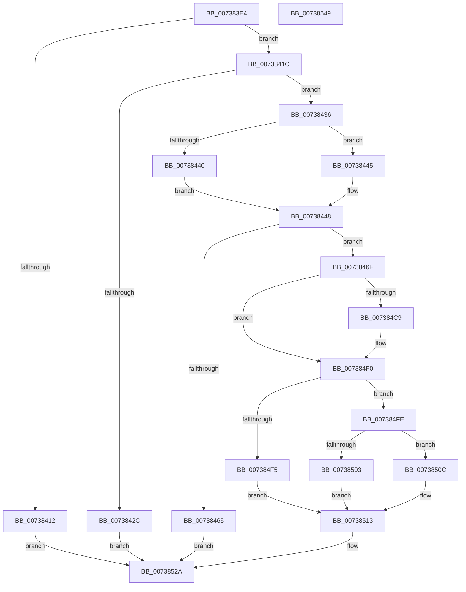

# PnpSetPowerVetoEvent

- RVA: `0x007383E4`–`0x0073854A` (길이 `358` bytes)
- VA: `0x00000001407383E4`
- 실행 섹션: `PAGE`
- PDB 이름 있음: `예`; PDB Function 태그: `아니요`
- unwind 정보 RVA: `0x0005FEF8`
- 디코드: `87`개 명령, `358/358` bytes 표시
- 미해석 바이트: `0` (있으면 어셈블리에 `.byte`로 보존)

> 이 문서는 커널 이미지의 기계어와 PDB 기호를 분석해 생성했습니다. 4번과 5번은 함수 원형과 자료형을 바이너리 사용 방식에서 추정한 C 해석이며 원본 소스 복구 결과는 아닙니다.

## 1. Dependencies

- 직접 호출 지점: **5**; 고유 호출 대상: **4**
- 직접 호출자로 확인된 함수: **2**
- RIP 상대 이미지 참조: **4**

### Outgoing calls
- `0x00738458` → [PnpCreateDeviceEventEntry](../95/PnpCreateDeviceEventEntry_function_00951B48.md) (function, `0x00951B48`)
- `0x00738477` → [ObfReferenceObjectWithTag](../../text/21/ObfReferenceObjectWithTag_function_00210710.md) (function, `0x00210710`)
- `0x007384AF` → [memcpy](../../text/6C/memcpy_function_006C6840.md) (function, `0x006C6840`)
- `0x007384DC` → [memcpy](../../text/6C/memcpy_function_006C6840.md) (function, `0x006C6840`)
- `0x00738525` → [PnpInsertEventInQueue](../95/PnpInsertEventInQueue_function_00951B78.md) (function, `0x00951B78`)

### Direct callers
- [IoNotifyPowerOperationVetoed](../72/IoNotifyPowerOperationVetoed_function_00729A38.md) at `0x00729A8C`
- [IopWarmEjectDevice](../74/IopWarmEjectDevice_function_007405EC.md) at `0x00740661`

### Static image references
- `0x00738407` → RVA `0x00F8C5E4` (`.data`; read)
- `0x007384F5` → RVA `0x00026B30` (`.rdata`; read)
- `0x00738503` → RVA `0x00026B50` (`.rdata`; read)
- `0x0073850C` → RVA `0x00026B40` (`.rdata`; read)

## 2. Other-region calls and transfers

- 다른 실행 섹션으로 향하는 call: **3**
  - `0x00738477` → [ObfReferenceObjectWithTag](../../text/21/ObfReferenceObjectWithTag_function_00210710.md) (`PAGE` → `.text`)
  - `0x007384AF` → [memcpy](../../text/6C/memcpy_function_006C6840.md) (`PAGE` → `.text`)
  - `0x007384DC` → [memcpy](../../text/6C/memcpy_function_006C6840.md) (`PAGE` → `.text`)
- 별도 외부 분기/꼬리 이동을 확인하지 못했습니다.

## 3. Assembly (complete function range)

```asm
007383E4  48 8B C4                        mov rax, rsp
007383E7  48 89 58 08                     mov qword ptr [rax + 8], rbx
007383EB  48 89 68 10                     mov qword ptr [rax + 0x10], rbp
007383EF  48 89 70 18                     mov qword ptr [rax + 0x18], rsi
007383F3  48 89 78 20                     mov qword ptr [rax + 0x20], rdi
007383F7  41 54                           push r12
007383F9  41 56                           push r14
007383FB  41 57                           push r15
007383FD  48 83 EC 20                     sub rsp, 0x20
00738401  45 33 E4                        xor r12d, r12d
00738404  4D 8B F1                        mov r14, r9
00738407  44 39 25 D6 41 85 00            cmp dword ptr [rip + 0x8541d6], r12d
0073840E  8B E9                           mov ebp, ecx
00738410  74 0A                           je 0x14073841c
00738412  B8 89 01 00 C0                  mov eax, 0xc0000189
00738417  E9 0E 01 00 00                  jmp 0x14073852a
0073841C  49 8B 81 38 01 00 00            mov rax, qword ptr [r9 + 0x138]
00738423  48 8B 58 28                     mov rbx, qword ptr [rax + 0x28]
00738427  48 85 DB                        test rbx, rbx
0073842A  75 0A                           jne 0x140738436
0073842C  B8 F0 00 00 C0                  mov eax, 0xc00000f0
00738431  E9 F4 00 00 00                  jmp 0x14073852a
00738436  48 8B 74 24 68                  mov rsi, qword ptr [rsp + 0x68]
0073843B  48 85 F6                        test rsi, rsi
0073843E  74 05                           je 0x140738445
00738440  0F B7 0E                        movzx ecx, word ptr [rsi]
00738443  EB 03                           jmp 0x140738448
00738445  41 8B CC                        mov ecx, r12d
00738448  44 0F B7 7B 28                  movzx r15d, word ptr [rbx + 0x28]
0073844D  41 83 C7 54                     add r15d, 0x54
00738451  44 03 F9                        add r15d, ecx
00738454  41 8D 4F 78                     lea ecx, [r15 + 0x78]
00738458  E8 EB 96 21 00                  call 0x140951b48
0073845D  48 8B F8                        mov rdi, rax
00738460  48 85 C0                        test rax, rax
00738463  75 0A                           jne 0x14073846f
00738465  B8 9A 00 00 C0                  mov eax, 0xc000009a
0073846A  E9 BB 00 00 00                  jmp 0x14073852a
0073846F  BA 50 6E 70 56                  mov edx, 0x56706e50
00738474  49 8B CE                        mov rcx, r14
00738477  E8 94 82 AD FF                  call 0x140210710
0073847C  8B 44 24 60                     mov eax, dword ptr [rsp + 0x60]
00738480  48 8D 8F AC 00 00 00            lea rcx, [rdi + 0xac]
00738487  89 87 A8 00 00 00               mov dword ptr [rdi + 0xa8], eax
0073848D  4C 89 67 18                     mov qword ptr [rdi + 0x18], r12
00738491  44 89 BF 9C 00 00 00            mov dword ptr [rdi + 0x9c], r15d
00738498  4C 89 B7 A0 00 00 00            mov qword ptr [rdi + 0xa0], r14
0073849F  4C 89 A7 90 00 00 00            mov qword ptr [rdi + 0x90], r12
007384A6  44 0F B7 43 28                  movzx r8d, word ptr [rbx + 0x28]
007384AB  48 8B 53 30                     mov rdx, qword ptr [rbx + 0x30]
007384AF  E8 8C E3 F8 FF                  call 0x1406c6840
007384B4  0F B7 43 28                     movzx eax, word ptr [rbx + 0x28]
007384B8  48 D1 E8                        shr rax, 1
007384BB  66 44 89 A4 47 AC 00 00 00      mov word ptr [rdi + rax*2 + 0xac], r12w
007384C4  48 85 F6                        test rsi, rsi
007384C7  74 27                           je 0x1407384f0
007384C9  44 0F B7 06                     movzx r8d, word ptr [rsi]
007384CD  48 8D 1C 47                     lea rbx, [rdi + rax*2]
007384D1  48 8B 56 08                     mov rdx, qword ptr [rsi + 8]
007384D5  48 8D 8B AE 00 00 00            lea rcx, [rbx + 0xae]
007384DC  E8 5F E3 F8 FF                  call 0x1406c6840
007384E1  0F B7 06                        movzx eax, word ptr [rsi]
007384E4  48 D1 E8                        shr rax, 1
007384E7  66 44 89 A4 43 AE 00 00 00      mov word ptr [rbx + rax*2 + 0xae], r12w
007384F0  83 FD 07                        cmp ebp, 7
007384F3  75 09                           jne 0x1407384fe
007384F5  0F 10 05 34 E6 8E FF            movups xmm0, xmmword ptr [rip - 0x7119cc]
007384FC  EB 15                           jmp 0x140738513
007384FE  83 FD 03                        cmp ebp, 3
00738501  75 09                           jne 0x14073850c
00738503  0F 10 05 46 E6 8E FF            movups xmm0, xmmword ptr [rip - 0x7119ba]
0073850A  EB 07                           jmp 0x140738513
0073850C  0F 10 05 2D E6 8E FF            movups xmm0, xmmword ptr [rip - 0x7119d3]
00738513  48 8B CF                        mov rcx, rdi
00738516  C7 87 88 00 00 00 06 00 00 00   mov dword ptr [rdi + 0x88], 6
00738520  F3 0F 7F 47 78                  movdqu xmmword ptr [rdi + 0x78], xmm0
00738525  E8 4E 96 21 00                  call 0x140951b78
0073852A  48 8B 5C 24 40                  mov rbx, qword ptr [rsp + 0x40]
0073852F  48 8B 6C 24 48                  mov rbp, qword ptr [rsp + 0x48]
00738534  48 8B 74 24 50                  mov rsi, qword ptr [rsp + 0x50]
00738539  48 8B 7C 24 58                  mov rdi, qword ptr [rsp + 0x58]
0073853E  48 83 C4 20                     add rsp, 0x20
00738542  41 5F                           pop r15
00738544  41 5E                           pop r14
00738546  41 5C                           pop r12
00738548  C3                              ret
00738549  CC                              int3
```

## 4. C-style interpretation (structured pseudocode)

```c
__int64 __fastcall PnpSetPowerVetoEvent(int a1, __int64 a2, __int64 a3, __int64 a4, unsigned int a5, __int64 a6)
{
    __int64 result;
    __int64 v_r12;
    __int64 v_r15;
    __int64 v_rbx;
    __int64 v_rsp;
    unsigned __int64 v_stack_p10;
    unsigned __int64 v_stack_p18;
    unsigned __int64 v_stack_p20;
    unsigned __int64 v_stack_p8;

    *(unsigned __int64 *)(v_rsp + 8) = v_rbx;
    *(unsigned __int64 *)(v_rsp + 16) = v_rbp;
    *(unsigned __int64 *)(v_rsp + 24) = v_rsi;
    *(unsigned __int64 *)(v_rsp + 32) = v_rdi;
    v_rsp = (v_rsp) - (32);
    v_r12 = 0;
    if ((*(unsigned int *)(v_rip + 8733142)) == 0) goto loc_0073841C;
    goto loc_0073852A;
loc_0073841C:
    if (*(unsigned __int64 *)(*(unsigned __int64 *)(a4 + 312) + 40) != 0) goto loc_00738436;
    goto loc_0073852A;
loc_00738436:
    if (a6 == 0) goto loc_00738445;
    goto loc_00738448;
loc_00738445:
loc_00738448:
    v_r15 = (unsigned int)((*(unsigned __int16 *)(*(unsigned __int64 *)(*(unsigned __int64 *)(a4 + 312) + 40) + 40)) + (84));
    v_r15 = (unsigned int)((v_r15) + (0));
    result = PnpCreateDeviceEventEntry(v_r15 + 120, a2, a3, a4);
    if (result != 0) goto loc_0073846F;
    goto loc_0073852A;
loc_0073846F:
    result = ObfReferenceObjectWithTag(a4, (unsigned int)(0x56706E50ULL), a3, a4);
    *(unsigned int *)(result + 168) = (unsigned int)((unsigned int)(a5));
    *(unsigned __int64 *)(result + 24) = 0;
    *(unsigned int *)(result + 156) = (unsigned int)(v_r15);
    *(unsigned __int64 *)(result + 160) = a4;
    *(unsigned __int64 *)(result + 144) = 0;
    result = memcpy(result + 172, *(unsigned __int64 *)(*(unsigned __int64 *)(*(unsigned __int64 *)(a4 + 312) + 40) + 48), *(unsigned __int16 *)(*(unsigned __int64 *)(*(unsigned __int64 *)(a4 + 312) + 40) + 40), a4);
    result = (*(unsigned __int16 *)(*(unsigned __int64 *)(*(unsigned __int64 *)(a4 + 312) + 40) + 40)) >> (1);
    *(unsigned __int16 *)(result + result * 2 + 172) = 0;
    v_rbx = *(unsigned __int64 *)(*(unsigned __int64 *)(a4 + 312) + 40);
    if (a6 != 0) {
        a3 = *(unsigned __int16 *)(a6);
        v_rbx = result + result * 2;
        a2 = *(unsigned __int64 *)(a6 + 8);
        a1 = v_rbx + 174;
        result = memcpy(a1, a2, a3, a4);
        result = *(unsigned __int16 *)(a6);
        result = (result) >> (1);
        *(unsigned __int16 *)(v_rbx + result * 2 + 174) = 0;
    }
    if (((unsigned int)((unsigned int)(a1))) != 7) goto loc_007384FE;
    goto loc_00738513;
loc_007384FE:
    if (((unsigned int)((unsigned int)(a1))) != 3) goto loc_0073850C;
    goto loc_00738513;
loc_0073850C:
loc_00738513:
    *(unsigned int *)(result + 136) = 6;
    *(unsigned __int64 *)(result + 120) = v_xmm0;
    result = PnpInsertEventInQueue(result, a2, a3, a4);
loc_0073852A:
    v_rsp = (v_rsp) + (32);
    return result;
}
```

## 5. (Beta) C Style

```c
int64_t PnpSetPowerVetoEvent(int32_t Arg1, int64_t Arg2, int64_t Arg3, void *Arg4, uint32_t Arg5, int64_t Arg6)
{
    uint8_t *arg4 = (uint8_t *)Arg4;

    int64_t result;
    int64_t local_r12;
    int64_t local_r15;
    int64_t local_rbx;
    int64_t local_rsp;
    uint64_t v_stack_p10;
    uint64_t v_stack_p18;
    uint64_t v_stack_p20;
    uint64_t v_stack_p8;

    *(uint64_t *)(local_rsp + 0x8) = local_rbx;
    *(uint64_t *)(local_rsp + 0x10) = local_rbp;
    *(uint64_t *)(local_rsp + 0x18) = local_rsi;
    *(uint64_t *)(local_rsp + 0x20) = local_rdi;
    local_rsp = (local_rsp) - (32);
    local_r12 = 0;
    if ((*(uint32_t *)(v_rip + 0x8541D6)) == 0) goto loc_0073841C;
    goto loc_0073852A;
loc_0073841C:
    if (*(uint64_t *)(*(uint64_t *)(arg4 + 0x138) + 0x28) != 0) goto loc_00738436;
    goto loc_0073852A;
loc_00738436:
    if (Arg6 == 0) goto loc_00738445;
    goto loc_00738448;
loc_00738445:
loc_00738448:
    local_r15 = (uint32_t)((*(uint16_t *)(*(uint64_t *)(*(uint64_t *)(arg4 + 0x138) + 0x28) + 0x28)) + (84));
    local_r15 = (uint32_t)((local_r15) + (0));
    result = PnpCreateDeviceEventEntry(local_r15 + 120, Arg2, Arg3, Arg4);
    if (result != 0) goto loc_0073846F;
    goto loc_0073852A;
loc_0073846F:
    result = ObfReferenceObjectWithTag(Arg4, (uint32_t)(0x56706E50ULL), Arg3, Arg4);
    *(uint32_t *)(result + 0xA8) = (uint32_t)((uint32_t)(Arg5));
    *(uint64_t *)(result + 0x18) = 0;
    *(uint32_t *)(result + 0x9C) = (uint32_t)(local_r15);
    *(void **)(result + 0xA0) = Arg4;
    *(uint64_t *)(result + 0x90) = 0;
    result = memcpy(result + 172, *(uint64_t *)(*(uint64_t *)(*(uint64_t *)(arg4 + 0x138) + 0x28) + 0x30), *(uint16_t *)(*(uint64_t *)(*(uint64_t *)(arg4 + 0x138) + 0x28) + 0x28), Arg4);
    result = (*(uint16_t *)(*(uint64_t *)(*(uint64_t *)(arg4 + 0x138) + 0x28) + 0x28)) >> (1);
    *(uint16_t *)(result + result * 2 + 0xAC) = 0;
    local_rbx = *(uint64_t *)(*(uint64_t *)(arg4 + 0x138) + 0x28);
    if (Arg6 != 0) {
        Arg3 = *(uint16_t *)(Arg6);
        local_rbx = result + result * 2;
        Arg2 = *(uint64_t *)(Arg6 + 0x8);
        Arg1 = local_rbx + 174;
        result = memcpy(Arg1, Arg2, Arg3, Arg4);
        result = *(uint16_t *)(Arg6);
        result = (result) >> (1);
        *(uint16_t *)(local_rbx + result * 2 + 0xAE) = 0;
    }
    if (((uint32_t)((uint32_t)(Arg1))) != 7) goto loc_007384FE;
    goto loc_00738513;
loc_007384FE:
    if (((uint32_t)((uint32_t)(Arg1))) != 3) goto loc_0073850C;
    goto loc_00738513;
loc_0073850C:
loc_00738513:
    *(uint32_t *)(result + 0x88) = 6;
    *(uint64_t *)(result + 0x78) = v_xmm0;
    result = PnpInsertEventInQueue(result, Arg2, Arg3, Arg4);
loc_0073852A:
    local_rsp = (local_rsp) + (32);
    return result;
}
```

### 관측된 메모리 오프셋

구조체 형식이 확인되지 않은 접근은 인자 기준의 오프셋으로만 기록했습니다.

| 기준 인자 | 오프셋 표현 | 폭 (bit) | 접근 |
|---|---:|---:|---|
| `Arg4` | `+ 0x138` | `64` | `R` |

## 6. Execution-region graph

[열기: 2D/3D 그래프와 함수 탐색 컨트롤 패널](../../../control-panel.html?section=page&rva=0x007383E4&view=graph)

- 2D 그래프는 위에서 아래로 흐르고, 3D 그래프는 빈 공간을 드래그해 회전합니다. Shift+드래그는 이동, 휠은 확대·축소, 함수 노드 선택은 대상 보고서 이동입니다.

### Static fallback


