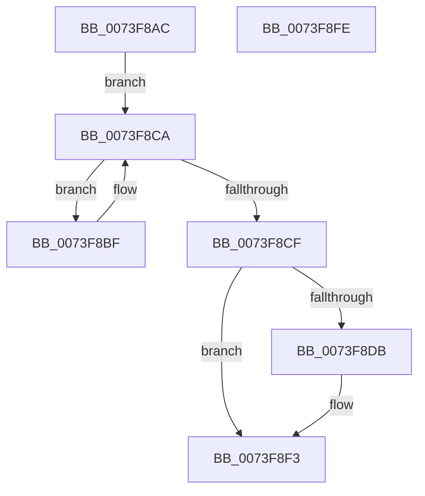

# PnpStopDeviceSubtree

- RVA: `0x0073F8AC`–`0x0073F8FF` (길이 `83` bytes)
- VA: `0x000000014073F8AC`
- 실행 섹션: `PAGE`
- PDB 이름 있음: `예`; PDB Function 태그: `아니요`
- unwind 정보 RVA: `0x0005CAAC`
- 디코드: `24`개 명령, `83/83` bytes 표시
- 미해석 바이트: `0` (있으면 어셈블리에 `.byte`로 보존)

> 이 문서는 커널 이미지의 기계어와 PDB 기호를 분석해 생성했습니다. 4번과 5번은 함수 원형과 자료형을 바이너리 사용 방식에서 추정한 C 해석이며 원본 소스 복구 결과는 아닙니다.

## 1. Dependencies

- 직접 호출 지점: **3**; 고유 호출 대상: **3**
- 직접 호출자로 확인된 함수: **2**
- RIP 상대 이미지 참조: **0**

### Outgoing calls
- `0x0073F8C2` → [PnpStopDeviceSubtree](PnpStopDeviceSubtree_function_0073F8AC.md) (function, `0x0073F8AC`)
- `0x0073F8E1` → [IopQueryReconfiguration](IopQueryReconfiguration_function_0073DFD0.md) (function, `0x0073DFD0`)
- `0x0073F8EE` → [PipSetDevNodeState](../../text/47/PipSetDevNodeState_function_00470708.md) (function, `0x00470708`)

### Direct callers
- [PnpRebalance](PnpRebalance_function_0073F508.md) at `0x0073F7AB`
- [PnpStopDeviceSubtree](PnpStopDeviceSubtree_function_0073F8AC.md) at `0x0073F8C2`

### Static image references
- 디코드된 RIP-relative 메모리 참조가 없습니다.

## 2. Other-region calls and transfers

- 다른 실행 섹션으로 향하는 call: **1**
  - `0x0073F8EE` → [PipSetDevNodeState](../../text/47/PipSetDevNodeState_function_00470708.md) (`PAGE` → `.text`)
- 별도 외부 분기/꼬리 이동을 확인하지 못했습니다.

## 3. Assembly (complete function range)

```asm
0073F8AC  48 89 5C 24 08                  mov qword ptr [rsp + 8], rbx
0073F8B1  57                              push rdi
0073F8B2  48 83 EC 20                     sub rsp, 0x20
0073F8B6  48 8B 59 08                     mov rbx, qword ptr [rcx + 8]
0073F8BA  48 8B F9                        mov rdi, rcx
0073F8BD  EB 0B                           jmp 0x14073f8ca
0073F8BF  48 8B CB                        mov rcx, rbx
0073F8C2  E8 E5 FF FF FF                  call 0x14073f8ac
0073F8C7  48 8B 1B                        mov rbx, qword ptr [rbx]
0073F8CA  48 85 DB                        test rbx, rbx
0073F8CD  75 F0                           jne 0x14073f8bf
0073F8CF  81 BF 2C 01 00 00 0B 03 00 00   cmp dword ptr [rdi + 0x12c], 0x30b
0073F8D9  75 18                           jne 0x14073f8f3
0073F8DB  48 8B 57 20                     mov rdx, qword ptr [rdi + 0x20]
0073F8DF  B1 04                           mov cl, 4
0073F8E1  E8 EA E6 FF FF                  call 0x14073dfd0
0073F8E6  BA 0C 03 00 00                  mov edx, 0x30c
0073F8EB  48 8B CF                        mov rcx, rdi
0073F8EE  E8 15 0E D3 FF                  call 0x140470708
0073F8F3  48 8B 5C 24 30                  mov rbx, qword ptr [rsp + 0x30]
0073F8F8  48 83 C4 20                     add rsp, 0x20
0073F8FC  5F                              pop rdi
0073F8FD  C3                              ret
0073F8FE  CC                              int3
```

## 4. C-style interpretation (structured pseudocode)

```c
__int64 __fastcall PnpStopDeviceSubtree(__int64 a1)
{
    __int64 result;
    __int64 v_rsp;
    unsigned __int64 v_stack_p8;

    v_stack_p8 = v_rbx;
    v_rsp = (v_rsp) - (32);
    goto loc_0073F8CA;
loc_0073F8BF:
    result = PnpStopDeviceSubtree(*(unsigned __int64 *)(a1 + 8), a2, a3, a4);
loc_0073F8CA:
    if (*(unsigned __int64 *)(*(unsigned __int64 *)(a1 + 8)) != 0) goto loc_0073F8BF;
    if ((*(unsigned int *)(a1 + 300)) == 779) {
        a2 = *(unsigned __int64 *)(a1 + 32);
        a1 = 4;
        result = IopQueryReconfiguration(a1, a2, a3, a4);
        a2 = 780;
        a1 = a1;
        result = PipSetDevNodeState(a1, a2, a3, a4);
    }
    v_rsp = (v_rsp) + (32);
    return result;
}
```

## 5. (Beta) C Style

```c
int64_t PnpStopDeviceSubtree(void *Arg1)
{
    uint8_t *arg1 = (uint8_t *)Arg1;

    int64_t result;
    int64_t local_rsp;
    uint64_t v_stack_p8;

    v_stack_p8 = local_rbx;
    local_rsp = (local_rsp) - (32);
    goto loc_0073F8CA;
loc_0073F8BF:
    result = PnpStopDeviceSubtree(*(uint64_t *)(arg1 + 0x8), a2, a3, a4);
loc_0073F8CA:
    if (*(uint64_t *)(*(uint64_t *)(arg1 + 0x8)) != 0) goto loc_0073F8BF;
    if ((*(uint32_t *)(arg1 + 0x12C)) == 779) {
        a2 = *(uint64_t *)(arg1 + 0x20);
        Arg1 = 4;
        result = IopQueryReconfiguration(Arg1, a2, a3, a4);
        a2 = 780;
        Arg1 = Arg1;
        result = PipSetDevNodeState(Arg1, a2, a3, a4);
    }
    local_rsp = (local_rsp) + (32);
    return result;
}
```

### 관측된 메모리 오프셋

구조체 형식이 확인되지 않은 접근은 인자 기준의 오프셋으로만 기록했습니다.

| 기준 인자 | 오프셋 표현 | 폭 (bit) | 접근 |
|---|---:|---:|---|
| `Arg1` | `+ 0x8` | `64` | `R` |
| `Arg1` | `+ 0x20` | `64` | `R` |
| `Arg1` | `+ 0x12C` | `32` | `R` |

## 6. Execution-region graph

[열기: 2D/3D 그래프와 함수 탐색 컨트롤 패널](../../../control-panel.html?section=page&rva=0x0073F8AC&view=graph)

- 2D 그래프는 위에서 아래로 흐르고, 3D 그래프는 빈 공간을 드래그해 회전합니다. Shift+드래그는 이동, 휠은 확대·축소, 함수 노드 선택은 대상 보고서 이동입니다.

### Static fallback


