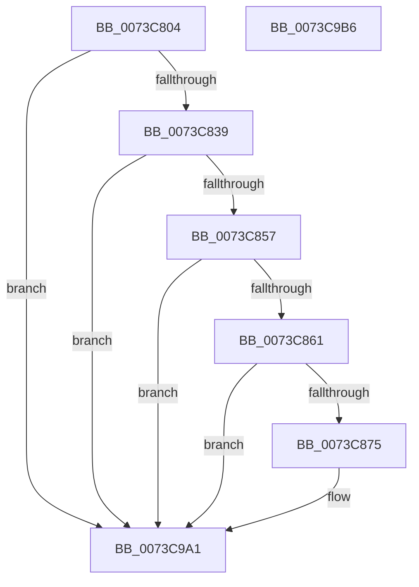

# PnpTraceDeviceRemovalForResetComplete

- RVA: `0x0073C804`–`0x0073C9B7` (길이 `435` bytes)
- VA: `0x000000014073C804`
- 실행 섹션: `PAGE`
- PDB 이름 있음: `예`; PDB Function 태그: `아니요`
- unwind 정보 RVA: `0x000C4240`
- 디코드: `87`개 명령, `435/435` bytes 표시
- 미해석 바이트: `0` (있으면 어셈블리에 `.byte`로 보존)

> 이 문서는 커널 이미지의 기계어와 PDB 기호를 분석해 생성했습니다. 4번과 5번은 함수 원형과 자료형을 바이너리 사용 방식에서 추정한 C 해석이며 원본 소스 복구 결과는 아닙니다.

## 1. Dependencies

- 직접 호출 지점: **4**; 고유 호출 대상: **3**
- 직접 호출자로 확인된 함수: **1**
- RIP 상대 이미지 참조: **5**

### Outgoing calls
- `0x0073C84A` → [tlgKeywordOn](../../text/42/tlgKeywordOn_function_0042EAA0.md) (function, `0x0042EAA0`)
- `0x0073C868` → [tlgKeywordOn](../../text/42/tlgKeywordOn_function_0042EAA0.md) (function, `0x0042EAA0`)
- `0x0073C99C` → [tlgWriteTransfer_EtwWriteTransfer](../../text/42/tlgWriteTransfer_EtwWriteTransfer_function_004260E0.md) (function, `0x004260E0`)
- `0x0073C9A8` → [_security_check_cookie](../../text/6A/_security_check_cookie_function_006AC640.md) (function, `0x006AC640`)

### Direct callers
- [IopLogDeviceResetComplete](../72/IopLogDeviceResetComplete_function_0072A914.md) at `0x0072A94E`

### Static image references
- `0x0073C812` → RVA `0x00E0A740` (`.data`; read)
- `0x0073C820` → RVA `0x00E06F90` (`.data`; read)
- `0x0073C888` → RVA `0x00046FD8` (`.rdata`; read)
- `0x0073C915` → RVA `0x00E06F50` (`.data`; read)
- `0x0073C920` → RVA `0x00E06F48` (`.data`; read)

## 2. Other-region calls and transfers

- 다른 실행 섹션으로 향하는 call: **4**
  - `0x0073C84A` → [tlgKeywordOn](../../text/42/tlgKeywordOn_function_0042EAA0.md) (`PAGE` → `.text`)
  - `0x0073C868` → [tlgKeywordOn](../../text/42/tlgKeywordOn_function_0042EAA0.md) (`PAGE` → `.text`)
  - `0x0073C99C` → [tlgWriteTransfer_EtwWriteTransfer](../../text/42/tlgWriteTransfer_EtwWriteTransfer_function_004260E0.md) (`PAGE` → `.text`)
  - `0x0073C9A8` → [_security_check_cookie](../../text/6A/_security_check_cookie_function_006AC640.md) (`PAGE` → `.text`)
- 별도 외부 분기/꼬리 이동을 확인하지 못했습니다.

## 3. Assembly (complete function range)

```asm
0073C804  40 55                           push rbp
0073C806  48 8D 6C 24 C0                  lea rbp, [rsp - 0x40]
0073C80B  48 81 EC 40 01 00 00            sub rsp, 0x140
0073C812  48 8B 05 27 DF 6C 00            mov rax, qword ptr [rip + 0x6cdf27]
0073C819  48 33 C4                        xor rax, rsp
0073C81C  48 89 45 30                     mov qword ptr [rbp + 0x30], rax
0073C820  44 8B 05 69 A7 6C 00            mov r8d, dword ptr [rip + 0x6ca769]
0073C827  45 33 DB                        xor r11d, r11d
0073C82A  44 8B D2                        mov r10d, edx
0073C82D  4C 8B C9                        mov r9, rcx
0073C830  45 85 C0                        test r8d, r8d
0073C833  0F 84 68 01 00 00               je 0x14073c9a1
0073C839  48 BA 00 00 00 00 00 40 00 00   movabs rdx, 0x400000000000
0073C843  48 8D 0D 46 A7 6C 00            lea rcx, [rip + 0x6ca746]
0073C84A  E8 51 22 CF FF                  call 0x14042eaa0
0073C84F  84 C0                           test al, al
0073C851  0F 84 4A 01 00 00               je 0x14073c9a1
0073C857  41 83 F8 05                     cmp r8d, 5
0073C85B  0F 86 40 01 00 00               jbe 0x14073c9a1
0073C861  48 8D 0D 28 A7 6C 00            lea rcx, [rip + 0x6ca728]
0073C868  E8 33 22 CF FF                  call 0x14042eaa0
0073C86D  84 C0                           test al, al
0073C86F  0F 84 2C 01 00 00               je 0x14073c9a1
0073C875  48 8D 44 24 40                  lea rax, [rsp + 0x40]
0073C87A  48 C7 44 24 40 00 00 00 01      mov qword ptr [rsp + 0x40], 0x1000000
0073C883  48 89 44 24 70                  mov qword ptr [rsp + 0x70], rax
0073C888  48 8D 15 49 A7 90 FF            lea rdx, [rip - 0x6f58b7]
0073C88F  48 8D 45 98                     lea rax, [rbp - 0x68]
0073C893  48 C7 44 24 78 08 00 00 00      mov qword ptr [rsp + 0x78], 8
0073C89C  48 89 45 80                     mov qword ptr [rbp - 0x80], rax
0073C8A0  48 8D 0D E9 A6 6C 00            lea rcx, [rip + 0x6ca6e9]
0073C8A7  49 8B 41 30                     mov rax, qword ptr [r9 + 0x30]
0073C8AB  45 33 C0                        xor r8d, r8d
0073C8AE  48 89 45 90                     mov qword ptr [rbp - 0x70], rax
0073C8B2  41 0F B7 41 28                  movzx eax, word ptr [r9 + 0x28]
0073C8B7  89 45 98                        mov dword ptr [rbp - 0x68], eax
0073C8BA  48 8D 45 B8                     lea rax, [rbp - 0x48]
0073C8BE  48 89 45 A0                     mov qword ptr [rbp - 0x60], rax
0073C8C2  49 8B 41 40                     mov rax, qword ptr [r9 + 0x40]
0073C8C6  48 89 45 B0                     mov qword ptr [rbp - 0x50], rax
0073C8CA  41 0F B7 41 38                  movzx eax, word ptr [r9 + 0x38]
0073C8CF  89 45 B8                        mov dword ptr [rbp - 0x48], eax
0073C8D2  41 8B 81 2C 01 00 00            mov eax, dword ptr [r9 + 0x12c]
0073C8D9  45 33 C9                        xor r9d, r9d
0073C8DC  89 44 24 30                     mov dword ptr [rsp + 0x30], eax
0073C8E0  48 8D 44 24 30                  lea rax, [rsp + 0x30]
0073C8E5  48 89 45 C0                     mov qword ptr [rbp - 0x40], rax
0073C8E9  48 8D 44 24 34                  lea rax, [rsp + 0x34]
0073C8EE  48 89 45 D0                     mov qword ptr [rbp - 0x30], rax
0073C8F2  48 8D 44 24 38                  lea rax, [rsp + 0x38]
0073C8F7  48 89 45 E0                     mov qword ptr [rbp - 0x20], rax
0073C8FB  48 8D 44 24 48                  lea rax, [rsp + 0x48]
0073C900  48 89 45 F0                     mov qword ptr [rbp - 0x10], rax
0073C904  48 8D 44 24 3C                  lea rax, [rsp + 0x3c]
0073C909  48 89 45 00                     mov qword ptr [rbp], rax
0073C90D  48 8D 45 28                     lea rax, [rbp + 0x28]
0073C911  48 89 45 10                     mov qword ptr [rbp + 0x10], rax
0073C915  48 8B 05 34 A6 6C 00            mov rax, qword ptr [rip + 0x6ca634]
0073C91C  48 89 45 20                     mov qword ptr [rbp + 0x20], rax
0073C920  0F B7 05 21 A6 6C 00            movzx eax, word ptr [rip + 0x6ca621]
0073C927  89 45 28                        mov dword ptr [rbp + 0x28], eax
0073C92A  48 8D 44 24 50                  lea rax, [rsp + 0x50]
0073C92F  48 89 44 24 28                  mov qword ptr [rsp + 0x28], rax
0073C934  C7 44 24 20 0E 00 00 00         mov dword ptr [rsp + 0x20], 0xe
0073C93C  48 C7 45 88 02 00 00 00         mov qword ptr [rbp - 0x78], 2
0073C944  44 89 5D 9C                     mov dword ptr [rbp - 0x64], r11d
0073C948  48 C7 45 A8 02 00 00 00         mov qword ptr [rbp - 0x58], 2
0073C950  44 89 5D BC                     mov dword ptr [rbp - 0x44], r11d
0073C954  48 C7 45 C8 04 00 00 00         mov qword ptr [rbp - 0x38], 4
0073C95C  44 89 54 24 34                  mov dword ptr [rsp + 0x34], r10d
0073C961  48 C7 45 D8 04 00 00 00         mov qword ptr [rbp - 0x28], 4
0073C969  44 89 5C 24 38                  mov dword ptr [rsp + 0x38], r11d
0073C96E  48 C7 45 E8 04 00 00 00         mov qword ptr [rbp - 0x18], 4
0073C976  4C 89 5C 24 48                  mov qword ptr [rsp + 0x48], r11
0073C97B  48 C7 45 F8 08 00 00 00         mov qword ptr [rbp - 8], 8
0073C983  44 89 5C 24 3C                  mov dword ptr [rsp + 0x3c], r11d
0073C988  48 C7 45 08 04 00 00 00         mov qword ptr [rbp + 8], 4
0073C990  48 C7 45 18 02 00 00 00         mov qword ptr [rbp + 0x18], 2
0073C998  44 89 5D 2C                     mov dword ptr [rbp + 0x2c], r11d
0073C99C  E8 3F 97 CE FF                  call 0x1404260e0
0073C9A1  48 8B 4D 30                     mov rcx, qword ptr [rbp + 0x30]
0073C9A5  48 33 CC                        xor rcx, rsp
0073C9A8  E8 93 FC F6 FF                  call 0x1406ac640
0073C9AD  48 81 C4 40 01 00 00            add rsp, 0x140
0073C9B4  5D                              pop rbp
0073C9B5  C3                              ret
0073C9B6  CC                              int3
```

## 4. C-style interpretation (structured pseudocode)

```c
__int64 __fastcall PnpTraceDeviceRemovalForResetComplete(__int64 a1, int a2)
{
    __int64 result;
    __int64 v_r11;
    __int64 v_rsp;
    unsigned __int64 v_stack_m100;
    unsigned __int64 v_stack_m108;
    unsigned __int64 v_stack_m10C;
    unsigned __int64 v_stack_m110;
    unsigned __int64 v_stack_m114;
    unsigned int v_stack_m118;
    unsigned __int64 v_stack_m120;
    unsigned int v_stack_m128;
    unsigned __int64 v_stack_m18;
    unsigned int v_stack_m1C;
    unsigned __int64 v_stack_m20;
    unsigned __int64 v_stack_m28;
    unsigned __int64 v_stack_m30;
    unsigned __int64 v_stack_m38;
    unsigned __int64 v_stack_m40;
    unsigned __int64 v_stack_m48;
    unsigned __int64 v_stack_m50;
    unsigned __int64 v_stack_m58;
    unsigned __int64 v_stack_m60;
    unsigned __int64 v_stack_m68;
    unsigned __int64 v_stack_m70;
    unsigned __int64 v_stack_m78;
    unsigned __int64 v_stack_m80;
    unsigned __int64 v_stack_m88;
    unsigned int v_stack_m8C;
    unsigned __int64 v_stack_m90;
    unsigned __int64 v_stack_m98;
    unsigned __int64 v_stack_mA0;
    unsigned __int64 v_stack_mA8;
    unsigned int v_stack_mAC;
    unsigned __int64 v_stack_mB0;
    unsigned __int64 v_stack_mB8;
    unsigned __int64 v_stack_mC0;
    unsigned __int64 v_stack_mC8;
    unsigned __int64 v_stack_mD0;
    unsigned __int64 v_stack_mD8;
    unsigned __int64 v_stack_mF8;

    v_rsp = (v_rsp) - (320);
    result = (*(unsigned __int64 *)(v_rip + 7135015)) ^ (v_rsp);
    v_stack_m18 = result;
    v_r11 = 0;
    if ((unsigned int)((unsigned int)(*(unsigned int *)(v_rip + 7120745))) == 0) goto loc_0073C9A1;
    result = tlgKeywordOn(v_rip + 7120710, a2, (unsigned int)(*(unsigned int *)(v_rip + 7120745)), a1);
    if ((unsigned __int8)(result) == 0) goto loc_0073C9A1;
    if (((unsigned int)((unsigned int)(*(unsigned int *)(v_rip + 7120745)))) <= 5) goto loc_0073C9A1;
    result = tlgKeywordOn(v_rip + 7120680, a2, (unsigned int)(*(unsigned int *)(v_rip + 7120745)), a1);
    if ((unsigned __int8)(result) != 0) {
        result = v_stack_m108;
        v_stack_m108 = 0x1000000ULL;
        v_stack_mD8 = result;
        a2 = v_rip - 7297207;
        result = v_stack_mB0;
        v_stack_mD0 = 8;
        v_stack_mC8 = result;
        a1 = v_rip + 7120617;
        result = *(unsigned __int64 *)(a1 + 48);
        a3 = 0;
        v_stack_mB8 = result;
        result = *(unsigned __int16 *)(a1 + 40);
        v_stack_mB0 = (unsigned int)(result);
        result = v_stack_m90;
        v_stack_mA8 = result;
        result = *(unsigned __int64 *)(a1 + 64);
        v_stack_m98 = result;
        result = *(unsigned __int16 *)(a1 + 56);
        v_stack_m90 = (unsigned int)(result);
        result = *(unsigned int *)(a1 + 300);
        a4 = 0;
        v_stack_m118 = (unsigned int)(result);
        result = v_stack_m118;
        v_stack_m88 = result;
        result = v_stack_m114;
        v_stack_m78 = result;
        result = v_stack_m110;
        v_stack_m68 = result;
        result = v_stack_m100;
        v_stack_m58 = result;
        result = v_stack_m10C;
        v_stack_m48 = result;
        result = v_stack_m20;
        v_stack_m38 = result;
        result = *(unsigned __int64 *)(v_rip + 7120436);
        v_stack_m28 = result;
        result = *(unsigned __int16 *)(v_rip + 7120417);
        v_stack_m20 = (unsigned int)(result);
        result = v_stack_mF8;
        v_stack_m120 = result;
        v_stack_m128 = 14;
        v_stack_mC0 = 2;
        v_stack_mAC = 0;
        v_stack_mA0 = 2;
        v_stack_m8C = 0;
        v_stack_m80 = 4;
        v_stack_m114 = (unsigned int)((unsigned int)(a2));
        v_stack_m70 = 4;
        v_stack_m110 = 0;
        v_stack_m60 = 4;
        v_stack_m100 = 0;
        v_stack_m50 = 8;
        v_stack_m10C = 0;
        v_stack_m40 = 4;
        v_stack_m30 = 2;
        v_stack_m1C = 0;
        result = tlgWriteTransfer_EtwWriteTransfer(a1, a2, a3, a4);
    }
    a1 = (v_stack_m18) ^ (v_rsp);
    result = _security_check_cookie(a1, a2, a3, a4);
    v_rsp = (v_rsp) + (320);
    return result;
}
```

## 5. (Beta) C Style

```c
int64_t PnpTraceDeviceRemovalForResetComplete(int64_t Arg1, int32_t Arg2)
{
    int64_t result;
    int64_t local_r11;
    int64_t local_rsp;
    uint64_t v_stack_m100;
    uint64_t v_stack_m108;
    uint64_t v_stack_m10C;
    uint64_t v_stack_m110;
    uint64_t v_stack_m114;
    uint32_t v_stack_m118;
    uint64_t v_stack_m120;
    uint32_t v_stack_m128;
    uint64_t v_stack_m18;
    uint32_t v_stack_m1C;
    uint64_t v_stack_m20;
    uint64_t v_stack_m28;
    uint64_t v_stack_m30;
    uint64_t v_stack_m38;
    uint64_t v_stack_m40;
    uint64_t v_stack_m48;
    uint64_t v_stack_m50;
    uint64_t v_stack_m58;
    uint64_t v_stack_m60;
    uint64_t v_stack_m68;
    uint64_t v_stack_m70;
    uint64_t v_stack_m78;
    uint64_t v_stack_m80;
    uint64_t v_stack_m88;
    uint32_t v_stack_m8C;
    uint64_t v_stack_m90;
    uint64_t v_stack_m98;
    uint64_t v_stack_mA0;
    uint64_t v_stack_mA8;
    uint32_t v_stack_mAC;
    uint64_t v_stack_mB0;
    uint64_t v_stack_mB8;
    uint64_t v_stack_mC0;
    uint64_t v_stack_mC8;
    uint64_t v_stack_mD0;
    uint64_t v_stack_mD8;
    uint64_t v_stack_mF8;

    local_rsp = (local_rsp) - (320);
    result = (*(uint64_t *)(v_rip + 0x6CDF27)) ^ (local_rsp);
    v_stack_m18 = result;
    local_r11 = 0;
    if ((uint32_t)((uint32_t)(*(uint32_t *)(v_rip + 0x6CA769))) == 0) goto loc_0073C9A1;
    result = tlgKeywordOn(v_rip + 7120710, Arg2, (uint32_t)(*(uint32_t *)(v_rip + 0x6CA769)), Arg1);
    if ((uint8_t)(result) == 0) goto loc_0073C9A1;
    if (((uint32_t)((uint32_t)(*(uint32_t *)(v_rip + 0x6CA769)))) <= 5) goto loc_0073C9A1;
    result = tlgKeywordOn(v_rip + 7120680, Arg2, (uint32_t)(*(uint32_t *)(v_rip + 0x6CA769)), Arg1);
    if ((uint8_t)(result) != 0) {
        result = v_stack_m108;
        v_stack_m108 = 0x1000000ULL;
        v_stack_mD8 = result;
        Arg2 = v_rip - 7297207;
        result = v_stack_mB0;
        v_stack_mD0 = 8;
        v_stack_mC8 = result;
        Arg1 = v_rip + 7120617;
        result = *(uint64_t *)(Arg1 + 0x30);
        a3 = 0;
        v_stack_mB8 = result;
        result = *(uint16_t *)(Arg1 + 0x28);
        v_stack_mB0 = (uint32_t)(result);
        result = v_stack_m90;
        v_stack_mA8 = result;
        result = *(uint64_t *)(Arg1 + 0x40);
        v_stack_m98 = result;
        result = *(uint16_t *)(Arg1 + 0x38);
        v_stack_m90 = (uint32_t)(result);
        result = *(uint32_t *)(Arg1 + 0x12C);
        a4 = 0;
        v_stack_m118 = (uint32_t)(result);
        result = v_stack_m118;
        v_stack_m88 = result;
        result = v_stack_m114;
        v_stack_m78 = result;
        result = v_stack_m110;
        v_stack_m68 = result;
        result = v_stack_m100;
        v_stack_m58 = result;
        result = v_stack_m10C;
        v_stack_m48 = result;
        result = v_stack_m20;
        v_stack_m38 = result;
        result = *(uint64_t *)(v_rip + 0x6CA634);
        v_stack_m28 = result;
        result = *(uint16_t *)(v_rip + 0x6CA621);
        v_stack_m20 = (uint32_t)(result);
        result = v_stack_mF8;
        v_stack_m120 = result;
        v_stack_m128 = 14;
        v_stack_mC0 = 2;
        v_stack_mAC = 0;
        v_stack_mA0 = 2;
        v_stack_m8C = 0;
        v_stack_m80 = 4;
        v_stack_m114 = (uint32_t)((uint32_t)(Arg2));
        v_stack_m70 = 4;
        v_stack_m110 = 0;
        v_stack_m60 = 4;
        v_stack_m100 = 0;
        v_stack_m50 = 8;
        v_stack_m10C = 0;
        v_stack_m40 = 4;
        v_stack_m30 = 2;
        v_stack_m1C = 0;
        result = tlgWriteTransfer_EtwWriteTransfer(Arg1, Arg2, a3, a4);
    }
    Arg1 = (v_stack_m18) ^ (local_rsp);
    result = _security_check_cookie(Arg1, Arg2, a3, a4);
    local_rsp = (local_rsp) + (320);
    return result;
}
```

## 6. Execution-region graph

[열기: 2D/3D 그래프와 함수 탐색 컨트롤 패널](../../../control-panel.html?section=page&rva=0x0073C804&view=graph)

- 2D 그래프는 위에서 아래로 흐르고, 3D 그래프는 빈 공간을 드래그해 회전합니다. Shift+드래그는 이동, 휠은 확대·축소, 함수 노드 선택은 대상 보고서 이동입니다.

### Static fallback


