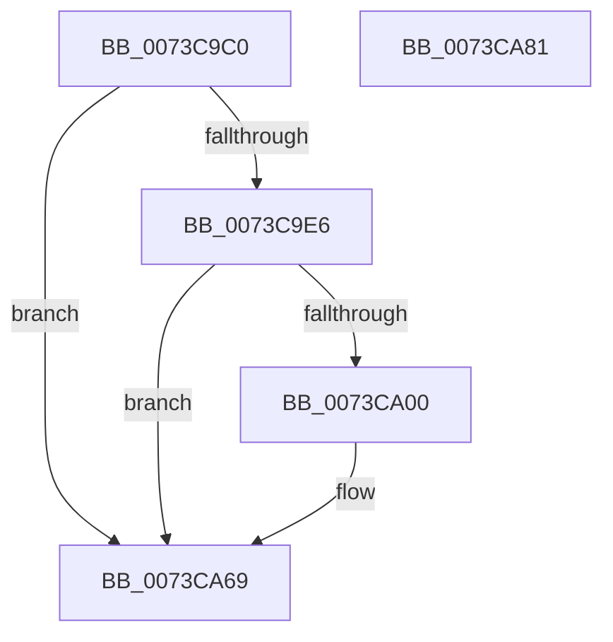

# PnpTraceDmaGuardSystemPolicy

- RVA: `0x0073C9C0`–`0x0073CA82` (길이 `194` bytes)
- VA: `0x000000014073C9C0`
- 실행 섹션: `PAGE`
- PDB 이름 있음: `예`; PDB Function 태그: `아니요`
- unwind 정보 RVA: `0x000B9BCC`
- 디코드: `37`개 명령, `194/194` bytes 표시
- 미해석 바이트: `0` (있으면 어셈블리에 `.byte`로 보존)

> 이 문서는 커널 이미지의 기계어와 PDB 기호를 분석해 생성했습니다. 4번과 5번은 함수 원형과 자료형을 바이너리 사용 방식에서 추정한 C 해석이며 원본 소스 복구 결과는 아닙니다.

## 1. Dependencies

- 직접 호출 지점: **3**; 고유 호출 대상: **3**
- 직접 호출자로 확인된 함수: **1**
- RIP 상대 이미지 참조: **4**

### Outgoing calls
- `0x0073C9F7` → [tlgKeywordOn](../../text/42/tlgKeywordOn_function_0042EAA0.md) (function, `0x0042EAA0`)
- `0x0073CA64` → [tlgWriteTransfer_EtwWriteTransfer](../../text/42/tlgWriteTransfer_EtwWriteTransfer_function_004260E0.md) (function, `0x004260E0`)
- `0x0073CA74` → [_security_check_cookie](../../text/6A/_security_check_cookie_function_006AC640.md) (function, `0x006AC640`)

### Direct callers
- [PipDmgInitPhaseTwo](PipDmgInitPhaseTwo_function_0073C07C.md) at `0x0073C0A3`

### Static image references
- `0x0073C9C7` → RVA `0x00E0A740` (`.data`; read)
- `0x0073C9D9` → RVA `0x00E06F90` (`.data`; read)
- `0x0073CA20` → RVA `0x00F8A9AC` (`.data`; read)
- `0x0073CA4C` → RVA `0x000470E9` (`.rdata`; read)

## 2. Other-region calls and transfers

- 다른 실행 섹션으로 향하는 call: **3**
  - `0x0073C9F7` → [tlgKeywordOn](../../text/42/tlgKeywordOn_function_0042EAA0.md) (`PAGE` → `.text`)
  - `0x0073CA64` → [tlgWriteTransfer_EtwWriteTransfer](../../text/42/tlgWriteTransfer_EtwWriteTransfer_function_004260E0.md) (`PAGE` → `.text`)
  - `0x0073CA74` → [_security_check_cookie](../../text/6A/_security_check_cookie_function_006AC640.md) (`PAGE` → `.text`)
- 별도 외부 분기/꼬리 이동을 확인하지 못했습니다.

## 3. Assembly (complete function range)

```asm
0073C9C0  48 81 EC 98 00 00 00            sub rsp, 0x98
0073C9C7  48 8B 05 72 DD 6C 00            mov rax, qword ptr [rip + 0x6cdd72]
0073C9CE  48 33 C4                        xor rax, rsp
0073C9D1  48 89 84 24 80 00 00 00         mov qword ptr [rsp + 0x80], rax
0073C9D9  83 3D B0 A5 6C 00 05            cmp dword ptr [rip + 0x6ca5b0], 5
0073C9E0  0F 86 83 00 00 00               jbe 0x14073ca69
0073C9E6  48 BA 00 00 00 00 00 40 00 00   movabs rdx, 0x400000000000
0073C9F0  48 8D 0D 99 A5 6C 00            lea rcx, [rip + 0x6ca599]
0073C9F7  E8 A4 20 CF FF                  call 0x14042eaa0
0073C9FC  84 C0                           test al, al
0073C9FE  74 69                           je 0x14073ca69
0073CA00  83 64 24 6C 00                  and dword ptr [rsp + 0x6c], 0
0073CA05  48 8D 44 24 38                  lea rax, [rsp + 0x38]
0073CA0A  83 64 24 7C 00                  and dword ptr [rsp + 0x7c], 0
0073CA0F  48 8D 0D 7A A5 6C 00            lea rcx, [rip + 0x6ca57a]
0073CA16  48 89 44 24 60                  mov qword ptr [rsp + 0x60], rax
0073CA1B  BA 04 00 00 00                  mov edx, 4
0073CA20  8B 05 86 DF 84 00               mov eax, dword ptr [rip + 0x84df86]
0073CA26  45 33 C9                        xor r9d, r9d
0073CA29  89 44 24 30                     mov dword ptr [rsp + 0x30], eax
0073CA2D  45 33 C0                        xor r8d, r8d
0073CA30  48 8D 44 24 30                  lea rax, [rsp + 0x30]
0073CA35  89 54 24 78                     mov dword ptr [rsp + 0x78], edx
0073CA39  48 89 44 24 70                  mov qword ptr [rsp + 0x70], rax
0073CA3E  48 8D 44 24 40                  lea rax, [rsp + 0x40]
0073CA43  48 89 44 24 28                  mov qword ptr [rsp + 0x28], rax
0073CA48  89 54 24 20                     mov dword ptr [rsp + 0x20], edx
0073CA4C  48 8D 15 96 A6 90 FF            lea rdx, [rip - 0x6f596a]
0073CA53  48 C7 44 24 38 00 08 00 00      mov qword ptr [rsp + 0x38], 0x800
0073CA5C  C7 44 24 68 08 00 00 00         mov dword ptr [rsp + 0x68], 8
0073CA64  E8 77 96 CE FF                  call 0x1404260e0
0073CA69  48 8B 8C 24 80 00 00 00         mov rcx, qword ptr [rsp + 0x80]
0073CA71  48 33 CC                        xor rcx, rsp
0073CA74  E8 C7 FB F6 FF                  call 0x1406ac640
0073CA79  48 81 C4 98 00 00 00            add rsp, 0x98
0073CA80  C3                              ret
0073CA81  CC                              int3
```

## 4. C-style interpretation (structured pseudocode)

```c
__int64 __fastcall PnpTraceDmaGuardSystemPolicy(__int64 a1, __int64 a2, int a3, int a4)
{
    __int64 result;
    __int64 v_rsp;
    unsigned __int64 v_stack_m18;
    unsigned int v_stack_m1C;
    unsigned int v_stack_m20;
    unsigned __int64 v_stack_m28;
    unsigned int v_stack_m2C;
    unsigned int v_stack_m30;
    unsigned __int64 v_stack_m38;
    unsigned __int64 v_stack_m58;
    unsigned __int64 v_stack_m60;
    unsigned int v_stack_m68;
    unsigned __int64 v_stack_m70;
    unsigned int v_stack_m78;

    v_rsp = (v_rsp) - (152);
    result = (*(unsigned __int64 *)(v_rip + 7134578)) ^ (v_rsp);
    v_stack_m18 = result;
    if ((*(unsigned int *)(v_rip + 7120304)) <= 5) goto loc_0073CA69;
    result = tlgKeywordOn(v_rip + 7120281, a2, a3, a4);
    if ((unsigned __int8)(result) != 0) {
        result = v_stack_m60;
        a1 = v_rip + 7120250;
        v_stack_m38 = result;
        a2 = 4;
        result = *(unsigned int *)(v_rip + 8707974);
        a4 = 0;
        v_stack_m68 = (unsigned int)(result);
        a3 = 0;
        result = v_stack_m68;
        v_stack_m20 = (unsigned int)(a2);
        v_stack_m28 = result;
        result = v_stack_m58;
        v_stack_m70 = result;
        v_stack_m78 = (unsigned int)(a2);
        a2 = v_rip - 7297386;
        v_stack_m60 = 0x800ULL;
        v_stack_m30 = 8;
        result = tlgWriteTransfer_EtwWriteTransfer(a1, a2, a3, a4);
    }
    a1 = (v_stack_m18) ^ (v_rsp);
    result = _security_check_cookie(a1, a2, a3, a4);
    v_rsp = (v_rsp) + (152);
    return result;
}
```

## 5. (Beta) C Style

```c
int64_t PnpTraceDmaGuardSystemPolicy(int64_t Arg1, int64_t Arg2, int32_t Arg3, int32_t Arg4)
{
    int64_t result;
    int64_t local_rsp;
    uint64_t v_stack_m18;
    uint32_t v_stack_m1C;
    uint32_t v_stack_m20;
    uint64_t v_stack_m28;
    uint32_t v_stack_m2C;
    uint32_t v_stack_m30;
    uint64_t v_stack_m38;
    uint64_t v_stack_m58;
    uint64_t v_stack_m60;
    uint32_t v_stack_m68;
    uint64_t v_stack_m70;
    uint32_t v_stack_m78;

    local_rsp = (local_rsp) - (152);
    result = (*(uint64_t *)(v_rip + 0x6CDD72)) ^ (local_rsp);
    v_stack_m18 = result;
    if ((*(uint32_t *)(v_rip + 0x6CA5B0)) <= 5) goto loc_0073CA69;
    result = tlgKeywordOn(v_rip + 7120281, Arg2, Arg3, Arg4);
    if ((uint8_t)(result) != 0) {
        result = v_stack_m60;
        Arg1 = v_rip + 7120250;
        v_stack_m38 = result;
        Arg2 = 4;
        result = *(uint32_t *)(v_rip + 0x84DF86);
        Arg4 = 0;
        v_stack_m68 = (uint32_t)(result);
        Arg3 = 0;
        result = v_stack_m68;
        v_stack_m20 = (uint32_t)(Arg2);
        v_stack_m28 = result;
        result = v_stack_m58;
        v_stack_m70 = result;
        v_stack_m78 = (uint32_t)(Arg2);
        Arg2 = v_rip - 7297386;
        v_stack_m60 = 0x800ULL;
        v_stack_m30 = 8;
        result = tlgWriteTransfer_EtwWriteTransfer(Arg1, Arg2, Arg3, Arg4);
    }
    Arg1 = (v_stack_m18) ^ (local_rsp);
    result = _security_check_cookie(Arg1, Arg2, Arg3, Arg4);
    local_rsp = (local_rsp) + (152);
    return result;
}
```

## 6. Execution-region graph

[열기: 2D/3D 그래프와 함수 탐색 컨트롤 패널](../../../control-panel.html?section=page&rva=0x0073C9C0&view=graph)

- 2D 그래프는 위에서 아래로 흐르고, 3D 그래프는 빈 공간을 드래그해 회전합니다. Shift+드래그는 이동, 휠은 확대·축소, 함수 노드 선택은 대상 보고서 이동입니다.

### Static fallback


