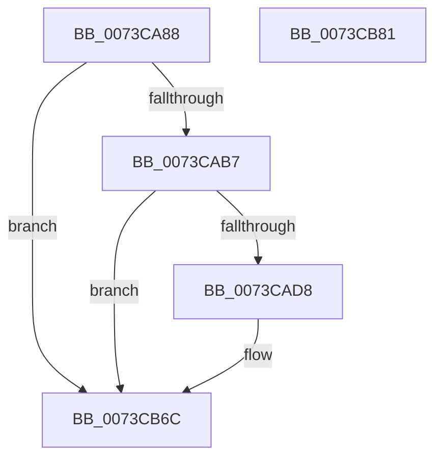

# PnpTraceDockDeviceEnumeration

- RVA: `0x0073CA88`–`0x0073CB82` (길이 `250` bytes)
- VA: `0x000000014073CA88`
- 실행 섹션: `PAGE`
- PDB 이름 있음: `예`; PDB Function 태그: `아니요`
- unwind 정보 RVA: `0x000AC058`
- 디코드: `52`개 명령, `250/250` bytes 표시
- 미해석 바이트: `0` (있으면 어셈블리에 `.byte`로 보존)

> 이 문서는 커널 이미지의 기계어와 PDB 기호를 분석해 생성했습니다. 4번과 5번은 함수 원형과 자료형을 바이너리 사용 방식에서 추정한 C 해석이며 원본 소스 복구 결과는 아닙니다.

## 1. Dependencies

- 직접 호출 지점: **3**; 고유 호출 대상: **3**
- 직접 호출자로 확인된 함수: **1**
- RIP 상대 이미지 참조: **3**

### Outgoing calls
- `0x0073CAC8` → [tlgKeywordOn](../../text/42/tlgKeywordOn_function_0042EAA0.md) (function, `0x0042EAA0`)
- `0x0073CB67` → [tlgWriteTransfer_EtwWriteTransfer](../../text/42/tlgWriteTransfer_EtwWriteTransfer_function_004260E0.md) (function, `0x004260E0`)
- `0x0073CB73` → [_security_check_cookie](../../text/6A/_security_check_cookie_function_006AC640.md) (function, `0x006AC640`)

### Direct callers
- [PiProcessNewDeviceNode](../A2/PiProcessNewDeviceNode_function_00A28F20.md) at `0x00A2A435`

### Static image references
- `0x0073CA96` → RVA `0x00E0A740` (`.data`; read)
- `0x0073CAA4` → RVA `0x00E06F90` (`.data`; read)
- `0x0073CAE4` → RVA `0x0004718A` (`.rdata`; read)

## 2. Other-region calls and transfers

- 다른 실행 섹션으로 향하는 call: **3**
  - `0x0073CAC8` → [tlgKeywordOn](../../text/42/tlgKeywordOn_function_0042EAA0.md) (`PAGE` → `.text`)
  - `0x0073CB67` → [tlgWriteTransfer_EtwWriteTransfer](../../text/42/tlgWriteTransfer_EtwWriteTransfer_function_004260E0.md) (`PAGE` → `.text`)
  - `0x0073CB73` → [_security_check_cookie](../../text/6A/_security_check_cookie_function_006AC640.md) (`PAGE` → `.text`)
- 별도 외부 분기/꼬리 이동을 확인하지 못했습니다.

## 3. Assembly (complete function range)

```asm
0073CA88  40 55                           push rbp
0073CA8A  48 8D 6C 24 A9                  lea rbp, [rsp - 0x57]
0073CA8F  48 81 EC C0 00 00 00            sub rsp, 0xc0
0073CA96  48 8B 05 A3 DC 6C 00            mov rax, qword ptr [rip + 0x6cdca3]
0073CA9D  48 33 C4                        xor rax, rsp
0073CAA0  48 89 45 47                     mov qword ptr [rbp + 0x47], rax
0073CAA4  83 3D E5 A4 6C 00 05            cmp dword ptr [rip + 0x6ca4e5], 5
0073CAAB  44 8B CA                        mov r9d, edx
0073CAAE  4C 8B C1                        mov r8, rcx
0073CAB1  0F 86 B5 00 00 00               jbe 0x14073cb6c
0073CAB7  48 BA 00 00 00 00 00 40 00 00   movabs rdx, 0x400000000000
0073CAC1  48 8D 0D C8 A4 6C 00            lea rcx, [rip + 0x6ca4c8]
0073CAC8  E8 D3 1F CF FF                  call 0x14042eaa0
0073CACD  45 33 D2                        xor r10d, r10d
0073CAD0  84 C0                           test al, al
0073CAD2  0F 84 94 00 00 00               je 0x14073cb6c
0073CAD8  48 8D 45 CF                     lea rax, [rbp - 0x31]
0073CADC  44 89 4D CB                     mov dword ptr [rbp - 0x35], r9d
0073CAE0  48 89 45 F7                     mov qword ptr [rbp - 9], rax
0073CAE4  48 8D 15 9F A6 90 FF            lea rdx, [rip - 0x6f5961]
0073CAEB  48 8D 45 1F                     lea rax, [rbp + 0x1f]
0073CAEF  48 C7 45 CF 00 08 00 00         mov qword ptr [rbp - 0x31], 0x800
0073CAF7  48 89 45 07                     mov qword ptr [rbp + 7], rax
0073CAFB  48 8D 0D 8E A4 6C 00            lea rcx, [rip + 0x6ca48e]
0073CB02  49 8B 40 30                     mov rax, qword ptr [r8 + 0x30]
0073CB06  45 33 C9                        xor r9d, r9d
0073CB09  48 89 45 17                     mov qword ptr [rbp + 0x17], rax
0073CB0D  41 0F B7 40 28                  movzx eax, word ptr [r8 + 0x28]
0073CB12  89 45 1F                        mov dword ptr [rbp + 0x1f], eax
0073CB15  41 8B 80 38 02 00 00            mov eax, dword ptr [r8 + 0x238]
0073CB1C  45 33 C0                        xor r8d, r8d
0073CB1F  89 45 C7                        mov dword ptr [rbp - 0x39], eax
0073CB22  48 8D 45 C7                     lea rax, [rbp - 0x39]
0073CB26  48 89 45 27                     mov qword ptr [rbp + 0x27], rax
0073CB2A  48 8D 45 CB                     lea rax, [rbp - 0x35]
0073CB2E  48 89 45 37                     mov qword ptr [rbp + 0x37], rax
0073CB32  48 8D 45 D7                     lea rax, [rbp - 0x29]
0073CB36  48 89 44 24 28                  mov qword ptr [rsp + 0x28], rax
0073CB3B  C7 44 24 20 07 00 00 00         mov dword ptr [rsp + 0x20], 7
0073CB43  48 C7 45 FF 08 00 00 00         mov qword ptr [rbp - 1], 8
0073CB4B  48 C7 45 0F 02 00 00 00         mov qword ptr [rbp + 0xf], 2
0073CB53  44 89 55 23                     mov dword ptr [rbp + 0x23], r10d
0073CB57  48 C7 45 2F 04 00 00 00         mov qword ptr [rbp + 0x2f], 4
0073CB5F  48 C7 45 3F 04 00 00 00         mov qword ptr [rbp + 0x3f], 4
0073CB67  E8 74 95 CE FF                  call 0x1404260e0
0073CB6C  48 8B 4D 47                     mov rcx, qword ptr [rbp + 0x47]
0073CB70  48 33 CC                        xor rcx, rsp
0073CB73  E8 C8 FA F6 FF                  call 0x1406ac640
0073CB78  48 81 C4 C0 00 00 00            add rsp, 0xc0
0073CB7F  5D                              pop rbp
0073CB80  C3                              ret
0073CB81  CC                              int3
```

## 4. C-style interpretation (structured pseudocode)

```c
__int64 __fastcall PnpTraceDockDeviceEnumeration(__int64 a1, int a2)
{
    __int64 result;
    __int64 v_r10;
    __int64 v_rsp;
    unsigned __int64 v_stack_m18;
    unsigned __int64 v_stack_m20;
    unsigned __int64 v_stack_m28;
    unsigned __int64 v_stack_m30;
    unsigned __int64 v_stack_m38;
    unsigned int v_stack_m3C;
    unsigned __int64 v_stack_m40;
    unsigned __int64 v_stack_m48;
    unsigned __int64 v_stack_m50;
    unsigned __int64 v_stack_m58;
    unsigned __int64 v_stack_m5F;
    unsigned __int64 v_stack_m60;
    unsigned __int64 v_stack_m68;
    unsigned __int64 v_stack_m88;
    unsigned __int64 v_stack_m90;
    unsigned int v_stack_m94;
    unsigned int v_stack_m98;
    unsigned __int64 v_stack_mA0;
    unsigned int v_stack_mA8;

    v_rsp = (v_rsp) - (192);
    result = (*(unsigned __int64 *)(v_rip + 7134371)) ^ (v_rsp);
    v_stack_m18 = result;
    if ((*(unsigned int *)(v_rip + 7120101)) <= 5) goto loc_0073CB6C;
    result = tlgKeywordOn(v_rip + 7120072, a2, a1, (unsigned int)(a2));
    v_r10 = 0;
    if ((unsigned __int8)(result) != 0) {
        result = v_stack_m90;
        v_stack_m94 = (unsigned int)((unsigned int)(a2));
        v_stack_m68 = result;
        a2 = v_rip - 7297377;
        result = v_stack_m40;
        v_stack_m90 = 0x800ULL;
        v_stack_m58 = result;
        a1 = v_rip + 7120014;
        result = *(unsigned __int64 *)(a1 + 48);
        a4 = 0;
        v_stack_m48 = result;
        result = *(unsigned __int16 *)(a1 + 40);
        v_stack_m40 = (unsigned int)(result);
        result = *(unsigned int *)(a1 + 568);
        a3 = 0;
        v_stack_m98 = (unsigned int)(result);
        result = v_stack_m98;
        v_stack_m38 = result;
        result = v_stack_m94;
        v_stack_m28 = result;
        result = v_stack_m88;
        v_stack_mA0 = result;
        v_stack_mA8 = 7;
        v_stack_m60 = 8;
        v_stack_m50 = 2;
        v_stack_m3C = 0;
        v_stack_m30 = 4;
        v_stack_m20 = 4;
        result = tlgWriteTransfer_EtwWriteTransfer(a1, a2, a3, a4);
    }
    a1 = (v_stack_m18) ^ (v_rsp);
    result = _security_check_cookie(a1, a2, a3, a4);
    v_rsp = (v_rsp) + (192);
    return result;
}
```

## 5. (Beta) C Style

```c
int64_t PnpTraceDockDeviceEnumeration(int64_t Arg1, int32_t Arg2)
{
    int64_t result;
    int64_t local_r10;
    int64_t local_rsp;
    uint64_t v_stack_m18;
    uint64_t v_stack_m20;
    uint64_t v_stack_m28;
    uint64_t v_stack_m30;
    uint64_t v_stack_m38;
    uint32_t v_stack_m3C;
    uint64_t v_stack_m40;
    uint64_t v_stack_m48;
    uint64_t v_stack_m50;
    uint64_t v_stack_m58;
    uint64_t v_stack_m5F;
    uint64_t v_stack_m60;
    uint64_t v_stack_m68;
    uint64_t v_stack_m88;
    uint64_t v_stack_m90;
    uint32_t v_stack_m94;
    uint32_t v_stack_m98;
    uint64_t v_stack_mA0;
    uint32_t v_stack_mA8;

    local_rsp = (local_rsp) - (192);
    result = (*(uint64_t *)(v_rip + 0x6CDCA3)) ^ (local_rsp);
    v_stack_m18 = result;
    if ((*(uint32_t *)(v_rip + 0x6CA4E5)) <= 5) goto loc_0073CB6C;
    result = tlgKeywordOn(v_rip + 7120072, Arg2, Arg1, (uint32_t)(Arg2));
    local_r10 = 0;
    if ((uint8_t)(result) != 0) {
        result = v_stack_m90;
        v_stack_m94 = (uint32_t)((uint32_t)(Arg2));
        v_stack_m68 = result;
        Arg2 = v_rip - 7297377;
        result = v_stack_m40;
        v_stack_m90 = 0x800ULL;
        v_stack_m58 = result;
        Arg1 = v_rip + 7120014;
        result = *(uint64_t *)(Arg1 + 0x30);
        a4 = 0;
        v_stack_m48 = result;
        result = *(uint16_t *)(Arg1 + 0x28);
        v_stack_m40 = (uint32_t)(result);
        result = *(uint32_t *)(Arg1 + 0x238);
        a3 = 0;
        v_stack_m98 = (uint32_t)(result);
        result = v_stack_m98;
        v_stack_m38 = result;
        result = v_stack_m94;
        v_stack_m28 = result;
        result = v_stack_m88;
        v_stack_mA0 = result;
        v_stack_mA8 = 7;
        v_stack_m60 = 8;
        v_stack_m50 = 2;
        v_stack_m3C = 0;
        v_stack_m30 = 4;
        v_stack_m20 = 4;
        result = tlgWriteTransfer_EtwWriteTransfer(Arg1, Arg2, a3, a4);
    }
    Arg1 = (v_stack_m18) ^ (local_rsp);
    result = _security_check_cookie(Arg1, Arg2, a3, a4);
    local_rsp = (local_rsp) + (192);
    return result;
}
```

## 6. Execution-region graph

[열기: 2D/3D 그래프와 함수 탐색 컨트롤 패널](../../../control-panel.html?section=page&rva=0x0073CA88&view=graph)

- 2D 그래프는 위에서 아래로 흐르고, 3D 그래프는 빈 공간을 드래그해 회전합니다. Shift+드래그는 이동, 휠은 확대·축소, 함수 노드 선택은 대상 보고서 이동입니다.

### Static fallback


