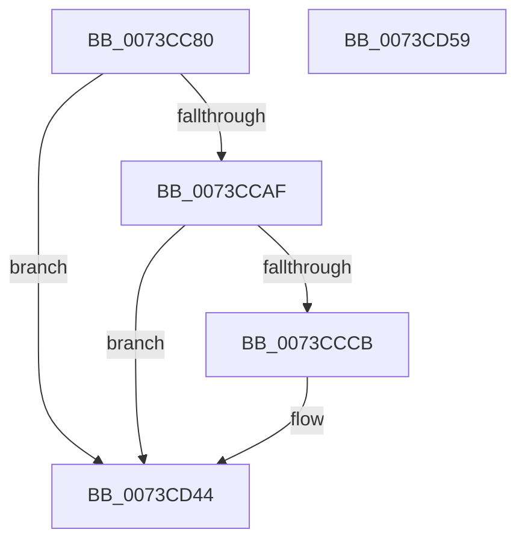

# PnpTraceIommuDeviceProperties

- RVA: `0x0073CC80`–`0x0073CD5A` (길이 `218` bytes)
- VA: `0x000000014073CC80`
- 실행 섹션: `PAGE`
- PDB 이름 있음: `예`; PDB Function 태그: `아니요`
- unwind 정보 RVA: `0x00079278`
- 디코드: `47`개 명령, `218/218` bytes 표시
- 미해석 바이트: `0` (있으면 어셈블리에 `.byte`로 보존)

> 이 문서는 커널 이미지의 기계어와 PDB 기호를 분석해 생성했습니다. 4번과 5번은 함수 원형과 자료형을 바이너리 사용 방식에서 추정한 C 해석이며 원본 소스 복구 결과는 아닙니다.

## 1. Dependencies

- 직접 호출 지점: **3**; 고유 호출 대상: **3**
- 직접 호출자로 확인된 함수: **1**
- RIP 상대 이미지 참조: **3**

### Outgoing calls
- `0x0073CCC0` → [tlgKeywordOn](../../text/42/tlgKeywordOn_function_0042EAA0.md) (function, `0x0042EAA0`)
- `0x0073CD3F` → [tlgWriteTransfer_EtwWriteTransfer](../../text/42/tlgWriteTransfer_EtwWriteTransfer_function_004260E0.md) (function, `0x004260E0`)
- `0x0073CD4B` → [_security_check_cookie](../../text/6A/_security_check_cookie_function_006AC640.md) (function, `0x006AC640`)

### Direct callers
- [PiIommuAllocateExtension](../74/PiIommuAllocateExtension_function_00740004.md) at `0x007400F8`

### Static image references
- `0x0073CC8E` → RVA `0x00E0A740` (`.data`; read)
- `0x0073CC9C` → RVA `0x00E06F90` (`.data`; read)
- `0x0073CCD6` → RVA `0x00046E4D` (`.rdata`; read)

## 2. Other-region calls and transfers

- 다른 실행 섹션으로 향하는 call: **3**
  - `0x0073CCC0` → [tlgKeywordOn](../../text/42/tlgKeywordOn_function_0042EAA0.md) (`PAGE` → `.text`)
  - `0x0073CD3F` → [tlgWriteTransfer_EtwWriteTransfer](../../text/42/tlgWriteTransfer_EtwWriteTransfer_function_004260E0.md) (`PAGE` → `.text`)
  - `0x0073CD4B` → [_security_check_cookie](../../text/6A/_security_check_cookie_function_006AC640.md) (`PAGE` → `.text`)
- 별도 외부 분기/꼬리 이동을 확인하지 못했습니다.

## 3. Assembly (complete function range)

```asm
0073CC80  40 55                           push rbp
0073CC82  48 8D 6C 24 A9                  lea rbp, [rsp - 0x57]
0073CC87  48 81 EC B0 00 00 00            sub rsp, 0xb0
0073CC8E  48 8B 05 AB DA 6C 00            mov rax, qword ptr [rip + 0x6cdaab]
0073CC95  48 33 C4                        xor rax, rsp
0073CC98  48 89 45 47                     mov qword ptr [rbp + 0x47], rax
0073CC9C  83 3D ED A2 6C 00 05            cmp dword ptr [rip + 0x6ca2ed], 5
0073CCA3  44 8B C2                        mov r8d, edx
0073CCA6  4C 8B C9                        mov r9, rcx
0073CCA9  0F 86 95 00 00 00               jbe 0x14073cd44
0073CCAF  48 BA 00 00 00 00 00 40 00 00   movabs rdx, 0x400000000000
0073CCB9  48 8D 0D D0 A2 6C 00            lea rcx, [rip + 0x6ca2d0]
0073CCC0  E8 DB 1D CF FF                  call 0x14042eaa0
0073CCC5  33 D2                           xor edx, edx
0073CCC7  84 C0                           test al, al
0073CCC9  74 79                           je 0x14073cd44
0073CCCB  48 8D 45 DF                     lea rax, [rbp - 0x21]
0073CCCF  89 55 33                        mov dword ptr [rbp + 0x33], edx
0073CCD2  48 89 45 07                     mov qword ptr [rbp + 7], rax
0073CCD6  48 8D 15 70 A1 90 FF            lea rdx, [rip - 0x6f5e90]
0073CCDD  48 8D 45 2F                     lea rax, [rbp + 0x2f]
0073CCE1  44 89 45 D7                     mov dword ptr [rbp - 0x29], r8d
0073CCE5  48 89 45 17                     mov qword ptr [rbp + 0x17], rax
0073CCE9  48 8D 0D A0 A2 6C 00            lea rcx, [rip + 0x6ca2a0]
0073CCF0  49 8B 41 30                     mov rax, qword ptr [r9 + 0x30]
0073CCF4  45 33 C0                        xor r8d, r8d
0073CCF7  48 89 45 27                     mov qword ptr [rbp + 0x27], rax
0073CCFB  41 0F B7 41 28                  movzx eax, word ptr [r9 + 0x28]
0073CD00  45 33 C9                        xor r9d, r9d
0073CD03  89 45 2F                        mov dword ptr [rbp + 0x2f], eax
0073CD06  48 8D 45 D7                     lea rax, [rbp - 0x29]
0073CD0A  48 89 45 37                     mov qword ptr [rbp + 0x37], rax
0073CD0E  48 8D 45 E7                     lea rax, [rbp - 0x19]
0073CD12  48 89 44 24 28                  mov qword ptr [rsp + 0x28], rax
0073CD17  C7 44 24 20 06 00 00 00         mov dword ptr [rsp + 0x20], 6
0073CD1F  48 C7 45 DF 00 08 00 00         mov qword ptr [rbp - 0x21], 0x800
0073CD27  48 C7 45 0F 08 00 00 00         mov qword ptr [rbp + 0xf], 8
0073CD2F  48 C7 45 1F 02 00 00 00         mov qword ptr [rbp + 0x1f], 2
0073CD37  48 C7 45 3F 04 00 00 00         mov qword ptr [rbp + 0x3f], 4
0073CD3F  E8 9C 93 CE FF                  call 0x1404260e0
0073CD44  48 8B 4D 47                     mov rcx, qword ptr [rbp + 0x47]
0073CD48  48 33 CC                        xor rcx, rsp
0073CD4B  E8 F0 F8 F6 FF                  call 0x1406ac640
0073CD50  48 81 C4 B0 00 00 00            add rsp, 0xb0
0073CD57  5D                              pop rbp
0073CD58  C3                              ret
0073CD59  CC                              int3
```

## 4. C-style interpretation (structured pseudocode)

```c
__int64 __fastcall PnpTraceIommuDeviceProperties(__int64 a1, int a2)
{
    __int64 result;
    __int64 v_rsp;
    unsigned __int64 v_stack_m18;
    unsigned __int64 v_stack_m20;
    unsigned __int64 v_stack_m28;
    unsigned int v_stack_m2C;
    unsigned __int64 v_stack_m30;
    unsigned __int64 v_stack_m38;
    unsigned __int64 v_stack_m40;
    unsigned __int64 v_stack_m48;
    unsigned __int64 v_stack_m50;
    unsigned __int64 v_stack_m58;
    unsigned __int64 v_stack_m5F;
    unsigned __int64 v_stack_m78;
    unsigned __int64 v_stack_m80;
    unsigned int v_stack_m88;
    unsigned __int64 v_stack_m90;
    unsigned int v_stack_m98;

    v_rsp = (v_rsp) - (176);
    result = (*(unsigned __int64 *)(v_rip + 7133867)) ^ (v_rsp);
    v_stack_m18 = result;
    if ((*(unsigned int *)(v_rip + 7119597)) <= 5) goto loc_0073CD44;
    result = tlgKeywordOn(v_rip + 7119568, a2, (unsigned int)(a2), a1);
    a2 = 0;
    if ((unsigned __int8)(result) != 0) {
        result = v_stack_m80;
        v_stack_m2C = 0;
        v_stack_m58 = result;
        a2 = v_rip - 7298704;
        result = v_stack_m30;
        v_stack_m88 = (unsigned int)((unsigned int)(a2));
        v_stack_m48 = result;
        a1 = v_rip + 7119520;
        result = *(unsigned __int64 *)(a1 + 48);
        a3 = 0;
        v_stack_m38 = result;
        result = *(unsigned __int16 *)(a1 + 40);
        a4 = 0;
        v_stack_m30 = (unsigned int)(result);
        result = v_stack_m88;
        v_stack_m28 = result;
        result = v_stack_m78;
        v_stack_m90 = result;
        v_stack_m98 = 6;
        v_stack_m80 = 0x800ULL;
        v_stack_m50 = 8;
        v_stack_m40 = 2;
        v_stack_m20 = 4;
        result = tlgWriteTransfer_EtwWriteTransfer(a1, a2, a3, a4);
    }
    a1 = (v_stack_m18) ^ (v_rsp);
    result = _security_check_cookie(a1, a2, a3, a4);
    v_rsp = (v_rsp) + (176);
    return result;
}
```

## 5. (Beta) C Style

```c
int64_t PnpTraceIommuDeviceProperties(int64_t Arg1, int32_t Arg2)
{
    int64_t result;
    int64_t local_rsp;
    uint64_t v_stack_m18;
    uint64_t v_stack_m20;
    uint64_t v_stack_m28;
    uint32_t v_stack_m2C;
    uint64_t v_stack_m30;
    uint64_t v_stack_m38;
    uint64_t v_stack_m40;
    uint64_t v_stack_m48;
    uint64_t v_stack_m50;
    uint64_t v_stack_m58;
    uint64_t v_stack_m5F;
    uint64_t v_stack_m78;
    uint64_t v_stack_m80;
    uint32_t v_stack_m88;
    uint64_t v_stack_m90;
    uint32_t v_stack_m98;

    local_rsp = (local_rsp) - (176);
    result = (*(uint64_t *)(v_rip + 0x6CDAAB)) ^ (local_rsp);
    v_stack_m18 = result;
    if ((*(uint32_t *)(v_rip + 0x6CA2ED)) <= 5) goto loc_0073CD44;
    result = tlgKeywordOn(v_rip + 7119568, Arg2, (uint32_t)(Arg2), Arg1);
    Arg2 = 0;
    if ((uint8_t)(result) != 0) {
        result = v_stack_m80;
        v_stack_m2C = 0;
        v_stack_m58 = result;
        Arg2 = v_rip - 7298704;
        result = v_stack_m30;
        v_stack_m88 = (uint32_t)((uint32_t)(Arg2));
        v_stack_m48 = result;
        Arg1 = v_rip + 7119520;
        result = *(uint64_t *)(Arg1 + 0x30);
        a3 = 0;
        v_stack_m38 = result;
        result = *(uint16_t *)(Arg1 + 0x28);
        a4 = 0;
        v_stack_m30 = (uint32_t)(result);
        result = v_stack_m88;
        v_stack_m28 = result;
        result = v_stack_m78;
        v_stack_m90 = result;
        v_stack_m98 = 6;
        v_stack_m80 = 0x800ULL;
        v_stack_m50 = 8;
        v_stack_m40 = 2;
        v_stack_m20 = 4;
        result = tlgWriteTransfer_EtwWriteTransfer(Arg1, Arg2, a3, a4);
    }
    Arg1 = (v_stack_m18) ^ (local_rsp);
    result = _security_check_cookie(Arg1, Arg2, a3, a4);
    local_rsp = (local_rsp) + (176);
    return result;
}
```

## 6. Execution-region graph

[열기: 2D/3D 그래프와 함수 탐색 컨트롤 패널](../../../control-panel.html?section=page&rva=0x0073CC80&view=graph)

- 2D 그래프는 위에서 아래로 흐르고, 3D 그래프는 빈 공간을 드래그해 회전합니다. Shift+드래그는 이동, 휠은 확대·축소, 함수 노드 선택은 대상 보고서 이동입니다.

### Static fallback


