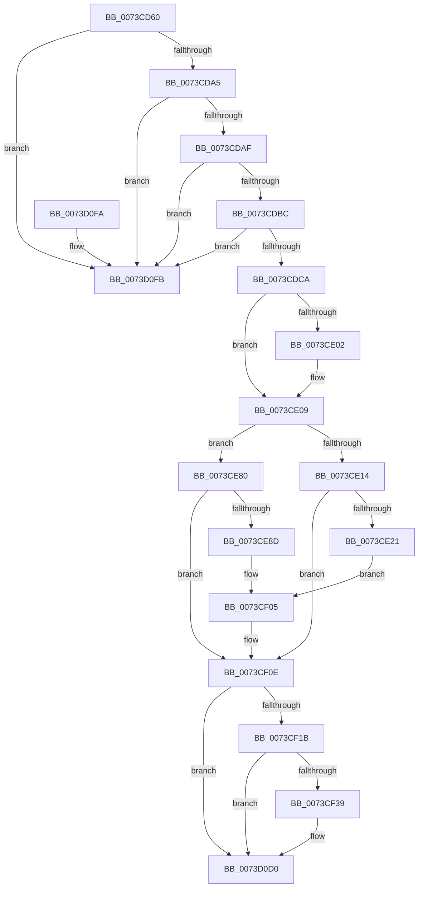

# PnpTraceRebalanceResult

- RVA: `0x0073CD60`–`0x0073D102` (길이 `930` bytes)
- VA: `0x000000014073CD60`
- 실행 섹션: `PAGE`
- PDB 이름 있음: `예`; PDB Function 태그: `아니요`
- unwind 정보 RVA: `0x000C9084`
- 디코드: `206`개 명령, `930/930` bytes 표시
- 미해석 바이트: `0` (있으면 어셈블리에 `.byte`로 보존)

> 이 문서는 커널 이미지의 기계어와 PDB 기호를 분석해 생성했습니다. 4번과 5번은 함수 원형과 자료형을 바이너리 사용 방식에서 추정한 C 해석이며 원본 소스 복구 결과는 아닙니다.

## 1. Dependencies

- 직접 호출 지점: **5**; 고유 호출 대상: **5**
- 직접 호출자로 확인된 함수: **1**
- RIP 상대 이미지 참조: **5**

### Outgoing calls
- `0x0073CE76` → [McTemplateK0zzqqzttquxt_EtwWriteTransfer](../../text/5A/McTemplateK0zzqqzttquxt_EtwWriteTransfer_function_005AA160.md) (function, `0x005AA160`)
- `0x0073CF00` → [McTemplateK0zzqqzttquqqzxt_EtwWriteTransfer](../../text/5A/McTemplateK0zzqqzttquqqzxt_EtwWriteTransfer_function_005A9F58.md) (function, `0x005A9F58`)
- `0x0073CF2C` → [tlgKeywordOn](../../text/42/tlgKeywordOn_function_0042EAA0.md) (function, `0x0042EAA0`)
- `0x0073D0CB` → [tlgWriteTransfer_EtwWriteTransfer](../../text/42/tlgWriteTransfer_EtwWriteTransfer_function_004260E0.md) (function, `0x004260E0`)
- `0x0073D0DA` → [_security_check_cookie](../../text/6A/_security_check_cookie_function_006AC640.md) (function, `0x006AC640`)

### Direct callers
- [PnpRebalance](PnpRebalance_function_0073F508.md) at `0x0073F72B`
- [PnpRebalance](PnpRebalance_function_0073F508.md) at `0x0073F741`

### Static image references
- `0x0073CD7F` → RVA `0x00E0A740` (`.data`; read)
- `0x0073CE02` → RVA `0x00E06F48` (`.data`; read)
- `0x0073CE14` → RVA `0x00EF012C` (`.data`; read)
- `0x0073CF0E` → RVA `0x00E06F90` (`.data`; read)
- `0x0073CF49` → RVA `0x0004726B` (`.rdata`; read)

## 2. Other-region calls and transfers

- 다른 실행 섹션으로 향하는 call: **5**
  - `0x0073CE76` → [McTemplateK0zzqqzttquxt_EtwWriteTransfer](../../text/5A/McTemplateK0zzqqzttquxt_EtwWriteTransfer_function_005AA160.md) (`PAGE` → `.text`)
  - `0x0073CF00` → [McTemplateK0zzqqzttquqqzxt_EtwWriteTransfer](../../text/5A/McTemplateK0zzqqzttquqqzxt_EtwWriteTransfer_function_005A9F58.md) (`PAGE` → `.text`)
  - `0x0073CF2C` → [tlgKeywordOn](../../text/42/tlgKeywordOn_function_0042EAA0.md) (`PAGE` → `.text`)
  - `0x0073D0CB` → [tlgWriteTransfer_EtwWriteTransfer](../../text/42/tlgWriteTransfer_EtwWriteTransfer_function_004260E0.md) (`PAGE` → `.text`)
  - `0x0073D0DA` → [_security_check_cookie](../../text/6A/_security_check_cookie_function_006AC640.md) (`PAGE` → `.text`)
- 별도 외부 분기/꼬리 이동을 확인하지 못했습니다.

## 3. Assembly (complete function range)

```asm
0073CD60  48 89 5C 24 10                  mov qword ptr [rsp + 0x10], rbx
0073CD65  55                              push rbp
0073CD66  56                              push rsi
0073CD67  57                              push rdi
0073CD68  41 54                           push r12
0073CD6A  41 55                           push r13
0073CD6C  41 56                           push r14
0073CD6E  41 57                           push r15
0073CD70  48 8D AC 24 20 FF FF FF         lea rbp, [rsp - 0xe0]
0073CD78  48 81 EC F0 01 00 00            sub rsp, 0x1f0
0073CD7F  48 8B 05 BA D9 6C 00            mov rax, qword ptr [rip + 0x6cd9ba]
0073CD86  48 33 C4                        xor rax, rsp
0073CD89  48 89 85 D0 00 00 00            mov qword ptr [rbp + 0xd0], rax
0073CD90  45 33 D2                        xor r10d, r10d
0073CD93  44 8B F1                        mov r14d, ecx
0073CD96  49 8B D8                        mov rbx, r8
0073CD99  44 8B CA                        mov r9d, edx
0073CD9C  4D 85 C0                        test r8, r8
0073CD9F  0F 84 56 03 00 00               je 0x14073d0fb
0073CDA5  41 83 FE 02                     cmp r14d, 2
0073CDA9  0F 83 4C 03 00 00               jae 0x14073d0fb
0073CDAF  49 8B 70 30                     mov rsi, qword ptr [r8 + 0x30]
0073CDB3  48 85 F6                        test rsi, rsi
0073CDB6  0F 84 3F 03 00 00               je 0x14073d0fb
0073CDBC  4F 8B 6C F0 18                  mov r13, qword ptr [r8 + r14*8 + 0x18]
0073CDC1  4D 85 ED                        test r13, r13
0073CDC4  0F 84 31 03 00 00               je 0x14073d0fb
0073CDCA  49 BC 08 00 00 00 80 F7 FF FF   movabs r12, 0xfffff78000000008
0073CDD4  48 B8 4B 59 86 38 D6 C5 6D 34   movabs rax, 0x346dc5d63886594b
0073CDDE  4D 8B 24 24                     mov r12, qword ptr [r12]
0073CDE2  49 8B CC                        mov rcx, r12
0073CDE5  4B 2B 4C F0 40                  sub rcx, qword ptr [r8 + r14*8 + 0x40]
0073CDEA  48 F7 E1                        mul rcx
0073CDED  4B 8B 44 F0 50                  mov rax, qword ptr [r8 + r14*8 + 0x50]
0073CDF2  4C 8B FA                        mov r15, rdx
0073CDF5  49 C1 EF 0B                     shr r15, 0xb
0073CDF9  4C 8D 40 28                     lea r8, [rax + 0x28]
0073CDFD  48 85 C0                        test rax, rax
0073CE00  75 07                           jne 0x14073ce09
0073CE02  4C 8D 05 3F A1 6C 00            lea r8, [rip + 0x6ca13f]
0073CE09  41 BB 01 00 00 00               mov r11d, 1
0073CE0F  45 85 C9                        test r9d, r9d
0073CE12  78 6C                           js 0x14073ce80
0073CE14  F6 05 11 33 7B 00 08            test byte ptr [rip + 0x7b3311], 8
0073CE1B  0F 84 ED 00 00 00               je 0x14073cf0e
0073CE21  8B 53 38                        mov edx, dword ptr [rbx + 0x38]
0073CE24  8B C2                           mov eax, edx
0073CE26  41 0F B6 4C 1E 28               movzx ecx, byte ptr [r14 + rbx + 0x28]
0073CE2C  41 23 D3                        and edx, r11d
0073CE2F  4C 8B 4E 30                     mov r9, qword ptr [rsi + 0x30]
0073CE33  D1 E8                           shr eax, 1
0073CE35  41 23 C3                        and eax, r11d
0073CE38  89 44 24 68                     mov dword ptr [rsp + 0x68], eax
0073CE3C  8A 43 68                        mov al, byte ptr [rbx + 0x68]
0073CE3F  4C 89 7C 24 60                  mov qword ptr [rsp + 0x60], r15
0073CE44  88 44 24 58                     mov byte ptr [rsp + 0x58], al
0073CE48  8B 43 0C                        mov eax, dword ptr [rbx + 0xc]
0073CE4B  89 44 24 50                     mov dword ptr [rsp + 0x50], eax
0073CE4F  49 8B 45 30                     mov rax, qword ptr [r13 + 0x30]
0073CE53  89 54 24 48                     mov dword ptr [rsp + 0x48], edx
0073CE57  89 4C 24 40                     mov dword ptr [rsp + 0x40], ecx
0073CE5B  48 89 44 24 38                  mov qword ptr [rsp + 0x38], rax
0073CE60  42 8B 04 B3                     mov eax, dword ptr [rbx + r14*4]
0073CE64  44 89 74 24 30                  mov dword ptr [rsp + 0x30], r14d
0073CE69  89 44 24 28                     mov dword ptr [rsp + 0x28], eax
0073CE6D  48 8B 46 40                     mov rax, qword ptr [rsi + 0x40]
0073CE71  48 89 44 24 20                  mov qword ptr [rsp + 0x20], rax
0073CE76  E8 E5 D2 E6 FF                  call 0x1405aa160
0073CE7B  E9 85 00 00 00                  jmp 0x14073cf05
0073CE80  F6 05 A5 32 7B 00 04            test byte ptr [rip + 0x7b32a5], 4
0073CE87  0F 84 81 00 00 00               je 0x14073cf0e
0073CE8D  8B 53 38                        mov edx, dword ptr [rbx + 0x38]
0073CE90  8B C2                           mov eax, edx
0073CE92  41 0F B6 4C 1E 28               movzx ecx, byte ptr [r14 + rbx + 0x28]
0073CE98  41 23 D3                        and edx, r11d
0073CE9B  4C 8B 4E 30                     mov r9, qword ptr [rsi + 0x30]
0073CE9F  D1 E8                           shr eax, 1
0073CEA1  41 23 C3                        and eax, r11d
0073CEA4  89 84 24 80 00 00 00            mov dword ptr [rsp + 0x80], eax
0073CEAB  49 8B 40 08                     mov rax, qword ptr [r8 + 8]
0073CEAF  4C 89 7C 24 78                  mov qword ptr [rsp + 0x78], r15
0073CEB4  48 89 44 24 70                  mov qword ptr [rsp + 0x70], rax
0073CEB9  42 8B 44 B3 60                  mov eax, dword ptr [rbx + r14*4 + 0x60]
0073CEBE  89 44 24 68                     mov dword ptr [rsp + 0x68], eax
0073CEC2  42 8B 44 B3 10                  mov eax, dword ptr [rbx + r14*4 + 0x10]
0073CEC7  89 44 24 60                     mov dword ptr [rsp + 0x60], eax
0073CECB  8A 43 68                        mov al, byte ptr [rbx + 0x68]
0073CECE  88 44 24 58                     mov byte ptr [rsp + 0x58], al
0073CED2  8B 43 0C                        mov eax, dword ptr [rbx + 0xc]
0073CED5  89 44 24 50                     mov dword ptr [rsp + 0x50], eax
0073CED9  49 8B 45 30                     mov rax, qword ptr [r13 + 0x30]
0073CEDD  89 54 24 48                     mov dword ptr [rsp + 0x48], edx
0073CEE1  89 4C 24 40                     mov dword ptr [rsp + 0x40], ecx
0073CEE5  48 89 44 24 38                  mov qword ptr [rsp + 0x38], rax
0073CEEA  42 8B 04 B3                     mov eax, dword ptr [rbx + r14*4]
0073CEEE  44 89 74 24 30                  mov dword ptr [rsp + 0x30], r14d
0073CEF3  89 44 24 28                     mov dword ptr [rsp + 0x28], eax
0073CEF7  48 8B 46 40                     mov rax, qword ptr [rsi + 0x40]
0073CEFB  48 89 44 24 20                  mov qword ptr [rsp + 0x20], rax
0073CF00  E8 53 D0 E6 FF                  call 0x1405a9f58
0073CF05  41 BB 01 00 00 00               mov r11d, 1
0073CF0B  45 33 D2                        xor r10d, r10d
0073CF0E  83 3D 7B A0 6C 00 05            cmp dword ptr [rip + 0x6ca07b], 5
0073CF15  0F 86 B5 01 00 00               jbe 0x14073d0d0
0073CF1B  48 BA 00 00 00 00 00 40 00 00   movabs rdx, 0x400000000000
0073CF25  48 8D 0D 64 A0 6C 00            lea rcx, [rip + 0x6ca064]
0073CF2C  E8 6F 1B CF FF                  call 0x14042eaa0
0073CF31  84 C0                           test al, al
0073CF33  0F 84 97 01 00 00               je 0x14073d0d0
0073CF39  48 8D 45 90                     lea rax, [rbp - 0x70]
0073CF3D  48 C7 45 90 00 00 00 01         mov qword ptr [rbp - 0x70], 0x1000000
0073CF45  48 89 45 D0                     mov qword ptr [rbp - 0x30], rax
0073CF49  48 8D 15 1B A3 90 FF            lea rdx, [rip - 0x6f5ce5]
0073CF50  48 8D 45 F8                     lea rax, [rbp - 8]
0073CF54  48 C7 45 D8 08 00 00 00         mov qword ptr [rbp - 0x28], 8
0073CF5C  48 89 45 E0                     mov qword ptr [rbp - 0x20], rax
0073CF60  48 8D 0D 29 A0 6C 00            lea rcx, [rip + 0x6ca029]
0073CF67  48 8B 46 30                     mov rax, qword ptr [rsi + 0x30]
0073CF6B  45 33 C9                        xor r9d, r9d
0073CF6E  48 89 45 F0                     mov qword ptr [rbp - 0x10], rax
0073CF72  45 33 C0                        xor r8d, r8d
0073CF75  0F B7 46 28                     movzx eax, word ptr [rsi + 0x28]
0073CF79  89 45 F8                        mov dword ptr [rbp - 8], eax
0073CF7C  48 8D 45 18                     lea rax, [rbp + 0x18]
0073CF80  48 89 45 00                     mov qword ptr [rbp], rax
0073CF84  48 8B 46 40                     mov rax, qword ptr [rsi + 0x40]
0073CF88  48 89 45 10                     mov qword ptr [rbp + 0x10], rax
0073CF8C  0F B7 46 38                     movzx eax, word ptr [rsi + 0x38]
0073CF90  89 45 18                        mov dword ptr [rbp + 0x18], eax
0073CF93  42 8B 04 B3                     mov eax, dword ptr [rbx + r14*4]
0073CF97  89 45 84                        mov dword ptr [rbp - 0x7c], eax
0073CF9A  48 8D 45 84                     lea rax, [rbp - 0x7c]
0073CF9E  48 89 45 20                     mov qword ptr [rbp + 0x20], rax
0073CFA2  48 8D 45 48                     lea rax, [rbp + 0x48]
0073CFA6  48 89 45 30                     mov qword ptr [rbp + 0x30], rax
0073CFAA  49 8B 45 30                     mov rax, qword ptr [r13 + 0x30]
0073CFAE  48 89 45 40                     mov qword ptr [rbp + 0x40], rax
0073CFB2  41 0F B7 45 28                  movzx eax, word ptr [r13 + 0x28]
0073CFB7  89 45 48                        mov dword ptr [rbp + 0x48], eax
0073CFBA  41 8A 44 1E 28                  mov al, byte ptr [r14 + rbx + 0x28]
0073CFBF  88 45 80                        mov byte ptr [rbp - 0x80], al
0073CFC2  48 8D 45 80                     lea rax, [rbp - 0x80]
0073CFC6  48 89 45 50                     mov qword ptr [rbp + 0x50], rax
0073CFCA  8A 43 38                        mov al, byte ptr [rbx + 0x38]
0073CFCD  41 22 C3                        and al, r11b
0073CFD0  48 C7 45 E8 02 00 00 00         mov qword ptr [rbp - 0x18], 2
0073CFD8  88 45 81                        mov byte ptr [rbp - 0x7f], al
0073CFDB  48 8D 45 81                     lea rax, [rbp - 0x7f]
0073CFDF  48 89 45 60                     mov qword ptr [rbp + 0x60], rax
0073CFE3  8B 43 0C                        mov eax, dword ptr [rbx + 0xc]
0073CFE6  89 45 88                        mov dword ptr [rbp - 0x78], eax
0073CFE9  48 8D 45 88                     lea rax, [rbp - 0x78]
0073CFED  48 89 45 70                     mov qword ptr [rbp + 0x70], rax
0073CFF1  42 8B 44 B3 10                  mov eax, dword ptr [rbx + r14*4 + 0x10]
0073CFF6  89 45 8C                        mov dword ptr [rbp - 0x74], eax
0073CFF9  48 8D 45 8C                     lea rax, [rbp - 0x74]
0073CFFD  48 89 85 80 00 00 00            mov qword ptr [rbp + 0x80], rax
0073D004  48 8D 45 98                     lea rax, [rbp - 0x68]
0073D008  48 89 85 90 00 00 00            mov qword ptr [rbp + 0x90], rax
0073D00F  48 8D 45 A0                     lea rax, [rbp - 0x60]
0073D013  48 89 85 A0 00 00 00            mov qword ptr [rbp + 0xa0], rax
0073D01A  48 8D 45 82                     lea rax, [rbp - 0x7e]
0073D01E  48 89 85 B0 00 00 00            mov qword ptr [rbp + 0xb0], rax
0073D025  8B 43 38                        mov eax, dword ptr [rbx + 0x38]
0073D028  D1 E8                           shr eax, 1
0073D02A  41 22 C3                        and al, r11b
0073D02D  44 89 55 FC                     mov dword ptr [rbp - 4], r10d
0073D031  88 45 83                        mov byte ptr [rbp - 0x7d], al
0073D034  48 8D 45 83                     lea rax, [rbp - 0x7d]
0073D038  48 89 85 C0 00 00 00            mov qword ptr [rbp + 0xc0], rax
0073D03F  48 8D 45 B0                     lea rax, [rbp - 0x50]
0073D043  48 89 44 24 28                  mov qword ptr [rsp + 0x28], rax
0073D048  C7 44 24 20 12 00 00 00         mov dword ptr [rsp + 0x20], 0x12
0073D050  48 C7 45 08 02 00 00 00         mov qword ptr [rbp + 8], 2
0073D058  44 89 55 1C                     mov dword ptr [rbp + 0x1c], r10d
0073D05C  48 C7 45 28 04 00 00 00         mov qword ptr [rbp + 0x28], 4
0073D064  48 C7 45 38 02 00 00 00         mov qword ptr [rbp + 0x38], 2
0073D06C  44 89 55 4C                     mov dword ptr [rbp + 0x4c], r10d
0073D070  48 C7 45 58 01 00 00 00         mov qword ptr [rbp + 0x58], 1
0073D078  48 C7 45 68 01 00 00 00         mov qword ptr [rbp + 0x68], 1
0073D080  48 C7 45 78 04 00 00 00         mov qword ptr [rbp + 0x78], 4
0073D088  48 C7 85 88 00 00 00 04 00 00 00  mov qword ptr [rbp + 0x88], 4
0073D093  4C 89 7D 98                     mov qword ptr [rbp - 0x68], r15
0073D097  48 C7 85 98 00 00 00 08 00 00 00  mov qword ptr [rbp + 0x98], 8
0073D0A2  4C 89 65 A0                     mov qword ptr [rbp - 0x60], r12
0073D0A6  48 C7 85 A8 00 00 00 08 00 00 00  mov qword ptr [rbp + 0xa8], 8
0073D0B1  44 88 75 82                     mov byte ptr [rbp - 0x7e], r14b
0073D0B5  48 C7 85 B8 00 00 00 01 00 00 00  mov qword ptr [rbp + 0xb8], 1
0073D0C0  48 C7 85 C8 00 00 00 01 00 00 00  mov qword ptr [rbp + 0xc8], 1
0073D0CB  E8 10 90 CE FF                  call 0x1404260e0
0073D0D0  48 8B 8D D0 00 00 00            mov rcx, qword ptr [rbp + 0xd0]
0073D0D7  48 33 CC                        xor rcx, rsp
0073D0DA  E8 61 F5 F6 FF                  call 0x1406ac640
0073D0DF  48 8B 9C 24 38 02 00 00         mov rbx, qword ptr [rsp + 0x238]
0073D0E7  48 81 C4 F0 01 00 00            add rsp, 0x1f0
0073D0EE  41 5F                           pop r15
0073D0F0  41 5E                           pop r14
0073D0F2  41 5D                           pop r13
0073D0F4  41 5C                           pop r12
0073D0F6  5F                              pop rdi
0073D0F7  5E                              pop rsi
0073D0F8  5D                              pop rbp
0073D0F9  C3                              ret
0073D0FA  CC                              int3
0073D0FB  B9 05 00 00 00                  mov ecx, 5
0073D100  CD 29                           int 0x29
```

## 4. C-style interpretation (structured pseudocode)

```c
__int64 __fastcall PnpTraceRebalanceResult(int a1, __int64 a2, __int64 a3)
{
    __int64 result;
    __int64 v_r10;
    __int64 v_r15;
    __int64 v_rsp;
    unsigned __int64 v_stack_m100;
    unsigned __int64 v_stack_m108;
    unsigned __int64 v_stack_m110;
    unsigned __int64 v_stack_m118;
    unsigned int v_stack_m11C;
    unsigned __int64 v_stack_m120;
    unsigned __int64 v_stack_m128;
    unsigned __int64 v_stack_m130;
    unsigned __int64 v_stack_m138;
    unsigned __int64 v_stack_m140;
    unsigned __int64 v_stack_m148;
    unsigned __int64 v_stack_m168;
    unsigned __int64 v_stack_m178;
    unsigned __int64 v_stack_m180;
    unsigned __int64 v_stack_m188;
    unsigned int v_stack_m18C;
    unsigned int v_stack_m190;
    unsigned int v_stack_m194;
    unsigned __int8 v_stack_m195;
    unsigned __int64 v_stack_m196;
    unsigned __int8 v_stack_m197;
    unsigned __int8 v_stack_m198;
    unsigned int v_stack_m1A8;
    unsigned __int64 v_stack_m1B0;
    unsigned __int64 v_stack_m1B8;
    unsigned int v_stack_m1C0;
    unsigned __int64 v_stack_m1C8;
    unsigned __int8 v_stack_m1D0;
    unsigned int v_stack_m1D8;
    unsigned int v_stack_m1E0;
    unsigned int v_stack_m1E8;
    unsigned __int64 v_stack_m1F0;
    unsigned int v_stack_m1F8;
    unsigned int v_stack_m200;
    unsigned __int64 v_stack_m208;
    unsigned __int64 v_stack_m48;
    unsigned __int64 v_stack_m50;
    unsigned __int64 v_stack_m58;
    unsigned __int64 v_stack_m60;
    unsigned __int64 v_stack_m68;
    unsigned __int64 v_stack_m70;
    unsigned __int64 v_stack_m78;
    unsigned __int64 v_stack_m80;
    unsigned __int64 v_stack_m88;
    unsigned __int64 v_stack_m90;
    unsigned __int64 v_stack_m98;
    unsigned __int64 v_stack_mA0;
    unsigned __int64 v_stack_mA8;
    unsigned __int64 v_stack_mB0;
    unsigned __int64 v_stack_mB8;
    unsigned __int64 v_stack_mC0;
    unsigned __int64 v_stack_mC8;
    unsigned int v_stack_mCC;
    unsigned __int64 v_stack_mD0;
    unsigned __int64 v_stack_mD8;
    unsigned __int64 v_stack_mE0;
    unsigned __int64 v_stack_mE8;
    unsigned __int64 v_stack_mF0;
    unsigned __int64 v_stack_mF8;
    unsigned int v_stack_mFC;
    unsigned __int64 v_stack_p10;

    v_stack_p10 = v_rbx;
    v_rsp = (v_rsp) - (496);
    result = (*(unsigned __int64 *)(v_rip + 7133626)) ^ (v_rsp);
    v_stack_m48 = result;
    v_r10 = 0;
    if (a3 == 0) goto loc_0073D0FB;
    if (((unsigned int)((unsigned int)(a1))) >= 2) goto loc_0073D0FB;
    if (*(unsigned __int64 *)(a3 + 48) == 0) goto loc_0073D0FB;
    if (*(unsigned __int64 *)(a3 + (unsigned int)(a1) * 8 + 24) == 0) goto loc_0073D0FB;
    a1 = (*(unsigned __int64 *)(v_r12)) - (*(unsigned __int64 *)(a3 + (unsigned int)(a1) * 8 + 64));
    v_r15 = (a2) >> (11);
    if (*(unsigned __int64 *)(a3 + (unsigned int)(a1) * 8 + 80) == 0) {
        a3 = v_rip + 7119167;
    }
    if (sign_flag) goto loc_0073CE80;
    if (((*(unsigned __int8 *)(v_rip + 8074001)) & (8)) == 0) goto loc_0073CF0E;
    a2 = (unsigned int)(((unsigned int)(*(unsigned int *)(a3 + 56))) & (1));
    result = (unsigned int)(((unsigned int)((unsigned int)((unsigned int)(*(unsigned int *)(a3 + 56))))) >> (1));
    result = (unsigned int)((result) & (1));
    v_stack_m1C0 = (unsigned int)(result);
    v_stack_m1C8 = v_r15;
    v_stack_m1D0 = (unsigned __int8)(*(unsigned __int8 *)(a3 + 104));
    v_stack_m1D8 = (unsigned int)((unsigned int)(*(unsigned int *)(a3 + 12)));
    v_stack_m1E0 = (unsigned int)(a2);
    v_stack_m1E8 = (unsigned int)(*(unsigned __int8 *)((unsigned int)(a1) + a3 * 1 + 40));
    v_stack_m1F0 = *(unsigned __int64 *)(*(unsigned __int64 *)(a3 + (unsigned int)(a1) * 8 + 24) + 48);
    v_stack_m1F8 = (unsigned int)((unsigned int)(a1));
    v_stack_m200 = (unsigned int)((unsigned int)(*(unsigned int *)(a3 + (unsigned int)(a1) * 4)));
    v_stack_m208 = *(unsigned __int64 *)(*(unsigned __int64 *)(a3 + 48) + 64);
    result = McTemplateK0zzqqzttquxt_EtwWriteTransfer(*(unsigned __int8 *)((unsigned int)(a1) + a3 * 1 + 40), a2, a3, *(unsigned __int64 *)(*(unsigned __int64 *)(a3 + 48) + 48));
    goto loc_0073CF05;
loc_0073CE80:
    if (((*(unsigned __int8 *)(v_rip + 8073893)) & (4)) == 0) goto loc_0073CF0E;
    a2 = (unsigned int)(((unsigned int)(*(unsigned int *)(a3 + 56))) & (1));
    result = (unsigned int)(((unsigned int)((unsigned int)((unsigned int)(*(unsigned int *)(a3 + 56))))) >> (1));
    result = (unsigned int)((result) & (1));
    v_stack_m1A8 = (unsigned int)(result);
    v_stack_m1B0 = v_r15;
    v_stack_m1B8 = *(unsigned __int64 *)(a3 + 8);
    v_stack_m1C0 = (unsigned int)((unsigned int)(*(unsigned int *)(a3 + (unsigned int)(a1) * 4 + 96)));
    v_stack_m1C8 = (unsigned int)((unsigned int)(*(unsigned int *)(a3 + (unsigned int)(a1) * 4 + 16)));
    v_stack_m1D0 = (unsigned __int8)(*(unsigned __int8 *)(a3 + 104));
    v_stack_m1D8 = (unsigned int)((unsigned int)(*(unsigned int *)(a3 + 12)));
    v_stack_m1E0 = (unsigned int)(a2);
    v_stack_m1E8 = (unsigned int)(*(unsigned __int8 *)((unsigned int)(a1) + a3 * 1 + 40));
    v_stack_m1F0 = *(unsigned __int64 *)(*(unsigned __int64 *)(a3 + (unsigned int)(a1) * 8 + 24) + 48);
    v_stack_m1F8 = (unsigned int)((unsigned int)(a1));
    v_stack_m200 = (unsigned int)((unsigned int)(*(unsigned int *)(a3 + (unsigned int)(a1) * 4)));
    v_stack_m208 = *(unsigned __int64 *)(*(unsigned __int64 *)(a3 + 48) + 64);
    result = McTemplateK0zzqqzttquqqzxt_EtwWriteTransfer(*(unsigned __int8 *)((unsigned int)(a1) + a3 * 1 + 40), a2, a3, *(unsigned __int64 *)(*(unsigned __int64 *)(a3 + 48) + 48));
loc_0073CF05:
    v_r10 = 0;
loc_0073CF0E:
    if ((*(unsigned int *)(v_rip + 7118971)) <= 5) goto loc_0073D0D0;
    result = tlgKeywordOn(v_rip + 7118948, a2, a3, *(unsigned __int64 *)(*(unsigned __int64 *)(a3 + 48) + 48));
    if ((unsigned __int8)(result) != 0) {
        result = v_stack_m188;
        v_stack_m188 = 0x1000000ULL;
        v_stack_m148 = result;
        a2 = v_rip - 7298277;
        result = v_stack_m120;
        v_stack_m140 = 8;
        v_stack_m138 = result;
        a1 = v_rip + 7118889;
        result = *(unsigned __int64 *)(*(unsigned __int64 *)(a3 + 48) + 48);
        a4 = 0;
        v_stack_m128 = result;
        a3 = 0;
        result = *(unsigned __int16 *)(*(unsigned __int64 *)(a3 + 48) + 40);
        v_stack_m120 = (unsigned int)(result);
        result = v_stack_m100;
        v_stack_m118 = result;
        result = *(unsigned __int64 *)(*(unsigned __int64 *)(a3 + 48) + 64);
        v_stack_m108 = result;
        result = *(unsigned __int16 *)(*(unsigned __int64 *)(a3 + 48) + 56);
        v_stack_m100 = (unsigned int)(result);
        result = *(unsigned int *)(a3 + (unsigned int)(a1) * 4);
        v_stack_m194 = (unsigned int)(result);
        result = v_stack_m194;
        v_stack_mF8 = result;
        result = v_stack_mD0;
        v_stack_mE8 = result;
        result = *(unsigned __int64 *)(*(unsigned __int64 *)(a3 + (unsigned int)(a1) * 8 + 24) + 48);
        v_stack_mD8 = result;
        result = *(unsigned __int16 *)(*(unsigned __int64 *)(a3 + (unsigned int)(a1) * 8 + 24) + 40);
        v_stack_mD0 = (unsigned int)(result);
        result = *(unsigned __int8 *)((unsigned int)(a1) + a3 * 1 + 40);
        v_stack_m198 = (unsigned __int8)(result);
        result = v_stack_m198;
        v_stack_mC8 = result;
        result = *(unsigned __int8 *)(a3 + 56);
        result = (unsigned __int8)((result) & (1));
        v_stack_m130 = 2;
        v_stack_m197 = (unsigned __int8)(result);
        result = v_stack_m197;
        v_stack_mB8 = result;
        result = *(unsigned int *)(a3 + 12);
        v_stack_m190 = (unsigned int)(result);
        result = v_stack_m190;
        v_stack_mA8 = result;
        result = *(unsigned int *)(a3 + (unsigned int)(a1) * 4 + 16);
        v_stack_m18C = (unsigned int)(result);
        result = v_stack_m18C;
        v_stack_m98 = result;
        result = v_stack_m180;
        v_stack_m88 = result;
        result = v_stack_m178;
        v_stack_m78 = result;
        result = v_stack_m196;
        v_stack_m68 = result;
        result = *(unsigned int *)(a3 + 56);
        result = (unsigned int)((result) >> (1));
        result = (unsigned __int8)((result) & (1));
        v_stack_m11C = 0;
        v_stack_m195 = (unsigned __int8)(result);
        result = v_stack_m195;
        v_stack_m58 = result;
        result = v_stack_m168;
        v_stack_m200 = result;
        v_stack_m208 = 18;
        v_stack_m110 = 2;
        v_stack_mFC = 0;
        v_stack_mF0 = 4;
        v_stack_mE0 = 2;
        v_stack_mCC = 0;
        v_stack_mC0 = 1;
        v_stack_mB0 = 1;
        v_stack_mA0 = 4;
        v_stack_m90 = 4;
        v_stack_m180 = v_r15;
        v_stack_m80 = 8;
        v_stack_m178 = *(unsigned __int64 *)(v_r12);
        v_stack_m70 = 8;
        v_stack_m196 = (unsigned __int8)((unsigned int)(a1));
        v_stack_m60 = 1;
        v_stack_m50 = 1;
        result = tlgWriteTransfer_EtwWriteTransfer(a1, a2, a3, a4);
    }
    a1 = (v_stack_m48) ^ (v_rsp);
    result = _security_check_cookie(a1, a2, a3, a4);
    v_rsp = (v_rsp) + (496);
    return result;
loc_0073D0FB:
    return result;
}
```

## 5. (Beta) C Style

```c
int64_t PnpTraceRebalanceResult(int32_t Arg1, int64_t Arg2, void *Arg3)
{
    uint8_t *arg3 = (uint8_t *)Arg3;

    int64_t result;
    int64_t local_r10;
    int64_t local_r15;
    int64_t local_rsp;
    uint64_t v_stack_m100;
    uint64_t v_stack_m108;
    uint64_t v_stack_m110;
    uint64_t v_stack_m118;
    uint32_t v_stack_m11C;
    uint64_t v_stack_m120;
    uint64_t v_stack_m128;
    uint64_t v_stack_m130;
    uint64_t v_stack_m138;
    uint64_t v_stack_m140;
    uint64_t v_stack_m148;
    uint64_t v_stack_m168;
    uint64_t v_stack_m178;
    uint64_t v_stack_m180;
    uint64_t v_stack_m188;
    uint32_t v_stack_m18C;
    uint32_t v_stack_m190;
    uint32_t v_stack_m194;
    uint8_t v_stack_m195;
    uint64_t v_stack_m196;
    uint8_t v_stack_m197;
    uint8_t v_stack_m198;
    uint32_t v_stack_m1A8;
    uint64_t v_stack_m1B0;
    uint64_t v_stack_m1B8;
    uint32_t v_stack_m1C0;
    uint64_t v_stack_m1C8;
    uint8_t v_stack_m1D0;
    uint32_t v_stack_m1D8;
    uint32_t v_stack_m1E0;
    uint32_t v_stack_m1E8;
    uint64_t v_stack_m1F0;
    uint32_t v_stack_m1F8;
    uint32_t v_stack_m200;
    uint64_t v_stack_m208;
    uint64_t v_stack_m48;
    uint64_t v_stack_m50;
    uint64_t v_stack_m58;
    uint64_t v_stack_m60;
    uint64_t v_stack_m68;
    uint64_t v_stack_m70;
    uint64_t v_stack_m78;
    uint64_t v_stack_m80;
    uint64_t v_stack_m88;
    uint64_t v_stack_m90;
    uint64_t v_stack_m98;
    uint64_t v_stack_mA0;
    uint64_t v_stack_mA8;
    uint64_t v_stack_mB0;
    uint64_t v_stack_mB8;
    uint64_t v_stack_mC0;
    uint64_t v_stack_mC8;
    uint32_t v_stack_mCC;
    uint64_t v_stack_mD0;
    uint64_t v_stack_mD8;
    uint64_t v_stack_mE0;
    uint64_t v_stack_mE8;
    uint64_t v_stack_mF0;
    uint64_t v_stack_mF8;
    uint32_t v_stack_mFC;
    uint64_t v_stack_p10;

    v_stack_p10 = local_rbx;
    local_rsp = (local_rsp) - (496);
    result = (*(uint64_t *)(v_rip + 0x6CD9BA)) ^ (local_rsp);
    v_stack_m48 = result;
    local_r10 = 0;
    if (Arg3 == NULL) goto loc_0073D0FB;
    if (((uint32_t)((uint32_t)(Arg1))) >= 2) goto loc_0073D0FB;
    if (*(uint64_t *)(arg3 + 0x30) == 0) goto loc_0073D0FB;
    if (*(uint64_t *)(arg3 + (uint32_t)(Arg1) * 8 + 0x18) == 0) goto loc_0073D0FB;
    Arg1 = (*(uint64_t *)(local_r12)) - (*(uint64_t *)(arg3 + (uint32_t)(Arg1) * 8 + 0x40));
    local_r15 = (Arg2) >> (11);
    if (*(uint64_t *)(arg3 + (uint32_t)(Arg1) * 8 + 0x50) == 0) {
        Arg3 = v_rip + 7119167;
    }
    if (sign_flag) goto loc_0073CE80;
    if (((*(uint8_t *)(v_rip + 0x7B3311)) & (8)) == 0) goto loc_0073CF0E;
    Arg2 = (uint32_t)(((uint32_t)(*(uint32_t *)(arg3 + 0x38))) & (1));
    result = (uint32_t)(((uint32_t)((uint32_t)((uint32_t)(*(uint32_t *)(arg3 + 0x38))))) >> (1));
    result = (uint32_t)((result) & (1));
    v_stack_m1C0 = (uint32_t)(result);
    v_stack_m1C8 = local_r15;
    v_stack_m1D0 = (uint8_t)(*(uint8_t *)(arg3 + 0x68));
    v_stack_m1D8 = (uint32_t)((uint32_t)(*(uint32_t *)(arg3 + 0xC)));
    v_stack_m1E0 = (uint32_t)(Arg2);
    v_stack_m1E8 = (uint32_t)(*(uint8_t *)((uint32_t)(Arg1) + arg3 * 1 + 0x28));
    v_stack_m1F0 = *(uint64_t *)(*(uint64_t *)(arg3 + (uint32_t)(Arg1) * 8 + 0x18) + 0x30);
    v_stack_m1F8 = (uint32_t)((uint32_t)(Arg1));
    v_stack_m200 = (uint32_t)((uint32_t)(*(uint32_t *)(arg3 + (uint32_t)(Arg1) * 4)));
    v_stack_m208 = *(uint64_t *)(*(uint64_t *)(arg3 + 0x30) + 0x40);
    result = McTemplateK0zzqqzttquxt_EtwWriteTransfer(*(uint8_t *)((uint32_t)(Arg1) + arg3 * 1 + 0x28), Arg2, Arg3, *(uint64_t *)(*(uint64_t *)(arg3 + 0x30) + 0x30));
    goto loc_0073CF05;
loc_0073CE80:
    if (((*(uint8_t *)(v_rip + 0x7B32A5)) & (4)) == 0) goto loc_0073CF0E;
    Arg2 = (uint32_t)(((uint32_t)(*(uint32_t *)(arg3 + 0x38))) & (1));
    result = (uint32_t)(((uint32_t)((uint32_t)((uint32_t)(*(uint32_t *)(arg3 + 0x38))))) >> (1));
    result = (uint32_t)((result) & (1));
    v_stack_m1A8 = (uint32_t)(result);
    v_stack_m1B0 = local_r15;
    v_stack_m1B8 = *(uint64_t *)(arg3 + 0x8);
    v_stack_m1C0 = (uint32_t)((uint32_t)(*(uint32_t *)(arg3 + (uint32_t)(Arg1) * 4 + 0x60)));
    v_stack_m1C8 = (uint32_t)((uint32_t)(*(uint32_t *)(arg3 + (uint32_t)(Arg1) * 4 + 0x10)));
    v_stack_m1D0 = (uint8_t)(*(uint8_t *)(arg3 + 0x68));
    v_stack_m1D8 = (uint32_t)((uint32_t)(*(uint32_t *)(arg3 + 0xC)));
    v_stack_m1E0 = (uint32_t)(Arg2);
    v_stack_m1E8 = (uint32_t)(*(uint8_t *)((uint32_t)(Arg1) + arg3 * 1 + 0x28));
    v_stack_m1F0 = *(uint64_t *)(*(uint64_t *)(arg3 + (uint32_t)(Arg1) * 8 + 0x18) + 0x30);
    v_stack_m1F8 = (uint32_t)((uint32_t)(Arg1));
    v_stack_m200 = (uint32_t)((uint32_t)(*(uint32_t *)(arg3 + (uint32_t)(Arg1) * 4)));
    v_stack_m208 = *(uint64_t *)(*(uint64_t *)(arg3 + 0x30) + 0x40);
    result = McTemplateK0zzqqzttquqqzxt_EtwWriteTransfer(*(uint8_t *)((uint32_t)(Arg1) + arg3 * 1 + 0x28), Arg2, Arg3, *(uint64_t *)(*(uint64_t *)(arg3 + 0x30) + 0x30));
loc_0073CF05:
    local_r10 = 0;
loc_0073CF0E:
    if ((*(uint32_t *)(v_rip + 0x6CA07B)) <= 5) goto loc_0073D0D0;
    result = tlgKeywordOn(v_rip + 7118948, Arg2, Arg3, *(uint64_t *)(*(uint64_t *)(arg3 + 0x30) + 0x30));
    if ((uint8_t)(result) != 0) {
        result = v_stack_m188;
        v_stack_m188 = 0x1000000ULL;
        v_stack_m148 = result;
        Arg2 = v_rip - 7298277;
        result = v_stack_m120;
        v_stack_m140 = 8;
        v_stack_m138 = result;
        Arg1 = v_rip + 7118889;
        result = *(uint64_t *)(*(uint64_t *)(arg3 + 0x30) + 0x30);
        a4 = 0;
        v_stack_m128 = result;
        Arg3 = 0;
        result = *(uint16_t *)(*(uint64_t *)(arg3 + 0x30) + 0x28);
        v_stack_m120 = (uint32_t)(result);
        result = v_stack_m100;
        v_stack_m118 = result;
        result = *(uint64_t *)(*(uint64_t *)(arg3 + 0x30) + 0x40);
        v_stack_m108 = result;
        result = *(uint16_t *)(*(uint64_t *)(arg3 + 0x30) + 0x38);
        v_stack_m100 = (uint32_t)(result);
        result = *(uint32_t *)(arg3 + (uint32_t)(Arg1) * 4);
        v_stack_m194 = (uint32_t)(result);
        result = v_stack_m194;
        v_stack_mF8 = result;
        result = v_stack_mD0;
        v_stack_mE8 = result;
        result = *(uint64_t *)(*(uint64_t *)(arg3 + (uint32_t)(Arg1) * 8 + 0x18) + 0x30);
        v_stack_mD8 = result;
        result = *(uint16_t *)(*(uint64_t *)(arg3 + (uint32_t)(Arg1) * 8 + 0x18) + 0x28);
        v_stack_mD0 = (uint32_t)(result);
        result = *(uint8_t *)((uint32_t)(Arg1) + arg3 * 1 + 0x28);
        v_stack_m198 = (uint8_t)(result);
        result = v_stack_m198;
        v_stack_mC8 = result;
        result = *(uint8_t *)(arg3 + 0x38);
        result = (uint8_t)((result) & (1));
        v_stack_m130 = 2;
        v_stack_m197 = (uint8_t)(result);
        result = v_stack_m197;
        v_stack_mB8 = result;
        result = *(uint32_t *)(arg3 + 0xC);
        v_stack_m190 = (uint32_t)(result);
        result = v_stack_m190;
        v_stack_mA8 = result;
        result = *(uint32_t *)(arg3 + (uint32_t)(Arg1) * 4 + 0x10);
        v_stack_m18C = (uint32_t)(result);
        result = v_stack_m18C;
        v_stack_m98 = result;
        result = v_stack_m180;
        v_stack_m88 = result;
        result = v_stack_m178;
        v_stack_m78 = result;
        result = v_stack_m196;
        v_stack_m68 = result;
        result = *(uint32_t *)(arg3 + 0x38);
        result = (uint32_t)((result) >> (1));
        result = (uint8_t)((result) & (1));
        v_stack_m11C = 0;
        v_stack_m195 = (uint8_t)(result);
        result = v_stack_m195;
        v_stack_m58 = result;
        result = v_stack_m168;
        v_stack_m200 = result;
        v_stack_m208 = 18;
        v_stack_m110 = 2;
        v_stack_mFC = 0;
        v_stack_mF0 = 4;
        v_stack_mE0 = 2;
        v_stack_mCC = 0;
        v_stack_mC0 = 1;
        v_stack_mB0 = 1;
        v_stack_mA0 = 4;
        v_stack_m90 = 4;
        v_stack_m180 = local_r15;
        v_stack_m80 = 8;
        v_stack_m178 = *(uint64_t *)(local_r12);
        v_stack_m70 = 8;
        v_stack_m196 = (uint8_t)((uint32_t)(Arg1));
        v_stack_m60 = 1;
        v_stack_m50 = 1;
        result = tlgWriteTransfer_EtwWriteTransfer(Arg1, Arg2, Arg3, a4);
    }
    Arg1 = (v_stack_m48) ^ (local_rsp);
    result = _security_check_cookie(Arg1, Arg2, Arg3, a4);
    local_rsp = (local_rsp) + (496);
    return result;
loc_0073D0FB:
    return result;
}
```

### 관측된 메모리 오프셋

구조체 형식이 확인되지 않은 접근은 인자 기준의 오프셋으로만 기록했습니다.

| 기준 인자 | 오프셋 표현 | 폭 (bit) | 접근 |
|---|---:|---:|---|
| `Arg3` | `+ 0x0 + r14*4` | `32` | `R` |
| `Arg3` | `+ 0xC` | `32` | `R` |
| `Arg3` | `+ 0x10 + r14*4` | `32` | `R` |
| `Arg3` | `+ 0x38` | `8` | `R` |
| `Arg3` | `+ 0x38` | `32` | `R` |
| `Arg3` | `+ 0x60 + r14*4` | `32` | `R` |
| `Arg3` | `+ 0x68` | `8` | `R` |

## 6. Execution-region graph

[열기: 2D/3D 그래프와 함수 탐색 컨트롤 패널](../../../control-panel.html?section=page&rva=0x0073CD60&view=graph)

- 2D 그래프는 위에서 아래로 흐르고, 3D 그래프는 빈 공간을 드래그해 회전합니다. Shift+드래그는 이동, 휠은 확대·축소, 함수 노드 선택은 대상 보고서 이동입니다.

### Static fallback


