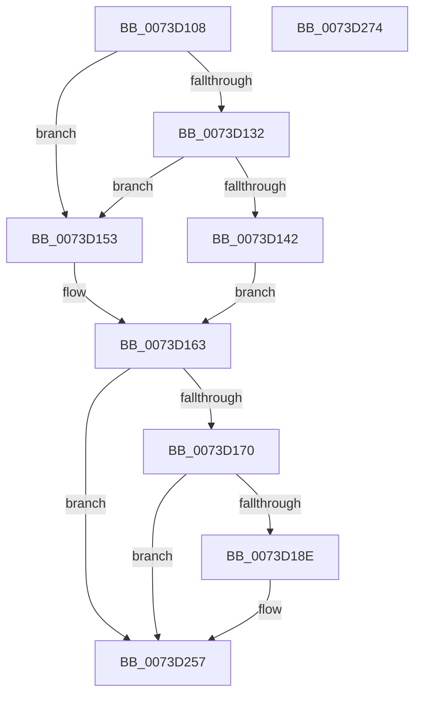

# PnpTraceRequestDeviceRemovalForReset

- RVA: `0x0073D108`–`0x0073D275` (길이 `365` bytes)
- VA: `0x000000014073D108`
- 실행 섹션: `PAGE`
- PDB 이름 있음: `예`; PDB Function 태그: `아니요`
- unwind 정보 RVA: `0x000C9068`
- 디코드: `85`개 명령, `365/365` bytes 표시
- 미해석 바이트: `0` (있으면 어셈블리에 `.byte`로 보존)

> 이 문서는 커널 이미지의 기계어와 PDB 기호를 분석해 생성했습니다. 4번과 5번은 함수 원형과 자료형을 바이너리 사용 방식에서 추정한 C 해석이며 원본 소스 복구 결과는 아닙니다.

## 1. Dependencies

- 직접 호출 지점: **3**; 고유 호출 대상: **3**
- 직접 호출자로 확인된 함수: **1**
- RIP 상대 이미지 참조: **4**

### Outgoing calls
- `0x0073D181` → [tlgKeywordOn](../../text/42/tlgKeywordOn_function_0042EAA0.md) (function, `0x0042EAA0`)
- `0x0073D252` → [tlgWriteTransfer_EtwWriteTransfer](../../text/42/tlgWriteTransfer_EtwWriteTransfer_function_004260E0.md) (function, `0x004260E0`)
- `0x0073D25E` → [_security_check_cookie](../../text/6A/_security_check_cookie_function_006AC640.md) (function, `0x006AC640`)

### Direct callers
- [PiProcessDeviceResetAction](../../text/5A/PiProcessDeviceResetAction_function_005A5CD8.md) at `0x005A5D63`

### Static image references
- `0x0073D11A` → RVA `0x00E0A740` (`.data`; read)
- `0x0073D153` → RVA `0x00E06F48` (`.data`; read)
- `0x0073D163` → RVA `0x00E06F90` (`.data`; read)
- `0x0073D224` → RVA `0x000471F1` (`.rdata`; read)

## 2. Other-region calls and transfers

- 다른 실행 섹션으로 향하는 call: **3**
  - `0x0073D181` → [tlgKeywordOn](../../text/42/tlgKeywordOn_function_0042EAA0.md) (`PAGE` → `.text`)
  - `0x0073D252` → [tlgWriteTransfer_EtwWriteTransfer](../../text/42/tlgWriteTransfer_EtwWriteTransfer_function_004260E0.md) (`PAGE` → `.text`)
  - `0x0073D25E` → [_security_check_cookie](../../text/6A/_security_check_cookie_function_006AC640.md) (`PAGE` → `.text`)
- 별도 외부 분기/꼬리 이동을 확인하지 못했습니다.

## 3. Assembly (complete function range)

```asm
0073D108  48 89 5C 24 08                  mov qword ptr [rsp + 8], rbx
0073D10D  55                              push rbp
0073D10E  48 8D 6C 24 A9                  lea rbp, [rsp - 0x57]
0073D113  48 81 EC 00 01 00 00            sub rsp, 0x100
0073D11A  48 8B 05 1F D6 6C 00            mov rax, qword ptr [rip + 0x6cd61f]
0073D121  48 33 C4                        xor rax, rsp
0073D124  48 89 45 47                     mov qword ptr [rbp + 0x47], rax
0073D128  45 8B D8                        mov r11d, r8d
0073D12B  8B DA                           mov ebx, edx
0073D12D  48 85 C9                        test rcx, rcx
0073D130  74 21                           je 0x14073d153
0073D132  48 8B 81 38 01 00 00            mov rax, qword ptr [rcx + 0x138]
0073D139  48 8B 48 28                     mov rcx, qword ptr [rax + 0x28]
0073D13D  48 85 C9                        test rcx, rcx
0073D140  74 11                           je 0x14073d153
0073D142  44 8B 91 2C 01 00 00            mov r10d, dword ptr [rcx + 0x12c]
0073D149  4C 8D 41 28                     lea r8, [rcx + 0x28]
0073D14D  4C 8D 49 38                     lea r9, [rcx + 0x38]
0073D151  EB 10                           jmp 0x14073d163
0073D153  4C 8D 05 EE 9D 6C 00            lea r8, [rip + 0x6c9dee]
0073D15A  41 BA 00 03 00 00               mov r10d, 0x300
0073D160  4D 8B C8                        mov r9, r8
0073D163  83 3D 26 9E 6C 00 05            cmp dword ptr [rip + 0x6c9e26], 5
0073D16A  0F 86 E7 00 00 00               jbe 0x14073d257
0073D170  48 BA 00 00 00 00 00 40 00 00   movabs rdx, 0x400000000000
0073D17A  48 8D 0D 0F 9E 6C 00            lea rcx, [rip + 0x6c9e0f]
0073D181  E8 1A 19 CF FF                  call 0x14042eaa0
0073D186  84 C0                           test al, al
0073D188  0F 84 C9 00 00 00               je 0x14073d257
0073D18E  83 65 D3 00                     and dword ptr [rbp - 0x2d], 0
0073D192  48 8D 45 97                     lea rax, [rbp - 0x69]
0073D196  83 65 E3 00                     and dword ptr [rbp - 0x1d], 0
0073D19A  B9 02 00 00 00                  mov ecx, 2
0073D19F  83 65 F3 00                     and dword ptr [rbp - 0xd], 0
0073D1A3  83 65 03 00                     and dword ptr [rbp + 3], 0
0073D1A7  83 65 13 00                     and dword ptr [rbp + 0x13], 0
0073D1AB  83 65 23 00                     and dword ptr [rbp + 0x23], 0
0073D1AF  8D 51 02                        lea edx, [rcx + 2]
0073D1B2  83 65 33 00                     and dword ptr [rbp + 0x33], 0
0073D1B6  83 65 43 00                     and dword ptr [rbp + 0x43], 0
0073D1BA  48 89 45 C7                     mov qword ptr [rbp - 0x39], rax
0073D1BE  48 8D 45 EF                     lea rax, [rbp - 0x11]
0073D1C2  48 89 45 D7                     mov qword ptr [rbp - 0x29], rax
0073D1C6  49 8B 40 08                     mov rax, qword ptr [r8 + 8]
0073D1CA  48 89 45 E7                     mov qword ptr [rbp - 0x19], rax
0073D1CE  41 0F B7 00                     movzx eax, word ptr [r8]
0073D1D2  45 33 C0                        xor r8d, r8d
0073D1D5  89 45 EF                        mov dword ptr [rbp - 0x11], eax
0073D1D8  48 8D 45 0F                     lea rax, [rbp + 0xf]
0073D1DC  48 89 45 F7                     mov qword ptr [rbp - 9], rax
0073D1E0  49 8B 41 08                     mov rax, qword ptr [r9 + 8]
0073D1E4  48 89 45 07                     mov qword ptr [rbp + 7], rax
0073D1E8  41 0F B7 01                     movzx eax, word ptr [r9]
0073D1EC  45 33 C9                        xor r9d, r9d
0073D1EF  89 45 0F                        mov dword ptr [rbp + 0xf], eax
0073D1F2  48 8D 45 87                     lea rax, [rbp - 0x79]
0073D1F6  48 89 45 17                     mov qword ptr [rbp + 0x17], rax
0073D1FA  48 8D 45 8B                     lea rax, [rbp - 0x75]
0073D1FE  48 89 45 27                     mov qword ptr [rbp + 0x27], rax
0073D202  48 8D 45 8F                     lea rax, [rbp - 0x71]
0073D206  48 89 45 37                     mov qword ptr [rbp + 0x37], rax
0073D20A  48 8D 45 A7                     lea rax, [rbp - 0x59]
0073D20E  89 4D DF                        mov dword ptr [rbp - 0x21], ecx
0073D211  89 4D FF                        mov dword ptr [rbp - 1], ecx
0073D214  48 8D 0D 75 9D 6C 00            lea rcx, [rip + 0x6c9d75]
0073D21B  89 55 1F                        mov dword ptr [rbp + 0x1f], edx
0073D21E  89 55 2F                        mov dword ptr [rbp + 0x2f], edx
0073D221  89 55 3F                        mov dword ptr [rbp + 0x3f], edx
0073D224  48 8D 15 C6 9F 90 FF            lea rdx, [rip - 0x6f603a]
0073D22B  48 89 44 24 28                  mov qword ptr [rsp + 0x28], rax
0073D230  C7 44 24 20 0A 00 00 00         mov dword ptr [rsp + 0x20], 0xa
0073D238  48 C7 45 97 00 00 00 01         mov qword ptr [rbp - 0x69], 0x1000000
0073D240  C7 45 CF 08 00 00 00            mov dword ptr [rbp - 0x31], 8
0073D247  44 89 55 87                     mov dword ptr [rbp - 0x79], r10d
0073D24B  89 5D 8B                        mov dword ptr [rbp - 0x75], ebx
0073D24E  44 89 5D 8F                     mov dword ptr [rbp - 0x71], r11d
0073D252  E8 89 8E CE FF                  call 0x1404260e0
0073D257  48 8B 4D 47                     mov rcx, qword ptr [rbp + 0x47]
0073D25B  48 33 CC                        xor rcx, rsp
0073D25E  E8 DD F3 F6 FF                  call 0x1406ac640
0073D263  48 8B 9C 24 10 01 00 00         mov rbx, qword ptr [rsp + 0x110]
0073D26B  48 81 C4 00 01 00 00            add rsp, 0x100
0073D272  5D                              pop rbp
0073D273  C3                              ret
0073D274  CC                              int3
```

## 4. C-style interpretation (structured pseudocode)

```c
__int64 __fastcall PnpTraceRequestDeviceRemovalForReset(__int64 a1, int a2, int a3)
{
    __int64 result;
    __int64 v_rsp;
    unsigned __int64 v_stack_m18;
    unsigned int v_stack_m1C;
    unsigned int v_stack_m20;
    unsigned __int64 v_stack_m28;
    unsigned int v_stack_m2C;
    unsigned int v_stack_m30;
    unsigned __int64 v_stack_m38;
    unsigned int v_stack_m3C;
    unsigned int v_stack_m40;
    unsigned __int64 v_stack_m48;
    unsigned int v_stack_m4C;
    unsigned __int64 v_stack_m50;
    unsigned __int64 v_stack_m58;
    unsigned int v_stack_m5C;
    unsigned __int64 v_stack_m5F;
    unsigned int v_stack_m60;
    unsigned __int64 v_stack_m68;
    unsigned int v_stack_m6C;
    unsigned __int64 v_stack_m70;
    unsigned __int64 v_stack_m78;
    unsigned int v_stack_m7C;
    unsigned int v_stack_m80;
    unsigned __int64 v_stack_m88;
    unsigned int v_stack_m8C;
    unsigned int v_stack_m90;
    unsigned __int64 v_stack_m98;
    unsigned __int64 v_stack_mB8;
    unsigned __int64 v_stack_mC8;
    unsigned __int64 v_stack_mD0;
    unsigned __int64 v_stack_mD4;
    unsigned __int64 v_stack_mD8;
    unsigned __int64 v_stack_mE0;
    unsigned int v_stack_mE8;
    unsigned __int64 v_stack_p8;

    v_stack_p8 = v_rbx;
    v_rsp = (v_rsp) - (256);
    result = (*(unsigned __int64 *)(v_rip + 7132703)) ^ (v_rsp);
    v_stack_m18 = result;
    if (a1 == 0) goto loc_0073D153;
    if (*(unsigned __int64 *)(*(unsigned __int64 *)(a1 + 312) + 40) == 0) goto loc_0073D153;
    goto loc_0073D163;
loc_0073D153:
loc_0073D163:
    if ((*(unsigned int *)(v_rip + 7118374)) <= 5) goto loc_0073D257;
    result = tlgKeywordOn(v_rip + 7118351, a2, v_rip + 7118318, v_rip + 7118318);
    if ((unsigned __int8)(result) != 0) {
        result = v_stack_mC8;
        a1 = 2;
        a2 = a1 + 2;
        v_stack_m98 = result;
        result = v_stack_m70;
        v_stack_m88 = result;
        result = *(unsigned __int64 *)(v_rip + 7118318 + 8);
        v_stack_m78 = result;
        result = *(unsigned __int16 *)(v_rip + 7118318);
        a3 = 0;
        v_stack_m70 = (unsigned int)(result);
        result = v_stack_m50;
        v_stack_m68 = result;
        result = *(unsigned __int64 *)(v_rip + 7118318 + 8);
        v_stack_m58 = result;
        result = *(unsigned __int16 *)(v_rip + 7118318);
        a4 = 0;
        v_stack_m50 = (unsigned int)(result);
        result = v_stack_mD8;
        v_stack_m48 = result;
        result = v_stack_mD4;
        v_stack_m38 = result;
        result = v_stack_mD0;
        v_stack_m28 = result;
        result = v_stack_mB8;
        v_stack_m80 = (unsigned int)(a1);
        v_stack_m60 = (unsigned int)(a1);
        a1 = v_rip + 7118197;
        v_stack_m40 = a2;
        v_stack_m30 = a2;
        v_stack_m20 = a2;
        a2 = v_rip - 7299130;
        v_stack_mE0 = result;
        v_stack_mE8 = 10;
        v_stack_mC8 = 0x1000000ULL;
        v_stack_m90 = 8;
        v_stack_mD8 = 768;
        v_stack_mD4 = (unsigned int)((unsigned int)(a2));
        v_stack_mD0 = (unsigned int)((unsigned int)(a3));
        result = tlgWriteTransfer_EtwWriteTransfer(a1, a2, a3, a4);
    }
    a1 = (v_stack_m18) ^ (v_rsp);
    result = _security_check_cookie(a1, a2, a3, a4);
    v_rsp = (v_rsp) + (256);
    return result;
}
```

## 5. (Beta) C Style

```c
int64_t PnpTraceRequestDeviceRemovalForReset(int64_t Arg1, int32_t Arg2, int32_t Arg3)
{
    int64_t result;
    int64_t local_rsp;
    uint64_t v_stack_m18;
    uint32_t v_stack_m1C;
    uint32_t v_stack_m20;
    uint64_t v_stack_m28;
    uint32_t v_stack_m2C;
    uint32_t v_stack_m30;
    uint64_t v_stack_m38;
    uint32_t v_stack_m3C;
    uint32_t v_stack_m40;
    uint64_t v_stack_m48;
    uint32_t v_stack_m4C;
    uint64_t v_stack_m50;
    uint64_t v_stack_m58;
    uint32_t v_stack_m5C;
    uint64_t v_stack_m5F;
    uint32_t v_stack_m60;
    uint64_t v_stack_m68;
    uint32_t v_stack_m6C;
    uint64_t v_stack_m70;
    uint64_t v_stack_m78;
    uint32_t v_stack_m7C;
    uint32_t v_stack_m80;
    uint64_t v_stack_m88;
    uint32_t v_stack_m8C;
    uint32_t v_stack_m90;
    uint64_t v_stack_m98;
    uint64_t v_stack_mB8;
    uint64_t v_stack_mC8;
    uint64_t v_stack_mD0;
    uint64_t v_stack_mD4;
    uint64_t v_stack_mD8;
    uint64_t v_stack_mE0;
    uint32_t v_stack_mE8;
    uint64_t v_stack_p8;

    v_stack_p8 = local_rbx;
    local_rsp = (local_rsp) - (256);
    result = (*(uint64_t *)(v_rip + 0x6CD61F)) ^ (local_rsp);
    v_stack_m18 = result;
    if (Arg1 == 0) goto loc_0073D153;
    if (*(uint64_t *)(*(uint64_t *)(Arg1 + 0x138) + 0x28) == 0) goto loc_0073D153;
    goto loc_0073D163;
loc_0073D153:
loc_0073D163:
    if ((*(uint32_t *)(v_rip + 0x6C9E26)) <= 5) goto loc_0073D257;
    result = tlgKeywordOn(v_rip + 7118351, Arg2, v_rip + 7118318, v_rip + 7118318);
    if ((uint8_t)(result) != 0) {
        result = v_stack_mC8;
        Arg1 = 2;
        Arg2 = Arg1 + 2;
        v_stack_m98 = result;
        result = v_stack_m70;
        v_stack_m88 = result;
        result = *(uint64_t *)(v_rip + 0x6C9DEE + 0x8);
        v_stack_m78 = result;
        result = *(uint16_t *)(v_rip + 0x6C9DEE);
        Arg3 = 0;
        v_stack_m70 = (uint32_t)(result);
        result = v_stack_m50;
        v_stack_m68 = result;
        result = *(uint64_t *)(v_rip + 0x6C9DEE + 0x8);
        v_stack_m58 = result;
        result = *(uint16_t *)(v_rip + 0x6C9DEE);
        a4 = 0;
        v_stack_m50 = (uint32_t)(result);
        result = v_stack_mD8;
        v_stack_m48 = result;
        result = v_stack_mD4;
        v_stack_m38 = result;
        result = v_stack_mD0;
        v_stack_m28 = result;
        result = v_stack_mB8;
        v_stack_m80 = (uint32_t)(Arg1);
        v_stack_m60 = (uint32_t)(Arg1);
        Arg1 = v_rip + 7118197;
        v_stack_m40 = Arg2;
        v_stack_m30 = Arg2;
        v_stack_m20 = Arg2;
        Arg2 = v_rip - 7299130;
        v_stack_mE0 = result;
        v_stack_mE8 = 10;
        v_stack_mC8 = 0x1000000ULL;
        v_stack_m90 = 8;
        v_stack_mD8 = 768;
        v_stack_mD4 = (uint32_t)((uint32_t)(Arg2));
        v_stack_mD0 = (uint32_t)((uint32_t)(Arg3));
        result = tlgWriteTransfer_EtwWriteTransfer(Arg1, Arg2, Arg3, a4);
    }
    Arg1 = (v_stack_m18) ^ (local_rsp);
    result = _security_check_cookie(Arg1, Arg2, Arg3, a4);
    local_rsp = (local_rsp) + (256);
    return result;
}
```

## 6. Execution-region graph

[열기: 2D/3D 그래프와 함수 탐색 컨트롤 패널](../../../control-panel.html?section=page&rva=0x0073D108&view=graph)

- 2D 그래프는 위에서 아래로 흐르고, 3D 그래프는 빈 공간을 드래그해 회전합니다. Shift+드래그는 이동, 휠은 확대·축소, 함수 노드 선택은 대상 보고서 이동입니다.

### Static fallback


