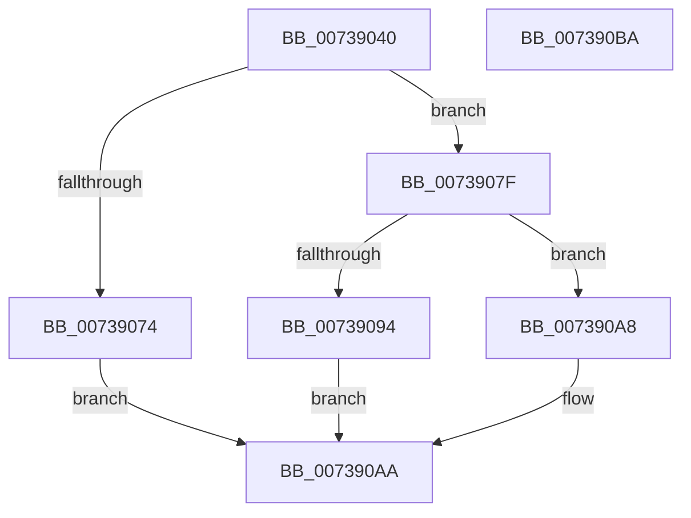

# PnprAddDeviceResources

- RVA: `0x00739040`–`0x007390BB` (길이 `123` bytes)
- VA: `0x0000000140739040`
- 실행 섹션: `PAGE`
- PDB 이름 있음: `예`; PDB Function 태그: `아니요`
- unwind 정보 RVA: `0x000C88C4`
- 디코드: `37`개 명령, `123/123` bytes 표시
- 미해석 바이트: `0` (있으면 어셈블리에 `.byte`로 보존)

> 이 문서는 커널 이미지의 기계어와 PDB 기호를 분석해 생성했습니다. 4번과 5번은 함수 원형과 자료형을 바이너리 사용 방식에서 추정한 C 해석이며 원본 소스 복구 결과는 아닙니다.

## 1. Dependencies

- 직접 호출 지점: **4**; 고유 호출 대상: **4**
- 직접 호출자로 확인된 함수: **0**
- RIP 상대 이미지 참조: **0**

### Outgoing calls
- `0x00739068` → [PnprIsMemoryDevice](PnprIsMemoryDevice_function_00739DF0.md) (function, `0x00739DF0`)
- `0x00739078` → [PnprAddMemoryResources](PnprAddMemoryResources_function_007390C4.md) (function, `0x007390C4`)
- `0x0073908B` → [PnprIsProcessorDevice](PnprIsProcessorDevice_function_00739EA8.md) (function, `0x00739EA8`)
- `0x007390A1` → [PnprAddProcessorResources](PnprAddProcessorResources_function_007392AC.md) (function, `0x007392AC`)

### Direct callers
- 이 함수 시작 RVA로 연결되는 직접 call은 확인되지 않았습니다. 간접 호출은 완전히 역산할 수 없습니다.

### Static image references
- 디코드된 RIP-relative 메모리 참조가 없습니다.

## 2. Other-region calls and transfers

- 다른 실행 섹션으로 향하는 call: **0**
- 별도 외부 분기/꼬리 이동을 확인하지 못했습니다.

## 3. Assembly (complete function range)

```asm
00739040  48 8B C4                        mov rax, rsp
00739043  48 89 58 18                     mov qword ptr [rax + 0x18], rbx
00739047  48 89 70 20                     mov qword ptr [rax + 0x20], rsi
0073904B  57                              push rdi
0073904C  48 83 EC 20                     sub rsp, 0x20
00739050  48 8B 59 20                     mov rbx, qword ptr [rcx + 0x20]
00739054  48 8B F2                        mov rsi, rdx
00739057  48 8B 7A 08                     mov rdi, qword ptr [rdx + 8]
0073905B  48 8B CB                        mov rcx, rbx
0073905E  8A 12                           mov dl, byte ptr [rdx]
00739060  83 60 08 00                     and dword ptr [rax + 8], 0
00739064  83 60 10 00                     and dword ptr [rax + 0x10], 0
00739068  E8 83 0D 00 00                  call 0x140739df0
0073906D  48 8B CB                        mov rcx, rbx
00739070  84 C0                           test al, al
00739072  74 0B                           je 0x14073907f
00739074  48 8D 57 18                     lea rdx, [rdi + 0x18]
00739078  E8 47 00 00 00                  call 0x1407390c4
0073907D  EB 2B                           jmp 0x1407390aa
0073907F  8A 16                           mov dl, byte ptr [rsi]
00739081  4C 8D 4C 24 30                  lea r9, [rsp + 0x30]
00739086  4C 8D 44 24 38                  lea r8, [rsp + 0x38]
0073908B  E8 18 0E 00 00                  call 0x140739ea8
00739090  84 C0                           test al, al
00739092  74 14                           je 0x1407390a8
00739094  44 8B 44 24 30                  mov r8d, dword ptr [rsp + 0x30]
00739099  4C 8D 4F 10                     lea r9, [rdi + 0x10]
0073909D  8B 54 24 38                     mov edx, dword ptr [rsp + 0x38]
007390A1  E8 06 02 00 00                  call 0x1407392ac
007390A6  EB 02                           jmp 0x1407390aa
007390A8  33 C0                           xor eax, eax
007390AA  48 8B 5C 24 40                  mov rbx, qword ptr [rsp + 0x40]
007390AF  48 8B 74 24 48                  mov rsi, qword ptr [rsp + 0x48]
007390B4  48 83 C4 20                     add rsp, 0x20
007390B8  5F                              pop rdi
007390B9  C3                              ret
007390BA  CC                              int3
```

## 4. C-style interpretation (structured pseudocode)

```c
__int64 __fastcall PnprAddDeviceResources(__int64 a1, __int64 a2)
{
    __int64 result;
    __int64 v_rsp;
    unsigned __int64 v_stack_p10;
    unsigned __int64 v_stack_p18;
    unsigned __int64 v_stack_p20;
    unsigned __int64 v_stack_p8;

    *(unsigned __int64 *)(v_rsp + 24) = v_rbx;
    *(unsigned __int64 *)(v_rsp + 32) = v_rsi;
    v_rsp = (v_rsp) - (32);
    result = PnprIsMemoryDevice(*(unsigned __int64 *)(a1 + 32), *(unsigned __int8 *)(a2), a3, a4);
    if ((unsigned __int8)(result) == 0) goto loc_0073907F;
    result = PnprAddMemoryResources(*(unsigned __int64 *)(a1 + 32), *(unsigned __int64 *)(a2 + 8) + 24, a3, a4);
    goto loc_007390AA;
loc_0073907F:
    result = PnprIsProcessorDevice(*(unsigned __int64 *)(a1 + 32), *(unsigned __int8 *)(a2), v_stack_p10, v_stack_p8);
    if ((unsigned __int8)(result) == 0) goto loc_007390A8;
    result = PnprAddProcessorResources(*(unsigned __int64 *)(a1 + 32), (unsigned int)(v_stack_p10), (unsigned int)(v_stack_p8), *(unsigned __int64 *)(a2 + 8) + 16);
    goto loc_007390AA;
loc_007390A8:
    result = 0;
loc_007390AA:
    v_rsp = (v_rsp) + (32);
    return result;
}
```

## 5. (Beta) C Style

```c
int64_t PnprAddDeviceResources(void *Arg1, void *Arg2)
{
    uint8_t *arg1 = (uint8_t *)Arg1;
    uint8_t *arg2 = (uint8_t *)Arg2;

    int64_t result;
    int64_t local_rsp;
    uint64_t v_stack_p10;
    uint64_t v_stack_p18;
    uint64_t v_stack_p20;
    uint64_t v_stack_p8;

    *(uint64_t *)(local_rsp + 0x18) = local_rbx;
    *(uint64_t *)(local_rsp + 0x20) = local_rsi;
    local_rsp = (local_rsp) - (32);
    result = PnprIsMemoryDevice(*(uint64_t *)(arg1 + 0x20), *(uint8_t *)(arg2), a3, a4);
    if ((uint8_t)(result) == 0) goto loc_0073907F;
    result = PnprAddMemoryResources(*(uint64_t *)(arg1 + 0x20), *(uint64_t *)(arg2 + 0x8) + 24, a3, a4);
    goto loc_007390AA;
loc_0073907F:
    result = PnprIsProcessorDevice(*(uint64_t *)(arg1 + 0x20), *(uint8_t *)(arg2), v_stack_p10, v_stack_p8);
    if ((uint8_t)(result) == 0) goto loc_007390A8;
    result = PnprAddProcessorResources(*(uint64_t *)(arg1 + 0x20), (uint32_t)(v_stack_p10), (uint32_t)(v_stack_p8), *(uint64_t *)(arg2 + 0x8) + 16);
    goto loc_007390AA;
loc_007390A8:
    result = 0;
loc_007390AA:
    local_rsp = (local_rsp) + (32);
    return result;
}
```

### 관측된 메모리 오프셋

구조체 형식이 확인되지 않은 접근은 인자 기준의 오프셋으로만 기록했습니다.

| 기준 인자 | 오프셋 표현 | 폭 (bit) | 접근 |
|---|---:|---:|---|
| `Arg1` | `+ 0x20` | `64` | `R` |
| `Arg2` | `+ 0x0` | `8` | `R` |
| `Arg2` | `+ 0x8` | `64` | `R` |

## 6. Execution-region graph

[열기: 2D/3D 그래프와 함수 탐색 컨트롤 패널](../../../control-panel.html?section=page&rva=0x00739040&view=graph)

- 2D 그래프는 위에서 아래로 흐르고, 3D 그래프는 빈 공간을 드래그해 회전합니다. Shift+드래그는 이동, 휠은 확대·축소, 함수 노드 선택은 대상 보고서 이동입니다.

### Static fallback


