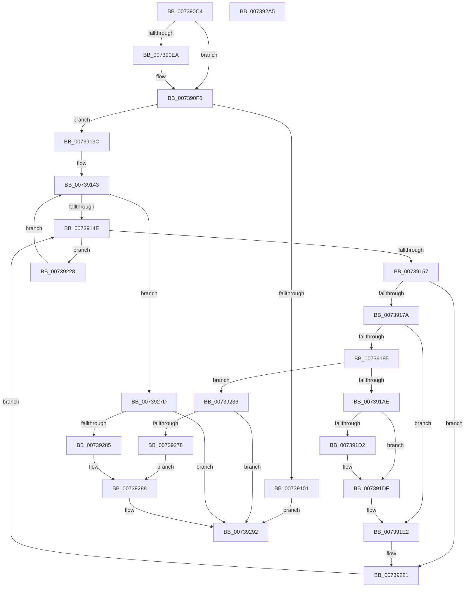

# PnprAddMemoryResources

- RVA: `0x007390C4`–`0x007392A6` (길이 `482` bytes)
- VA: `0x00000001407390C4`
- 실행 섹션: `PAGE`
- PDB 이름 있음: `예`; PDB Function 태그: `아니요`
- unwind 정보 RVA: `0x000C8F34`
- 디코드: `133`개 명령, `482/482` bytes 표시
- 미해석 바이트: `0` (있으면 어셈블리에 `.byte`로 보존)

> 이 문서는 커널 이미지의 기계어와 PDB 기호를 분석해 생성했습니다. 4번과 5번은 함수 원형과 자료형을 바이너리 사용 방식에서 추정한 C 해석이며 원본 소스 복구 결과는 아닙니다.

## 1. Dependencies

- 직접 호출 지점: **5**; 고유 호출 대상: **4**
- 직접 호출자로 확인된 함수: **1**
- RIP 상대 이미지 참조: **1**

### Outgoing calls
- `0x0073919D` → [ExAllocatePool2](../../poolcode/B8/ExAllocatePool2_function_00B820F0.md) (function, `0x00B820F0`)
- `0x007391C0` → [memcpy](../../text/6C/memcpy_function_006C6840.md) (function, `0x006C6840`)
- `0x007391DA` → [ExFreePoolWithTag](../../poolcode/B8/ExFreePoolWithTag_function_00B82870.md) (function, `0x00B82870`)
- `0x007391F2` → [RtlCmDecodeMemIoResource](../../text/4A/RtlCmDecodeMemIoResource_function_004A0120.md) (function, `0x004A0120`)
- `0x0073928D` → [ExFreePoolWithTag](../../poolcode/B8/ExFreePoolWithTag_function_00B82870.md) (function, `0x00B82870`)

### Direct callers
- [PnprAddDeviceResources](PnprAddDeviceResources_function_00739040.md) at `0x00739078`

### Static image references
- `0x00739101` → RVA `0x00F8AC38` (`.data`; read)

## 2. Other-region calls and transfers

- 다른 실행 섹션으로 향하는 call: **5**
  - `0x0073919D` → [ExAllocatePool2](../../poolcode/B8/ExAllocatePool2_function_00B820F0.md) (`PAGE` → `POOLCODE`)
  - `0x007391C0` → [memcpy](../../text/6C/memcpy_function_006C6840.md) (`PAGE` → `.text`)
  - `0x007391DA` → [ExFreePoolWithTag](../../poolcode/B8/ExFreePoolWithTag_function_00B82870.md) (`PAGE` → `POOLCODE`)
  - `0x007391F2` → [RtlCmDecodeMemIoResource](../../text/4A/RtlCmDecodeMemIoResource_function_004A0120.md) (`PAGE` → `.text`)
  - `0x0073928D` → [ExFreePoolWithTag](../../poolcode/B8/ExFreePoolWithTag_function_00B82870.md) (`PAGE` → `POOLCODE`)
- 별도 외부 분기/꼬리 이동을 확인하지 못했습니다.

## 3. Assembly (complete function range)

```asm
007390C4  48 8B C4                        mov rax, rsp
007390C7  53                              push rbx
007390C8  55                              push rbp
007390C9  56                              push rsi
007390CA  57                              push rdi
007390CB  41 54                           push r12
007390CD  41 55                           push r13
007390CF  41 56                           push r14
007390D1  41 57                           push r15
007390D3  48 83 EC 28                     sub rsp, 0x28
007390D7  48 83 60 18 00                  and qword ptr [rax + 0x18], 0
007390DC  4C 8B FA                        mov r15, rdx
007390DF  48 8B 1A                        mov rbx, qword ptr [rdx]
007390E2  48 8B F3                        mov rsi, rbx
007390E5  48 85 C9                        test rcx, rcx
007390E8  74 0B                           je 0x1407390f5
007390EA  48 8B 81 38 01 00 00            mov rax, qword ptr [rcx + 0x138]
007390F1  48 8B 48 28                     mov rcx, qword ptr [rax + 0x28]
007390F5  4C 8B B1 A0 01 00 00            mov r14, qword ptr [rcx + 0x1a0]
007390FC  4D 85 F6                        test r14, r14
007390FF  75 3B                           jne 0x14073913c
00739101  48 8B 0D 30 1B 85 00            mov rcx, qword ptr [rip + 0x851b30]
00739108  33 FF                           xor edi, edi
0073910A  BA 77 02 00 00                  mov edx, 0x277
0073910F  8B 81 08 82 00 00               mov eax, dword ptr [rcx + 0x8208]
00739115  85 C0                           test eax, eax
00739117  0F 44 C2                        cmove eax, edx
0073911A  8D 57 06                        lea edx, [rdi + 6]
0073911D  89 81 08 82 00 00               mov dword ptr [rcx + 0x8208], eax
00739123  8B 81 0C 82 00 00               mov eax, dword ptr [rcx + 0x820c]
00739129  85 C0                           test eax, eax
0073912B  0F 44 C2                        cmove eax, edx
0073912E  89 81 0C 82 00 00               mov dword ptr [rcx + 0x820c], eax
00739134  49 89 1F                        mov qword ptr [r15], rbx
00739137  E9 56 01 00 00                  jmp 0x140739292
0073913C  49 8D 6E 04                     lea rbp, [r14 + 4]
00739140  45 33 E4                        xor r12d, r12d
00739143  33 FF                           xor edi, edi
00739145  45 3B 26                        cmp r12d, dword ptr [r14]
00739148  0F 83 2F 01 00 00               jae 0x14073927d
0073914E  3B 7D 0C                        cmp edi, dword ptr [rbp + 0xc]
00739151  0F 83 D1 00 00 00               jae 0x140739228
00739157  48 8D 0C BF                     lea rcx, [rdi + rdi*4]
0073915B  48 8D 04 8D 10 00 00 00         lea rax, [rcx*4 + 0x10]
00739163  48 03 C5                        add rax, rbp
00739166  48 89 84 24 88 00 00 00         mov qword ptr [rsp + 0x88], rax
0073916E  8A 00                           mov al, byte ptr [rax]
00739170  2C 03                           sub al, 3
00739172  A8 FB                           test al, 0xfb
00739174  0F 85 A7 00 00 00               jne 0x140739221
0073917A  8B 43 04                        mov eax, dword ptr [rbx + 4]
0073917D  89 44 24 70                     mov dword ptr [rsp + 0x70], eax
00739181  3B 03                           cmp eax, dword ptr [rbx]
00739183  75 5D                           jne 0x1407391e2
00739185  83 C0 04                        add eax, 4
00739188  B9 40 00 00 00                  mov ecx, 0x40
0073918D  41 B8 50 6E 70 51               mov r8d, 0x51706e50
00739193  89 44 24 78                     mov dword ptr [rsp + 0x78], eax
00739197  8D 50 01                        lea edx, [rax + 1]
0073919A  C1 E2 04                        shl edx, 4
0073919D  E8 4E 8F 44 00                  call 0x140b820f0
007391A2  4C 8B E8                        mov r13, rax
007391A5  48 85 C0                        test rax, rax
007391A8  0F 84 88 00 00 00               je 0x140739236
007391AE  44 8B 44 24 70                  mov r8d, dword ptr [rsp + 0x70]
007391B3  48 8B D3                        mov rdx, rbx
007391B6  41 FF C0                        inc r8d
007391B9  48 8B C8                        mov rcx, rax
007391BC  41 C1 E0 04                     shl r8d, 4
007391C0  E8 7B D6 F8 FF                  call 0x1406c6840
007391C5  8B 44 24 78                     mov eax, dword ptr [rsp + 0x78]
007391C9  41 89 45 00                     mov dword ptr [r13], eax
007391CD  48 3B DE                        cmp rbx, rsi
007391D0  74 0D                           je 0x1407391df
007391D2  BA 50 6E 70 51                  mov edx, 0x51706e50
007391D7  48 8B CB                        mov rcx, rbx
007391DA  E8 91 96 44 00                  call 0x140b82870
007391DF  49 8B DD                        mov rbx, r13
007391E2  48 8B 8C 24 88 00 00 00         mov rcx, qword ptr [rsp + 0x88]
007391EA  48 8D 94 24 80 00 00 00         lea rdx, [rsp + 0x80]
007391F2  E8 29 6F D6 FF                  call 0x1404a0120
007391F7  8B 4B 04                        mov ecx, dword ptr [rbx + 4]
007391FA  48 8B D0                        mov rdx, rax
007391FD  48 8B 84 24 80 00 00 00         mov rax, qword ptr [rsp + 0x80]
00739205  48 FF C1                        inc rcx
00739208  48 03 C9                        add rcx, rcx
0073920B  48 89 04 CB                     mov qword ptr [rbx + rcx*8], rax
0073920F  8B 43 04                        mov eax, dword ptr [rbx + 4]
00739212  48 03 C0                        add rax, rax
00739215  48 89 54 C3 18                  mov qword ptr [rbx + rax*8 + 0x18], rdx
0073921A  48 01 53 08                     add qword ptr [rbx + 8], rdx
0073921E  FF 43 04                        inc dword ptr [rbx + 4]
00739221  FF C7                           inc edi
00739223  E9 26 FF FF FF                  jmp 0x14073914e
00739228  8D 4F 24                        lea ecx, [rdi + 0x24]
0073922B  48 03 E9                        add rbp, rcx
0073922E  41 FF C4                        inc r12d
00739231  E9 0D FF FF FF                  jmp 0x140739143
00739236  48 8B 0D FB 19 85 00            mov rcx, qword ptr [rip + 0x8519fb]
0073923D  BA 9F 02 00 00                  mov edx, 0x29f
00739242  41 B8 0A 00 00 00               mov r8d, 0xa
00739248  BF 9A 00 00 C0                  mov edi, 0xc000009a
0073924D  8B 81 08 82 00 00               mov eax, dword ptr [rcx + 0x8208]
00739253  85 C0                           test eax, eax
00739255  0F 44 C2                        cmove eax, edx
00739258  89 81 08 82 00 00               mov dword ptr [rcx + 0x8208], eax
0073925E  8B 81 0C 82 00 00               mov eax, dword ptr [rcx + 0x820c]
00739264  85 C0                           test eax, eax
00739266  41 0F 44 C0                     cmove eax, r8d
0073926A  89 81 0C 82 00 00               mov dword ptr [rcx + 0x820c], eax
00739270  49 89 37                        mov qword ptr [r15], rsi
00739273  48 3B DE                        cmp rbx, rsi
00739276  74 1A                           je 0x140739292
00739278  48 8B CB                        mov rcx, rbx
0073927B  EB 0B                           jmp 0x140739288
0073927D  49 89 1F                        mov qword ptr [r15], rbx
00739280  48 3B DE                        cmp rbx, rsi
00739283  74 0D                           je 0x140739292
00739285  48 8B CE                        mov rcx, rsi
00739288  BA 50 6E 70 51                  mov edx, 0x51706e50
0073928D  E8 DE 95 44 00                  call 0x140b82870
00739292  8B C7                           mov eax, edi
00739294  48 83 C4 28                     add rsp, 0x28
00739298  41 5F                           pop r15
0073929A  41 5E                           pop r14
0073929C  41 5D                           pop r13
0073929E  41 5C                           pop r12
007392A0  5F                              pop rdi
007392A1  5E                              pop rsi
007392A2  5D                              pop rbp
007392A3  5B                              pop rbx
007392A4  C3                              ret
007392A5  CC                              int3
```

## 4. C-style interpretation (structured pseudocode)

```c
__int64 __fastcall PnprAddMemoryResources(__int64 a1, __int64 a2)
{
    __int64 result;
    __int64 v_r12;
    __int64 v_rbp;
    __int64 v_rdi;
    __int64 v_rsp;
    unsigned int v_stack_p10;
    unsigned __int64 v_stack_p18;
    unsigned __int64 v_stack_p20;
    unsigned int v_stack_p8;

    v_rsp = (v_rsp) - (40);
    result = v_rsp;
    if (a1 != 0) {
        result = *(unsigned __int64 *)(a1 + 312);
        a1 = *(unsigned __int64 *)(result + 40);
    }
    if (*(unsigned __int64 *)(a1 + 416) != 0) goto loc_0073913C;
    v_rdi = 0;
    result = (unsigned int)(*(unsigned int *)(*(unsigned __int64 *)(v_rip + 8723248) + 33288));
    if ((unsigned int)((unsigned int)(*(unsigned int *)(*(unsigned __int64 *)(v_rip + 8723248) + 33288))) == 0) { result = 631; }
    *(unsigned int *)(*(unsigned __int64 *)(v_rip + 8723248) + 33288) = (unsigned int)(result);
    result = (unsigned int)(*(unsigned int *)(*(unsigned __int64 *)(v_rip + 8723248) + 33292));
    if ((unsigned int)((unsigned int)(*(unsigned int *)(*(unsigned __int64 *)(v_rip + 8723248) + 33292))) == 0) { result = (unsigned int)(v_rdi + 6); }
    *(unsigned int *)(*(unsigned __int64 *)(v_rip + 8723248) + 33292) = (unsigned int)(result);
    *(unsigned __int64 *)(a2) = *(unsigned __int64 *)(a2);
    goto loc_00739292;
loc_0073913C:
    v_r12 = 0;
loc_00739143:
    v_rdi = 0;
    if (0 >= (*(unsigned int *)(*(unsigned __int64 *)(a1 + 416)))) goto loc_0073927D;
loc_0073914E:
    if (0 >= (*(unsigned int *)(*(unsigned __int64 *)(a1 + 416) + 4 + 12))) goto loc_00739228;
    result = (v_rdi + v_rdi * 4 * 4 + 16) + (*(unsigned __int64 *)(a1 + 416) + 4);
    v_stack_p20 = result;
    result = (unsigned __int8)((*(unsigned __int8 *)(result)) - (3));
    if ((((unsigned __int8)(result)) & (251)) != 0) goto loc_00739221;
    v_stack_p8 = (unsigned int)((unsigned int)(*(unsigned int *)(*(unsigned __int64 *)(a2) + 4)));
    if (((unsigned int)((unsigned int)(*(unsigned int *)(*(unsigned __int64 *)(a2) + 4)))) != (*(unsigned int *)(*(unsigned __int64 *)(a2)))) goto loc_007391E2;
    result = (unsigned int)(((unsigned int)(*(unsigned int *)(*(unsigned __int64 *)(a2) + 4))) + (4));
    v_stack_p10 = (unsigned int)(result);
    a2 = (unsigned int)((result + 1) << (4));
    result = ExAllocatePool2(64, a2, (unsigned int)(0x51706E50ULL), a4);
    if (result == 0) goto loc_00739236;
    a3 = (unsigned int)(((unsigned int)(v_stack_p8)) + 1);
    a3 = (unsigned int)((a3) << (4));
    result = memcpy(result, *(unsigned __int64 *)(a2), a3, a4);
    *(unsigned int *)(result) = (unsigned int)((unsigned int)(v_stack_p10));
    result = (unsigned int)(v_stack_p10);
    if ((*(unsigned __int64 *)(a2)) != (*(unsigned __int64 *)(a2))) {
        a2 = 0x51706E50ULL;
        a1 = *(unsigned __int64 *)(a2);
        result = ExFreePoolWithTag(a1, a2, a3, a4);
    }
loc_007391E2:
    result = RtlCmDecodeMemIoResource(v_stack_p20, v_stack_p18, a3, a4);
    a1 = ((unsigned int)(*(unsigned int *)(result + 4))) + 1;
    a1 = (a1) + (a1);
    *(unsigned __int64 *)(result + a1 * 8) = v_stack_p18;
    result = ((unsigned int)(*(unsigned int *)(result + 4))) + ((unsigned int)(*(unsigned int *)(result + 4)));
    *(unsigned __int64 *)(result + result * 8 + 24) = result;
loc_00739221:
    v_rdi = (unsigned int)((v_rdi) + 1);
    goto loc_0073914E;
loc_00739228:
    v_rbp = (*(unsigned __int64 *)(a1 + 416) + 4) + (v_rdi + 36);
    v_r12 = (unsigned int)((v_r12) + 1);
    goto loc_00739143;
loc_00739236:
    result = (unsigned int)(*(unsigned int *)(*(unsigned __int64 *)(v_rip + 8722939) + 33288));
    if ((unsigned int)((unsigned int)(*(unsigned int *)(*(unsigned __int64 *)(v_rip + 8722939) + 33288))) == 0) { result = 671; }
    *(unsigned int *)(*(unsigned __int64 *)(v_rip + 8722939) + 33288) = (unsigned int)(result);
    result = (unsigned int)(*(unsigned int *)(*(unsigned __int64 *)(v_rip + 8722939) + 33292));
    if ((unsigned int)((unsigned int)(*(unsigned int *)(*(unsigned __int64 *)(v_rip + 8722939) + 33292))) == 0) { result = 10; }
    *(unsigned int *)(*(unsigned __int64 *)(v_rip + 8722939) + 33292) = (unsigned int)(result);
    *(unsigned __int64 *)(a2) = *(unsigned __int64 *)(a2);
    if (result == (*(unsigned __int64 *)(a2))) goto loc_00739292;
    goto loc_00739288;
loc_0073927D:
    *(unsigned __int64 *)(a2) = result;
    if (result == (*(unsigned __int64 *)(a2))) goto loc_00739292;
loc_00739288:
    result = ExFreePoolWithTag(*(unsigned __int64 *)(a2), (unsigned int)(0x51706E50ULL), 10, a4);
loc_00739292:
    v_rsp = (v_rsp) + (40);
    return (unsigned int)((unsigned int)((unsigned int)(0xC000009AULL)));
}
```

## 5. (Beta) C Style

```c
int64_t PnprAddMemoryResources(int64_t Arg1, void *Arg2)
{
    uint8_t *arg2 = (uint8_t *)Arg2;

    int64_t result;
    int64_t local_r12;
    int64_t local_rbp;
    int64_t local_rdi;
    int64_t local_rsp;
    uint32_t v_stack_p10;
    uint64_t v_stack_p18;
    uint64_t v_stack_p20;
    uint32_t v_stack_p8;

    local_rsp = (local_rsp) - (40);
    result = local_rsp;
    if (Arg1 != 0) {
        result = *(uint64_t *)(Arg1 + 0x138);
        Arg1 = *(uint64_t *)(result + 0x28);
    }
    if (*(uint64_t *)(Arg1 + 0x1A0) != 0) goto loc_0073913C;
    local_rdi = 0;
    result = (uint32_t)(*(uint32_t *)(*(uint64_t *)(v_rip + 0x851B30) + 0x8208));
    if ((uint32_t)((uint32_t)(*(uint32_t *)(*(uint64_t *)(v_rip + 0x851B30) + 0x8208))) == 0) { result = 631; }
    *(uint32_t *)(*(uint64_t *)(v_rip + 0x851B30) + 0x8208) = (uint32_t)(result);
    result = (uint32_t)(*(uint32_t *)(*(uint64_t *)(v_rip + 0x851B30) + 0x820C));
    if ((uint32_t)((uint32_t)(*(uint32_t *)(*(uint64_t *)(v_rip + 0x851B30) + 0x820C))) == 0) { result = (uint32_t)(local_rdi + 6); }
    *(uint32_t *)(*(uint64_t *)(v_rip + 0x851B30) + 0x820C) = (uint32_t)(result);
    *(uint64_t *)(arg2) = *(uint64_t *)(arg2);
    goto loc_00739292;
loc_0073913C:
    local_r12 = 0;
loc_00739143:
    local_rdi = 0;
    if (0 >= (*(uint32_t *)(*(uint64_t *)(Arg1 + 0x1A0)))) goto loc_0073927D;
loc_0073914E:
    if (0 >= (*(uint32_t *)(*(uint64_t *)(Arg1 + 0x1A0) + 0x4 + 0xC))) goto loc_00739228;
    result = (local_rdi + local_rdi * 4 * 4 + 16) + (*(uint64_t *)(Arg1 + 0x1A0) + 4);
    v_stack_p20 = result;
    result = (uint8_t)((*(uint8_t *)(result)) - (3));
    if ((((uint8_t)(result)) & (251)) != 0) goto loc_00739221;
    v_stack_p8 = (uint32_t)((uint32_t)(*(uint32_t *)(*(uint64_t *)(arg2) + 0x4)));
    if (((uint32_t)((uint32_t)(*(uint32_t *)(*(uint64_t *)(arg2) + 0x4)))) != (*(uint32_t *)(*(uint64_t *)(arg2)))) goto loc_007391E2;
    result = (uint32_t)(((uint32_t)(*(uint32_t *)(*(uint64_t *)(arg2) + 0x4))) + (4));
    v_stack_p10 = (uint32_t)(result);
    Arg2 = (uint32_t)((result + 1) << (4));
    result = ExAllocatePool2(64, Arg2, (uint32_t)(0x51706E50ULL), a4);
    if (result == 0) goto loc_00739236;
    a3 = (uint32_t)(((uint32_t)(v_stack_p8)) + 1);
    a3 = (uint32_t)((a3) << (4));
    result = memcpy(result, *(uint64_t *)(arg2), a3, a4);
    *(uint32_t *)(result) = (uint32_t)((uint32_t)(v_stack_p10));
    result = (uint32_t)(v_stack_p10);
    if ((*(uint64_t *)(arg2)) != (*(uint64_t *)(arg2))) {
        Arg2 = 0x51706E50ULL;
        Arg1 = *(uint64_t *)(arg2);
        result = ExFreePoolWithTag(Arg1, Arg2, a3, a4);
    }
loc_007391E2:
    result = RtlCmDecodeMemIoResource(v_stack_p20, v_stack_p18, a3, a4);
    Arg1 = ((uint32_t)(*(uint32_t *)(result + 0x4))) + 1;
    Arg1 = (Arg1) + (Arg1);
    *(uint64_t *)(result + Arg1 * 8) = v_stack_p18;
    result = ((uint32_t)(*(uint32_t *)(result + 0x4))) + ((uint32_t)(*(uint32_t *)(result + 0x4)));
    *(uint64_t *)(result + result * 8 + 0x18) = result;
loc_00739221:
    local_rdi = (uint32_t)((local_rdi) + 1);
    goto loc_0073914E;
loc_00739228:
    local_rbp = (*(uint64_t *)(Arg1 + 0x1A0) + 4) + (local_rdi + 36);
    local_r12 = (uint32_t)((local_r12) + 1);
    goto loc_00739143;
loc_00739236:
    result = (uint32_t)(*(uint32_t *)(*(uint64_t *)(v_rip + 0x8519FB) + 0x8208));
    if ((uint32_t)((uint32_t)(*(uint32_t *)(*(uint64_t *)(v_rip + 0x8519FB) + 0x8208))) == 0) { result = 671; }
    *(uint32_t *)(*(uint64_t *)(v_rip + 0x8519FB) + 0x8208) = (uint32_t)(result);
    result = (uint32_t)(*(uint32_t *)(*(uint64_t *)(v_rip + 0x8519FB) + 0x820C));
    if ((uint32_t)((uint32_t)(*(uint32_t *)(*(uint64_t *)(v_rip + 0x8519FB) + 0x820C))) == 0) { result = 10; }
    *(uint32_t *)(*(uint64_t *)(v_rip + 0x8519FB) + 0x820C) = (uint32_t)(result);
    *(uint64_t *)(arg2) = *(uint64_t *)(arg2);
    if (result == (*(uint64_t *)(arg2))) goto loc_00739292;
    goto loc_00739288;
loc_0073927D:
    *(uint64_t *)(arg2) = result;
    if (result == (*(uint64_t *)(arg2))) goto loc_00739292;
loc_00739288:
    result = ExFreePoolWithTag(*(uint64_t *)(arg2), (uint32_t)(0x51706E50ULL), 10, a4);
loc_00739292:
    local_rsp = (local_rsp) + (40);
    return (uint32_t)((uint32_t)((uint32_t)(0xC000009AULL)));
}
```

### 관측된 메모리 오프셋

구조체 형식이 확인되지 않은 접근은 인자 기준의 오프셋으로만 기록했습니다.

| 기준 인자 | 오프셋 표현 | 폭 (bit) | 접근 |
|---|---:|---:|---|
| `Arg2` | `+ 0x0` | `64` | `R` |
| `Arg2` | `+ 0x0` | `64` | `W` |

## 6. Execution-region graph

[열기: 2D/3D 그래프와 함수 탐색 컨트롤 패널](../../../control-panel.html?section=page&rva=0x007390C4&view=graph)

- 2D 그래프는 위에서 아래로 흐르고, 3D 그래프는 빈 공간을 드래그해 회전합니다. Shift+드래그는 이동, 휠은 확대·축소, 함수 노드 선택은 대상 보고서 이동입니다.

### Static fallback


