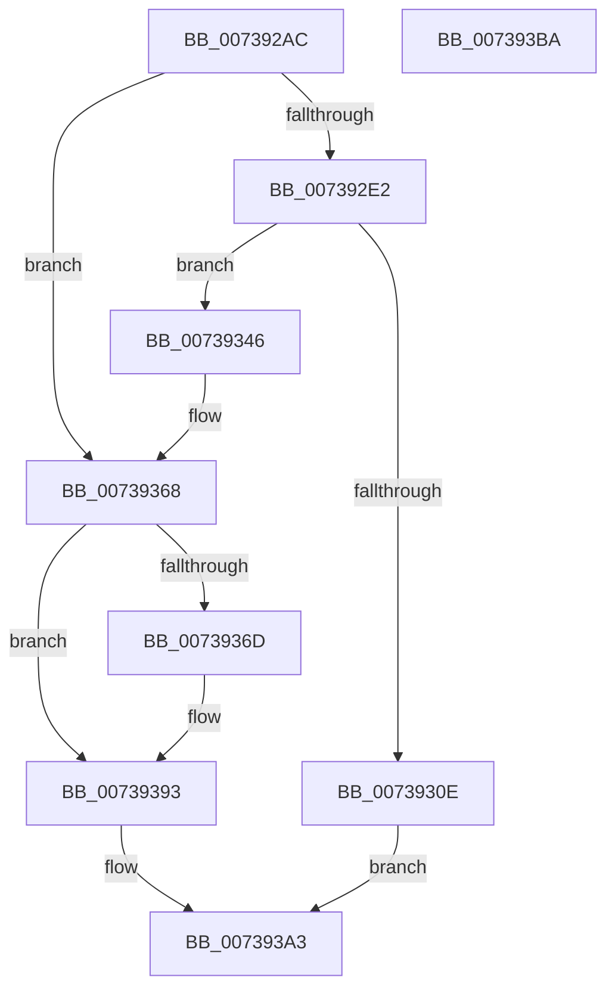

# PnprAddProcessorResources

- RVA: `0x007392AC`–`0x007393BB` (길이 `271` bytes)
- VA: `0x00000001407392AC`
- 실행 섹션: `PAGE`
- PDB 이름 있음: `예`; PDB Function 태그: `아니요`
- unwind 정보 RVA: `0x000C8F18`
- 디코드: `75`개 명령, `271/271` bytes 표시
- 미해석 바이트: `0` (있으면 어셈블리에 `.byte`로 보존)

> 이 문서는 커널 이미지의 기계어와 PDB 기호를 분석해 생성했습니다. 4번과 5번은 함수 원형과 자료형을 바이너리 사용 방식에서 추정한 C 해석이며 원본 소스 복구 결과는 아닙니다.

## 1. Dependencies

- 직접 호출 지점: **4**; 고유 호출 대상: **4**
- 직접 호출자로 확인된 함수: **1**
- RIP 상대 이미지 참조: **1**

### Outgoing calls
- `0x00739301` → [ExAllocatePool2](../../poolcode/B8/ExAllocatePool2_function_00B820F0.md) (function, `0x00B820F0`)
- `0x0073934F` → [memcpy](../../text/6C/memcpy_function_006C6840.md) (function, `0x006C6840`)
- `0x0073935C` → [ExFreePoolWithTag](../../poolcode/B8/ExFreePoolWithTag_function_00B82870.md) (function, `0x00B82870`)
- `0x00739374` → [KeGetProcessorNumberFromIndex](../../text/2D/KeGetProcessorNumberFromIndex_function_002DD320.md) (function, `0x002DD320`)

### Direct callers
- [PnprAddDeviceResources](PnprAddDeviceResources_function_00739040.md) at `0x007390A1`

### Static image references
- `0x0073930E` → RVA `0x00F8AC38` (`.data`; read)

## 2. Other-region calls and transfers

- 다른 실행 섹션으로 향하는 call: **4**
  - `0x00739301` → [ExAllocatePool2](../../poolcode/B8/ExAllocatePool2_function_00B820F0.md) (`PAGE` → `POOLCODE`)
  - `0x0073934F` → [memcpy](../../text/6C/memcpy_function_006C6840.md) (`PAGE` → `.text`)
  - `0x0073935C` → [ExFreePoolWithTag](../../poolcode/B8/ExFreePoolWithTag_function_00B82870.md) (`PAGE` → `POOLCODE`)
  - `0x00739374` → [KeGetProcessorNumberFromIndex](../../text/2D/KeGetProcessorNumberFromIndex_function_002DD320.md) (`PAGE` → `.text`)
- 별도 외부 분기/꼬리 이동을 확인하지 못했습니다.

## 3. Assembly (complete function range)

```asm
007392AC  48 8B C4                        mov rax, rsp
007392AF  48 89 58 10                     mov qword ptr [rax + 0x10], rbx
007392B3  48 89 68 18                     mov qword ptr [rax + 0x18], rbp
007392B7  48 89 48 08                     mov qword ptr [rax + 8], rcx
007392BB  56                              push rsi
007392BC  57                              push rdi
007392BD  41 54                           push r12
007392BF  41 56                           push r14
007392C1  41 57                           push r15
007392C3  48 83 EC 20                     sub rsp, 0x20
007392C7  49 8B 19                        mov rbx, qword ptr [r9]
007392CA  49 8B F1                        mov rsi, r9
007392CD  83 60 08 00                     and dword ptr [rax + 8], 0
007392D1  45 8B F0                        mov r14d, r8d
007392D4  8B FA                           mov edi, edx
007392D6  8B 43 10                        mov eax, dword ptr [rbx + 0x10]
007392D9  3B 43 0C                        cmp eax, dword ptr [rbx + 0xc]
007392DC  0F 85 86 00 00 00               jne 0x140739368
007392E2  44 8D 78 04                     lea r15d, [rax + 4]
007392E6  B9 40 00 00 00                  mov ecx, 0x40
007392EB  42 8D 14 BD 14 00 00 00         lea edx, [r15*4 + 0x14]
007392F3  41 B8 50 6E 70 51               mov r8d, 0x51706e50
007392F9  44 8D 24 85 14 00 00 00         lea r12d, [rax*4 + 0x14]
00739301  E8 EA 8D 44 00                  call 0x140b820f0
00739306  48 8B E8                        mov rbp, rax
00739309  48 85 C0                        test rax, rax
0073930C  75 38                           jne 0x140739346
0073930E  48 8B 0D 23 19 85 00            mov rcx, qword ptr [rip + 0x851923]
00739315  BA 2F 03 00 00                  mov edx, 0x32f
0073931A  8B 81 08 82 00 00               mov eax, dword ptr [rcx + 0x8208]
00739320  85 C0                           test eax, eax
00739322  0F 44 C2                        cmove eax, edx
00739325  8D 55 0A                        lea edx, [rbp + 0xa]
00739328  89 81 08 82 00 00               mov dword ptr [rcx + 0x8208], eax
0073932E  8B 81 0C 82 00 00               mov eax, dword ptr [rcx + 0x820c]
00739334  85 C0                           test eax, eax
00739336  0F 44 C2                        cmove eax, edx
00739339  89 81 0C 82 00 00               mov dword ptr [rcx + 0x820c], eax
0073933F  B8 9A 00 00 C0                  mov eax, 0xc000009a
00739344  EB 5D                           jmp 0x1407393a3
00739346  45 8B C4                        mov r8d, r12d
00739349  48 8B D3                        mov rdx, rbx
0073934C  48 8B CD                        mov rcx, rbp
0073934F  E8 EC D4 F8 FF                  call 0x1406c6840
00739354  BA 50 6E 70 51                  mov edx, 0x51706e50
00739359  48 8B CB                        mov rcx, rbx
0073935C  E8 0F 95 44 00                  call 0x140b82870
00739361  48 8B DD                        mov rbx, rbp
00739364  44 89 7D 0C                     mov dword ptr [rbp + 0xc], r15d
00739368  83 FF FF                        cmp edi, -1
0073936B  74 26                           je 0x140739393
0073936D  48 8D 54 24 50                  lea rdx, [rsp + 0x50]
00739372  8B CF                           mov ecx, edi
00739374  E8 A7 3F BA FF                  call 0x1402dd320
00739379  44 0F B7 44 24 50               movzx r8d, word ptr [rsp + 0x50]
0073937F  48 8B 13                        mov rdx, qword ptr [rbx]
00739382  0F B6 44 24 52                  movzx eax, byte ptr [rsp + 0x52]
00739387  4A 8B 0C C2                     mov rcx, qword ptr [rdx + r8*8]
0073938B  48 0F AB C1                     bts rcx, rax
0073938F  4A 89 0C C2                     mov qword ptr [rdx + r8*8], rcx
00739393  8B 43 10                        mov eax, dword ptr [rbx + 0x10]
00739396  44 89 74 83 14                  mov dword ptr [rbx + rax*4 + 0x14], r14d
0073939B  FF 43 10                        inc dword ptr [rbx + 0x10]
0073939E  33 C0                           xor eax, eax
007393A0  48 89 1E                        mov qword ptr [rsi], rbx
007393A3  48 8B 5C 24 58                  mov rbx, qword ptr [rsp + 0x58]
007393A8  48 8B 6C 24 60                  mov rbp, qword ptr [rsp + 0x60]
007393AD  48 83 C4 20                     add rsp, 0x20
007393B1  41 5F                           pop r15
007393B3  41 5E                           pop r14
007393B5  41 5C                           pop r12
007393B7  5F                              pop rdi
007393B8  5E                              pop rsi
007393B9  C3                              ret
007393BA  CC                              int3
```

## 4. C-style interpretation (structured pseudocode)

```c
__int64 __fastcall PnprAddProcessorResources(__int64 a1, int a2, int a3, __int64 a4)
{
    __int64 result;
    __int64 v_rsp;
    unsigned __int64 v_stack_p10;
    unsigned __int64 v_stack_p18;
    unsigned __int64 v_stack_p8;
    unsigned __int8 v_stack_pA;

    *(unsigned __int64 *)(v_rsp + 16) = v_rbx;
    *(unsigned __int64 *)(v_rsp + 24) = v_rbp;
    *(unsigned __int64 *)(v_rsp + 8) = a1;
    v_rsp = (v_rsp) - (32);
    if (((unsigned int)((unsigned int)(*(unsigned int *)(*(unsigned __int64 *)(a4) + 16)))) != (*(unsigned int *)(*(unsigned __int64 *)(a4) + 12))) goto loc_00739368;
    result = ExAllocatePool2(64, (unsigned int)(*(unsigned int *)(*(unsigned __int64 *)(a4) + 16)) + 4 * 4 + 20, (unsigned int)(0x51706E50ULL), a4);
    if (result != 0) goto loc_00739346;
    result = (unsigned int)(*(unsigned int *)(*(unsigned __int64 *)(v_rip + 8722723) + 33288));
    if ((unsigned int)((unsigned int)(*(unsigned int *)(*(unsigned __int64 *)(v_rip + 8722723) + 33288))) == 0) { result = 815; }
    *(unsigned int *)(*(unsigned __int64 *)(v_rip + 8722723) + 33288) = (unsigned int)(result);
    result = (unsigned int)(*(unsigned int *)(*(unsigned __int64 *)(v_rip + 8722723) + 33292));
    if ((unsigned int)((unsigned int)(*(unsigned int *)(*(unsigned __int64 *)(v_rip + 8722723) + 33292))) == 0) { result = (unsigned int)(result + 10); }
    *(unsigned int *)(*(unsigned __int64 *)(v_rip + 8722723) + 33292) = (unsigned int)(result);
    goto loc_007393A3;
loc_00739346:
    result = memcpy(result, *(unsigned __int64 *)(a4), (unsigned int)((unsigned int)((unsigned int)(*(unsigned int *)(*(unsigned __int64 *)(a4) + 16)) * 4 + 20)), a4);
    result = ExFreePoolWithTag(*(unsigned __int64 *)(a4), (unsigned int)(0x51706E50ULL), (unsigned int)((unsigned int)((unsigned int)(*(unsigned int *)(*(unsigned __int64 *)(a4) + 16)) * 4 + 20)), a4);
    *(unsigned int *)(result + 12) = (unsigned int)((unsigned int)(*(unsigned int *)(*(unsigned __int64 *)(a4) + 16)) + 4);
loc_00739368:
    if (((unsigned int)((unsigned int)(a2))) != -1) {
        a2 = v_stack_p8;
        a1 = (unsigned int)((unsigned int)(a2));
        result = KeGetProcessorNumberFromIndex(a1, a2, (unsigned int)((unsigned int)((unsigned int)(*(unsigned int *)(*(unsigned __int64 *)(a4) + 16)) * 4 + 20)), a4);
        a3 = v_stack_p8;
        a2 = *(unsigned __int64 *)(result);
        result = v_stack_pA;
        a1 = *(unsigned __int64 *)(a2 + a3 * 8);
        *(unsigned __int64 *)(a2 + a3 * 8) = a1;
    }
    *(unsigned int *)(result + (unsigned int)(*(unsigned int *)(result + 16)) * 4 + 20) = (unsigned int)((unsigned int)(a3));
    result = 0;
    *(unsigned __int64 *)(a4) = 0;
loc_007393A3:
    v_rsp = (v_rsp) + (32);
    return result;
}
```

## 5. (Beta) C Style

```c
int64_t PnprAddProcessorResources(int64_t Arg1, int32_t Arg2, int32_t Arg3, void *Arg4)
{
    uint8_t *arg4 = (uint8_t *)Arg4;

    int64_t result;
    int64_t local_rsp;
    uint64_t v_stack_p10;
    uint64_t v_stack_p18;
    uint64_t v_stack_p8;
    uint8_t v_stack_pA;

    *(uint64_t *)(local_rsp + 0x10) = local_rbx;
    *(uint64_t *)(local_rsp + 0x18) = local_rbp;
    *(uint64_t *)(local_rsp + 0x8) = Arg1;
    local_rsp = (local_rsp) - (32);
    if (((uint32_t)((uint32_t)(*(uint32_t *)(*(uint64_t *)(arg4) + 0x10)))) != (*(uint32_t *)(*(uint64_t *)(arg4) + 0xC))) goto loc_00739368;
    result = ExAllocatePool2(64, (uint32_t)(*(uint32_t *)(*(uint64_t *)(arg4) + 0x10)) + 4 * 4 + 20, (uint32_t)(0x51706E50ULL), Arg4);
    if (result != 0) goto loc_00739346;
    result = (uint32_t)(*(uint32_t *)(*(uint64_t *)(v_rip + 0x851923) + 0x8208));
    if ((uint32_t)((uint32_t)(*(uint32_t *)(*(uint64_t *)(v_rip + 0x851923) + 0x8208))) == 0) { result = 815; }
    *(uint32_t *)(*(uint64_t *)(v_rip + 0x851923) + 0x8208) = (uint32_t)(result);
    result = (uint32_t)(*(uint32_t *)(*(uint64_t *)(v_rip + 0x851923) + 0x820C));
    if ((uint32_t)((uint32_t)(*(uint32_t *)(*(uint64_t *)(v_rip + 0x851923) + 0x820C))) == 0) { result = (uint32_t)(result + 10); }
    *(uint32_t *)(*(uint64_t *)(v_rip + 0x851923) + 0x820C) = (uint32_t)(result);
    goto loc_007393A3;
loc_00739346:
    result = memcpy(result, *(uint64_t *)(arg4), (uint32_t)((uint32_t)((uint32_t)(*(uint32_t *)(*(uint64_t *)(arg4) + 0x10)) * 4 + 20)), Arg4);
    result = ExFreePoolWithTag(*(uint64_t *)(arg4), (uint32_t)(0x51706E50ULL), (uint32_t)((uint32_t)((uint32_t)(*(uint32_t *)(*(uint64_t *)(arg4) + 0x10)) * 4 + 20)), Arg4);
    *(uint32_t *)(result + 0xC) = (uint32_t)((uint32_t)(*(uint32_t *)(*(uint64_t *)(arg4) + 0x10)) + 4);
loc_00739368:
    if (((uint32_t)((uint32_t)(Arg2))) != -1) {
        Arg2 = v_stack_p8;
        Arg1 = (uint32_t)((uint32_t)(Arg2));
        result = KeGetProcessorNumberFromIndex(Arg1, Arg2, (uint32_t)((uint32_t)((uint32_t)(*(uint32_t *)(*(uint64_t *)(arg4) + 0x10)) * 4 + 20)), Arg4);
        Arg3 = v_stack_p8;
        Arg2 = *(uint64_t *)(result);
        result = v_stack_pA;
        Arg1 = *(uint64_t *)(Arg2 + Arg3 * 8);
        *(uint64_t *)(Arg2 + Arg3 * 8) = Arg1;
    }
    *(uint32_t *)(result + (uint32_t)(*(uint32_t *)(result + 0x10)) * 4 + 0x14) = (uint32_t)((uint32_t)(Arg3));
    result = 0;
    *(uint64_t *)(arg4) = 0;
loc_007393A3:
    local_rsp = (local_rsp) + (32);
    return result;
}
```

### 관측된 메모리 오프셋

구조체 형식이 확인되지 않은 접근은 인자 기준의 오프셋으로만 기록했습니다.

| 기준 인자 | 오프셋 표현 | 폭 (bit) | 접근 |
|---|---:|---:|---|
| `Arg4` | `+ 0x0` | `64` | `R` |
| `Arg4` | `+ 0x0` | `64` | `W` |

## 6. Execution-region graph

[열기: 2D/3D 그래프와 함수 탐색 컨트롤 패널](../../../control-panel.html?section=page&rva=0x007392AC&view=graph)

- 2D 그래프는 위에서 아래로 흐르고, 3D 그래프는 빈 공간을 드래그해 회전합니다. Shift+드래그는 이동, 휠은 확대·축소, 함수 노드 선택은 대상 보고서 이동입니다.

### Static fallback


