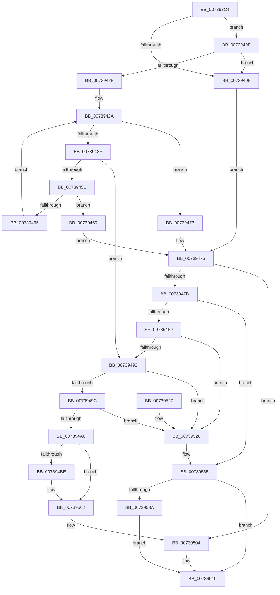

# PnprAllocateMappingReserves

- RVA: `0x007393C4`–`0x00739549` (길이 `389` bytes)
- VA: `0x00000001407393C4`
- 실행 섹션: `PAGE`
- PDB 이름 있음: `예`; PDB Function 태그: `아니요`
- unwind 정보 RVA: `0x000C8E1C`
- 디코드: `115`개 명령, `389/389` bytes 표시
- 미해석 바이트: `0` (있으면 어셈블리에 `.byte`로 보존)

> 이 문서는 커널 이미지의 기계어와 PDB 기호를 분석해 생성했습니다. 4번과 5번은 함수 원형과 자료형을 바이너리 사용 방식에서 추정한 C 해석이며 원본 소스 복구 결과는 아닙니다.

## 1. Dependencies

- 직접 호출 지점: **7**; 고유 호출 대상: **4**
- 직접 호출자로 확인된 함수: **1**
- RIP 상대 이미지 참조: **1**

### Outgoing calls
- `0x007393FB` → [ExAllocatePool2](../../poolcode/B8/ExAllocatePool2_function_00B820F0.md) (function, `0x00B820F0`)
- `0x0073941B` → [ExAllocatePool2](../../poolcode/B8/ExAllocatePool2_function_00B820F0.md) (function, `0x00B820F0`)
- `0x00739446` → [PnprInitializeMappingReserve](PnprInitializeMappingReserve_function_00739D24.md) (function, `0x00739D24`)
- `0x0073945A` → [PnprInitializeMappingReserve](PnprInitializeMappingReserve_function_00739D24.md) (function, `0x00739D24`)
- `0x0073946C` → [PnprFreeMappingReserve](PnprFreeMappingReserve_function_0073989C.md) (function, `0x0073989C`)
- `0x00739530` → [ExFreePoolWithTag](../../poolcode/B8/ExFreePoolWithTag_function_00B82870.md) (function, `0x00B82870`)
- `0x00739542` → [ExFreePoolWithTag](../../poolcode/B8/ExFreePoolWithTag_function_00B82870.md) (function, `0x00B82870`)

### Direct callers
- [PnpReplacePartitionUnit](PnpReplacePartitionUnit_function_00738550.md) at `0x00738CC8`

### Static image references
- `0x007394A6` → RVA `0x00F8AC38` (`.data`; read)

## 2. Other-region calls and transfers

- 다른 실행 섹션으로 향하는 call: **4**
  - `0x007393FB` → [ExAllocatePool2](../../poolcode/B8/ExAllocatePool2_function_00B820F0.md) (`PAGE` → `POOLCODE`)
  - `0x0073941B` → [ExAllocatePool2](../../poolcode/B8/ExAllocatePool2_function_00B820F0.md) (`PAGE` → `POOLCODE`)
  - `0x00739530` → [ExFreePoolWithTag](../../poolcode/B8/ExFreePoolWithTag_function_00B82870.md) (`PAGE` → `POOLCODE`)
  - `0x00739542` → [ExFreePoolWithTag](../../poolcode/B8/ExFreePoolWithTag_function_00B82870.md) (`PAGE` → `POOLCODE`)
- 별도 외부 분기/꼬리 이동을 확인하지 못했습니다.

## 3. Assembly (complete function range)

```asm
007393C4  48 89 5C 24 10                  mov qword ptr [rsp + 0x10], rbx
007393C9  48 89 4C 24 08                  mov qword ptr [rsp + 8], rcx
007393CE  55                              push rbp
007393CF  56                              push rsi
007393D0  57                              push rdi
007393D1  41 54                           push r12
007393D3  41 55                           push r13
007393D5  41 56                           push r14
007393D7  41 57                           push r15
007393D9  48 83 EC 20                     sub rsp, 0x20
007393DD  43 8D 04 40                     lea eax, [r8 + r8*2]
007393E1  45 8B F8                        mov r15d, r8d
007393E4  C1 E0 03                        shl eax, 3
007393E7  4C 8B EA                        mov r13, rdx
007393EA  33 FF                           xor edi, edi
007393EC  8B D0                           mov edx, eax
007393EE  41 B8 50 6E 70 51               mov r8d, 0x51706e50
007393F4  8B D8                           mov ebx, eax
007393F6  8D 6F 40                        lea ebp, [rdi + 0x40]
007393F9  8B CD                           mov ecx, ebp
007393FB  E8 F0 8C 44 00                  call 0x140b820f0
00739400  48 8B F0                        mov rsi, rax
00739403  48 85 C0                        test rax, rax
00739406  75 07                           jne 0x14073940f
00739408  BB 9A 00 00 C0                  mov ebx, 0xc000009a
0073940D  EB 66                           jmp 0x140739475
0073940F  41 B8 50 6E 70 51               mov r8d, 0x51706e50
00739415  48 8B D3                        mov rdx, rbx
00739418  48 8B CD                        mov rcx, rbp
0073941B  E8 D0 8C 44 00                  call 0x140b820f0
00739420  48 8B F8                        mov rdi, rax
00739423  48 85 C0                        test rax, rax
00739426  74 E0                           je 0x140739408
00739428  33 ED                           xor ebp, ebp
0073942A  41 3B EF                        cmp ebp, r15d
0073942D  73 44                           jae 0x140739473
0073942F  4C 8D 24 6D 00 00 00 00         lea r12, [rbp*2]
00739437  B9 02 00 00 00                  mov ecx, 2
0073943C  4C 03 E5                        add r12, rbp
0073943F  4E 8D 34 E6                     lea r14, [rsi + r12*8]
00739443  49 8B D6                        mov rdx, r14
00739446  E8 D9 08 00 00                  call 0x140739d24
0073944B  8B D8                           mov ebx, eax
0073944D  85 C0                           test eax, eax
0073944F  78 41                           js 0x140739492
00739451  4A 8D 14 E7                     lea rdx, [rdi + r12*8]
00739455  B9 02 08 00 00                  mov ecx, 0x802
0073945A  E8 C5 08 00 00                  call 0x140739d24
0073945F  8B D8                           mov ebx, eax
00739461  85 C0                           test eax, eax
00739463  78 04                           js 0x140739469
00739465  FF C5                           inc ebp
00739467  EB C1                           jmp 0x14073942a
00739469  49 8B CE                        mov rcx, r14
0073946C  E8 2B 04 00 00                  call 0x14073989c
00739471  EB 02                           jmp 0x140739475
00739473  33 DB                           xor ebx, ebx
00739475  85 DB                           test ebx, ebx
00739477  0F 89 87 00 00 00               jns 0x140739504
0073947D  48 8B C7                        mov rax, rdi
00739480  48 85 F6                        test rsi, rsi
00739483  0F 84 AC 00 00 00               je 0x140739535
00739489  48 85 C0                        test rax, rax
0073948C  0F 84 96 00 00 00               je 0x140739528
00739492  48 83 3E 00                     cmp qword ptr [rsi], 0
00739496  0F 84 8C 00 00 00               je 0x140739528
0073949C  48 83 3F 00                     cmp qword ptr [rdi], 0
007394A0  0F 84 82 00 00 00               je 0x140739528
007394A6  48 8B 15 8B 17 85 00            mov rdx, qword ptr [rip + 0x85178b]
007394AD  8B 82 B4 00 00 00               mov eax, dword ptr [rdx + 0xb4]
007394B3  48 8D 0C 40                     lea rcx, [rax + rax*2]
007394B7  48 83 3C CE 00                  cmp qword ptr [rsi + rcx*8], 0
007394BC  75 44                           jne 0x140739502
007394BE  0F 10 06                        movups xmm0, xmmword ptr [rsi]
007394C1  0F 11 04 CE                     movups xmmword ptr [rsi + rcx*8], xmm0
007394C5  F2 0F 10 4E 10                  movsd xmm1, qword ptr [rsi + 0x10]
007394CA  F2 0F 11 4C CE 10               movsd qword ptr [rsi + rcx*8 + 0x10], xmm1
007394D0  8B 82 B4 00 00 00               mov eax, dword ptr [rdx + 0xb4]
007394D6  0F 10 07                        movups xmm0, xmmword ptr [rdi]
007394D9  48 8D 0C 40                     lea rcx, [rax + rax*2]
007394DD  33 C0                           xor eax, eax
007394DF  0F 11 04 CF                     movups xmmword ptr [rdi + rcx*8], xmm0
007394E3  F2 0F 10 4F 10                  movsd xmm1, qword ptr [rdi + 0x10]
007394E8  0F 57 C0                        xorps xmm0, xmm0
007394EB  F2 0F 11 4C CF 10               movsd qword ptr [rdi + rcx*8 + 0x10], xmm1
007394F1  0F 57 C9                        xorps xmm1, xmm1
007394F4  0F 11 06                        movups xmmword ptr [rsi], xmm0
007394F7  48 89 46 10                     mov qword ptr [rsi + 0x10], rax
007394FB  0F 11 0F                        movups xmmword ptr [rdi], xmm1
007394FE  48 89 47 10                     mov qword ptr [rdi + 0x10], rax
00739502  33 DB                           xor ebx, ebx
00739504  48 8B 44 24 60                  mov rax, qword ptr [rsp + 0x60]
00739509  48 89 30                        mov qword ptr [rax], rsi
0073950C  49 89 7D 00                     mov qword ptr [r13], rdi
00739510  8B C3                           mov eax, ebx
00739512  48 8B 5C 24 68                  mov rbx, qword ptr [rsp + 0x68]
00739517  48 83 C4 20                     add rsp, 0x20
0073951B  41 5F                           pop r15
0073951D  41 5E                           pop r14
0073951F  41 5D                           pop r13
00739521  41 5C                           pop r12
00739523  5F                              pop rdi
00739524  5E                              pop rsi
00739525  5D                              pop rbp
00739526  C3                              ret
00739527  CC                              int3
00739528  BA 50 6E 70 51                  mov edx, 0x51706e50
0073952D  48 8B CE                        mov rcx, rsi
00739530  E8 3B 93 44 00                  call 0x140b82870
00739535  48 85 FF                        test rdi, rdi
00739538  74 D6                           je 0x140739510
0073953A  BA 50 6E 70 51                  mov edx, 0x51706e50
0073953F  48 8B CF                        mov rcx, rdi
00739542  E8 29 93 44 00                  call 0x140b82870
00739547  EB C7                           jmp 0x140739510
```

## 4. C-style interpretation (structured pseudocode)

```c
__int64 __fastcall PnprAllocateMappingReserves(__int64 a1, __int64 a2, __int64 a3)
{
    __int64 result;
    __int64 v_r12;
    __int64 v_rbp;
    __int64 v_rbx;
    __int64 v_rdi;
    __int64 v_rsp;
    unsigned __int64 v_stack_p10;
    unsigned __int64 v_stack_p8;

    v_stack_p10 = v_rbx;
    v_stack_p8 = a1;
    v_rsp = (v_rsp) - (32);
    result = (unsigned int)((a3 + a3 * 2) << (3));
    v_rdi = 0;
    result = ExAllocatePool2((unsigned int)((unsigned int)(v_rdi + 64)), (unsigned int)((unsigned int)(result)), (unsigned int)(0x51706E50ULL), a4);
    if (result != 0) goto loc_0073940F;
loc_00739408:
    goto loc_00739475;
loc_0073940F:
    result = ExAllocatePool2(v_rdi + 64, (unsigned int)(0xC000009AULL), (unsigned int)(0x51706E50ULL), a4);
    if (result == 0) goto loc_00739408;
    v_rbp = 0;
loc_0073942A:
    if (0 >= ((unsigned int)((unsigned int)((unsigned int)(a3))))) goto loc_00739473;
    v_r12 = (v_rbp * 2) + (0);
    result = PnprInitializeMappingReserve(2, result + v_r12 * 8, (unsigned int)(0x51706E50ULL), a4);
    if (sign_flag) goto loc_00739492;
    result = PnprInitializeMappingReserve((unsigned int)(0x802ULL), result + v_r12 * 8, (unsigned int)(0x51706E50ULL), a4);
    if (sign_flag) goto loc_00739469;
    v_rbp = (unsigned int)((v_rbp) + 1);
    goto loc_0073942A;
loc_00739469:
    result = PnprFreeMappingReserve(result + v_r12 * 8, result + v_r12 * 8, (unsigned int)(0x51706E50ULL), a4);
    goto loc_00739475;
loc_00739473:
    v_rbx = 0;
loc_00739475:
    if (!sign_flag) goto loc_00739504;
    if (result == 0) goto loc_00739535;
    if (result == 0) goto loc_00739528;
loc_00739492:
    if ((*(unsigned __int64 *)(result)) == 0) goto loc_00739528;
    if ((*(unsigned __int64 *)(result)) == 0) goto loc_00739528;
    result = (unsigned int)(*(unsigned int *)(*(unsigned __int64 *)(v_rip + 8722315) + 180));
    if ((*(unsigned __int64 *)(result + (unsigned int)(*(unsigned int *)(*(unsigned __int64 *)(v_rip + 8722315) + 180)) + (unsigned int)(*(unsigned int *)(*(unsigned __int64 *)(v_rip + 8722315) + 180)) * 2 * 8)) == 0) {
        *(unsigned __int64 *)(result + (unsigned int)(*(unsigned int *)(*(unsigned __int64 *)(v_rip + 8722315) + 180)) + (unsigned int)(*(unsigned int *)(*(unsigned __int64 *)(v_rip + 8722315) + 180)) * 2 * 8) = v_xmm0;
        *(unsigned __int64 *)(result + (unsigned int)(*(unsigned int *)(*(unsigned __int64 *)(v_rip + 8722315) + 180)) + (unsigned int)(*(unsigned int *)(*(unsigned __int64 *)(v_rip + 8722315) + 180)) * 2 * 8 + 16) = v_xmm1;
        result = *(unsigned int *)(*(unsigned __int64 *)(v_rip + 8722315) + 180);
        a1 = result + result * 2;
        result = 0;
        *(unsigned __int64 *)(result + a1 * 8) = v_xmm0;
        *(unsigned __int64 *)(result + a1 * 8 + 16) = v_xmm1;
        *(unsigned __int64 *)(result) = v_xmm0;
        *(unsigned __int64 *)(result + 16) = 0;
        *(unsigned __int64 *)(result) = v_xmm1;
        *(unsigned __int64 *)(result + 16) = 0;
    }
    v_rbx = 0;
loc_00739504:
    *(unsigned __int64 *)(v_stack_p8) = 0;
    *(unsigned __int64 *)(a2) = 0;
loc_00739510:
    v_rsp = (v_rsp) + (32);
    return 0;
loc_00739528:
    result = ExFreePoolWithTag(0, (unsigned int)(0x51706E50ULL), (unsigned int)(0x51706E50ULL), a4);
loc_00739535:
    if (result == 0) goto loc_00739510;
    result = ExFreePoolWithTag(result, (unsigned int)(0x51706E50ULL), (unsigned int)(0x51706E50ULL), a4);
    goto loc_00739510;
}
```

## 5. (Beta) C Style

```c
int64_t PnprAllocateMappingReserves(int64_t Arg1, void *Arg2, void *Arg3)
{
    uint8_t *arg2 = (uint8_t *)Arg2;
    uint8_t *arg3 = (uint8_t *)Arg3;

    int64_t result;
    int64_t local_r12;
    int64_t local_rbp;
    int64_t local_rbx;
    int64_t local_rdi;
    int64_t local_rsp;
    uint64_t v_stack_p10;
    uint64_t v_stack_p8;

    v_stack_p10 = local_rbx;
    v_stack_p8 = Arg1;
    local_rsp = (local_rsp) - (32);
    result = (uint32_t)((Arg3 + Arg3 * 2) << (3));
    local_rdi = 0;
    result = ExAllocatePool2((uint32_t)((uint32_t)(local_rdi + 64)), (uint32_t)((uint32_t)(result)), (uint32_t)(0x51706E50ULL), a4);
    if (result != 0) goto loc_0073940F;
loc_00739408:
    goto loc_00739475;
loc_0073940F:
    result = ExAllocatePool2(local_rdi + 64, (uint32_t)(0xC000009AULL), (uint32_t)(0x51706E50ULL), a4);
    if (result == 0) goto loc_00739408;
    local_rbp = 0;
loc_0073942A:
    if (0 >= ((uint32_t)((uint32_t)((uint32_t)(Arg3))))) goto loc_00739473;
    local_r12 = (local_rbp * 2) + (0);
    result = PnprInitializeMappingReserve(2, result + local_r12 * 8, (uint32_t)(0x51706E50ULL), a4);
    if (sign_flag) goto loc_00739492;
    result = PnprInitializeMappingReserve((uint32_t)(0x802ULL), result + local_r12 * 8, (uint32_t)(0x51706E50ULL), a4);
    if (sign_flag) goto loc_00739469;
    local_rbp = (uint32_t)((local_rbp) + 1);
    goto loc_0073942A;
loc_00739469:
    result = PnprFreeMappingReserve(result + local_r12 * 8, result + local_r12 * 8, (uint32_t)(0x51706E50ULL), a4);
    goto loc_00739475;
loc_00739473:
    local_rbx = 0;
loc_00739475:
    if (!sign_flag) goto loc_00739504;
    if (result == 0) goto loc_00739535;
    if (result == 0) goto loc_00739528;
loc_00739492:
    if ((*(uint64_t *)(result)) == 0) goto loc_00739528;
    if ((*(uint64_t *)(result)) == 0) goto loc_00739528;
    result = (uint32_t)(*(uint32_t *)(*(uint64_t *)(v_rip + 0x85178B) + 0xB4));
    if ((*(uint64_t *)(result + (uint32_t)(*(uint32_t *)(*(uint64_t *)(v_rip + 0x85178B) + 0xB4)) + (uint32_t)(*(uint32_t *)(*(uint64_t *)(v_rip + 0x85178B) + 0xB4)) * 2 * 8)) == 0) {
        *(uint64_t *)(result + (uint32_t)(*(uint32_t *)(*(uint64_t *)(v_rip + 0x85178B) + 0xB4)) + (uint32_t)(*(uint32_t *)(*(uint64_t *)(v_rip + 0x85178B) + 0xB4)) * 2 * 8) = v_xmm0;
        *(uint64_t *)(result + (uint32_t)(*(uint32_t *)(*(uint64_t *)(v_rip + 0x85178B) + 0xB4)) + (uint32_t)(*(uint32_t *)(*(uint64_t *)(v_rip + 0x85178B) + 0xB4)) * 2 * 8 + 0x10) = v_xmm1;
        result = *(uint32_t *)(*(uint64_t *)(v_rip + 0x85178B) + 0xB4);
        Arg1 = result + result * 2;
        result = 0;
        *(uint64_t *)(result + Arg1 * 8) = v_xmm0;
        *(uint64_t *)(result + Arg1 * 8 + 0x10) = v_xmm1;
        *(uint64_t *)(result) = v_xmm0;
        *(uint64_t *)(result + 0x10) = 0;
        *(uint64_t *)(result) = v_xmm1;
        *(uint64_t *)(result + 0x10) = 0;
    }
    local_rbx = 0;
loc_00739504:
    *(uint64_t *)(v_stack_p8) = 0;
    *(uint64_t *)(arg2) = 0;
loc_00739510:
    local_rsp = (local_rsp) + (32);
    return 0;
loc_00739528:
    result = ExFreePoolWithTag(0, (uint32_t)(0x51706E50ULL), (uint32_t)(0x51706E50ULL), a4);
loc_00739535:
    if (result == 0) goto loc_00739510;
    result = ExFreePoolWithTag(result, (uint32_t)(0x51706E50ULL), (uint32_t)(0x51706E50ULL), a4);
    goto loc_00739510;
}
```

### 관측된 메모리 오프셋

구조체 형식이 확인되지 않은 접근은 인자 기준의 오프셋으로만 기록했습니다.

| 기준 인자 | 오프셋 표현 | 폭 (bit) | 접근 |
|---|---:|---:|---|
| `Arg2` | `+ 0x0` | `64` | `W` |
| `Arg3` | `+ 0x0 + r8*2` | `32` | `R` |

## 6. Execution-region graph

[열기: 2D/3D 그래프와 함수 탐색 컨트롤 패널](../../../control-panel.html?section=page&rva=0x007393C4&view=graph)

- 2D 그래프는 위에서 아래로 흐르고, 3D 그래프는 빈 공간을 드래그해 회전합니다. Shift+드래그는 이동, 휠은 확대·축소, 함수 노드 선택은 대상 보고서 이동입니다.

### Static fallback


