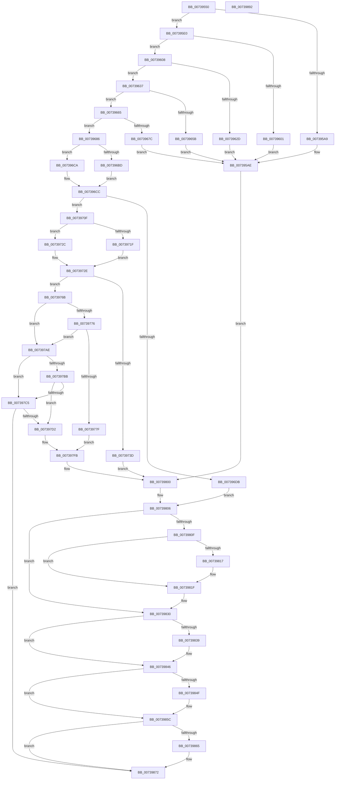

# PnprCollectResources

- RVA: `0x00739550`–`0x00739893` (길이 `835` bytes)
- VA: `0x0000000140739550`
- 실행 섹션: `PAGE`
- PDB 이름 있음: `예`; PDB Function 태그: `아니요`
- unwind 정보 RVA: `0x000C8EF8`
- 디코드: `220`개 명령, `835/835` bytes 표시
- 미해석 바이트: `0` (있으면 어셈블리에 `.byte`로 보존)

> 이 문서는 커널 이미지의 기계어와 PDB 기호를 분석해 생성했습니다. 4번과 5번은 함수 원형과 자료형을 바이너리 사용 방식에서 추정한 C 해석이며 원본 소스 복구 결과는 아닙니다.

## 1. Dependencies

- 직접 호출 지점: **12**; 고유 호출 대상: **3**
- 직접 호출자로 확인된 함수: **1**
- RIP 상대 이미지 참조: **2**

### Outgoing calls
- `0x0073959B` → [ExAllocatePool2](../../poolcode/B8/ExAllocatePool2_function_00B820F0.md) (function, `0x00B820F0`)
- `0x007395F3` → [ExAllocatePool2](../../poolcode/B8/ExAllocatePool2_function_00B820F0.md) (function, `0x00B820F0`)
- `0x00739617` → [ExAllocatePool2](../../poolcode/B8/ExAllocatePool2_function_00B820F0.md) (function, `0x00B820F0`)
- `0x0073964D` → [ExAllocatePool2](../../poolcode/B8/ExAllocatePool2_function_00B820F0.md) (function, `0x00B820F0`)
- `0x0073966E` → [ExAllocatePool2](../../poolcode/B8/ExAllocatePool2_function_00B820F0.md) (function, `0x00B820F0`)
- `0x007396D0` → [PipForAllChildDeviceNodes](../A5/PipForAllChildDeviceNodes_function_00A519A0.md) (function, `0x00A519A0`)
- `0x00739732` → [PipForAllChildDeviceNodes](../A5/PipForAllChildDeviceNodes_function_00A519A0.md) (function, `0x00A519A0`)
- `0x0073981A` → [ExFreePoolWithTag](../../poolcode/B8/ExFreePoolWithTag_function_00B82870.md) (function, `0x00B82870`)
- `0x00739826` → [ExFreePoolWithTag](../../poolcode/B8/ExFreePoolWithTag_function_00B82870.md) (function, `0x00B82870`)
- `0x0073983C` → [ExFreePoolWithTag](../../poolcode/B8/ExFreePoolWithTag_function_00B82870.md) (function, `0x00B82870`)
- `0x00739852` → [ExFreePoolWithTag](../../poolcode/B8/ExFreePoolWithTag_function_00B82870.md) (function, `0x00B82870`)
- `0x00739868` → [ExFreePoolWithTag](../../poolcode/B8/ExFreePoolWithTag_function_00B82870.md) (function, `0x00B82870`)

### Direct callers
- [PnpReplacePartitionUnit](PnpReplacePartitionUnit_function_00738550.md) at `0x00738B6A`

### Static image references
- `0x007395AE` → RVA `0x00F8AC38` (`.data`; read)
- `0x0073969A` → RVA `0x00739040` (`PnprAddDeviceResources`; read)

## 2. Other-region calls and transfers

- 다른 실행 섹션으로 향하는 call: **10**
  - `0x0073959B` → [ExAllocatePool2](../../poolcode/B8/ExAllocatePool2_function_00B820F0.md) (`PAGE` → `POOLCODE`)
  - `0x007395F3` → [ExAllocatePool2](../../poolcode/B8/ExAllocatePool2_function_00B820F0.md) (`PAGE` → `POOLCODE`)
  - `0x00739617` → [ExAllocatePool2](../../poolcode/B8/ExAllocatePool2_function_00B820F0.md) (`PAGE` → `POOLCODE`)
  - `0x0073964D` → [ExAllocatePool2](../../poolcode/B8/ExAllocatePool2_function_00B820F0.md) (`PAGE` → `POOLCODE`)
  - `0x0073966E` → [ExAllocatePool2](../../poolcode/B8/ExAllocatePool2_function_00B820F0.md) (`PAGE` → `POOLCODE`)
  - `0x0073981A` → [ExFreePoolWithTag](../../poolcode/B8/ExFreePoolWithTag_function_00B82870.md) (`PAGE` → `POOLCODE`)
  - `0x00739826` → [ExFreePoolWithTag](../../poolcode/B8/ExFreePoolWithTag_function_00B82870.md) (`PAGE` → `POOLCODE`)
  - `0x0073983C` → [ExFreePoolWithTag](../../poolcode/B8/ExFreePoolWithTag_function_00B82870.md) (`PAGE` → `POOLCODE`)
  - `0x00739852` → [ExFreePoolWithTag](../../poolcode/B8/ExFreePoolWithTag_function_00B82870.md) (`PAGE` → `POOLCODE`)
  - `0x00739868` → [ExFreePoolWithTag](../../poolcode/B8/ExFreePoolWithTag_function_00B82870.md) (`PAGE` → `POOLCODE`)
- 별도 외부 분기/꼬리 이동을 확인하지 못했습니다.

## 3. Assembly (complete function range)

```asm
00739550  48 8B C4                        mov rax, rsp
00739553  48 89 58 08                     mov qword ptr [rax + 8], rbx
00739557  48 89 70 10                     mov qword ptr [rax + 0x10], rsi
0073955B  48 89 78 18                     mov qword ptr [rax + 0x18], rdi
0073955F  4C 89 60 20                     mov qword ptr [rax + 0x20], r12
00739563  55                              push rbp
00739564  41 55                           push r13
00739566  41 57                           push r15
00739568  48 8B EC                        mov rbp, rsp
0073956B  48 83 EC 40                     sub rsp, 0x40
0073956F  33 C0                           xor eax, eax
00739571  48 8B FA                        mov rdi, rdx
00739574  48 8B D9                        mov rbx, rcx
00739577  48 89 45 E1                     mov qword ptr [rbp - 0x1f], rax
0073957B  0F 57 C0                        xorps xmm0, xmm0
0073957E  48 89 45 E0                     mov qword ptr [rbp - 0x20], rax
00739582  41 BF 50 6E 70 51               mov r15d, 0x51706e50
00739588  44 8D 68 24                     lea r13d, [rax + 0x24]
0073958C  45 8B C7                        mov r8d, r15d
0073958F  8D 70 40                        lea esi, [rax + 0x40]
00739592  41 8B D5                        mov edx, r13d
00739595  8B CE                           mov ecx, esi
00739597  0F 11 45 F0                     movups xmmword ptr [rbp - 0x10], xmm0
0073959B  E8 50 8B 44 00                  call 0x140b820f0
007395A0  48 89 43 10                     mov qword ptr [rbx + 0x10], rax
007395A4  48 85 C0                        test rax, rax
007395A7  75 37                           jne 0x1407395e0
007395A9  BA FF 03 00 00                  mov edx, 0x3ff
007395AE  48 8B 0D 83 16 85 00            mov rcx, qword ptr [rip + 0x851683]
007395B5  BE 9A 00 00 C0                  mov esi, 0xc000009a
007395BA  8B 81 08 82 00 00               mov eax, dword ptr [rcx + 0x8208]
007395C0  85 C0                           test eax, eax
007395C2  0F 44 C2                        cmove eax, edx
007395C5  BA 0A 00 00 00                  mov edx, 0xa
007395CA  89 81 08 82 00 00               mov dword ptr [rcx + 0x8208], eax
007395D0  8B 81 0C 82 00 00               mov eax, dword ptr [rcx + 0x820c]
007395D6  85 C0                           test eax, eax
007395D8  0F 44 C2                        cmove eax, edx
007395DB  E9 20 02 00 00                  jmp 0x140739800
007395E0  41 BC 04 00 00 00               mov r12d, 4
007395E6  45 8B C7                        mov r8d, r15d
007395E9  49 8B D5                        mov rdx, r13
007395EC  44 89 60 0C                     mov dword ptr [rax + 0xc], r12d
007395F0  48 8B CE                        mov rcx, rsi
007395F3  E8 F8 8A 44 00                  call 0x140b820f0
007395F8  48 89 47 10                     mov qword ptr [rdi + 0x10], rax
007395FC  48 85 C0                        test rax, rax
007395FF  75 07                           jne 0x140739608
00739601  BA 0B 04 00 00                  mov edx, 0x40b
00739606  EB A6                           jmp 0x1407395ae
00739608  45 8B C7                        mov r8d, r15d
0073960B  44 89 60 0C                     mov dword ptr [rax + 0xc], r12d
0073960F  BA 00 01 00 00                  mov edx, 0x100
00739614  48 8B CE                        mov rcx, rsi
00739617  E8 D4 8A 44 00                  call 0x140b820f0
0073961C  48 8B 4B 10                     mov rcx, qword ptr [rbx + 0x10]
00739620  48 89 01                        mov qword ptr [rcx], rax
00739623  48 8B 43 10                     mov rax, qword ptr [rbx + 0x10]
00739627  48 83 38 00                     cmp qword ptr [rax], 0
0073962B  75 0A                           jne 0x140739637
0073962D  BA 1D 04 00 00                  mov edx, 0x41d
00739632  E9 77 FF FF FF                  jmp 0x1407395ae
00739637  41 BD 50 00 00 00               mov r13d, 0x50
0073963D  C7 40 08 20 00 00 00            mov dword ptr [rax + 8], 0x20
00739644  41 8B D5                        mov edx, r13d
00739647  45 8B C7                        mov r8d, r15d
0073964A  48 8B CE                        mov rcx, rsi
0073964D  E8 9E 8A 44 00                  call 0x140b820f0
00739652  48 89 43 18                     mov qword ptr [rbx + 0x18], rax
00739656  48 85 C0                        test rax, rax
00739659  75 0A                           jne 0x140739665
0073965B  BA 2F 04 00 00                  mov edx, 0x42f
00739660  E9 49 FF FF FF                  jmp 0x1407395ae
00739665  45 8B C7                        mov r8d, r15d
00739668  49 8B D5                        mov rdx, r13
0073966B  48 8B CE                        mov rcx, rsi
0073966E  E8 7D 8A 44 00                  call 0x140b820f0
00739673  48 89 47 18                     mov qword ptr [rdi + 0x18], rax
00739677  48 85 C0                        test rax, rax
0073967A  75 0A                           jne 0x140739686
0073967C  BA 3A 04 00 00                  mov edx, 0x43a
00739681  E9 28 FF FF FF                  jmp 0x1407395ae
00739686  48 8B 43 18                     mov rax, qword ptr [rbx + 0x18]
0073968A  41 BD 01 00 00 00               mov r13d, 1
00739690  44 89 20                        mov dword ptr [rax], r12d
00739693  48 8B 47 18                     mov rax, qword ptr [rdi + 0x18]
00739697  44 89 20                        mov dword ptr [rax], r12d
0073969A  48 8D 05 9F F9 FF FF            lea rax, [rip - 0x661]
007396A1  48 89 45 F0                     mov qword ptr [rbp - 0x10], rax
007396A5  48 8D 45 E0                     lea rax, [rbp - 0x20]
007396A9  48 89 45 F8                     mov qword ptr [rbp - 8], rax
007396AD  48 8B 03                        mov rax, qword ptr [rbx]
007396B0  48 89 5D E8                     mov qword ptr [rbp - 0x18], rbx
007396B4  44 88 6D E0                     mov byte ptr [rbp - 0x20], r13b
007396B8  48 85 C0                        test rax, rax
007396BB  74 0D                           je 0x1407396ca
007396BD  48 8B 80 38 01 00 00            mov rax, qword ptr [rax + 0x138]
007396C4  48 8B 48 28                     mov rcx, qword ptr [rax + 0x28]
007396C8  EB 02                           jmp 0x1407396cc
007396CA  33 C9                           xor ecx, ecx
007396CC  4C 8D 45 F0                     lea r8, [rbp - 0x10]
007396D0  E8 CB 82 31 00                  call 0x140a519a0
007396D5  8B F0                           mov esi, eax
007396D7  85 C0                           test eax, eax
007396D9  79 34                           jns 0x14073970f
007396DB  48 8B 15 56 15 85 00            mov rdx, qword ptr [rip + 0x851556]
007396E2  B8 4F 04 00 00                  mov eax, 0x44f
007396E7  8B 8A 08 82 00 00               mov ecx, dword ptr [rdx + 0x8208]
007396ED  85 C9                           test ecx, ecx
007396EF  0F 44 C8                        cmove ecx, eax
007396F2  8B 82 0C 82 00 00               mov eax, dword ptr [rdx + 0x820c]
007396F8  85 C0                           test eax, eax
007396FA  89 8A 08 82 00 00               mov dword ptr [rdx + 0x8208], ecx
00739700  41 0F 44 C5                     cmove eax, r13d
00739704  89 82 0C 82 00 00               mov dword ptr [rdx + 0x820c], eax
0073970A  E9 F7 00 00 00                  jmp 0x140739806
0073970F  48 8B 07                        mov rax, qword ptr [rdi]
00739712  48 89 7D E8                     mov qword ptr [rbp - 0x18], rdi
00739716  C6 45 E0 00                     mov byte ptr [rbp - 0x20], 0
0073971A  48 85 C0                        test rax, rax
0073971D  74 0D                           je 0x14073972c
0073971F  48 8B 80 38 01 00 00            mov rax, qword ptr [rax + 0x138]
00739726  48 8B 48 28                     mov rcx, qword ptr [rax + 0x28]
0073972A  EB 02                           jmp 0x14073972e
0073972C  33 C9                           xor ecx, ecx
0073972E  4C 8D 45 F0                     lea r8, [rbp - 0x10]
00739732  E8 69 82 31 00                  call 0x140a519a0
00739737  8B F0                           mov esi, eax
00739739  85 C0                           test eax, eax
0073973B  79 2E                           jns 0x14073976b
0073973D  48 8B 0D F4 14 85 00            mov rcx, qword ptr [rip + 0x8514f4]
00739744  BA 5A 04 00 00                  mov edx, 0x45a
00739749  8B 81 08 82 00 00               mov eax, dword ptr [rcx + 0x8208]
0073974F  85 C0                           test eax, eax
00739751  0F 44 C2                        cmove eax, edx
00739754  89 81 08 82 00 00               mov dword ptr [rcx + 0x8208], eax
0073975A  8B 81 0C 82 00 00               mov eax, dword ptr [rcx + 0x820c]
00739760  85 C0                           test eax, eax
00739762  41 0F 44 C5                     cmove eax, r13d
00739766  E9 95 00 00 00                  jmp 0x140739800
0073976B  48 8B 43 10                     mov rax, qword ptr [rbx + 0x10]
0073976F  8B 50 10                        mov edx, dword ptr [rax + 0x10]
00739772  85 D2                           test edx, edx
00739774  75 38                           jne 0x1407397ae
00739776  48 8B 43 18                     mov rax, qword ptr [rbx + 0x18]
0073977A  39 50 04                        cmp dword ptr [rax + 4], edx
0073977D  75 2F                           jne 0x1407397ae
0073977F  48 8B 0D B2 14 85 00            mov rcx, qword ptr [rip + 0x8514b2]
00739786  BA 66 04 00 00                  mov edx, 0x466
0073978B  8B 81 08 82 00 00               mov eax, dword ptr [rcx + 0x8208]
00739791  85 C0                           test eax, eax
00739793  0F 44 C2                        cmove eax, edx
00739796  BA 05 00 00 00                  mov edx, 5
0073979B  89 81 08 82 00 00               mov dword ptr [rcx + 0x8208], eax
007397A1  8B 81 0C 82 00 00               mov eax, dword ptr [rcx + 0x820c]
007397A7  85 C0                           test eax, eax
007397A9  0F 44 C2                        cmove eax, edx
007397AC  EB 4D                           jmp 0x1407397fb
007397AE  48 8B 47 18                     mov rax, qword ptr [rdi + 0x18]
007397B2  48 8B 48 08                     mov rcx, qword ptr [rax + 8]
007397B6  48 85 C9                        test rcx, rcx
007397B9  74 0A                           je 0x1407397c5
007397BB  48 8B 43 18                     mov rax, qword ptr [rbx + 0x18]
007397BF  48 39 48 08                     cmp qword ptr [rax + 8], rcx
007397C3  77 0D                           ja 0x1407397d2
007397C5  48 8B 47 10                     mov rax, qword ptr [rdi + 0x10]
007397C9  3B 50 10                        cmp edx, dword ptr [rax + 0x10]
007397CC  0F 86 A0 00 00 00               jbe 0x140739872
007397D2  48 8B 0D 5F 14 85 00            mov rcx, qword ptr [rip + 0x85145f]
007397D9  BA 6F 04 00 00                  mov edx, 0x46f
007397DE  8B 81 08 82 00 00               mov eax, dword ptr [rcx + 0x8208]
007397E4  85 C0                           test eax, eax
007397E6  0F 44 C2                        cmove eax, edx
007397E9  89 81 08 82 00 00               mov dword ptr [rcx + 0x8208], eax
007397EF  8B 81 0C 82 00 00               mov eax, dword ptr [rcx + 0x820c]
007397F5  85 C0                           test eax, eax
007397F7  41 0F 44 C4                     cmove eax, r12d
007397FB  BE 0D 00 00 C0                  mov esi, 0xc000000d
00739800  89 81 0C 82 00 00               mov dword ptr [rcx + 0x820c], eax
00739806  48 8B 43 10                     mov rax, qword ptr [rbx + 0x10]
0073980A  48 85 C0                        test rax, rax
0073980D  74 21                           je 0x140739830
0073980F  48 8B 08                        mov rcx, qword ptr [rax]
00739812  48 85 C9                        test rcx, rcx
00739815  74 08                           je 0x14073981f
00739817  41 8B D7                        mov edx, r15d
0073981A  E8 51 90 44 00                  call 0x140b82870
0073981F  48 8B 4B 10                     mov rcx, qword ptr [rbx + 0x10]
00739823  41 8B D7                        mov edx, r15d
00739826  E8 45 90 44 00                  call 0x140b82870
0073982B  48 83 63 10 00                  and qword ptr [rbx + 0x10], 0
00739830  48 8B 4B 18                     mov rcx, qword ptr [rbx + 0x18]
00739834  48 85 C9                        test rcx, rcx
00739837  74 0D                           je 0x140739846
00739839  41 8B D7                        mov edx, r15d
0073983C  E8 2F 90 44 00                  call 0x140b82870
00739841  48 83 63 18 00                  and qword ptr [rbx + 0x18], 0
00739846  48 8B 4F 10                     mov rcx, qword ptr [rdi + 0x10]
0073984A  48 85 C9                        test rcx, rcx
0073984D  74 0D                           je 0x14073985c
0073984F  41 8B D7                        mov edx, r15d
00739852  E8 19 90 44 00                  call 0x140b82870
00739857  48 83 67 10 00                  and qword ptr [rdi + 0x10], 0
0073985C  48 8B 4F 18                     mov rcx, qword ptr [rdi + 0x18]
00739860  48 85 C9                        test rcx, rcx
00739863  74 0D                           je 0x140739872
00739865  41 8B D7                        mov edx, r15d
00739868  E8 03 90 44 00                  call 0x140b82870
0073986D  48 83 67 18 00                  and qword ptr [rdi + 0x18], 0
00739872  48 8B 5C 24 60                  mov rbx, qword ptr [rsp + 0x60]
00739877  8B C6                           mov eax, esi
00739879  48 8B 74 24 68                  mov rsi, qword ptr [rsp + 0x68]
0073987E  48 8B 7C 24 70                  mov rdi, qword ptr [rsp + 0x70]
00739883  4C 8B 64 24 78                  mov r12, qword ptr [rsp + 0x78]
00739888  48 83 C4 40                     add rsp, 0x40
0073988C  41 5F                           pop r15
0073988E  41 5D                           pop r13
00739890  5D                              pop rbp
00739891  C3                              ret
00739892  CC                              int3
```

## 4. C-style interpretation (structured pseudocode)

```c
__int64 __fastcall PnprCollectResources(__int64 a1, __int64 a2)
{
    __int64 result;
    __int64 v_rsp;
    unsigned __int64 v_stack_m20;
    unsigned __int64 v_stack_m28;
    unsigned __int64 v_stack_m30;
    unsigned __int64 v_stack_m37;
    unsigned __int64 v_stack_m38;
    unsigned __int64 v_stack_p10;
    unsigned __int64 v_stack_p18;
    unsigned __int64 v_stack_p20;
    unsigned __int64 v_stack_p8;

    *(unsigned __int64 *)(v_rsp + 8) = v_rbx;
    *(unsigned __int64 *)(v_rsp + 16) = v_rsi;
    *(unsigned __int64 *)(v_rsp + 24) = v_rdi;
    *(unsigned __int64 *)(v_rsp + 32) = v_r12;
    v_rsp = (v_rsp) - (64);
    result = 0;
    v_stack_m37 = 0;
    v_stack_m38 = 0;
    v_stack_m28 = v_xmm0;
    result = ExAllocatePool2((unsigned int)((unsigned int)(result + 64)), (unsigned int)((unsigned int)(result + 36)), (unsigned int)((unsigned int)((unsigned int)(0x51706E50ULL))), a4);
    *(unsigned __int64 *)(a1 + 16) = result;
    if (result != 0) goto loc_007395E0;
loc_007395AE:
    result = (unsigned int)(*(unsigned int *)(*(unsigned __int64 *)(v_rip + 8722051) + 33288));
    if ((unsigned int)((unsigned int)(*(unsigned int *)(*(unsigned __int64 *)(v_rip + 8722051) + 33288))) == 0) { result = (unsigned int)((unsigned int)(0x3FFULL)); }
    *(unsigned int *)(*(unsigned __int64 *)(v_rip + 8722051) + 33288) = (unsigned int)(result);
    result = (unsigned int)(*(unsigned int *)(*(unsigned __int64 *)(v_rip + 8722051) + 33292));
    if ((unsigned int)((unsigned int)(*(unsigned int *)(*(unsigned __int64 *)(v_rip + 8722051) + 33292))) == 0) { result = 10; }
    goto loc_00739800;
loc_007395E0:
    *(unsigned int *)(result + 12) = 4;
    result = ExAllocatePool2((unsigned int)(0xC000009AULL), result + 36, (unsigned int)((unsigned int)((unsigned int)(0x51706E50ULL))), a4);
    *(unsigned __int64 *)(a2 + 16) = result;
    if (result != 0) goto loc_00739608;
    goto loc_007395AE;
loc_00739608:
    *(unsigned int *)(result + 12) = 4;
    result = ExAllocatePool2((unsigned int)(0xC000009AULL), 256, (unsigned int)((unsigned int)((unsigned int)(0x51706E50ULL))), a4);
    *(unsigned __int64 *)(*(unsigned __int64 *)(a1 + 16)) = result;
    if ((*(unsigned __int64 *)(*(unsigned __int64 *)(a1 + 16))) != 0) goto loc_00739637;
    goto loc_007395AE;
loc_00739637:
    *(unsigned int *)(*(unsigned __int64 *)(a1 + 16) + 8) = 32;
    result = ExAllocatePool2((unsigned int)(0xC000009AULL), 80, (unsigned int)((unsigned int)((unsigned int)(0x51706E50ULL))), a4);
    *(unsigned __int64 *)(a1 + 24) = result;
    if (result != 0) goto loc_00739665;
    goto loc_007395AE;
loc_00739665:
    result = ExAllocatePool2((unsigned int)(0xC000009AULL), 80, (unsigned int)((unsigned int)((unsigned int)(0x51706E50ULL))), a4);
    *(unsigned __int64 *)(a2 + 24) = result;
    if (result != 0) goto loc_00739686;
    goto loc_007395AE;
loc_00739686:
    *(unsigned int *)(*(unsigned __int64 *)(a1 + 24)) = 4;
    *(unsigned int *)(*(unsigned __int64 *)(a2 + 24)) = 4;
    v_stack_m28 = v_rip - 1633;
    v_stack_m20 = v_stack_m38;
    v_stack_m30 = a1;
    v_stack_m38 = 1;
    if (*(unsigned __int64 *)(a1) == 0) goto loc_007396CA;
    goto loc_007396CC;
loc_007396CA:
    a1 = 0;
loc_007396CC:
    result = PipForAllChildDeviceNodes(a1, (unsigned int)(0x43AULL), v_stack_m28, a4);
    if (!sign_flag) goto loc_0073970F;
    a1 = (unsigned int)(*(unsigned int *)(*(unsigned __int64 *)(v_rip + 8721750) + 33288));
    if ((unsigned int)((unsigned int)(*(unsigned int *)(*(unsigned __int64 *)(v_rip + 8721750) + 33288))) == 0) { a1 = (unsigned int)((unsigned int)(0x44FULL)); }
    *(unsigned int *)(*(unsigned __int64 *)(v_rip + 8721750) + 33288) = (unsigned int)(a1);
    result = (unsigned int)(*(unsigned int *)(*(unsigned __int64 *)(v_rip + 8721750) + 33292));
    if ((unsigned int)((unsigned int)(*(unsigned int *)(*(unsigned __int64 *)(v_rip + 8721750) + 33292))) == 0) { result = 1; }
    *(unsigned int *)(*(unsigned __int64 *)(v_rip + 8721750) + 33292) = (unsigned int)(result);
    goto loc_00739806;
loc_0073970F:
    v_stack_m30 = a2;
    v_stack_m38 = 0;
    if (*(unsigned __int64 *)(a2) == 0) goto loc_0073972C;
    goto loc_0073972E;
loc_0073972C:
    a1 = 0;
loc_0073972E:
    result = PipForAllChildDeviceNodes(a1, *(unsigned __int64 *)(v_rip + 8721750), v_stack_m28, a4);
    if (!sign_flag) goto loc_0073976B;
    result = (unsigned int)(*(unsigned int *)(*(unsigned __int64 *)(v_rip + 8721652) + 33288));
    if ((unsigned int)((unsigned int)(*(unsigned int *)(*(unsigned __int64 *)(v_rip + 8721652) + 33288))) == 0) { result = (unsigned int)((unsigned int)(0x45AULL)); }
    *(unsigned int *)(*(unsigned __int64 *)(v_rip + 8721652) + 33288) = (unsigned int)(result);
    result = (unsigned int)(*(unsigned int *)(*(unsigned __int64 *)(v_rip + 8721652) + 33292));
    if ((unsigned int)((unsigned int)(*(unsigned int *)(*(unsigned __int64 *)(v_rip + 8721652) + 33292))) == 0) { result = 1; }
    goto loc_00739800;
loc_0073976B:
    if ((unsigned int)((unsigned int)(*(unsigned int *)(*(unsigned __int64 *)(a1 + 16) + 16))) != 0) goto loc_007397AE;
    if ((*(unsigned int *)(*(unsigned __int64 *)(a1 + 24) + 4)) != ((unsigned int)((unsigned int)(*(unsigned int *)(*(unsigned __int64 *)(a1 + 16) + 16))))) goto loc_007397AE;
    result = (unsigned int)(*(unsigned int *)(*(unsigned __int64 *)(v_rip + 8721586) + 33288));
    if ((unsigned int)((unsigned int)(*(unsigned int *)(*(unsigned __int64 *)(v_rip + 8721586) + 33288))) == 0) { result = (unsigned int)((unsigned int)(0x466ULL)); }
    *(unsigned int *)(*(unsigned __int64 *)(v_rip + 8721586) + 33288) = (unsigned int)(result);
    result = (unsigned int)(*(unsigned int *)(*(unsigned __int64 *)(v_rip + 8721586) + 33292));
    if ((unsigned int)((unsigned int)(*(unsigned int *)(*(unsigned __int64 *)(v_rip + 8721586) + 33292))) == 0) { result = 5; }
    goto loc_007397FB;
loc_007397AE:
    if (*(unsigned __int64 *)(*(unsigned __int64 *)(a2 + 24) + 8) == 0) goto loc_007397C5;
    if ((*(unsigned __int64 *)(*(unsigned __int64 *)(a1 + 24) + 8)) > (*(unsigned __int64 *)(*(unsigned __int64 *)(a2 + 24) + 8))) goto loc_007397D2;
loc_007397C5:
    if (5 <= (*(unsigned int *)(*(unsigned __int64 *)(a2 + 16) + 16))) goto loc_00739872;
loc_007397D2:
    result = (unsigned int)(*(unsigned int *)(*(unsigned __int64 *)(v_rip + 8721503) + 33288));
    if ((unsigned int)((unsigned int)(*(unsigned int *)(*(unsigned __int64 *)(v_rip + 8721503) + 33288))) == 0) { result = (unsigned int)((unsigned int)(0x46FULL)); }
    *(unsigned int *)(*(unsigned __int64 *)(v_rip + 8721503) + 33288) = (unsigned int)(result);
    result = (unsigned int)(*(unsigned int *)(*(unsigned __int64 *)(v_rip + 8721503) + 33292));
    if ((unsigned int)((unsigned int)(*(unsigned int *)(*(unsigned __int64 *)(v_rip + 8721503) + 33292))) == 0) { result = 4; }
loc_007397FB:
loc_00739800:
    *(unsigned int *)(*(unsigned __int64 *)(v_rip + 8721503) + 33292) = (unsigned int)(result);
loc_00739806:
    if (*(unsigned __int64 *)(a1 + 16) == 0) goto loc_00739830;
    result = *(unsigned __int64 *)(a1 + 16);
    if (*(unsigned __int64 *)(*(unsigned __int64 *)(a1 + 16)) != 0) {
        a2 = (unsigned int)((unsigned int)(0x51706E50ULL));
        result = ExFreePoolWithTag(*(unsigned __int64 *)(*(unsigned __int64 *)(a1 + 16)), a2, v_stack_m28, a4);
    }
    result = ExFreePoolWithTag(*(unsigned __int64 *)(a1 + 16), (unsigned int)((unsigned int)((unsigned int)(0x51706E50ULL))), v_stack_m28, a4);
loc_00739830:
    if (*(unsigned __int64 *)(a1 + 24) != 0) {
        a2 = (unsigned int)((unsigned int)(0x51706E50ULL));
        result = ExFreePoolWithTag(*(unsigned __int64 *)(a1 + 24), a2, v_stack_m28, a4);
    }
    if (*(unsigned __int64 *)(a2 + 16) != 0) {
        a2 = (unsigned int)((unsigned int)(0x51706E50ULL));
        result = ExFreePoolWithTag(*(unsigned __int64 *)(a2 + 16), a2, v_stack_m28, a4);
    }
    if (*(unsigned __int64 *)(a2 + 24) != 0) {
        a2 = (unsigned int)((unsigned int)(0x51706E50ULL));
        result = ExFreePoolWithTag(*(unsigned __int64 *)(a2 + 24), a2, v_stack_m28, a4);
    }
    v_rsp = (v_rsp) + (64);
    return (unsigned int)((unsigned int)((unsigned int)(0xC000000DULL)));
}
```

## 5. (Beta) C Style

```c
int64_t PnprCollectResources(void *Arg1, void *Arg2)
{
    uint8_t *arg1 = (uint8_t *)Arg1;
    uint8_t *arg2 = (uint8_t *)Arg2;

    int64_t result;
    int64_t local_rsp;
    uint64_t v_stack_m20;
    uint64_t v_stack_m28;
    uint64_t v_stack_m30;
    uint64_t v_stack_m37;
    uint64_t v_stack_m38;
    uint64_t v_stack_p10;
    uint64_t v_stack_p18;
    uint64_t v_stack_p20;
    uint64_t v_stack_p8;

    *(uint64_t *)(local_rsp + 0x8) = local_rbx;
    *(uint64_t *)(local_rsp + 0x10) = local_rsi;
    *(uint64_t *)(local_rsp + 0x18) = local_rdi;
    *(uint64_t *)(local_rsp + 0x20) = local_r12;
    local_rsp = (local_rsp) - (64);
    result = 0;
    v_stack_m37 = 0;
    v_stack_m38 = 0;
    v_stack_m28 = v_xmm0;
    result = ExAllocatePool2((uint32_t)((uint32_t)(result + 64)), (uint32_t)((uint32_t)(result + 36)), (uint32_t)((uint32_t)((uint32_t)(0x51706E50ULL))), a4);
    *(uint64_t *)(arg1 + 0x10) = result;
    if (result != 0) goto loc_007395E0;
loc_007395AE:
    result = (uint32_t)(*(uint32_t *)(*(uint64_t *)(v_rip + 0x851683) + 0x8208));
    if ((uint32_t)((uint32_t)(*(uint32_t *)(*(uint64_t *)(v_rip + 0x851683) + 0x8208))) == 0) { result = (uint32_t)((uint32_t)(0x3FFULL)); }
    *(uint32_t *)(*(uint64_t *)(v_rip + 0x851683) + 0x8208) = (uint32_t)(result);
    result = (uint32_t)(*(uint32_t *)(*(uint64_t *)(v_rip + 0x851683) + 0x820C));
    if ((uint32_t)((uint32_t)(*(uint32_t *)(*(uint64_t *)(v_rip + 0x851683) + 0x820C))) == 0) { result = 10; }
    goto loc_00739800;
loc_007395E0:
    *(uint32_t *)(result + 0xC) = 4;
    result = ExAllocatePool2((uint32_t)(0xC000009AULL), result + 36, (uint32_t)((uint32_t)((uint32_t)(0x51706E50ULL))), a4);
    *(uint64_t *)(arg2 + 0x10) = result;
    if (result != 0) goto loc_00739608;
    goto loc_007395AE;
loc_00739608:
    *(uint32_t *)(result + 0xC) = 4;
    result = ExAllocatePool2((uint32_t)(0xC000009AULL), 256, (uint32_t)((uint32_t)((uint32_t)(0x51706E50ULL))), a4);
    *(uint64_t *)(*(uint64_t *)(arg1 + 0x10)) = result;
    if ((*(uint64_t *)(*(uint64_t *)(arg1 + 0x10))) != 0) goto loc_00739637;
    goto loc_007395AE;
loc_00739637:
    *(uint32_t *)(*(uint64_t *)(arg1 + 0x10) + 0x8) = 32;
    result = ExAllocatePool2((uint32_t)(0xC000009AULL), 80, (uint32_t)((uint32_t)((uint32_t)(0x51706E50ULL))), a4);
    *(uint64_t *)(arg1 + 0x18) = result;
    if (result != 0) goto loc_00739665;
    goto loc_007395AE;
loc_00739665:
    result = ExAllocatePool2((uint32_t)(0xC000009AULL), 80, (uint32_t)((uint32_t)((uint32_t)(0x51706E50ULL))), a4);
    *(uint64_t *)(arg2 + 0x18) = result;
    if (result != 0) goto loc_00739686;
    goto loc_007395AE;
loc_00739686:
    *(uint32_t *)(*(uint64_t *)(arg1 + 0x18)) = 4;
    *(uint32_t *)(*(uint64_t *)(arg2 + 0x18)) = 4;
    v_stack_m28 = v_rip - 1633;
    v_stack_m20 = v_stack_m38;
    v_stack_m30 = Arg1;
    v_stack_m38 = 1;
    if (*(uint64_t *)(arg1) == 0) goto loc_007396CA;
    goto loc_007396CC;
loc_007396CA:
    Arg1 = 0;
loc_007396CC:
    result = PipForAllChildDeviceNodes(Arg1, (uint32_t)(0x43AULL), v_stack_m28, a4);
    if (!sign_flag) goto loc_0073970F;
    Arg1 = (uint32_t)(*(uint32_t *)(*(uint64_t *)(v_rip + 0x851556) + 0x8208));
    if ((uint32_t)((uint32_t)(*(uint32_t *)(*(uint64_t *)(v_rip + 0x851556) + 0x8208))) == 0) { Arg1 = (uint32_t)((uint32_t)(0x44FULL)); }
    *(uint32_t *)(*(uint64_t *)(v_rip + 0x851556) + 0x8208) = (uint32_t)(Arg1);
    result = (uint32_t)(*(uint32_t *)(*(uint64_t *)(v_rip + 0x851556) + 0x820C));
    if ((uint32_t)((uint32_t)(*(uint32_t *)(*(uint64_t *)(v_rip + 0x851556) + 0x820C))) == 0) { result = 1; }
    *(uint32_t *)(*(uint64_t *)(v_rip + 0x851556) + 0x820C) = (uint32_t)(result);
    goto loc_00739806;
loc_0073970F:
    v_stack_m30 = Arg2;
    v_stack_m38 = 0;
    if (*(uint64_t *)(arg2) == 0) goto loc_0073972C;
    goto loc_0073972E;
loc_0073972C:
    Arg1 = 0;
loc_0073972E:
    result = PipForAllChildDeviceNodes(Arg1, *(uint64_t *)(v_rip + 0x851556), v_stack_m28, a4);
    if (!sign_flag) goto loc_0073976B;
    result = (uint32_t)(*(uint32_t *)(*(uint64_t *)(v_rip + 0x8514F4) + 0x8208));
    if ((uint32_t)((uint32_t)(*(uint32_t *)(*(uint64_t *)(v_rip + 0x8514F4) + 0x8208))) == 0) { result = (uint32_t)((uint32_t)(0x45AULL)); }
    *(uint32_t *)(*(uint64_t *)(v_rip + 0x8514F4) + 0x8208) = (uint32_t)(result);
    result = (uint32_t)(*(uint32_t *)(*(uint64_t *)(v_rip + 0x8514F4) + 0x820C));
    if ((uint32_t)((uint32_t)(*(uint32_t *)(*(uint64_t *)(v_rip + 0x8514F4) + 0x820C))) == 0) { result = 1; }
    goto loc_00739800;
loc_0073976B:
    if ((uint32_t)((uint32_t)(*(uint32_t *)(*(uint64_t *)(arg1 + 0x10) + 0x10))) != 0) goto loc_007397AE;
    if ((*(uint32_t *)(*(uint64_t *)(arg1 + 0x18) + 0x4)) != ((uint32_t)((uint32_t)(*(uint32_t *)(*(uint64_t *)(arg1 + 0x10) + 0x10))))) goto loc_007397AE;
    result = (uint32_t)(*(uint32_t *)(*(uint64_t *)(v_rip + 0x8514B2) + 0x8208));
    if ((uint32_t)((uint32_t)(*(uint32_t *)(*(uint64_t *)(v_rip + 0x8514B2) + 0x8208))) == 0) { result = (uint32_t)((uint32_t)(0x466ULL)); }
    *(uint32_t *)(*(uint64_t *)(v_rip + 0x8514B2) + 0x8208) = (uint32_t)(result);
    result = (uint32_t)(*(uint32_t *)(*(uint64_t *)(v_rip + 0x8514B2) + 0x820C));
    if ((uint32_t)((uint32_t)(*(uint32_t *)(*(uint64_t *)(v_rip + 0x8514B2) + 0x820C))) == 0) { result = 5; }
    goto loc_007397FB;
loc_007397AE:
    if (*(uint64_t *)(*(uint64_t *)(arg2 + 0x18) + 0x8) == 0) goto loc_007397C5;
    if ((*(uint64_t *)(*(uint64_t *)(arg1 + 0x18) + 0x8)) > (*(uint64_t *)(*(uint64_t *)(arg2 + 0x18) + 0x8))) goto loc_007397D2;
loc_007397C5:
    if (5 <= (*(uint32_t *)(*(uint64_t *)(arg2 + 0x10) + 0x10))) goto loc_00739872;
loc_007397D2:
    result = (uint32_t)(*(uint32_t *)(*(uint64_t *)(v_rip + 0x85145F) + 0x8208));
    if ((uint32_t)((uint32_t)(*(uint32_t *)(*(uint64_t *)(v_rip + 0x85145F) + 0x8208))) == 0) { result = (uint32_t)((uint32_t)(0x46FULL)); }
    *(uint32_t *)(*(uint64_t *)(v_rip + 0x85145F) + 0x8208) = (uint32_t)(result);
    result = (uint32_t)(*(uint32_t *)(*(uint64_t *)(v_rip + 0x85145F) + 0x820C));
    if ((uint32_t)((uint32_t)(*(uint32_t *)(*(uint64_t *)(v_rip + 0x85145F) + 0x820C))) == 0) { result = 4; }
loc_007397FB:
loc_00739800:
    *(uint32_t *)(*(uint64_t *)(v_rip + 0x85145F) + 0x820C) = (uint32_t)(result);
loc_00739806:
    if (*(uint64_t *)(arg1 + 0x10) == 0) goto loc_00739830;
    result = *(uint64_t *)(arg1 + 0x10);
    if (*(uint64_t *)(*(uint64_t *)(arg1 + 0x10)) != 0) {
        Arg2 = (uint32_t)((uint32_t)(0x51706E50ULL));
        result = ExFreePoolWithTag(*(uint64_t *)(*(uint64_t *)(arg1 + 0x10)), Arg2, v_stack_m28, a4);
    }
    result = ExFreePoolWithTag(*(uint64_t *)(arg1 + 0x10), (uint32_t)((uint32_t)((uint32_t)(0x51706E50ULL))), v_stack_m28, a4);
loc_00739830:
    if (*(uint64_t *)(arg1 + 0x18) != 0) {
        Arg2 = (uint32_t)((uint32_t)(0x51706E50ULL));
        result = ExFreePoolWithTag(*(uint64_t *)(arg1 + 0x18), Arg2, v_stack_m28, a4);
    }
    if (*(uint64_t *)(arg2 + 0x10) != 0) {
        Arg2 = (uint32_t)((uint32_t)(0x51706E50ULL));
        result = ExFreePoolWithTag(*(uint64_t *)(arg2 + 0x10), Arg2, v_stack_m28, a4);
    }
    if (*(uint64_t *)(arg2 + 0x18) != 0) {
        Arg2 = (uint32_t)((uint32_t)(0x51706E50ULL));
        result = ExFreePoolWithTag(*(uint64_t *)(arg2 + 0x18), Arg2, v_stack_m28, a4);
    }
    local_rsp = (local_rsp) + (64);
    return (uint32_t)((uint32_t)((uint32_t)(0xC000000DULL)));
}
```

### 관측된 메모리 오프셋

구조체 형식이 확인되지 않은 접근은 인자 기준의 오프셋으로만 기록했습니다.

| 기준 인자 | 오프셋 표현 | 폭 (bit) | 접근 |
|---|---:|---:|---|
| `Arg1` | `+ 0x0` | `64` | `R` |
| `Arg1` | `+ 0x10` | `64` | `R` |
| `Arg1` | `+ 0x10` | `64` | `R/W` |
| `Arg1` | `+ 0x10` | `64` | `W` |
| `Arg1` | `+ 0x18` | `64` | `R` |
| `Arg1` | `+ 0x18` | `64` | `R/W` |
| `Arg1` | `+ 0x18` | `64` | `W` |
| `Arg2` | `+ 0x0` | `64` | `R` |
| `Arg2` | `+ 0x10` | `64` | `R` |
| `Arg2` | `+ 0x10` | `64` | `R/W` |
| `Arg2` | `+ 0x10` | `64` | `W` |
| `Arg2` | `+ 0x18` | `64` | `R` |
| `Arg2` | `+ 0x18` | `64` | `R/W` |
| `Arg2` | `+ 0x18` | `64` | `W` |

## 6. Execution-region graph

[열기: 2D/3D 그래프와 함수 탐색 컨트롤 패널](../../../control-panel.html?section=page&rva=0x00739550&view=graph)

- 2D 그래프는 위에서 아래로 흐르고, 3D 그래프는 빈 공간을 드래그해 회전합니다. Shift+드래그는 이동, 휠은 확대·축소, 함수 노드 선택은 대상 보고서 이동입니다.

### Static fallback


