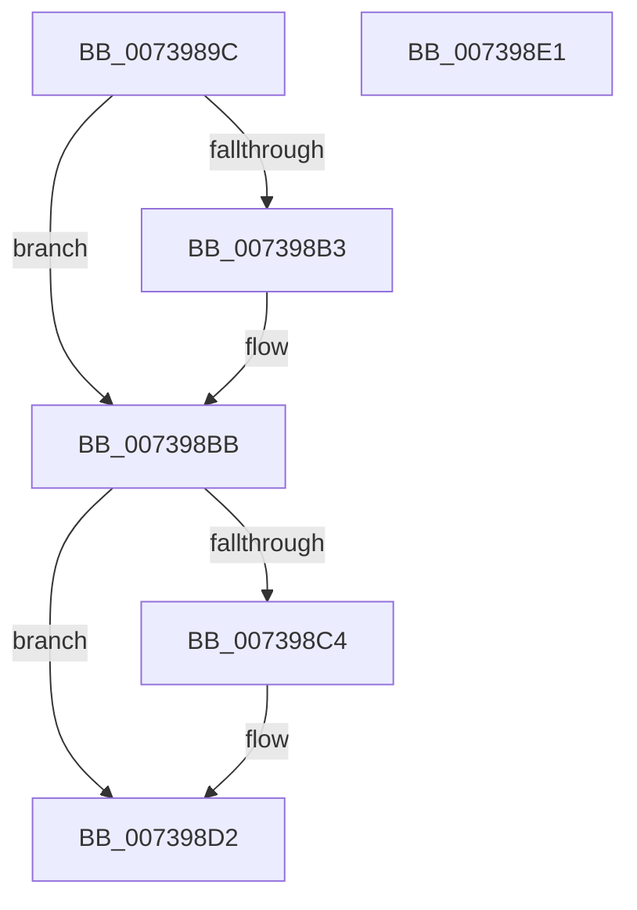

# PnprFreeMappingReserve

- RVA: `0x0073989C`–`0x007398E2` (길이 `70` bytes)
- VA: `0x000000014073989C`
- 실행 섹션: `PAGE`
- PDB 이름 있음: `예`; PDB Function 태그: `아니요`
- unwind 정보 RVA: `0x0005CAAC`
- 디코드: `22`개 명령, `70/70` bytes 표시
- 미해석 바이트: `0` (있으면 어셈블리에 `.byte`로 보존)

> 이 문서는 커널 이미지의 기계어와 PDB 기호를 분석해 생성했습니다. 4번과 5번은 함수 원형과 자료형을 바이너리 사용 방식에서 추정한 C 해석이며 원본 소스 복구 결과는 아닙니다.

## 1. Dependencies

- 직접 호출 지점: **2**; 고유 호출 대상: **2**
- 직접 호출자로 확인된 함수: **2**
- RIP 상대 이미지 참조: **0**

### Outgoing calls
- `0x007398B3` → [IoFreeMdl](../../text/29/IoFreeMdl_function_0029EA80.md) (function, `0x0029EA80`)
- `0x007398C9` → [MmFreeMappingAddress](../A7/MmFreeMappingAddress_function_00A75F20.md) (function, `0x00A75F20`)

### Direct callers
- [PnpReplacePartitionUnit](PnpReplacePartitionUnit_function_00738550.md) at `0x00738F28`
- [PnpReplacePartitionUnit](PnpReplacePartitionUnit_function_00738550.md) at `0x00738F37`
- [PnprAllocateMappingReserves](PnprAllocateMappingReserves_function_007393C4.md) at `0x0073946C`

### Static image references
- 디코드된 RIP-relative 메모리 참조가 없습니다.

## 2. Other-region calls and transfers

- 다른 실행 섹션으로 향하는 call: **1**
  - `0x007398B3` → [IoFreeMdl](../../text/29/IoFreeMdl_function_0029EA80.md) (`PAGE` → `.text`)
- 별도 외부 분기/꼬리 이동을 확인하지 못했습니다.

## 3. Assembly (complete function range)

```asm
0073989C  48 89 5C 24 08                  mov qword ptr [rsp + 8], rbx
007398A1  57                              push rdi
007398A2  48 83 EC 20                     sub rsp, 0x20
007398A6  48 8B D9                        mov rbx, rcx
007398A9  33 FF                           xor edi, edi
007398AB  48 8B 09                        mov rcx, qword ptr [rcx]
007398AE  48 85 C9                        test rcx, rcx
007398B1  74 08                           je 0x1407398bb
007398B3  E8 C8 51 B6 FF                  call 0x14029ea80
007398B8  48 89 3B                        mov qword ptr [rbx], rdi
007398BB  48 8B 4B 08                     mov rcx, qword ptr [rbx + 8]
007398BF  48 85 C9                        test rcx, rcx
007398C2  74 0E                           je 0x1407398d2
007398C4  BA 50 6E 70 51                  mov edx, 0x51706e50
007398C9  E8 52 C6 33 00                  call 0x140a75f20
007398CE  48 89 7B 08                     mov qword ptr [rbx + 8], rdi
007398D2  66 89 7B 10                     mov word ptr [rbx + 0x10], di
007398D6  48 8B 5C 24 30                  mov rbx, qword ptr [rsp + 0x30]
007398DB  48 83 C4 20                     add rsp, 0x20
007398DF  5F                              pop rdi
007398E0  C3                              ret
007398E1  CC                              int3
```

## 4. C-style interpretation (structured pseudocode)

```c
__int64 __fastcall PnprFreeMappingReserve(__int64 a1)
{
    __int64 result;
    __int64 v_rdi;
    __int64 v_rsp;
    unsigned __int64 v_stack_p8;

    v_stack_p8 = v_rbx;
    v_rsp = (v_rsp) - (32);
    v_rdi = 0;
    if (*(unsigned __int64 *)(a1) != 0) {
        result = IoFreeMdl(*(unsigned __int64 *)(a1), a2, a3, a4);
        *(unsigned __int64 *)(a1) = 0;
    }
    if (*(unsigned __int64 *)(a1 + 8) != 0) {
        a2 = 0x51706E50ULL;
        result = MmFreeMappingAddress(*(unsigned __int64 *)(a1 + 8), a2, a3, a4);
        *(unsigned __int64 *)(a1 + 8) = 0;
    }
    *(unsigned __int16 *)(a1 + 16) = 0;
    v_rsp = (v_rsp) + (32);
    return result;
}
```

## 5. (Beta) C Style

```c
int64_t PnprFreeMappingReserve(void *Arg1)
{
    uint8_t *arg1 = (uint8_t *)Arg1;

    int64_t result;
    int64_t local_rdi;
    int64_t local_rsp;
    uint64_t v_stack_p8;

    v_stack_p8 = local_rbx;
    local_rsp = (local_rsp) - (32);
    local_rdi = 0;
    if (*(uint64_t *)(arg1) != 0) {
        result = IoFreeMdl(*(uint64_t *)(arg1), a2, a3, a4);
        *(uint64_t *)(arg1) = 0;
    }
    if (*(uint64_t *)(arg1 + 0x8) != 0) {
        a2 = 0x51706E50ULL;
        result = MmFreeMappingAddress(*(uint64_t *)(arg1 + 0x8), a2, a3, a4);
        *(uint64_t *)(arg1 + 0x8) = 0;
    }
    *(uint16_t *)(arg1 + 0x10) = 0;
    local_rsp = (local_rsp) + (32);
    return result;
}
```

### 관측된 메모리 오프셋

구조체 형식이 확인되지 않은 접근은 인자 기준의 오프셋으로만 기록했습니다.

| 기준 인자 | 오프셋 표현 | 폭 (bit) | 접근 |
|---|---:|---:|---|
| `Arg1` | `+ 0x0` | `64` | `R` |
| `Arg1` | `+ 0x0` | `64` | `W` |
| `Arg1` | `+ 0x8` | `64` | `R` |
| `Arg1` | `+ 0x8` | `64` | `W` |
| `Arg1` | `+ 0x10` | `16` | `W` |

## 6. Execution-region graph

[열기: 2D/3D 그래프와 함수 탐색 컨트롤 패널](../../../control-panel.html?section=page&rva=0x0073989C&view=graph)

- 2D 그래프는 위에서 아래로 흐르고, 3D 그래프는 빈 공간을 드래그해 회전합니다. Shift+드래그는 이동, 휠은 확대·축소, 함수 노드 선택은 대상 보고서 이동입니다.

### Static fallback


