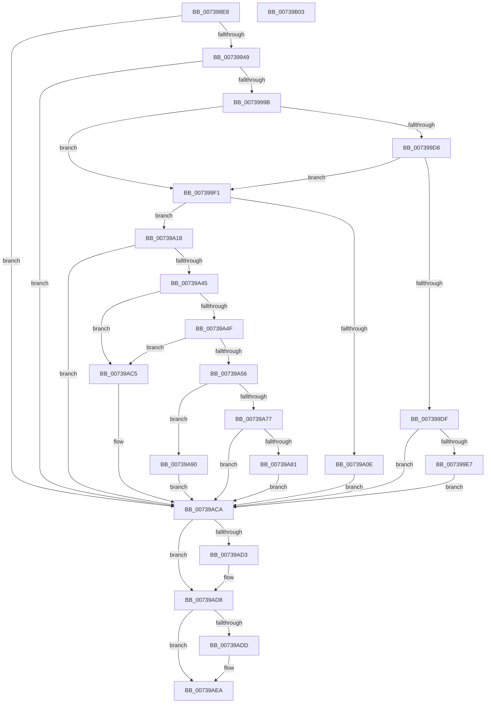

# PnprGetPluginDriverImagePath

- RVA: `0x007398E8`–`0x00739B04` (길이 `540` bytes)
- VA: `0x00000001407398E8`
- 실행 섹션: `PAGE`
- PDB 이름 있음: `예`; PDB Function 태그: `아니요`
- unwind 정보 RVA: `0x000C8E04`
- 디코드: `146`개 명령, `540/540` bytes 표시
- 미해석 바이트: `0` (있으면 어셈블리에 `.byte`로 보존)

> 이 문서는 커널 이미지의 기계어와 PDB 기호를 분석해 생성했습니다. 4번과 5번은 함수 원형과 자료형을 바이너리 사용 방식에서 추정한 C 해석이며 원본 소스 복구 결과는 아닙니다.

## 1. Dependencies

- 직접 호출 지점: **14**; 고유 호출 대상: **9**
- 직접 호출자로 확인된 함수: **1**
- RIP 상대 이미지 참조: **4**

### Outgoing calls
- `0x0073993A` → [_PnpCtxGetCachedContextBaseKey](../8E/_PnpCtxGetCachedContextBaseKey_function_008EFB2C.md) (function, `0x008EFB2C`)
- `0x00739954` → [RtlInitUnicodeString](../../text/42/RtlInitUnicodeString_function_0042A780.md) (function, `0x0042A780`)
- `0x0073998C` → [ZwOpenKey](../../text/6A/ZwOpenKey_function_006AD310.md) (function, `0x006AD310`)
- `0x007399A6` → [RtlInitUnicodeString](../../text/42/RtlInitUnicodeString_function_0042A780.md) (function, `0x0042A780`)
- `0x007399CA` → [ZwQueryValueKey](../../text/6A/ZwQueryValueKey_function_006AD3B0.md) (function, `0x006AD3B0`)
- `0x00739A01` → [ExAllocatePool2](../../poolcode/B8/ExAllocatePool2_function_00B820F0.md) (function, `0x00B820F0`)
- `0x00739A36` → [ZwQueryValueKey](../../text/6A/ZwQueryValueKey_function_006AD3B0.md) (function, `0x006AD3B0`)
- `0x00739A6A` → [ExAllocatePool2](../../poolcode/B8/ExAllocatePool2_function_00B820F0.md) (function, `0x00B820F0`)
- `0x00739A89` → [ExFreePoolWithTag](../../poolcode/B8/ExFreePoolWithTag_function_00B82870.md) (function, `0x00B82870`)
- `0x00739A9D` → [wcscpy_s](../../text/50/wcscpy_s_function_005064B0.md) (function, `0x005064B0`)
- `0x00739AB3` → [wcsncat_s](../../text/50/wcsncat_s_function_00506540.md) (function, `0x00506540`)
- `0x00739ABE` → [RtlInitUnicodeString](../../text/42/RtlInitUnicodeString_function_0042A780.md) (function, `0x0042A780`)
- `0x00739AD3` → [ZwClose](../../text/6A/ZwClose_function_006AD2B0.md) (function, `0x006AD2B0`)
- `0x00739AE5` → [ExFreePoolWithTag](../../poolcode/B8/ExFreePoolWithTag_function_00B82870.md) (function, `0x00B82870`)

### Direct callers
- [PnprLoadPluginDriver](PnprLoadPluginDriver_function_00739FC4.md) at `0x00739FF5`

### Static image references
- `0x0073991B` → RVA `0x00E66398` (`.data`; read)
- `0x00739949` → RVA `0x00AFFCC0` (` ?? ::NNGAKEGL::`string'`; read)
- `0x0073999B` → RVA `0x00AFFCE0` (` ?? ::NNGAKEGL::`string'`; read)
- `0x00739A90` → RVA `0x00AFFCA0` (` ?? ::NNGAKEGL::`string'`; read)

## 2. Other-region calls and transfers

- 다른 실행 섹션으로 향하는 call: **13**
  - `0x00739954` → [RtlInitUnicodeString](../../text/42/RtlInitUnicodeString_function_0042A780.md) (`PAGE` → `.text`)
  - `0x0073998C` → [ZwOpenKey](../../text/6A/ZwOpenKey_function_006AD310.md) (`PAGE` → `.text`)
  - `0x007399A6` → [RtlInitUnicodeString](../../text/42/RtlInitUnicodeString_function_0042A780.md) (`PAGE` → `.text`)
  - `0x007399CA` → [ZwQueryValueKey](../../text/6A/ZwQueryValueKey_function_006AD3B0.md) (`PAGE` → `.text`)
  - `0x00739A01` → [ExAllocatePool2](../../poolcode/B8/ExAllocatePool2_function_00B820F0.md) (`PAGE` → `POOLCODE`)
  - `0x00739A36` → [ZwQueryValueKey](../../text/6A/ZwQueryValueKey_function_006AD3B0.md) (`PAGE` → `.text`)
  - `0x00739A6A` → [ExAllocatePool2](../../poolcode/B8/ExAllocatePool2_function_00B820F0.md) (`PAGE` → `POOLCODE`)
  - `0x00739A89` → [ExFreePoolWithTag](../../poolcode/B8/ExFreePoolWithTag_function_00B82870.md) (`PAGE` → `POOLCODE`)
  - `0x00739A9D` → [wcscpy_s](../../text/50/wcscpy_s_function_005064B0.md) (`PAGE` → `.text`)
  - `0x00739AB3` → [wcsncat_s](../../text/50/wcsncat_s_function_00506540.md) (`PAGE` → `.text`)
  - `0x00739ABE` → [RtlInitUnicodeString](../../text/42/RtlInitUnicodeString_function_0042A780.md) (`PAGE` → `.text`)
  - `0x00739AD3` → [ZwClose](../../text/6A/ZwClose_function_006AD2B0.md) (`PAGE` → `.text`)
  - `0x00739AE5` → [ExFreePoolWithTag](../../poolcode/B8/ExFreePoolWithTag_function_00B82870.md) (`PAGE` → `POOLCODE`)
- 별도 외부 분기/꼬리 이동을 확인하지 못했습니다.

## 3. Assembly (complete function range)

```asm
007398E8  48 89 5C 24 08                  mov qword ptr [rsp + 8], rbx
007398ED  55                              push rbp
007398EE  56                              push rsi
007398EF  57                              push rdi
007398F0  41 56                           push r14
007398F2  41 57                           push r15
007398F4  48 8B EC                        mov rbp, rsp
007398F7  48 81 EC 80 00 00 00            sub rsp, 0x80
007398FE  48 83 65 48 00                  and qword ptr [rbp + 0x48], 0
00739903  4C 8D 45 48                     lea r8, [rbp + 0x48]
00739907  83 65 38 00                     and dword ptr [rbp + 0x38], 0
0073990B  33 C0                           xor eax, eax
0073990D  48 21 45 40                     and qword ptr [rbp + 0x40], rax
00739911  0F 57 C0                        xorps xmm0, xmm0
00739914  4C 8B F9                        mov r15, rcx
00739917  48 89 45 F0                     mov qword ptr [rbp - 0x10], rax
0073991B  48 8B 0D 76 CA 72 00            mov rcx, qword ptr [rip + 0x72ca76]
00739922  33 FF                           xor edi, edi
00739924  8D 50 04                        lea edx, [rax + 4]
00739927  89 45 F8                        mov dword ptr [rbp - 8], eax
0073992A  0F 11 45 C0                     movups xmmword ptr [rbp - 0x40], xmm0
0073992E  0F 11 45 D0                     movups xmmword ptr [rbp - 0x30], xmm0
00739932  0F 11 45 E0                     movups xmmword ptr [rbp - 0x20], xmm0
00739936  0F 11 45 B0                     movups xmmword ptr [rbp - 0x50], xmm0
0073993A  E8 ED 61 1B 00                  call 0x1408efb2c
0073993F  8B D8                           mov ebx, eax
00739941  85 C0                           test eax, eax
00739943  0F 88 81 01 00 00               js 0x140739aca
00739949  48 8D 15 70 63 3C 00            lea rdx, [rip + 0x3c6370]
00739950  48 8D 4D C0                     lea rcx, [rbp - 0x40]
00739954  E8 27 0E CF FF                  call 0x14042a780
00739959  48 8B 45 48                     mov rax, qword ptr [rbp + 0x48]
0073995D  4C 8D 45 D0                     lea r8, [rbp - 0x30]
00739961  48 89 45 D8                     mov qword ptr [rbp - 0x28], rax
00739965  48 8D 4D 40                     lea rcx, [rbp + 0x40]
00739969  48 8D 45 C0                     lea rax, [rbp - 0x40]
0073996D  C7 45 D0 30 00 00 00            mov dword ptr [rbp - 0x30], 0x30
00739974  0F 57 C0                        xorps xmm0, xmm0
00739977  48 89 45 E0                     mov qword ptr [rbp - 0x20], rax
0073997B  BA 19 00 02 00                  mov edx, 0x20019
00739980  C7 45 E8 40 02 00 00            mov dword ptr [rbp - 0x18], 0x240
00739987  F3 0F 7F 45 F0                  movdqu xmmword ptr [rbp - 0x10], xmm0
0073998C  E8 7F 39 F7 FF                  call 0x1406ad310
00739991  8B D8                           mov ebx, eax
00739993  85 C0                           test eax, eax
00739995  0F 88 2F 01 00 00               js 0x140739aca
0073999B  48 8D 15 3E 63 3C 00            lea rdx, [rip + 0x3c633e]
007399A2  48 8D 4D B0                     lea rcx, [rbp - 0x50]
007399A6  E8 D5 0D CF FF                  call 0x14042a780
007399AB  48 8B 4D 40                     mov rcx, qword ptr [rbp + 0x40]
007399AF  48 8D 45 38                     lea rax, [rbp + 0x38]
007399B3  48 89 44 24 28                  mov qword ptr [rsp + 0x28], rax
007399B8  44 8D 77 02                     lea r14d, [rdi + 2]
007399BC  21 7C 24 20                     and dword ptr [rsp + 0x20], edi
007399C0  48 8D 55 B0                     lea rdx, [rbp - 0x50]
007399C4  45 33 C9                        xor r9d, r9d
007399C7  45 8B C6                        mov r8d, r14d
007399CA  E8 E1 39 F7 FF                  call 0x1406ad3b0
007399CF  8B D8                           mov ebx, eax
007399D1  3D 05 00 00 80                  cmp eax, 0x80000005
007399D6  74 19                           je 0x1407399f1
007399D8  3D 23 00 00 C0                  cmp eax, 0xc0000023
007399DD  74 12                           je 0x1407399f1
007399DF  85 C0                           test eax, eax
007399E1  0F 88 E3 00 00 00               js 0x140739aca
007399E7  BB 01 00 00 C0                  mov ebx, 0xc0000001
007399EC  E9 D9 00 00 00                  jmp 0x140739aca
007399F1  8B 55 38                        mov edx, dword ptr [rbp + 0x38]
007399F4  BE 00 01 00 00                  mov esi, 0x100
007399F9  8B CE                           mov ecx, esi
007399FB  41 B8 50 6E 70 51               mov r8d, 0x51706e50
00739A01  E8 EA 86 44 00                  call 0x140b820f0
00739A06  48 8B F8                        mov rdi, rax
00739A09  48 85 C0                        test rax, rax
00739A0C  75 0A                           jne 0x140739a18
00739A0E  BB 9A 00 00 C0                  mov ebx, 0xc000009a
00739A13  E9 B2 00 00 00                  jmp 0x140739aca
00739A18  48 8B 4D 40                     mov rcx, qword ptr [rbp + 0x40]
00739A1C  48 8D 45 38                     lea rax, [rbp + 0x38]
00739A20  48 89 44 24 28                  mov qword ptr [rsp + 0x28], rax
00739A25  48 8D 55 B0                     lea rdx, [rbp - 0x50]
00739A29  8B 45 38                        mov eax, dword ptr [rbp + 0x38]
00739A2C  4C 8B CF                        mov r9, rdi
00739A2F  45 8B C6                        mov r8d, r14d
00739A32  89 44 24 20                     mov dword ptr [rsp + 0x20], eax
00739A36  E8 75 39 F7 FF                  call 0x1406ad3b0
00739A3B  8B D8                           mov ebx, eax
00739A3D  85 C0                           test eax, eax
00739A3F  0F 88 85 00 00 00               js 0x140739aca
00739A45  8B 47 04                        mov eax, dword ptr [rdi + 4]
00739A48  FF C8                           dec eax
00739A4A  83 F8 01                        cmp eax, 1
00739A4D  77 76                           ja 0x140739ac5
00739A4F  8B 47 08                        mov eax, dword ptr [rdi + 8]
00739A52  A8 01                           test al, 1
00739A54  75 6F                           jne 0x140739ac5
00739A56  4C 8D 70 1A                     lea r14, [rax + 0x1a]
00739A5A  41 B8 50 6E 70 51               mov r8d, 0x51706e50
00739A60  49 D1 EE                        shr r14, 1
00739A63  48 8B CE                        mov rcx, rsi
00739A66  4B 8D 14 36                     lea rdx, [r14 + r14]
00739A6A  E8 81 86 44 00                  call 0x140b820f0
00739A6F  48 8B F0                        mov rsi, rax
00739A72  4D 85 FF                        test r15, r15
00739A75  75 19                           jne 0x140739a90
00739A77  BB 9A 00 00 C0                  mov ebx, 0xc000009a
00739A7C  48 85 C0                        test rax, rax
00739A7F  74 49                           je 0x140739aca
00739A81  BA 50 6E 70 51                  mov edx, 0x51706e50
00739A86  48 8B C8                        mov rcx, rax
00739A89  E8 E2 8D 44 00                  call 0x140b82870
00739A8E  EB 3A                           jmp 0x140739aca
00739A90  4C 8D 05 09 62 3C 00            lea r8, [rip + 0x3c6209]
00739A97  49 8B D6                        mov rdx, r14
00739A9A  48 8B CE                        mov rcx, rsi
00739A9D  E8 0E CA DC FF                  call 0x1405064b0
00739AA2  44 8B 4F 08                     mov r9d, dword ptr [rdi + 8]
00739AA6  4C 8D 47 0C                     lea r8, [rdi + 0xc]
00739AAA  49 D1 E9                        shr r9, 1
00739AAD  49 8B D6                        mov rdx, r14
00739AB0  48 8B CE                        mov rcx, rsi
00739AB3  E8 88 CA DC FF                  call 0x140506540
00739AB8  48 8B D6                        mov rdx, rsi
00739ABB  49 8B CF                        mov rcx, r15
00739ABE  E8 BD 0C CF FF                  call 0x14042a780
00739AC3  EB 05                           jmp 0x140739aca
00739AC5  BB 0D 00 00 C0                  mov ebx, 0xc000000d
00739ACA  48 8B 4D 40                     mov rcx, qword ptr [rbp + 0x40]
00739ACE  48 85 C9                        test rcx, rcx
00739AD1  74 05                           je 0x140739ad8
00739AD3  E8 D8 37 F7 FF                  call 0x1406ad2b0
00739AD8  48 85 FF                        test rdi, rdi
00739ADB  74 0D                           je 0x140739aea
00739ADD  BA 50 6E 70 51                  mov edx, 0x51706e50
00739AE2  48 8B CF                        mov rcx, rdi
00739AE5  E8 86 8D 44 00                  call 0x140b82870
00739AEA  8B C3                           mov eax, ebx
00739AEC  48 8B 9C 24 B0 00 00 00         mov rbx, qword ptr [rsp + 0xb0]
00739AF4  48 81 C4 80 00 00 00            add rsp, 0x80
00739AFB  41 5F                           pop r15
00739AFD  41 5E                           pop r14
00739AFF  5F                              pop rdi
00739B00  5E                              pop rsi
00739B01  5D                              pop rbp
00739B02  C3                              ret
00739B03  CC                              int3
```

## 4. C-style interpretation (structured pseudocode)

```c
__int64 __fastcall PnprGetPluginDriverImagePath(__int64 a1, __int64 a2, __int64 a3, int a4)
{
    __int64 result;
    __int64 v_r14;
    __int64 v_rdi;
    __int64 v_rsp;
    unsigned int v_stack_m30;
    unsigned __int64 v_stack_m38;
    unsigned int v_stack_m40;
    unsigned __int64 v_stack_m48;
    unsigned __int64 v_stack_m50;
    unsigned __int64 v_stack_m58;
    unsigned __int64 v_stack_m68;
    unsigned __int64 v_stack_m78;
    unsigned __int64 v_stack_m80;
    unsigned int v_stack_m88;
    unsigned int v_stack_p10;
    unsigned __int64 v_stack_p18;
    unsigned __int64 v_stack_p20;
    unsigned __int64 v_stack_p8;

    v_stack_p8 = v_rbx;
    v_rsp = (v_rsp) - (128);
    result = 0;
    v_stack_m38 = 0;
    v_rdi = 0;
    v_stack_m30 = 0;
    v_stack_m68 = v_xmm0;
    v_stack_m58 = v_xmm0;
    v_stack_m48 = v_xmm0;
    v_stack_m78 = v_xmm0;
    result = _PnpCtxGetCachedContextBaseKey(*(unsigned __int64 *)(v_rip + 7522934), result + 4, v_stack_p20, a4);
    if (sign_flag) goto loc_00739ACA;
    result = RtlInitUnicodeString(v_stack_m68, v_rip + 3957616, v_stack_p20, a4);
    v_stack_m50 = v_stack_p20;
    v_stack_m58 = 48;
    v_stack_m48 = v_stack_m68;
    v_stack_m40 = 576;
    v_stack_m38 = v_xmm0;
    result = ZwOpenKey(v_stack_p18, (unsigned int)(0x20019ULL), v_stack_m58, a4);
    if (sign_flag) goto loc_00739ACA;
    result = RtlInitUnicodeString(v_stack_m78, v_rip + 3957566, v_stack_m58, a4);
    v_stack_m80 = v_stack_p10;
    a4 = 0;
    result = ZwQueryValueKey(v_stack_p18, v_stack_m78, (unsigned int)((unsigned int)(v_rdi + 2)), a4);
    if (((unsigned int)(result)) == 0x80000005ULL) goto loc_007399F1;
    if (((unsigned int)(result)) == 0xC0000023ULL) goto loc_007399F1;
    if (sign_flag) goto loc_00739ACA;
    goto loc_00739ACA;
loc_007399F1:
    result = ExAllocatePool2(256, (unsigned int)(v_stack_p10), (unsigned int)(0x51706E50ULL), a4);
    if (result != 0) goto loc_00739A18;
    goto loc_00739ACA;
loc_00739A18:
    v_stack_m80 = v_stack_p10;
    v_stack_m88 = (unsigned int)((unsigned int)(v_stack_p10));
    result = ZwQueryValueKey(v_stack_p18, v_stack_m78, (unsigned int)((unsigned int)(v_rdi + 2)), result);
    if (sign_flag) goto loc_00739ACA;
    result = (unsigned int)(((unsigned int)(*(unsigned int *)(result + 4))) - 1);
    if (((unsigned int)(result)) > 1) goto loc_00739AC5;
    if ((((unsigned __int8)((unsigned int)(*(unsigned int *)(result + 8)))) & (1)) != 0) goto loc_00739AC5;
    v_r14 = ((unsigned int)(*(unsigned int *)(result + 8)) + 26) >> (1);
    result = ExAllocatePool2(256, v_r14 + v_r14 * 1, (unsigned int)(0x51706E50ULL), result);
    if (a1 != 0) goto loc_00739A90;
    if (result == 0) goto loc_00739ACA;
    result = ExFreePoolWithTag(result, (unsigned int)(0x51706E50ULL), (unsigned int)(0x51706E50ULL), result);
    goto loc_00739ACA;
loc_00739A90:
    result = wcscpy_s(result, v_r14, v_rip + 3957257, result);
    a4 = ((unsigned int)(*(unsigned int *)(result + 8))) >> (1);
    result = wcsncat_s(result, v_r14, result + 12, a4);
    result = RtlInitUnicodeString(a1, result, result + 12, a4);
    goto loc_00739ACA;
loc_00739AC5:
loc_00739ACA:
    if (v_stack_p18 != 0) {
        result = ZwClose(v_stack_p18, result, result + 12, a4);
    }
    if (result != 0) {
        a2 = 0x51706E50ULL;
        a1 = result;
        result = ExFreePoolWithTag(a1, a2, result + 12, a4);
    }
    v_rsp = (v_rsp) + (128);
    return (unsigned int)((unsigned int)((unsigned int)(0xC000000DULL)));
}
```

## 5. (Beta) C Style

```c
int64_t PnprGetPluginDriverImagePath(int64_t Arg1, int64_t Arg2, int64_t Arg3, int32_t Arg4)
{
    int64_t result;
    int64_t local_r14;
    int64_t local_rdi;
    int64_t local_rsp;
    uint32_t v_stack_m30;
    uint64_t v_stack_m38;
    uint32_t v_stack_m40;
    uint64_t v_stack_m48;
    uint64_t v_stack_m50;
    uint64_t v_stack_m58;
    uint64_t v_stack_m68;
    uint64_t v_stack_m78;
    uint64_t v_stack_m80;
    uint32_t v_stack_m88;
    uint32_t v_stack_p10;
    uint64_t v_stack_p18;
    uint64_t v_stack_p20;
    uint64_t v_stack_p8;

    v_stack_p8 = local_rbx;
    local_rsp = (local_rsp) - (128);
    result = 0;
    v_stack_m38 = 0;
    local_rdi = 0;
    v_stack_m30 = 0;
    v_stack_m68 = v_xmm0;
    v_stack_m58 = v_xmm0;
    v_stack_m48 = v_xmm0;
    v_stack_m78 = v_xmm0;
    result = _PnpCtxGetCachedContextBaseKey(*(uint64_t *)(v_rip + 0x72CA76), result + 4, v_stack_p20, Arg4);
    if (sign_flag) goto loc_00739ACA;
    result = RtlInitUnicodeString(v_stack_m68, v_rip + 3957616, v_stack_p20, Arg4);
    v_stack_m50 = v_stack_p20;
    v_stack_m58 = 48;
    v_stack_m48 = v_stack_m68;
    v_stack_m40 = 576;
    v_stack_m38 = v_xmm0;
    result = ZwOpenKey(v_stack_p18, (uint32_t)(0x20019ULL), v_stack_m58, Arg4);
    if (sign_flag) goto loc_00739ACA;
    result = RtlInitUnicodeString(v_stack_m78, v_rip + 3957566, v_stack_m58, Arg4);
    v_stack_m80 = v_stack_p10;
    Arg4 = 0;
    result = ZwQueryValueKey(v_stack_p18, v_stack_m78, (uint32_t)((uint32_t)(local_rdi + 2)), Arg4);
    if (((uint32_t)(result)) == 0x80000005ULL) goto loc_007399F1;
    if (((uint32_t)(result)) == 0xC0000023ULL) goto loc_007399F1;
    if (sign_flag) goto loc_00739ACA;
    goto loc_00739ACA;
loc_007399F1:
    result = ExAllocatePool2(256, (uint32_t)(v_stack_p10), (uint32_t)(0x51706E50ULL), Arg4);
    if (result != 0) goto loc_00739A18;
    goto loc_00739ACA;
loc_00739A18:
    v_stack_m80 = v_stack_p10;
    v_stack_m88 = (uint32_t)((uint32_t)(v_stack_p10));
    result = ZwQueryValueKey(v_stack_p18, v_stack_m78, (uint32_t)((uint32_t)(local_rdi + 2)), result);
    if (sign_flag) goto loc_00739ACA;
    result = (uint32_t)(((uint32_t)(*(uint32_t *)(result + 0x4))) - 1);
    if (((uint32_t)(result)) > 1) goto loc_00739AC5;
    if ((((uint8_t)((uint32_t)(*(uint32_t *)(result + 0x8)))) & (1)) != 0) goto loc_00739AC5;
    local_r14 = ((uint32_t)(*(uint32_t *)(result + 0x8)) + 26) >> (1);
    result = ExAllocatePool2(256, local_r14 + local_r14 * 1, (uint32_t)(0x51706E50ULL), result);
    if (Arg1 != 0) goto loc_00739A90;
    if (result == 0) goto loc_00739ACA;
    result = ExFreePoolWithTag(result, (uint32_t)(0x51706E50ULL), (uint32_t)(0x51706E50ULL), result);
    goto loc_00739ACA;
loc_00739A90:
    result = wcscpy_s(result, local_r14, v_rip + 3957257, result);
    Arg4 = ((uint32_t)(*(uint32_t *)(result + 0x8))) >> (1);
    result = wcsncat_s(result, local_r14, result + 12, Arg4);
    result = RtlInitUnicodeString(Arg1, result, result + 12, Arg4);
    goto loc_00739ACA;
loc_00739AC5:
loc_00739ACA:
    if (v_stack_p18 != 0) {
        result = ZwClose(v_stack_p18, result, result + 12, Arg4);
    }
    if (result != 0) {
        Arg2 = 0x51706E50ULL;
        Arg1 = result;
        result = ExFreePoolWithTag(Arg1, Arg2, result + 12, Arg4);
    }
    local_rsp = (local_rsp) + (128);
    return (uint32_t)((uint32_t)((uint32_t)(0xC000000DULL)));
}
```

## 6. Execution-region graph

[열기: 2D/3D 그래프와 함수 탐색 컨트롤 패널](../../../control-panel.html?section=page&rva=0x007398E8&view=graph)

- 2D 그래프는 위에서 아래로 흐르고, 3D 그래프는 빈 공간을 드래그해 회전합니다. Shift+드래그는 이동, 휠은 확대·축소, 함수 노드 선택은 대상 보고서 이동입니다.

### Static fallback


