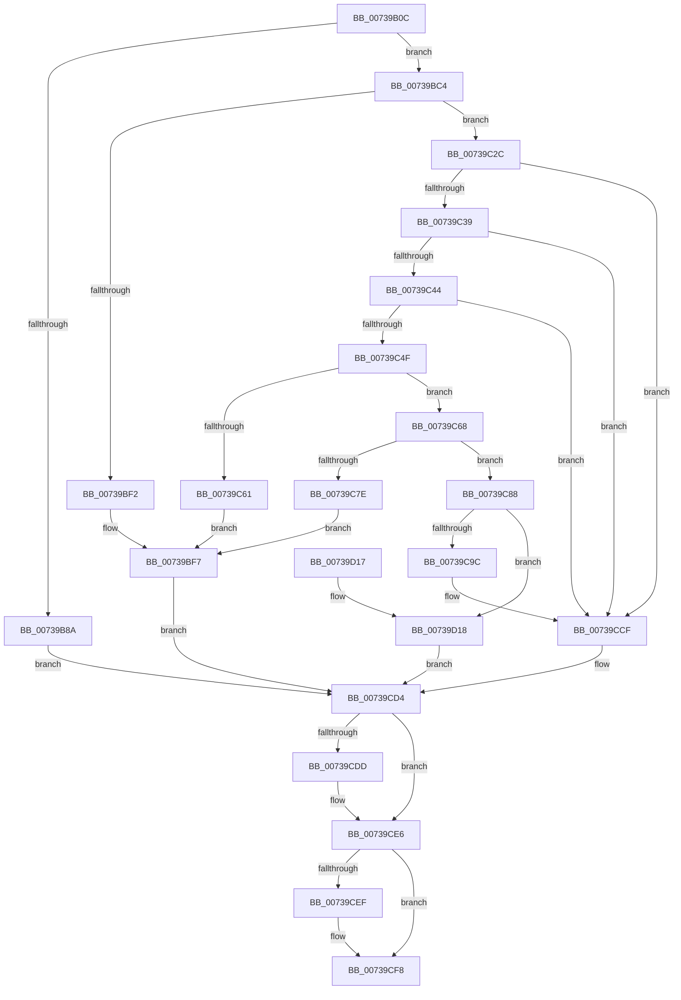

# PnprIdentifyUnits

- RVA: `0x00739B0C`–`0x00739D1C` (길이 `528` bytes)
- VA: `0x0000000140739B0C`
- 실행 섹션: `PAGE`
- PDB 이름 있음: `예`; PDB Function 태그: `아니요`
- unwind 정보 RVA: `0x000C8ED8`
- 디코드: `133`개 명령, `528/528` bytes 표시
- 미해석 바이트: `0` (있으면 어셈블리에 `.byte`로 보존)

> 이 문서는 커널 이미지의 기계어와 PDB 기호를 분석해 생성했습니다. 4번과 5번은 함수 원형과 자료형을 바이너리 사용 방식에서 추정한 C 해석이며 원본 소스 복구 결과는 아닙니다.

## 1. Dependencies

- 직접 호출 지점: **7**; 고유 호출 대상: **2**
- 직접 호출자로 확인된 함수: **1**
- RIP 상대 이미지 참조: **2**

### Outgoing calls
- `0x00739B7F` → [PnpQueryInterface](../A2/PnpQueryInterface_function_00A28D38.md) (function, `0x00A28D38`)
- `0x00739BE7` → [PnpQueryInterface](../A2/PnpQueryInterface_function_00A28D38.md) (function, `0x00A28D38`)
- `0x00739C56` → [guard_dispatch_icall](../../text/6B/guard_dispatch_icall_function_006BAAD0.md) (function, `0x006BAAD0`)
- `0x00739C73` → [guard_dispatch_icall](../../text/6B/guard_dispatch_icall_function_006BAAD0.md) (function, `0x006BAAD0`)
- `0x00739C93` → [guard_dispatch_icall](../../text/6B/guard_dispatch_icall_function_006BAAD0.md) (function, `0x006BAAD0`)
- `0x00739CE1` → [guard_dispatch_icall](../../text/6B/guard_dispatch_icall_function_006BAAD0.md) (function, `0x006BAAD0`)
- `0x00739CF3` → [guard_dispatch_icall](../../text/6B/guard_dispatch_icall_function_006BAAD0.md) (function, `0x006BAAD0`)

### Direct callers
- [PnpReplacePartitionUnit](PnpReplacePartitionUnit_function_00738550.md) at `0x00738B1F`

### Static image references
- `0x00739B41` → RVA `0x000240E8` (`.rdata`; read)
- `0x00739B8A` → RVA `0x00F8AC38` (`.data`; read)

## 2. Other-region calls and transfers

- 다른 실행 섹션으로 향하는 call: **5**
  - `0x00739C56` → [guard_dispatch_icall](../../text/6B/guard_dispatch_icall_function_006BAAD0.md) (`PAGE` → `.text`)
  - `0x00739C73` → [guard_dispatch_icall](../../text/6B/guard_dispatch_icall_function_006BAAD0.md) (`PAGE` → `.text`)
  - `0x00739C93` → [guard_dispatch_icall](../../text/6B/guard_dispatch_icall_function_006BAAD0.md) (`PAGE` → `.text`)
  - `0x00739CE1` → [guard_dispatch_icall](../../text/6B/guard_dispatch_icall_function_006BAAD0.md) (`PAGE` → `.text`)
  - `0x00739CF3` → [guard_dispatch_icall](../../text/6B/guard_dispatch_icall_function_006BAAD0.md) (`PAGE` → `.text`)
- 별도 외부 분기/꼬리 이동을 확인하지 못했습니다.

## 3. Assembly (complete function range)

```asm
00739B0C  4C 8B DC                        mov r11, rsp
00739B0F  49 89 5B 08                     mov qword ptr [r11 + 8], rbx
00739B13  49 89 73 10                     mov qword ptr [r11 + 0x10], rsi
00739B17  49 89 7B 18                     mov qword ptr [r11 + 0x18], rdi
00739B1B  4D 89 73 20                     mov qword ptr [r11 + 0x20], r14
00739B1F  55                              push rbp
00739B20  49 8D 6B A1                     lea rbp, [r11 - 0x5f]
00739B24  48 81 EC A0 00 00 00            sub rsp, 0xa0
00739B2B  48 8B F1                        mov rsi, rcx
00739B2E  0F 57 C0                        xorps xmm0, xmm0
00739B31  33 C9                           xor ecx, ecx
00739B33  0F 57 C9                        xorps xmm1, xmm1
00739B36  48 89 4D 17                     mov qword ptr [rbp + 0x17], rcx
00739B3A  48 8B C2                        mov rax, rdx
00739B3D  48 89 4D 4F                     mov qword ptr [rbp + 0x4f], rcx
00739B41  48 8D 15 A0 A5 8E FF            lea rdx, [rip - 0x715a60]
00739B48  4D 8B F1                        mov r14, r9
00739B4B  49 8B F8                        mov rdi, r8
00739B4E  44 8D 49 38                     lea r9d, [rcx + 0x38]
00739B52  44 8D 41 01                     lea r8d, [rcx + 1]
00739B56  48 8D 4D E7                     lea rcx, [rbp - 0x19]
00739B5A  49 89 4B 80                     mov qword ptr [r11 - 0x80], rcx
00739B5E  48 8B C8                        mov rcx, rax
00739B61  48 83 64 24 20 00               and qword ptr [rsp + 0x20], 0
00739B67  0F 11 45 E7                     movups xmmword ptr [rbp - 0x19], xmm0
00739B6B  0F 11 45 F7                     movups xmmword ptr [rbp - 9], xmm0
00739B6F  0F 11 45 07                     movups xmmword ptr [rbp + 7], xmm0
00739B73  0F 11 4D 1F                     movups xmmword ptr [rbp + 0x1f], xmm1
00739B77  0F 11 4D 2F                     movups xmmword ptr [rbp + 0x2f], xmm1
00739B7B  0F 11 4D 3F                     movups xmmword ptr [rbp + 0x3f], xmm1
00739B7F  E8 B4 F1 2E 00                  call 0x140a28d38
00739B84  8B D8                           mov ebx, eax
00739B86  85 C0                           test eax, eax
00739B88  79 3A                           jns 0x140739bc4
00739B8A  48 8B 15 A7 10 85 00            mov rdx, qword ptr [rip + 0x8510a7]
00739B91  B8 0D 05 00 00                  mov eax, 0x50d
00739B96  41 B8 03 00 00 00               mov r8d, 3
00739B9C  8B 8A 08 82 00 00               mov ecx, dword ptr [rdx + 0x8208]
00739BA2  85 C9                           test ecx, ecx
00739BA4  0F 44 C8                        cmove ecx, eax
00739BA7  8B 82 0C 82 00 00               mov eax, dword ptr [rdx + 0x820c]
00739BAD  85 C0                           test eax, eax
00739BAF  89 8A 08 82 00 00               mov dword ptr [rdx + 0x8208], ecx
00739BB5  41 0F 44 C0                     cmove eax, r8d
00739BB9  89 82 0C 82 00 00               mov dword ptr [rdx + 0x820c], eax
00739BBF  E9 10 01 00 00                  jmp 0x140739cd4
00739BC4  41 B9 38 00 00 00               mov r9d, 0x38
00739BCA  48 8D 45 1F                     lea rax, [rbp + 0x1f]
00739BCE  48 89 44 24 28                  mov qword ptr [rsp + 0x28], rax
00739BD3  48 8D 15 0E A5 8E FF            lea rdx, [rip - 0x715af2]
00739BDA  48 83 64 24 20 00               and qword ptr [rsp + 0x20], 0
00739BE0  48 8B CE                        mov rcx, rsi
00739BE3  45 8D 41 C9                     lea r8d, [r9 - 0x37]
00739BE7  E8 4C F1 2E 00                  call 0x140a28d38
00739BEC  8B D8                           mov ebx, eax
00739BEE  85 C0                           test eax, eax
00739BF0  79 3A                           jns 0x140739c2c
00739BF2  BA 19 05 00 00                  mov edx, 0x519
00739BF7  48 8B 0D 3A 10 85 00            mov rcx, qword ptr [rip + 0x85103a]
00739BFE  41 B8 03 00 00 00               mov r8d, 3
00739C04  8B 81 08 82 00 00               mov eax, dword ptr [rcx + 0x8208]
00739C0A  85 C0                           test eax, eax
00739C0C  0F 44 C2                        cmove eax, edx
00739C0F  89 81 08 82 00 00               mov dword ptr [rcx + 0x8208], eax
00739C15  8B 81 0C 82 00 00               mov eax, dword ptr [rcx + 0x820c]
00739C1B  85 C0                           test eax, eax
00739C1D  41 0F 44 C0                     cmove eax, r8d
00739C21  89 81 0C 82 00 00               mov dword ptr [rcx + 0x820c], eax
00739C27  E9 A8 00 00 00                  jmp 0x140739cd4
00739C2C  48 8B 45 3F                     mov rax, qword ptr [rbp + 0x3f]
00739C30  48 85 C0                        test rax, rax
00739C33  0F 84 96 00 00 00               je 0x140739ccf
00739C39  48 83 7D 07 00                  cmp qword ptr [rbp + 7], 0
00739C3E  0F 84 8B 00 00 00               je 0x140739ccf
00739C44  48 83 7D 17 00                  cmp qword ptr [rbp + 0x17], 0
00739C49  0F 84 80 00 00 00               je 0x140739ccf
00739C4F  48 8B 4D 27                     mov rcx, qword ptr [rbp + 0x27]
00739C53  48 8B D7                        mov rdx, rdi
00739C56  E8 75 0E F8 FF                  call 0x1406baad0
00739C5B  8B D8                           mov ebx, eax
00739C5D  85 C0                           test eax, eax
00739C5F  79 07                           jns 0x140739c68
00739C61  BA 2D 05 00 00                  mov edx, 0x52d
00739C66  EB 8F                           jmp 0x140739bf7
00739C68  48 8B 4D EF                     mov rcx, qword ptr [rbp - 0x11]
00739C6C  49 8B D6                        mov rdx, r14
00739C6F  48 8B 45 07                     mov rax, qword ptr [rbp + 7]
00739C73  E8 58 0E F8 FF                  call 0x1406baad0
00739C78  8B D8                           mov ebx, eax
00739C7A  85 C0                           test eax, eax
00739C7C  79 0A                           jns 0x140739c88
00739C7E  BA 35 05 00 00                  mov edx, 0x535
00739C83  E9 6F FF FF FF                  jmp 0x140739bf7
00739C88  48 8B 17                        mov rdx, qword ptr [rdi]
00739C8B  48 8B 4D EF                     mov rcx, qword ptr [rbp - 0x11]
00739C8F  48 8B 45 17                     mov rax, qword ptr [rbp + 0x17]
00739C93  E8 38 0E F8 FF                  call 0x1406baad0
00739C98  84 C0                           test al, al
00739C9A  75 7C                           jne 0x140739d18
00739C9C  48 8B 0D 95 0F 85 00            mov rcx, qword ptr [rip + 0x850f95]
00739CA3  BA 42 05 00 00                  mov edx, 0x542
00739CA8  8B 81 08 82 00 00               mov eax, dword ptr [rcx + 0x8208]
00739CAE  85 C0                           test eax, eax
00739CB0  0F 44 C2                        cmove eax, edx
00739CB3  BA 04 00 00 00                  mov edx, 4
00739CB8  89 81 08 82 00 00               mov dword ptr [rcx + 0x8208], eax
00739CBE  8B 81 0C 82 00 00               mov eax, dword ptr [rcx + 0x820c]
00739CC4  85 C0                           test eax, eax
00739CC6  0F 44 C2                        cmove eax, edx
00739CC9  89 81 0C 82 00 00               mov dword ptr [rcx + 0x820c], eax
00739CCF  BB 0D 00 00 C0                  mov ebx, 0xc000000d
00739CD4  48 8B 4D EF                     mov rcx, qword ptr [rbp - 0x11]
00739CD8  48 85 C9                        test rcx, rcx
00739CDB  74 09                           je 0x140739ce6
00739CDD  48 8B 45 FF                     mov rax, qword ptr [rbp - 1]
00739CE1  E8 EA 0D F8 FF                  call 0x1406baad0
00739CE6  48 8B 4D 27                     mov rcx, qword ptr [rbp + 0x27]
00739CEA  48 85 C9                        test rcx, rcx
00739CED  74 09                           je 0x140739cf8
00739CEF  48 8B 45 37                     mov rax, qword ptr [rbp + 0x37]
00739CF3  E8 D8 0D F8 FF                  call 0x1406baad0
00739CF8  4C 8D 9C 24 A0 00 00 00         lea r11, [rsp + 0xa0]
00739D00  8B C3                           mov eax, ebx
00739D02  49 8B 5B 10                     mov rbx, qword ptr [r11 + 0x10]
00739D06  49 8B 73 18                     mov rsi, qword ptr [r11 + 0x18]
00739D0A  49 8B 7B 20                     mov rdi, qword ptr [r11 + 0x20]
00739D0E  4D 8B 73 28                     mov r14, qword ptr [r11 + 0x28]
00739D12  49 8B E3                        mov rsp, r11
00739D15  5D                              pop rbp
00739D16  C3                              ret
00739D17  CC                              int3
00739D18  33 DB                           xor ebx, ebx
00739D1A  EB B8                           jmp 0x140739cd4
```

## 4. C-style interpretation (structured pseudocode)

```c
__int64 __fastcall PnprIdentifyUnits(__int64 a1, __int64 a2, __int64 a3, __int64 a4)
{
    __int64 result;
    __int64 v_rbx;
    __int64 v_rsp;
    unsigned __int64 v_stack_m8;
    unsigned __int64 v_stack_m80;
    unsigned __int64 v_stack_m88;

    *(unsigned __int64 *)(v_rsp + 8) = v_rbx;
    *(unsigned __int64 *)(v_rsp + 16) = v_rsi;
    *(unsigned __int64 *)(v_rsp + 24) = v_rdi;
    *(unsigned __int64 *)(v_rsp + 32) = v_r14;
    v_rsp = (v_rsp) - (160);
    a1 = 0;
    *(unsigned __int64 *)(v_rsp - 95 + 23) = 0;
    *(unsigned __int64 *)(v_rsp - 95 + 79) = 0;
    *(unsigned __int64 *)(v_rsp - 128) = v_rsp - 95 - 25;
    *(unsigned __int64 *)(v_rsp - 95 - 25) = v_xmm0;
    *(unsigned __int64 *)(v_rsp - 95 - 9) = v_xmm0;
    *(unsigned __int64 *)(v_rsp - 95 + 7) = v_xmm0;
    *(unsigned __int64 *)(v_rsp - 95 + 31) = v_xmm1;
    *(unsigned __int64 *)(v_rsp - 95 + 47) = v_xmm1;
    *(unsigned __int64 *)(v_rsp - 95 + 63) = v_xmm1;
    result = PnpQueryInterface(a2, v_rip - 7428704, a1 + 1, a1 + 56);
    if (!sign_flag) goto loc_00739BC4;
    a1 = (unsigned int)(*(unsigned int *)(*(unsigned __int64 *)(v_rip + 8720551) + 33288));
    if ((unsigned int)((unsigned int)(*(unsigned int *)(*(unsigned __int64 *)(v_rip + 8720551) + 33288))) == 0) { a1 = (unsigned int)((unsigned int)(0x50DULL)); }
    *(unsigned int *)(*(unsigned __int64 *)(v_rip + 8720551) + 33288) = (unsigned int)(a1);
    result = (unsigned int)(*(unsigned int *)(*(unsigned __int64 *)(v_rip + 8720551) + 33292));
    if ((unsigned int)((unsigned int)(*(unsigned int *)(*(unsigned __int64 *)(v_rip + 8720551) + 33292))) == 0) { result = 3; }
    *(unsigned int *)(*(unsigned __int64 *)(v_rip + 8720551) + 33292) = (unsigned int)(result);
    goto loc_00739CD4;
loc_00739BC4:
    v_stack_m80 = v_rsp - 95 + 31;
    result = PnpQueryInterface(a1, v_rip - 7428850, 56 - 55, 56);
    if (!sign_flag) goto loc_00739C2C;
loc_00739BF7:
    result = (unsigned int)(*(unsigned int *)(*(unsigned __int64 *)(v_rip + 8720442) + 33288));
    if ((unsigned int)((unsigned int)(*(unsigned int *)(*(unsigned __int64 *)(v_rip + 8720442) + 33288))) == 0) { result = (unsigned int)((unsigned int)(0x519ULL)); }
    *(unsigned int *)(*(unsigned __int64 *)(v_rip + 8720442) + 33288) = (unsigned int)(result);
    result = (unsigned int)(*(unsigned int *)(*(unsigned __int64 *)(v_rip + 8720442) + 33292));
    if ((unsigned int)((unsigned int)(*(unsigned int *)(*(unsigned __int64 *)(v_rip + 8720442) + 33292))) == 0) { result = 3; }
    *(unsigned int *)(*(unsigned __int64 *)(v_rip + 8720442) + 33292) = (unsigned int)(result);
    goto loc_00739CD4;
loc_00739C2C:
    if (*(unsigned __int64 *)(v_rsp - 95 + 63) == 0) goto loc_00739CCF;
    if ((*(unsigned __int64 *)(v_rsp - 95 + 7)) == 0) goto loc_00739CCF;
    if ((*(unsigned __int64 *)(v_rsp - 95 + 23)) == 0) goto loc_00739CCF;
    result = guard_dispatch_icall(*(unsigned __int64 *)(v_rsp - 95 + 39), a3, 3, 56);
    if (!sign_flag) goto loc_00739C68;
    goto loc_00739BF7;
loc_00739C68:
    result = guard_dispatch_icall(*(unsigned __int64 *)(v_rsp - 95 - 17), a4, 3, 56);
    if (!sign_flag) goto loc_00739C88;
    goto loc_00739BF7;
loc_00739C88:
    result = guard_dispatch_icall(*(unsigned __int64 *)(v_rsp - 95 - 17), *(unsigned __int64 *)(a3), 3, 56);
    if ((unsigned __int8)(result) != 0) goto loc_00739D18;
    result = (unsigned int)(*(unsigned int *)(*(unsigned __int64 *)(v_rip + 8720277) + 33288));
    if ((unsigned int)((unsigned int)(*(unsigned int *)(*(unsigned __int64 *)(v_rip + 8720277) + 33288))) == 0) { result = (unsigned int)((unsigned int)(0x542ULL)); }
    *(unsigned int *)(*(unsigned __int64 *)(v_rip + 8720277) + 33288) = (unsigned int)(result);
    result = (unsigned int)(*(unsigned int *)(*(unsigned __int64 *)(v_rip + 8720277) + 33292));
    if ((unsigned int)((unsigned int)(*(unsigned int *)(*(unsigned __int64 *)(v_rip + 8720277) + 33292))) == 0) { result = 4; }
    *(unsigned int *)(*(unsigned __int64 *)(v_rip + 8720277) + 33292) = (unsigned int)(result);
loc_00739CCF:
loc_00739CD4:
    if (*(unsigned __int64 *)(v_rsp - 95 - 17) != 0) {
        result = *(unsigned __int64 *)(v_rsp - 95 - 1);
        result = guard_dispatch_icall(*(unsigned __int64 *)(v_rsp - 95 - 17), 4, 3, 56);
    }
    if (*(unsigned __int64 *)(v_rsp - 95 + 39) != 0) {
        result = *(unsigned __int64 *)(v_rsp - 95 + 55);
        result = guard_dispatch_icall(*(unsigned __int64 *)(v_rsp - 95 + 39), 4, 3, 56);
    }
    return (unsigned int)((unsigned int)((unsigned int)(0xC000000DULL)));
loc_00739D18:
    v_rbx = 0;
    goto loc_00739CD4;
}
```

## 5. (Beta) C Style

```c
int64_t PnprIdentifyUnits(int64_t Arg1, int64_t Arg2, void *Arg3, int64_t Arg4)
{
    uint8_t *arg3 = (uint8_t *)Arg3;

    int64_t result;
    int64_t local_rbx;
    int64_t local_rsp;
    uint64_t v_stack_m8;
    uint64_t v_stack_m80;
    uint64_t v_stack_m88;

    *(uint64_t *)(local_rsp + 0x8) = local_rbx;
    *(uint64_t *)(local_rsp + 0x10) = local_rsi;
    *(uint64_t *)(local_rsp + 0x18) = local_rdi;
    *(uint64_t *)(local_rsp + 0x20) = local_r14;
    local_rsp = (local_rsp) - (160);
    Arg1 = 0;
    *(uint64_t *)(local_rsp - 0x5F + 0x17) = 0;
    *(uint64_t *)(local_rsp - 0x5F + 0x4F) = 0;
    *(uint64_t *)(local_rsp - 0x80) = local_rsp - 95 - 25;
    *(uint64_t *)(local_rsp - 0x5F - 0x19) = v_xmm0;
    *(uint64_t *)(local_rsp - 0x5F - 0x9) = v_xmm0;
    *(uint64_t *)(local_rsp - 0x5F + 0x7) = v_xmm0;
    *(uint64_t *)(local_rsp - 0x5F + 0x1F) = v_xmm1;
    *(uint64_t *)(local_rsp - 0x5F + 0x2F) = v_xmm1;
    *(uint64_t *)(local_rsp - 0x5F + 0x3F) = v_xmm1;
    result = PnpQueryInterface(Arg2, v_rip - 7428704, Arg1 + 1, Arg1 + 56);
    if (!sign_flag) goto loc_00739BC4;
    Arg1 = (uint32_t)(*(uint32_t *)(*(uint64_t *)(v_rip + 0x8510A7) + 0x8208));
    if ((uint32_t)((uint32_t)(*(uint32_t *)(*(uint64_t *)(v_rip + 0x8510A7) + 0x8208))) == 0) { Arg1 = (uint32_t)((uint32_t)(0x50DULL)); }
    *(uint32_t *)(*(uint64_t *)(v_rip + 0x8510A7) + 0x8208) = (uint32_t)(Arg1);
    result = (uint32_t)(*(uint32_t *)(*(uint64_t *)(v_rip + 0x8510A7) + 0x820C));
    if ((uint32_t)((uint32_t)(*(uint32_t *)(*(uint64_t *)(v_rip + 0x8510A7) + 0x820C))) == 0) { result = 3; }
    *(uint32_t *)(*(uint64_t *)(v_rip + 0x8510A7) + 0x820C) = (uint32_t)(result);
    goto loc_00739CD4;
loc_00739BC4:
    v_stack_m80 = local_rsp - 95 + 31;
    result = PnpQueryInterface(Arg1, v_rip - 7428850, 56 - 55, 56);
    if (!sign_flag) goto loc_00739C2C;
loc_00739BF7:
    result = (uint32_t)(*(uint32_t *)(*(uint64_t *)(v_rip + 0x85103A) + 0x8208));
    if ((uint32_t)((uint32_t)(*(uint32_t *)(*(uint64_t *)(v_rip + 0x85103A) + 0x8208))) == 0) { result = (uint32_t)((uint32_t)(0x519ULL)); }
    *(uint32_t *)(*(uint64_t *)(v_rip + 0x85103A) + 0x8208) = (uint32_t)(result);
    result = (uint32_t)(*(uint32_t *)(*(uint64_t *)(v_rip + 0x85103A) + 0x820C));
    if ((uint32_t)((uint32_t)(*(uint32_t *)(*(uint64_t *)(v_rip + 0x85103A) + 0x820C))) == 0) { result = 3; }
    *(uint32_t *)(*(uint64_t *)(v_rip + 0x85103A) + 0x820C) = (uint32_t)(result);
    goto loc_00739CD4;
loc_00739C2C:
    if (*(uint64_t *)(local_rsp - 0x5F + 0x3F) == 0) goto loc_00739CCF;
    if ((*(uint64_t *)(local_rsp - 0x5F + 0x7)) == 0) goto loc_00739CCF;
    if ((*(uint64_t *)(local_rsp - 0x5F + 0x17)) == 0) goto loc_00739CCF;
    result = guard_dispatch_icall(*(uint64_t *)(local_rsp - 0x5F + 0x27), Arg3, 3, 56);
    if (!sign_flag) goto loc_00739C68;
    goto loc_00739BF7;
loc_00739C68:
    result = guard_dispatch_icall(*(uint64_t *)(local_rsp - 0x5F - 0x11), Arg4, 3, 56);
    if (!sign_flag) goto loc_00739C88;
    goto loc_00739BF7;
loc_00739C88:
    result = guard_dispatch_icall(*(uint64_t *)(local_rsp - 0x5F - 0x11), *(uint64_t *)(arg3), 3, 56);
    if ((uint8_t)(result) != 0) goto loc_00739D18;
    result = (uint32_t)(*(uint32_t *)(*(uint64_t *)(v_rip + 0x850F95) + 0x8208));
    if ((uint32_t)((uint32_t)(*(uint32_t *)(*(uint64_t *)(v_rip + 0x850F95) + 0x8208))) == 0) { result = (uint32_t)((uint32_t)(0x542ULL)); }
    *(uint32_t *)(*(uint64_t *)(v_rip + 0x850F95) + 0x8208) = (uint32_t)(result);
    result = (uint32_t)(*(uint32_t *)(*(uint64_t *)(v_rip + 0x850F95) + 0x820C));
    if ((uint32_t)((uint32_t)(*(uint32_t *)(*(uint64_t *)(v_rip + 0x850F95) + 0x820C))) == 0) { result = 4; }
    *(uint32_t *)(*(uint64_t *)(v_rip + 0x850F95) + 0x820C) = (uint32_t)(result);
loc_00739CCF:
loc_00739CD4:
    if (*(uint64_t *)(local_rsp - 0x5F - 0x11) != 0) {
        result = *(uint64_t *)(local_rsp - 0x5F - 0x1);
        result = guard_dispatch_icall(*(uint64_t *)(local_rsp - 0x5F - 0x11), 4, 3, 56);
    }
    if (*(uint64_t *)(local_rsp - 0x5F + 0x27) != 0) {
        result = *(uint64_t *)(local_rsp - 0x5F + 0x37);
        result = guard_dispatch_icall(*(uint64_t *)(local_rsp - 0x5F + 0x27), 4, 3, 56);
    }
    return (uint32_t)((uint32_t)((uint32_t)(0xC000000DULL)));
loc_00739D18:
    local_rbx = 0;
    goto loc_00739CD4;
}
```

### 관측된 메모리 오프셋

구조체 형식이 확인되지 않은 접근은 인자 기준의 오프셋으로만 기록했습니다.

| 기준 인자 | 오프셋 표현 | 폭 (bit) | 접근 |
|---|---:|---:|---|
| `Arg3` | `+ 0x0` | `64` | `R` |

## 6. Execution-region graph

[열기: 2D/3D 그래프와 함수 탐색 컨트롤 패널](../../../control-panel.html?section=page&rva=0x00739B0C&view=graph)

- 2D 그래프는 위에서 아래로 흐르고, 3D 그래프는 빈 공간을 드래그해 회전합니다. Shift+드래그는 이동, 휠은 확대·축소, 함수 노드 선택은 대상 보고서 이동입니다.

### Static fallback


