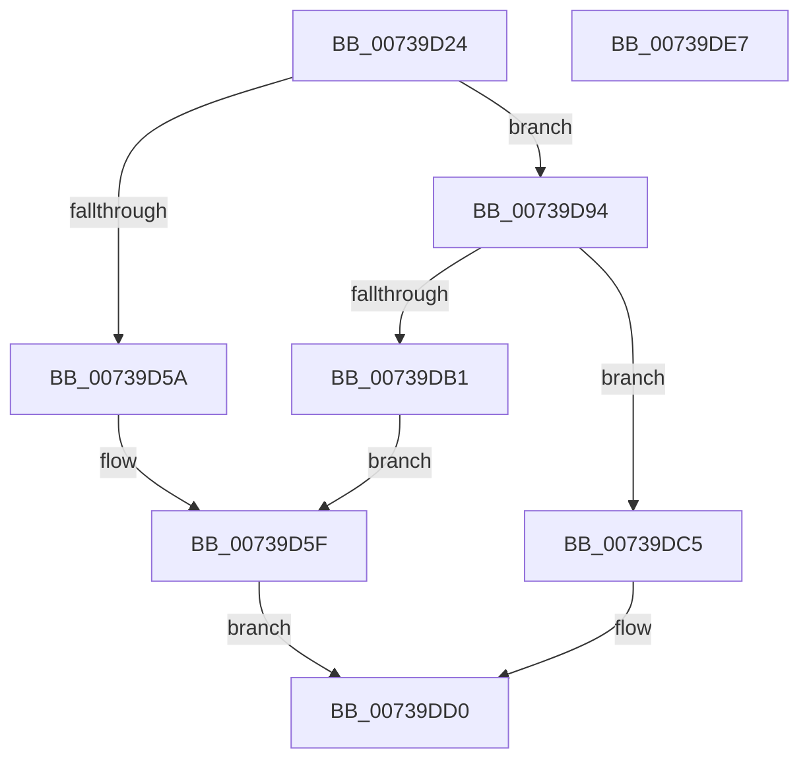

# PnprInitializeMappingReserve

- RVA: `0x00739D24`–`0x00739DE8` (길이 `196` bytes)
- VA: `0x0000000140739D24`
- 실행 섹션: `PAGE`
- PDB 이름 있음: `예`; PDB Function 태그: `아니요`
- unwind 정보 RVA: `0x00066400`
- 디코드: `52`개 명령, `196/196` bytes 표시
- 미해석 바이트: `0` (있으면 어셈블리에 `.byte`로 보존)

> 이 문서는 커널 이미지의 기계어와 PDB 기호를 분석해 생성했습니다. 4번과 5번은 함수 원형과 자료형을 바이너리 사용 방식에서 추정한 C 해석이며 원본 소스 복구 결과는 아닙니다.

## 1. Dependencies

- 직접 호출 지점: **3**; 고유 호출 대상: **3**
- 직접 호출자로 확인된 함수: **1**
- RIP 상대 이미지 참조: **1**

### Outgoing calls
- `0x00739D4D` → [MmAllocateMappingAddressEx](../A7/MmAllocateMappingAddressEx_function_00A726B0.md) (function, `0x00A726B0`)
- `0x00739DA7` → [IoAllocateMdl](../../text/29/IoAllocateMdl_function_0029EBF0.md) (function, `0x0029EBF0`)
- `0x00739DB9` → [MmFreeMappingAddress](../A7/MmFreeMappingAddress_function_00A75F20.md) (function, `0x00A75F20`)

### Direct callers
- [PnprAllocateMappingReserves](PnprAllocateMappingReserves_function_007393C4.md) at `0x00739446`
- [PnprAllocateMappingReserves](PnprAllocateMappingReserves_function_007393C4.md) at `0x0073945A`

### Static image references
- `0x00739D5F` → RVA `0x00F8AC38` (`.data`; read)

## 2. Other-region calls and transfers

- 다른 실행 섹션으로 향하는 call: **1**
  - `0x00739DA7` → [IoAllocateMdl](../../text/29/IoAllocateMdl_function_0029EBF0.md) (`PAGE` → `.text`)
- 별도 외부 분기/꼬리 이동을 확인하지 못했습니다.

## 3. Assembly (complete function range)

```asm
00739D24  48 89 5C 24 08                  mov qword ptr [rsp + 8], rbx
00739D29  48 89 6C 24 10                  mov qword ptr [rsp + 0x10], rbp
00739D2E  48 89 74 24 18                  mov qword ptr [rsp + 0x18], rsi
00739D33  57                              push rdi
00739D34  48 83 EC 30                     sub rsp, 0x30
00739D38  48 8B DA                        mov rbx, rdx
00739D3B  0F B7 E9                        movzx ebp, cx
00739D3E  BA 50 6E 70 51                  mov edx, 0x51706e50
00739D43  B9 00 00 01 00                  mov ecx, 0x10000
00739D48  45 33 C0                        xor r8d, r8d
00739D4B  33 F6                           xor esi, esi
00739D4D  E8 5E 89 33 00                  call 0x140a726b0
00739D52  48 8B F8                        mov rdi, rax
00739D55  48 85 C0                        test rax, rax
00739D58  75 3A                           jne 0x140739d94
00739D5A  BA 53 0F 00 00                  mov edx, 0xf53
00739D5F  48 8B 0D D2 0E 85 00            mov rcx, qword ptr [rip + 0x850ed2]
00739D66  BE 9A 00 00 C0                  mov esi, 0xc000009a
00739D6B  8B 81 08 82 00 00               mov eax, dword ptr [rcx + 0x8208]
00739D71  85 C0                           test eax, eax
00739D73  0F 44 C2                        cmove eax, edx
00739D76  BA 0A 00 00 00                  mov edx, 0xa
00739D7B  89 81 08 82 00 00               mov dword ptr [rcx + 0x8208], eax
00739D81  8B 81 0C 82 00 00               mov eax, dword ptr [rcx + 0x820c]
00739D87  85 C0                           test eax, eax
00739D89  0F 44 C2                        cmove eax, edx
00739D8C  89 81 0C 82 00 00               mov dword ptr [rcx + 0x820c], eax
00739D92  EB 3C                           jmp 0x140739dd0
00739D94  48 21 74 24 20                  and qword ptr [rsp + 0x20], rsi
00739D99  45 33 C9                        xor r9d, r9d
00739D9C  45 33 C0                        xor r8d, r8d
00739D9F  BA 00 00 01 00                  mov edx, 0x10000
00739DA4  48 8B CF                        mov rcx, rdi
00739DA7  E8 44 4E B6 FF                  call 0x14029ebf0
00739DAC  48 85 C0                        test rax, rax
00739DAF  75 14                           jne 0x140739dc5
00739DB1  BA 50 6E 70 51                  mov edx, 0x51706e50
00739DB6  48 8B CF                        mov rcx, rdi
00739DB9  E8 62 C1 33 00                  call 0x140a75f20
00739DBE  BA 62 0F 00 00                  mov edx, 0xf62
00739DC3  EB 9A                           jmp 0x140739d5f
00739DC5  48 89 03                        mov qword ptr [rbx], rax
00739DC8  48 89 7B 08                     mov qword ptr [rbx + 8], rdi
00739DCC  66 89 6B 10                     mov word ptr [rbx + 0x10], bp
00739DD0  48 8B 5C 24 40                  mov rbx, qword ptr [rsp + 0x40]
00739DD5  8B C6                           mov eax, esi
00739DD7  48 8B 74 24 50                  mov rsi, qword ptr [rsp + 0x50]
00739DDC  48 8B 6C 24 48                  mov rbp, qword ptr [rsp + 0x48]
00739DE1  48 83 C4 30                     add rsp, 0x30
00739DE5  5F                              pop rdi
00739DE6  C3                              ret
00739DE7  CC                              int3
```

## 4. C-style interpretation (structured pseudocode)

```c
__int64 __fastcall PnprInitializeMappingReserve(unsigned __int16 a1, __int64 a2, int a3, int a4)
{
    __int64 result;
    __int64 v_rsi;
    __int64 v_rsp;
    unsigned __int64 v_stack_m18;
    unsigned __int64 v_stack_p10;
    unsigned __int64 v_stack_p18;
    unsigned __int64 v_stack_p8;

    v_stack_p8 = v_rbx;
    v_stack_p10 = v_rbp;
    v_stack_p18 = v_rsi;
    v_rsp = (v_rsp) - (48);
    a3 = 0;
    v_rsi = 0;
    result = MmAllocateMappingAddressEx((unsigned int)(0x10000ULL), (unsigned int)(0x51706E50ULL), a3, a4);
    if (result != 0) goto loc_00739D94;
loc_00739D5F:
    result = (unsigned int)(*(unsigned int *)(*(unsigned __int64 *)(v_rip + 8720082) + 33288));
    if ((unsigned int)((unsigned int)(*(unsigned int *)(*(unsigned __int64 *)(v_rip + 8720082) + 33288))) == 0) { result = (unsigned int)((unsigned int)(0xF53ULL)); }
    *(unsigned int *)(*(unsigned __int64 *)(v_rip + 8720082) + 33288) = (unsigned int)(result);
    result = (unsigned int)(*(unsigned int *)(*(unsigned __int64 *)(v_rip + 8720082) + 33292));
    if ((unsigned int)((unsigned int)(*(unsigned int *)(*(unsigned __int64 *)(v_rip + 8720082) + 33292))) == 0) { result = 10; }
    *(unsigned int *)(*(unsigned __int64 *)(v_rip + 8720082) + 33292) = (unsigned int)(result);
    goto loc_00739DD0;
loc_00739D94:
    a4 = 0;
    a3 = 0;
    result = IoAllocateMdl(result, (unsigned int)(0x10000ULL), a3, a4);
    if (result != 0) goto loc_00739DC5;
    result = MmFreeMappingAddress(result, (unsigned int)(0x51706E50ULL), a3, a4);
    goto loc_00739D5F;
loc_00739DC5:
    *(unsigned __int64 *)(a2) = result;
    *(unsigned __int64 *)(a2 + 8) = result;
    *(unsigned __int16 *)(a2 + 16) = a1;
loc_00739DD0:
    v_rsp = (v_rsp) + (48);
    return (unsigned int)((unsigned int)((unsigned int)(0xC000009AULL)));
}
```

## 5. (Beta) C Style

```c
int64_t PnprInitializeMappingReserve(uint16_t Arg1, void *Arg2, int32_t Arg3, int32_t Arg4)
{
    uint8_t *arg2 = (uint8_t *)Arg2;

    int64_t result;
    int64_t local_rsi;
    int64_t local_rsp;
    uint64_t v_stack_m18;
    uint64_t v_stack_p10;
    uint64_t v_stack_p18;
    uint64_t v_stack_p8;

    v_stack_p8 = local_rbx;
    v_stack_p10 = local_rbp;
    v_stack_p18 = local_rsi;
    local_rsp = (local_rsp) - (48);
    Arg3 = 0;
    local_rsi = 0;
    result = MmAllocateMappingAddressEx((uint32_t)(0x10000ULL), (uint32_t)(0x51706E50ULL), Arg3, Arg4);
    if (result != 0) goto loc_00739D94;
loc_00739D5F:
    result = (uint32_t)(*(uint32_t *)(*(uint64_t *)(v_rip + 0x850ED2) + 0x8208));
    if ((uint32_t)((uint32_t)(*(uint32_t *)(*(uint64_t *)(v_rip + 0x850ED2) + 0x8208))) == 0) { result = (uint32_t)((uint32_t)(0xF53ULL)); }
    *(uint32_t *)(*(uint64_t *)(v_rip + 0x850ED2) + 0x8208) = (uint32_t)(result);
    result = (uint32_t)(*(uint32_t *)(*(uint64_t *)(v_rip + 0x850ED2) + 0x820C));
    if ((uint32_t)((uint32_t)(*(uint32_t *)(*(uint64_t *)(v_rip + 0x850ED2) + 0x820C))) == 0) { result = 10; }
    *(uint32_t *)(*(uint64_t *)(v_rip + 0x850ED2) + 0x820C) = (uint32_t)(result);
    goto loc_00739DD0;
loc_00739D94:
    Arg4 = 0;
    Arg3 = 0;
    result = IoAllocateMdl(result, (uint32_t)(0x10000ULL), Arg3, Arg4);
    if (result != 0) goto loc_00739DC5;
    result = MmFreeMappingAddress(result, (uint32_t)(0x51706E50ULL), Arg3, Arg4);
    goto loc_00739D5F;
loc_00739DC5:
    *(uint64_t *)(arg2) = result;
    *(uint64_t *)(arg2 + 0x8) = result;
    *(uint16_t *)(arg2 + 0x10) = Arg1;
loc_00739DD0:
    local_rsp = (local_rsp) + (48);
    return (uint32_t)((uint32_t)((uint32_t)(0xC000009AULL)));
}
```

### 관측된 메모리 오프셋

구조체 형식이 확인되지 않은 접근은 인자 기준의 오프셋으로만 기록했습니다.

| 기준 인자 | 오프셋 표현 | 폭 (bit) | 접근 |
|---|---:|---:|---|
| `Arg2` | `+ 0x0` | `64` | `W` |
| `Arg2` | `+ 0x8` | `64` | `W` |
| `Arg2` | `+ 0x10` | `16` | `W` |

## 6. Execution-region graph

[열기: 2D/3D 그래프와 함수 탐색 컨트롤 패널](../../../control-panel.html?section=page&rva=0x00739D24&view=graph)

- 2D 그래프는 위에서 아래로 흐르고, 3D 그래프는 빈 공간을 드래그해 회전합니다. Shift+드래그는 이동, 휠은 확대·축소, 함수 노드 선택은 대상 보고서 이동입니다.

### Static fallback


