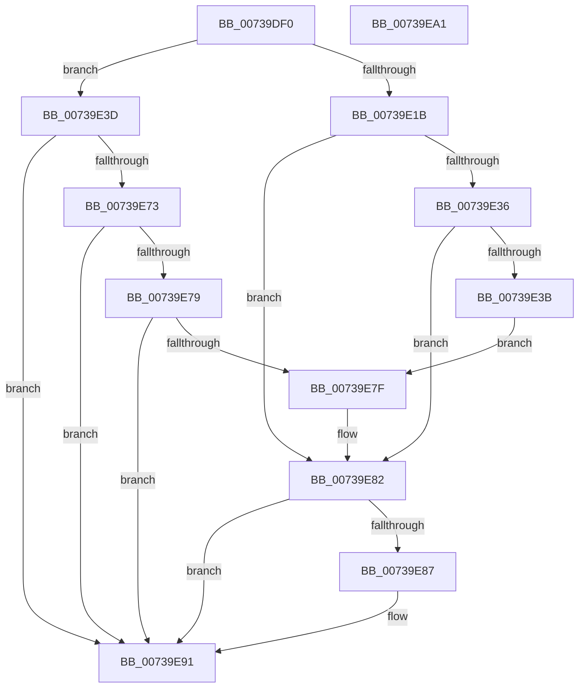

# PnprIsMemoryDevice

- RVA: `0x00739DF0`–`0x00739EA2` (길이 `178` bytes)
- VA: `0x0000000140739DF0`
- 실행 섹션: `PAGE`
- PDB 이름 있음: `예`; PDB Function 태그: `아니요`
- unwind 정보 RVA: `0x000BEAD8`
- 디코드: `56`개 명령, `178/178` bytes 표시
- 미해석 바이트: `0` (있으면 어셈블리에 `.byte`로 보존)

> 이 문서는 커널 이미지의 기계어와 PDB 기호를 분석해 생성했습니다. 4번과 5번은 함수 원형과 자료형을 바이너리 사용 방식에서 추정한 C 해석이며 원본 소스 복구 결과는 아닙니다.

## 1. Dependencies

- 직접 호출 지점: **3**; 고유 호출 대상: **3**
- 직접 호출자로 확인된 함수: **1**
- RIP 상대 이미지 참조: **2**

### Outgoing calls
- `0x00739E29` → [IoGetDeviceInterfaces](../95/IoGetDeviceInterfaces_function_00953340.md) (function, `0x00953340`)
- `0x00739E6A` → [IoGetDevicePropertyData](../90/IoGetDevicePropertyData_function_009005E0.md) (function, `0x009005E0`)
- `0x00739E8C` → [ExFreePoolWithTag](../../poolcode/B8/ExFreePoolWithTag_function_00B82870.md) (function, `0x00B82870`)

### Direct callers
- [PnprAddDeviceResources](PnprAddDeviceResources_function_00739040.md) at `0x00739068`

### Static image references
- `0x00739E22` → RVA `0x000236A0` (`.rdata`; read)
- `0x00739E49` → RVA `0x00023A90` (`.rdata`; read)

## 2. Other-region calls and transfers

- 다른 실행 섹션으로 향하는 call: **1**
  - `0x00739E8C` → [ExFreePoolWithTag](../../poolcode/B8/ExFreePoolWithTag_function_00B82870.md) (`PAGE` → `POOLCODE`)
- 별도 외부 분기/꼬리 이동을 확인하지 못했습니다.

## 3. Assembly (complete function range)

```asm
00739DF0  48 89 5C 24 08                  mov qword ptr [rsp + 8], rbx
00739DF5  55                              push rbp
00739DF6  56                              push rsi
00739DF7  57                              push rdi
00739DF8  48 8B EC                        mov rbp, rsp
00739DFB  48 83 EC 50                     sub rsp, 0x50
00739DFF  33 F6                           xor esi, esi
00739E01  45 33 C0                        xor r8d, r8d
00739E04  89 75 38                        mov dword ptr [rbp + 0x38], esi
00739E07  8B DE                           mov ebx, esi
00739E09  48 89 5D F0                     mov qword ptr [rbp - 0x10], rbx
00739E0D  40 8A FE                        mov dil, sil
00739E10  40 88 75 28                     mov byte ptr [rbp + 0x28], sil
00739E14  89 75 30                        mov dword ptr [rbp + 0x30], esi
00739E17  84 D2                           test dl, dl
00739E19  74 22                           je 0x140739e3d
00739E1B  48 8B D1                        mov rdx, rcx
00739E1E  4C 8D 4D F0                     lea r9, [rbp - 0x10]
00739E22  48 8D 0D 77 98 8E FF            lea rcx, [rip - 0x716789]
00739E29  E8 12 95 21 00                  call 0x140953340
00739E2E  48 8B 5D F0                     mov rbx, qword ptr [rbp - 0x10]
00739E32  85 C0                           test eax, eax
00739E34  78 4C                           js 0x140739e82
00739E36  66 39 33                        cmp word ptr [rbx], si
00739E39  74 47                           je 0x140739e82
00739E3B  EB 42                           jmp 0x140739e7f
00739E3D  48 8D 45 30                     lea rax, [rbp + 0x30]
00739E41  45 33 C9                        xor r9d, r9d
00739E44  48 89 44 24 38                  mov qword ptr [rsp + 0x38], rax
00739E49  48 8D 15 40 9C 8E FF            lea rdx, [rip - 0x7163c0]
00739E50  48 8D 45 38                     lea rax, [rbp + 0x38]
00739E54  48 89 44 24 30                  mov qword ptr [rsp + 0x30], rax
00739E59  48 8D 45 28                     lea rax, [rbp + 0x28]
00739E5D  48 89 44 24 28                  mov qword ptr [rsp + 0x28], rax
00739E62  C7 44 24 20 01 00 00 00         mov dword ptr [rsp + 0x20], 1
00739E6A  E8 71 67 1C 00                  call 0x1409005e0
00739E6F  85 C0                           test eax, eax
00739E71  78 1E                           js 0x140739e91
00739E73  83 7D 30 11                     cmp dword ptr [rbp + 0x30], 0x11
00739E77  75 18                           jne 0x140739e91
00739E79  40 38 75 28                     cmp byte ptr [rbp + 0x28], sil
00739E7D  74 12                           je 0x140739e91
00739E7F  40 B7 01                        mov dil, 1
00739E82  48 85 DB                        test rbx, rbx
00739E85  74 0A                           je 0x140739e91
00739E87  33 D2                           xor edx, edx
00739E89  48 8B CB                        mov rcx, rbx
00739E8C  E8 DF 89 44 00                  call 0x140b82870
00739E91  48 8B 5C 24 70                  mov rbx, qword ptr [rsp + 0x70]
00739E96  40 8A C7                        mov al, dil
00739E99  48 83 C4 50                     add rsp, 0x50
00739E9D  5F                              pop rdi
00739E9E  5E                              pop rsi
00739E9F  5D                              pop rbp
00739EA0  C3                              ret
00739EA1  CC                              int3
```

## 4. C-style interpretation (structured pseudocode)

```c
__int64 __fastcall PnprIsMemoryDevice(__int64 a1, unsigned __int8 a2, int a3)
{
    __int64 result;
    __int64 v_rsi;
    __int64 v_rsp;
    unsigned __int64 v_stack_m28;
    unsigned __int64 v_stack_m30;
    unsigned __int64 v_stack_m38;
    unsigned __int64 v_stack_m40;
    unsigned int v_stack_m48;
    unsigned __int8 v_stack_p10;
    unsigned int v_stack_p18;
    unsigned int v_stack_p20;
    unsigned __int64 v_stack_p8;

    v_stack_p8 = v_rbx;
    v_rsp = (v_rsp) - (80);
    v_rsi = 0;
    a3 = 0;
    v_stack_p20 = 0;
    v_stack_m28 = 0;
    v_stack_p10 = 0;
    v_stack_p18 = 0;
    if (a2 == 0) goto loc_00739E3D;
    result = IoGetDeviceInterfaces(v_rip - 7432073, a1, a3, v_stack_m28);
    if (sign_flag) goto loc_00739E82;
    if ((*(unsigned __int16 *)(v_stack_m28)) == 0) goto loc_00739E82;
    goto loc_00739E7F;
loc_00739E3D:
    a4 = 0;
    v_stack_m30 = v_stack_p18;
    v_stack_m38 = v_stack_p20;
    v_stack_m40 = v_stack_p10;
    v_stack_m48 = 1;
    result = IoGetDevicePropertyData(v_rip - 7432073, v_rip - 7431104, a3, a4);
    if (sign_flag) goto loc_00739E91;
    if (v_stack_p18 != 17) goto loc_00739E91;
    if (v_stack_p10 == 0) goto loc_00739E91;
loc_00739E7F:
loc_00739E82:
    if (v_stack_m28 != 0) {
        a2 = 0;
        a1 = v_stack_m28;
        result = ExFreePoolWithTag(a1, a2, a3, a4);
    }
    v_rsp = (v_rsp) + (80);
    return 1;
}
```

## 5. (Beta) C Style

```c
int64_t PnprIsMemoryDevice(int64_t Arg1, uint8_t Arg2, int32_t Arg3)
{
    int64_t result;
    int64_t local_rsi;
    int64_t local_rsp;
    uint64_t v_stack_m28;
    uint64_t v_stack_m30;
    uint64_t v_stack_m38;
    uint64_t v_stack_m40;
    uint32_t v_stack_m48;
    uint8_t v_stack_p10;
    uint32_t v_stack_p18;
    uint32_t v_stack_p20;
    uint64_t v_stack_p8;

    v_stack_p8 = local_rbx;
    local_rsp = (local_rsp) - (80);
    local_rsi = 0;
    Arg3 = 0;
    v_stack_p20 = 0;
    v_stack_m28 = 0;
    v_stack_p10 = 0;
    v_stack_p18 = 0;
    if (Arg2 == 0) goto loc_00739E3D;
    result = IoGetDeviceInterfaces(v_rip - 7432073, Arg1, Arg3, v_stack_m28);
    if (sign_flag) goto loc_00739E82;
    if ((*(uint16_t *)(v_stack_m28)) == 0) goto loc_00739E82;
    goto loc_00739E7F;
loc_00739E3D:
    a4 = 0;
    v_stack_m30 = v_stack_p18;
    v_stack_m38 = v_stack_p20;
    v_stack_m40 = v_stack_p10;
    v_stack_m48 = 1;
    result = IoGetDevicePropertyData(v_rip - 7432073, v_rip - 7431104, Arg3, a4);
    if (sign_flag) goto loc_00739E91;
    if (v_stack_p18 != 17) goto loc_00739E91;
    if (v_stack_p10 == 0) goto loc_00739E91;
loc_00739E7F:
loc_00739E82:
    if (v_stack_m28 != 0) {
        Arg2 = 0;
        Arg1 = v_stack_m28;
        result = ExFreePoolWithTag(Arg1, Arg2, Arg3, a4);
    }
    local_rsp = (local_rsp) + (80);
    return 1;
}
```

## 6. Execution-region graph

[열기: 2D/3D 그래프와 함수 탐색 컨트롤 패널](../../../control-panel.html?section=page&rva=0x00739DF0&view=graph)

- 2D 그래프는 위에서 아래로 흐르고, 3D 그래프는 빈 공간을 드래그해 회전합니다. Shift+드래그는 이동, 휠은 확대·축소, 함수 노드 선택은 대상 보고서 이동입니다.

### Static fallback


