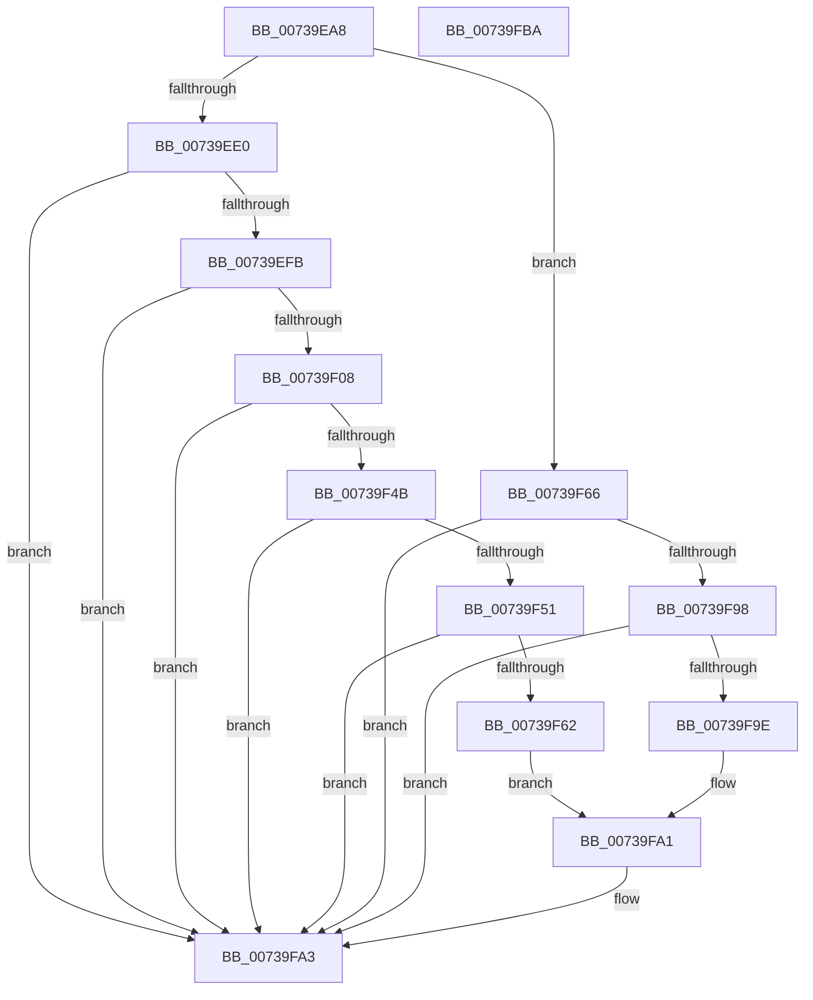

# PnprIsProcessorDevice

- RVA: `0x00739EA8`–`0x00739FBB` (길이 `275` bytes)
- VA: `0x0000000140739EA8`
- 실행 섹션: `PAGE`
- PDB 이름 있음: `예`; PDB Function 태그: `아니요`
- unwind 정보 RVA: `0x000C8EC0`
- 디코드: `78`개 명령, `275/275` bytes 표시
- 미해석 바이트: `0` (있으면 어셈블리에 `.byte`로 보존)

> 이 문서는 커널 이미지의 기계어와 PDB 기호를 분석해 생성했습니다. 4번과 5번은 함수 원형과 자료형을 바이너리 사용 방식에서 추정한 C 해석이며 원본 소스 복구 결과는 아닙니다.

## 1. Dependencies

- 직접 호출 지점: **5**; 고유 호출 대상: **4**
- 직접 호출자로 확인된 함수: **1**
- RIP 상대 이미지 참조: **3**

### Outgoing calls
- `0x00739EEE` → [IoGetDeviceInterfaces](../95/IoGetDeviceInterfaces_function_00953340.md) (function, `0x00953340`)
- `0x00739F0A` → [ExFreePoolWithTag](../../poolcode/B8/ExFreePoolWithTag_function_00B82870.md) (function, `0x00B82870`)
- `0x00739F42` → [IoGetDevicePropertyData](../90/IoGetDevicePropertyData_function_009005E0.md) (function, `0x009005E0`)
- `0x00739F59` → [HalGetProcessorIdByNtNumber](../../text/2D/HalGetProcessorIdByNtNumber_function_002D5560.md) (function, `0x002D5560`)
- `0x00739F8F` → [IoGetDevicePropertyData](../90/IoGetDevicePropertyData_function_009005E0.md) (function, `0x009005E0`)

### Direct callers
- [PnprAddDeviceResources](PnprAddDeviceResources_function_00739040.md) at `0x0073908B`

### Static image references
- `0x00739EE7` → RVA `0x00023670` (`.rdata`; read)
- `0x00739F1B` → RVA `0x000236E0` (`.rdata`; read)
- `0x00739F72` → RVA `0x00023AA8` (`.rdata`; read)

## 2. Other-region calls and transfers

- 다른 실행 섹션으로 향하는 call: **2**
  - `0x00739F0A` → [ExFreePoolWithTag](../../poolcode/B8/ExFreePoolWithTag_function_00B82870.md) (`PAGE` → `POOLCODE`)
  - `0x00739F59` → [HalGetProcessorIdByNtNumber](../../text/2D/HalGetProcessorIdByNtNumber_function_002D5560.md) (`PAGE` → `.text`)
- 별도 외부 분기/꼬리 이동을 확인하지 못했습니다.

## 3. Assembly (complete function range)

```asm
00739EA8  48 89 5C 24 08                  mov qword ptr [rsp + 8], rbx
00739EAD  48 89 74 24 18                  mov qword ptr [rsp + 0x18], rsi
00739EB2  55                              push rbp
00739EB3  57                              push rdi
00739EB4  41 56                           push r14
00739EB6  48 8B EC                        mov rbp, rsp
00739EB9  48 83 EC 50                     sub rsp, 0x50
00739EBD  33 DB                           xor ebx, ebx
00739EBF  49 8B F0                        mov rsi, r8
00739EC2  45 33 C0                        xor r8d, r8d
00739EC5  89 5D F0                        mov dword ptr [rbp - 0x10], ebx
00739EC8  89 5D F4                        mov dword ptr [rbp - 0xc], ebx
00739ECB  4D 8B F1                        mov r14, r9
00739ECE  48 89 5D F8                     mov qword ptr [rbp - 8], rbx
00739ED2  48 8B F9                        mov rdi, rcx
00739ED5  89 5D 28                        mov dword ptr [rbp + 0x28], ebx
00739ED8  84 D2                           test dl, dl
00739EDA  0F 84 86 00 00 00               je 0x140739f66
00739EE0  48 8B D1                        mov rdx, rcx
00739EE3  4C 8D 4D F8                     lea r9, [rbp - 8]
00739EE7  48 8D 0D 82 97 8E FF            lea rcx, [rip - 0x71687e]
00739EEE  E8 4D 94 21 00                  call 0x140953340
00739EF3  85 C0                           test eax, eax
00739EF5  0F 88 A8 00 00 00               js 0x140739fa3
00739EFB  48 8B 4D F8                     mov rcx, qword ptr [rbp - 8]
00739EFF  66 39 19                        cmp word ptr [rcx], bx
00739F02  0F 84 9B 00 00 00               je 0x140739fa3
00739F08  33 D2                           xor edx, edx
00739F0A  E8 61 89 44 00                  call 0x140b82870
00739F0F  48 8D 45 28                     lea rax, [rbp + 0x28]
00739F13  45 33 C9                        xor r9d, r9d
00739F16  48 89 44 24 38                  mov qword ptr [rsp + 0x38], rax
00739F1B  48 8D 15 BE 97 8E FF            lea rdx, [rip - 0x716842]
00739F22  48 8D 45 F4                     lea rax, [rbp - 0xc]
00739F26  45 33 C0                        xor r8d, r8d
00739F29  48 89 44 24 30                  mov qword ptr [rsp + 0x30], rax
00739F2E  48 8B CF                        mov rcx, rdi
00739F31  48 8D 45 F0                     lea rax, [rbp - 0x10]
00739F35  48 89 44 24 28                  mov qword ptr [rsp + 0x28], rax
00739F3A  C7 44 24 20 04 00 00 00         mov dword ptr [rsp + 0x20], 4
00739F42  E8 99 66 1C 00                  call 0x1409005e0
00739F47  85 C0                           test eax, eax
00739F49  78 58                           js 0x140739fa3
00739F4B  83 7D 28 07                     cmp dword ptr [rbp + 0x28], 7
00739F4F  75 52                           jne 0x140739fa3
00739F51  8B 7D F0                        mov edi, dword ptr [rbp - 0x10]
00739F54  49 8B D6                        mov rdx, r14
00739F57  8B CF                           mov ecx, edi
00739F59  E8 02 B6 B9 FF                  call 0x1402d5560
00739F5E  85 C0                           test eax, eax
00739F60  78 41                           js 0x140739fa3
00739F62  89 3E                           mov dword ptr [rsi], edi
00739F64  EB 3B                           jmp 0x140739fa1
00739F66  48 8D 45 28                     lea rax, [rbp + 0x28]
00739F6A  45 33 C9                        xor r9d, r9d
00739F6D  48 89 44 24 38                  mov qword ptr [rsp + 0x38], rax
00739F72  48 8D 15 2F 9B 8E FF            lea rdx, [rip - 0x7164d1]
00739F79  48 8D 45 F4                     lea rax, [rbp - 0xc]
00739F7D  48 89 44 24 30                  mov qword ptr [rsp + 0x30], rax
00739F82  4C 89 74 24 28                  mov qword ptr [rsp + 0x28], r14
00739F87  C7 44 24 20 04 00 00 00         mov dword ptr [rsp + 0x20], 4
00739F8F  E8 4C 66 1C 00                  call 0x1409005e0
00739F94  85 C0                           test eax, eax
00739F96  78 0B                           js 0x140739fa3
00739F98  83 7D 28 07                     cmp dword ptr [rbp + 0x28], 7
00739F9C  75 05                           jne 0x140739fa3
00739F9E  83 0E FF                        or dword ptr [rsi], 0xffffffff
00739FA1  B3 01                           mov bl, 1
00739FA3  4C 8D 5C 24 50                  lea r11, [rsp + 0x50]
00739FA8  8A C3                           mov al, bl
00739FAA  49 8B 5B 20                     mov rbx, qword ptr [r11 + 0x20]
00739FAE  49 8B 73 30                     mov rsi, qword ptr [r11 + 0x30]
00739FB2  49 8B E3                        mov rsp, r11
00739FB5  41 5E                           pop r14
00739FB7  5F                              pop rdi
00739FB8  5D                              pop rbp
00739FB9  C3                              ret
00739FBA  CC                              int3
```

## 4. C-style interpretation (structured pseudocode)

```c
__int64 __fastcall PnprIsProcessorDevice(__int64 a1, unsigned __int8 a2, __int64 a3, __int64 a4)
{
    __int64 result;
    __int64 v_rbx;
    __int64 v_rsp;
    unsigned __int64 v_stack_m18;
    unsigned __int64 v_stack_m20;
    unsigned int v_stack_m24;
    unsigned int v_stack_m28;
    unsigned __int64 v_stack_m30;
    unsigned __int64 v_stack_m38;
    unsigned __int64 v_stack_m40;
    unsigned int v_stack_m48;
    unsigned int v_stack_p10;
    unsigned __int64 v_stack_p18;
    unsigned __int64 v_stack_p8;

    v_stack_p8 = v_rbx;
    v_stack_p18 = v_rsi;
    v_rsp = (v_rsp) - (80);
    v_rbx = 0;
    a3 = 0;
    v_stack_m28 = 0;
    v_stack_m24 = 0;
    v_stack_m20 = 0;
    v_stack_p10 = 0;
    if (a2 == 0) goto loc_00739F66;
    result = IoGetDeviceInterfaces(v_rip - 7432318, a1, a3, v_stack_m20);
    if (sign_flag) goto loc_00739FA3;
    if ((*(unsigned __int16 *)(v_stack_m20)) == 0) goto loc_00739FA3;
    a2 = 0;
    result = ExFreePoolWithTag(v_stack_m20, a2, a3, v_stack_m20);
    a4 = 0;
    v_stack_m30 = v_stack_p10;
    a3 = 0;
    v_stack_m38 = v_stack_m24;
    v_stack_m40 = v_stack_m28;
    v_stack_m48 = 4;
    result = IoGetDevicePropertyData(a1, v_rip - 7432258, a3, a4);
    if (sign_flag) goto loc_00739FA3;
    if (v_stack_p10 != 7) goto loc_00739FA3;
    result = HalGetProcessorIdByNtNumber((unsigned int)((unsigned int)((unsigned int)(v_stack_m28))), 0, a3, a4);
    if (sign_flag) goto loc_00739FA3;
    *(unsigned int *)(a3) = (unsigned int)((unsigned int)(v_stack_m28));
    goto loc_00739FA1;
loc_00739F66:
    a4 = 0;
    v_stack_m30 = v_stack_p10;
    v_stack_m38 = v_stack_m24;
    v_stack_m40 = 0;
    v_stack_m48 = 4;
    result = IoGetDevicePropertyData((unsigned int)((unsigned int)((unsigned int)(v_stack_m28))), v_rip - 7431377, a3, a4);
    if (sign_flag) goto loc_00739FA3;
    if (v_stack_p10 != 7) goto loc_00739FA3;
loc_00739FA1:
loc_00739FA3:
    return 1;
}
```

## 5. (Beta) C Style

```c
int64_t PnprIsProcessorDevice(int64_t Arg1, uint8_t Arg2, void *Arg3, int64_t Arg4)
{
    uint8_t *arg3 = (uint8_t *)Arg3;

    int64_t result;
    int64_t local_rbx;
    int64_t local_rsp;
    uint64_t v_stack_m18;
    uint64_t v_stack_m20;
    uint32_t v_stack_m24;
    uint32_t v_stack_m28;
    uint64_t v_stack_m30;
    uint64_t v_stack_m38;
    uint64_t v_stack_m40;
    uint32_t v_stack_m48;
    uint32_t v_stack_p10;
    uint64_t v_stack_p18;
    uint64_t v_stack_p8;

    v_stack_p8 = local_rbx;
    v_stack_p18 = local_rsi;
    local_rsp = (local_rsp) - (80);
    local_rbx = 0;
    Arg3 = 0;
    v_stack_m28 = 0;
    v_stack_m24 = 0;
    v_stack_m20 = 0;
    v_stack_p10 = 0;
    if (Arg2 == 0) goto loc_00739F66;
    result = IoGetDeviceInterfaces(v_rip - 7432318, Arg1, Arg3, v_stack_m20);
    if (sign_flag) goto loc_00739FA3;
    if ((*(uint16_t *)(v_stack_m20)) == 0) goto loc_00739FA3;
    Arg2 = 0;
    result = ExFreePoolWithTag(v_stack_m20, Arg2, Arg3, v_stack_m20);
    Arg4 = 0;
    v_stack_m30 = v_stack_p10;
    Arg3 = 0;
    v_stack_m38 = v_stack_m24;
    v_stack_m40 = v_stack_m28;
    v_stack_m48 = 4;
    result = IoGetDevicePropertyData(Arg1, v_rip - 7432258, Arg3, Arg4);
    if (sign_flag) goto loc_00739FA3;
    if (v_stack_p10 != 7) goto loc_00739FA3;
    result = HalGetProcessorIdByNtNumber((uint32_t)((uint32_t)((uint32_t)(v_stack_m28))), 0, Arg3, Arg4);
    if (sign_flag) goto loc_00739FA3;
    *(uint32_t *)(arg3) = (uint32_t)((uint32_t)(v_stack_m28));
    goto loc_00739FA1;
loc_00739F66:
    Arg4 = 0;
    v_stack_m30 = v_stack_p10;
    v_stack_m38 = v_stack_m24;
    v_stack_m40 = 0;
    v_stack_m48 = 4;
    result = IoGetDevicePropertyData((uint32_t)((uint32_t)((uint32_t)(v_stack_m28))), v_rip - 7431377, Arg3, Arg4);
    if (sign_flag) goto loc_00739FA3;
    if (v_stack_p10 != 7) goto loc_00739FA3;
loc_00739FA1:
loc_00739FA3:
    return 1;
}
```

### 관측된 메모리 오프셋

구조체 형식이 확인되지 않은 접근은 인자 기준의 오프셋으로만 기록했습니다.

| 기준 인자 | 오프셋 표현 | 폭 (bit) | 접근 |
|---|---:|---:|---|
| `Arg3` | `+ 0x0` | `32` | `R/W` |
| `Arg3` | `+ 0x0` | `32` | `W` |

## 6. Execution-region graph

[열기: 2D/3D 그래프와 함수 탐색 컨트롤 패널](../../../control-panel.html?section=page&rva=0x00739EA8&view=graph)

- 2D 그래프는 위에서 아래로 흐르고, 3D 그래프는 빈 공간을 드래그해 회전합니다. Shift+드래그는 이동, 휠은 확대·축소, 함수 노드 선택은 대상 보고서 이동입니다.

### Static fallback


