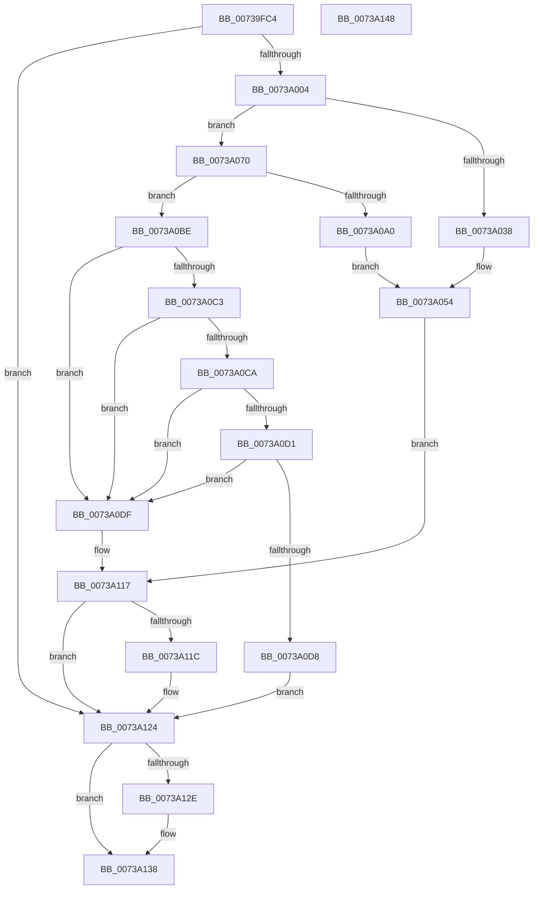

# PnprLoadPluginDriver

- RVA: `0x00739FC4`–`0x0073A149` (길이 `389` bytes)
- VA: `0x0000000140739FC4`
- 실행 섹션: `PAGE`
- PDB 이름 있음: `예`; PDB Function 태그: `아니요`
- unwind 정보 RVA: `0x000C8DF0`
- 디코드: `104`개 명령, `389/389` bytes 표시
- 미해석 바이트: `0` (있으면 어셈블리에 `.byte`로 보존)

> 이 문서는 커널 이미지의 기계어와 PDB 기호를 분석해 생성했습니다. 4번과 5번은 함수 원형과 자료형을 바이너리 사용 방식에서 추정한 C 해석이며 원본 소스 복구 결과는 아닙니다.

## 1. Dependencies

- 직접 호출 지점: **7**; 고유 호출 대상: **7**
- 직접 호출자로 확인된 함수: **1**
- RIP 상대 이미지 참조: **1**

### Outgoing calls
- `0x00739FEB` → [RtlInitUnicodeString](../../text/42/RtlInitUnicodeString_function_0042A780.md) (function, `0x0042A780`)
- `0x00739FF5` → [PnprGetPluginDriverImagePath](PnprGetPluginDriverImagePath_function_007398E8.md) (function, `0x007398E8`)
- `0x0073A028` → [MmLoadSystemImage](../99/MmLoadSystemImage_function_0099A9A0.md) (function, `0x0099A9A0`)
- `0x0073A07A` → [memset](../../text/6C/memset_function_006C6C40.md) (function, `0x006C6C40`)
- `0x0073A095` → [guard_dispatch_icall](../../text/6B/guard_dispatch_icall_function_006BAAD0.md) (function, `0x006BAAD0`)
- `0x0073A11F` → [MmUnloadSystemImage](../AA/MmUnloadSystemImage_function_00AA2F60.md) (function, `0x00AA2F60`)
- `0x0073A133` → [ExFreePoolWithTag](../../poolcode/B8/ExFreePoolWithTag_function_00B82870.md) (function, `0x00B82870`)

### Direct callers
- [PnpReplacePartitionUnit](PnpReplacePartitionUnit_function_00738550.md) at `0x00738BC1`

### Static image references
- `0x0073A038` → RVA `0x00F8AC38` (`.data`; read)

## 2. Other-region calls and transfers

- 다른 실행 섹션으로 향하는 call: **4**
  - `0x00739FEB` → [RtlInitUnicodeString](../../text/42/RtlInitUnicodeString_function_0042A780.md) (`PAGE` → `.text`)
  - `0x0073A07A` → [memset](../../text/6C/memset_function_006C6C40.md) (`PAGE` → `.text`)
  - `0x0073A095` → [guard_dispatch_icall](../../text/6B/guard_dispatch_icall_function_006BAAD0.md) (`PAGE` → `.text`)
  - `0x0073A133` → [ExFreePoolWithTag](../../poolcode/B8/ExFreePoolWithTag_function_00B82870.md) (`PAGE` → `POOLCODE`)
- 별도 외부 분기/꼬리 이동을 확인하지 못했습니다.

## 3. Assembly (complete function range)

```asm
00739FC4  48 8B C4                        mov rax, rsp
00739FC7  48 89 58 08                     mov qword ptr [rax + 8], rbx
00739FCB  56                              push rsi
00739FCC  57                              push rdi
00739FCD  41 56                           push r14
00739FCF  48 83 EC 40                     sub rsp, 0x40
00739FD3  48 83 60 18 00                  and qword ptr [rax + 0x18], 0
00739FD8  48 8B DA                        mov rbx, rdx
00739FDB  4C 8B F1                        mov r14, rcx
00739FDE  0F 57 C0                        xorps xmm0, xmm0
00739FE1  33 D2                           xor edx, edx
00739FE3  48 8D 48 D8                     lea rcx, [rax - 0x28]
00739FE7  0F 11 40 D8                     movups xmmword ptr [rax - 0x28], xmm0
00739FEB  E8 90 07 CF FF                  call 0x14042a780
00739FF0  48 8D 4C 24 30                  lea rcx, [rsp + 0x30]
00739FF5  E8 EE F8 FF FF                  call 0x1407398e8
00739FFA  8B F8                           mov edi, eax
00739FFC  85 C0                           test eax, eax
00739FFE  0F 88 20 01 00 00               js 0x14073a124
0073A004  48 8D 44 24 78                  lea rax, [rsp + 0x78]
0073A009  41 B9 02 00 00 00               mov r9d, 2
0073A00F  48 89 44 24 28                  mov qword ptr [rsp + 0x28], rax
0073A014  48 8D 4C 24 30                  lea rcx, [rsp + 0x30]
0073A019  48 8D 44 24 70                  lea rax, [rsp + 0x70]
0073A01E  45 33 C0                        xor r8d, r8d
0073A021  33 D2                           xor edx, edx
0073A023  48 89 44 24 20                  mov qword ptr [rsp + 0x20], rax
0073A028  E8 73 09 26 00                  call 0x14099a9a0
0073A02D  48 8B 74 24 70                  mov rsi, qword ptr [rsp + 0x70]
0073A032  8B F8                           mov edi, eax
0073A034  85 C0                           test eax, eax
0073A036  79 38                           jns 0x14073a070
0073A038  48 8B 0D F9 0B 85 00            mov rcx, qword ptr [rip + 0x850bf9]
0073A03F  BA 01 13 00 00                  mov edx, 0x1301
0073A044  8B 81 08 82 00 00               mov eax, dword ptr [rcx + 0x8208]
0073A04A  85 C0                           test eax, eax
0073A04C  0F 44 C2                        cmove eax, edx
0073A04F  BA 0A 00 00 00                  mov edx, 0xa
0073A054  89 81 08 82 00 00               mov dword ptr [rcx + 0x8208], eax
0073A05A  8B 81 0C 82 00 00               mov eax, dword ptr [rcx + 0x820c]
0073A060  85 C0                           test eax, eax
0073A062  0F 44 C2                        cmove eax, edx
0073A065  89 81 0C 82 00 00               mov dword ptr [rcx + 0x820c], eax
0073A06B  E9 A7 00 00 00                  jmp 0x14073a117
0073A070  33 D2                           xor edx, edx
0073A072  48 8D 4B 08                     lea rcx, [rbx + 8]
0073A076  44 8D 42 58                     lea r8d, [rdx + 0x58]
0073A07A  E8 C1 CB F8 FF                  call 0x1406c6c40
0073A07F  C7 43 04 01 00 00 00            mov dword ptr [rbx + 4], 1
0073A086  33 D2                           xor edx, edx
0073A088  C7 03 60 00 00 00               mov dword ptr [rbx], 0x60
0073A08E  48 8B CB                        mov rcx, rbx
0073A091  48 8B 46 38                     mov rax, qword ptr [rsi + 0x38]
0073A095  E8 36 0A F8 FF                  call 0x1406baad0
0073A09A  8B F8                           mov edi, eax
0073A09C  85 C0                           test eax, eax
0073A09E  79 1E                           jns 0x14073a0be
0073A0A0  48 8B 0D 91 0B 85 00            mov rcx, qword ptr [rip + 0x850b91]
0073A0A7  BA 0F 13 00 00                  mov edx, 0x130f
0073A0AC  8B 81 08 82 00 00               mov eax, dword ptr [rcx + 0x8208]
0073A0B2  85 C0                           test eax, eax
0073A0B4  0F 44 C2                        cmove eax, edx
0073A0B7  BA 08 00 00 00                  mov edx, 8
0073A0BC  EB 96                           jmp 0x14073a054
0073A0BE  83 3B 40                        cmp dword ptr [rbx], 0x40
0073A0C1  72 1C                           jb 0x14073a0df
0073A0C3  48 83 7B 38 00                  cmp qword ptr [rbx + 0x38], 0
0073A0C8  74 15                           je 0x14073a0df
0073A0CA  48 83 7B 18 00                  cmp qword ptr [rbx + 0x18], 0
0073A0CF  74 0E                           je 0x14073a0df
0073A0D1  48 83 7B 20 00                  cmp qword ptr [rbx + 0x20], 0
0073A0D6  74 07                           je 0x14073a0df
0073A0D8  49 89 36                        mov qword ptr [r14], rsi
0073A0DB  33 FF                           xor edi, edi
0073A0DD  EB 45                           jmp 0x14073a124
0073A0DF  48 8B 15 52 0B 85 00            mov rdx, qword ptr [rip + 0x850b52]
0073A0E6  B9 1F 13 00 00                  mov ecx, 0x131f
0073A0EB  BF BB 00 00 C0                  mov edi, 0xc00000bb
0073A0F0  8B 82 08 82 00 00               mov eax, dword ptr [rdx + 0x8208]
0073A0F6  85 C0                           test eax, eax
0073A0F8  0F 44 C1                        cmove eax, ecx
0073A0FB  B9 09 00 00 00                  mov ecx, 9
0073A100  89 82 08 82 00 00               mov dword ptr [rdx + 0x8208], eax
0073A106  8B 82 0C 82 00 00               mov eax, dword ptr [rdx + 0x820c]
0073A10C  85 C0                           test eax, eax
0073A10E  0F 44 C1                        cmove eax, ecx
0073A111  89 82 0C 82 00 00               mov dword ptr [rdx + 0x820c], eax
0073A117  48 85 F6                        test rsi, rsi
0073A11A  74 08                           je 0x14073a124
0073A11C  48 8B CE                        mov rcx, rsi
0073A11F  E8 3C 8E 36 00                  call 0x140aa2f60
0073A124  48 8B 4C 24 38                  mov rcx, qword ptr [rsp + 0x38]
0073A129  48 85 C9                        test rcx, rcx
0073A12C  74 0A                           je 0x14073a138
0073A12E  BA 50 6E 70 51                  mov edx, 0x51706e50
0073A133  E8 38 87 44 00                  call 0x140b82870
0073A138  48 8B 5C 24 60                  mov rbx, qword ptr [rsp + 0x60]
0073A13D  8B C7                           mov eax, edi
0073A13F  48 83 C4 40                     add rsp, 0x40
0073A143  41 5E                           pop r14
0073A145  5F                              pop rdi
0073A146  5E                              pop rsi
0073A147  C3                              ret
0073A148  CC                              int3
```

## 4. C-style interpretation (structured pseudocode)

```c
__int64 __fastcall PnprLoadPluginDriver(__int64 a1, __int64 a2, int a3)
{
    __int64 result;
    __int64 v_rdi;
    __int64 v_rsp;
    unsigned __int64 v_stack_m20;
    unsigned __int64 v_stack_m28;
    unsigned __int64 v_stack_m30;
    unsigned __int64 v_stack_m38;
    unsigned __int64 v_stack_p18;
    unsigned __int64 v_stack_p20;
    unsigned __int64 v_stack_p8;

    *(unsigned __int64 *)(v_rsp + 8) = v_rbx;
    v_rsp = (v_rsp) - (64);
    a2 = 0;
    *(unsigned __int64 *)(v_rsp - 40) = v_xmm0;
    result = RtlInitUnicodeString(v_rsp - 40, a2, a3, a4);
    result = PnprGetPluginDriverImagePath(v_stack_m28, a2, a3, a4);
    if (sign_flag) goto loc_0073A124;
    v_stack_m30 = v_stack_p20;
    a3 = 0;
    a2 = 0;
    v_stack_m38 = v_stack_p18;
    result = MmLoadSystemImage(v_stack_m28, a2, a3, 2);
    if (!sign_flag) goto loc_0073A070;
    result = (unsigned int)(*(unsigned int *)(*(unsigned __int64 *)(v_rip + 8719353) + 33288));
    if ((unsigned int)((unsigned int)(*(unsigned int *)(*(unsigned __int64 *)(v_rip + 8719353) + 33288))) == 0) { result = (unsigned int)((unsigned int)(0x1301ULL)); }
loc_0073A054:
    *(unsigned int *)(*(unsigned __int64 *)(v_rip + 8719353) + 33288) = (unsigned int)(result);
    result = (unsigned int)(*(unsigned int *)(*(unsigned __int64 *)(v_rip + 8719353) + 33292));
    if ((unsigned int)((unsigned int)(*(unsigned int *)(*(unsigned __int64 *)(v_rip + 8719353) + 33292))) == 0) { result = 10; }
    *(unsigned int *)(*(unsigned __int64 *)(v_rip + 8719353) + 33292) = (unsigned int)(result);
    goto loc_0073A117;
loc_0073A070:
    a2 = 0;
    result = memset(a2 + 8, a2, a2 + 88, 2);
    *(unsigned int *)(a2 + 4) = 1;
    a2 = 0;
    *(unsigned int *)(a2) = 96;
    result = guard_dispatch_icall(0, a2, a2 + 88, 2);
    if (!sign_flag) goto loc_0073A0BE;
    result = (unsigned int)(*(unsigned int *)(*(unsigned __int64 *)(v_rip + 8719249) + 33288));
    if ((unsigned int)((unsigned int)(*(unsigned int *)(*(unsigned __int64 *)(v_rip + 8719249) + 33288))) == 0) { result = (unsigned int)((unsigned int)(0x130FULL)); }
    goto loc_0073A054;
loc_0073A0BE:
    if ((*(unsigned int *)(a2)) < 64) goto loc_0073A0DF;
    if ((*(unsigned __int64 *)(a2 + 56)) == 0) goto loc_0073A0DF;
    if ((*(unsigned __int64 *)(a2 + 24)) == 0) goto loc_0073A0DF;
    if ((*(unsigned __int64 *)(a2 + 32)) == 0) goto loc_0073A0DF;
    *(unsigned __int64 *)(a1) = v_stack_p18;
    v_rdi = 0;
    goto loc_0073A124;
loc_0073A0DF:
    result = (unsigned int)(*(unsigned int *)(*(unsigned __int64 *)(v_rip + 8719186) + 33288));
    if ((unsigned int)((unsigned int)(*(unsigned int *)(*(unsigned __int64 *)(v_rip + 8719186) + 33288))) == 0) { result = (unsigned int)((unsigned int)(0x131FULL)); }
    *(unsigned int *)(*(unsigned __int64 *)(v_rip + 8719186) + 33288) = (unsigned int)(result);
    result = (unsigned int)(*(unsigned int *)(*(unsigned __int64 *)(v_rip + 8719186) + 33292));
    if ((unsigned int)((unsigned int)(*(unsigned int *)(*(unsigned __int64 *)(v_rip + 8719186) + 33292))) == 0) { result = 9; }
    *(unsigned int *)(*(unsigned __int64 *)(v_rip + 8719186) + 33292) = (unsigned int)(result);
loc_0073A117:
    if (v_stack_p18 != 0) {
        a1 = v_stack_p18;
        result = MmUnloadSystemImage(a1, *(unsigned __int64 *)(v_rip + 8719186), a2 + 88, 2);
    }
    if (v_stack_m20 != 0) {
        a2 = 0x51706E50ULL;
        result = ExFreePoolWithTag(v_stack_m20, a2, a2 + 88, 2);
    }
    v_rsp = (v_rsp) + (64);
    return (unsigned int)((unsigned int)((unsigned int)(0xC00000BBULL)));
}
```

## 5. (Beta) C Style

```c
int64_t PnprLoadPluginDriver(void *Arg1, void *Arg2, int32_t Arg3)
{
    uint8_t *arg1 = (uint8_t *)Arg1;
    uint8_t *arg2 = (uint8_t *)Arg2;

    int64_t result;
    int64_t local_rdi;
    int64_t local_rsp;
    uint64_t v_stack_m20;
    uint64_t v_stack_m28;
    uint64_t v_stack_m30;
    uint64_t v_stack_m38;
    uint64_t v_stack_p18;
    uint64_t v_stack_p20;
    uint64_t v_stack_p8;

    *(uint64_t *)(local_rsp + 0x8) = local_rbx;
    local_rsp = (local_rsp) - (64);
    Arg2 = 0;
    *(uint64_t *)(local_rsp - 0x28) = v_xmm0;
    result = RtlInitUnicodeString(local_rsp - 40, Arg2, Arg3, a4);
    result = PnprGetPluginDriverImagePath(v_stack_m28, Arg2, Arg3, a4);
    if (sign_flag) goto loc_0073A124;
    v_stack_m30 = v_stack_p20;
    Arg3 = 0;
    Arg2 = 0;
    v_stack_m38 = v_stack_p18;
    result = MmLoadSystemImage(v_stack_m28, Arg2, Arg3, 2);
    if (!sign_flag) goto loc_0073A070;
    result = (uint32_t)(*(uint32_t *)(*(uint64_t *)(v_rip + 0x850BF9) + 0x8208));
    if ((uint32_t)((uint32_t)(*(uint32_t *)(*(uint64_t *)(v_rip + 0x850BF9) + 0x8208))) == 0) { result = (uint32_t)((uint32_t)(0x1301ULL)); }
loc_0073A054:
    *(uint32_t *)(*(uint64_t *)(v_rip + 0x850BF9) + 0x8208) = (uint32_t)(result);
    result = (uint32_t)(*(uint32_t *)(*(uint64_t *)(v_rip + 0x850BF9) + 0x820C));
    if ((uint32_t)((uint32_t)(*(uint32_t *)(*(uint64_t *)(v_rip + 0x850BF9) + 0x820C))) == 0) { result = 10; }
    *(uint32_t *)(*(uint64_t *)(v_rip + 0x850BF9) + 0x820C) = (uint32_t)(result);
    goto loc_0073A117;
loc_0073A070:
    Arg2 = 0;
    result = memset(Arg2 + 8, Arg2, Arg2 + 88, 2);
    *(uint32_t *)(arg2 + 0x4) = 1;
    Arg2 = 0;
    *(uint32_t *)(arg2) = 96;
    result = guard_dispatch_icall(0, Arg2, Arg2 + 88, 2);
    if (!sign_flag) goto loc_0073A0BE;
    result = (uint32_t)(*(uint32_t *)(*(uint64_t *)(v_rip + 0x850B91) + 0x8208));
    if ((uint32_t)((uint32_t)(*(uint32_t *)(*(uint64_t *)(v_rip + 0x850B91) + 0x8208))) == 0) { result = (uint32_t)((uint32_t)(0x130FULL)); }
    goto loc_0073A054;
loc_0073A0BE:
    if ((*(uint32_t *)(arg2)) < 64) goto loc_0073A0DF;
    if ((*(uint64_t *)(arg2 + 0x38)) == 0) goto loc_0073A0DF;
    if ((*(uint64_t *)(arg2 + 0x18)) == 0) goto loc_0073A0DF;
    if ((*(uint64_t *)(arg2 + 0x20)) == 0) goto loc_0073A0DF;
    *(uint64_t *)(arg1) = v_stack_p18;
    local_rdi = 0;
    goto loc_0073A124;
loc_0073A0DF:
    result = (uint32_t)(*(uint32_t *)(*(uint64_t *)(v_rip + 0x850B52) + 0x8208));
    if ((uint32_t)((uint32_t)(*(uint32_t *)(*(uint64_t *)(v_rip + 0x850B52) + 0x8208))) == 0) { result = (uint32_t)((uint32_t)(0x131FULL)); }
    *(uint32_t *)(*(uint64_t *)(v_rip + 0x850B52) + 0x8208) = (uint32_t)(result);
    result = (uint32_t)(*(uint32_t *)(*(uint64_t *)(v_rip + 0x850B52) + 0x820C));
    if ((uint32_t)((uint32_t)(*(uint32_t *)(*(uint64_t *)(v_rip + 0x850B52) + 0x820C))) == 0) { result = 9; }
    *(uint32_t *)(*(uint64_t *)(v_rip + 0x850B52) + 0x820C) = (uint32_t)(result);
loc_0073A117:
    if (v_stack_p18 != 0) {
        Arg1 = v_stack_p18;
        result = MmUnloadSystemImage(Arg1, *(uint64_t *)(v_rip + 0x850B52), Arg2 + 88, 2);
    }
    if (v_stack_m20 != 0) {
        Arg2 = 0x51706E50ULL;
        result = ExFreePoolWithTag(v_stack_m20, Arg2, Arg2 + 88, 2);
    }
    local_rsp = (local_rsp) + (64);
    return (uint32_t)((uint32_t)((uint32_t)(0xC00000BBULL)));
}
```

### 관측된 메모리 오프셋

구조체 형식이 확인되지 않은 접근은 인자 기준의 오프셋으로만 기록했습니다.

| 기준 인자 | 오프셋 표현 | 폭 (bit) | 접근 |
|---|---:|---:|---|
| `Arg1` | `+ 0x0` | `64` | `W` |
| `Arg2` | `+ 0x0` | `32` | `R` |
| `Arg2` | `+ 0x0` | `32` | `W` |
| `Arg2` | `+ 0x4` | `32` | `W` |
| `Arg2` | `+ 0x8` | `64` | `R` |
| `Arg2` | `+ 0x18` | `64` | `R` |
| `Arg2` | `+ 0x20` | `64` | `R` |
| `Arg2` | `+ 0x38` | `64` | `R` |

## 6. Execution-region graph

[열기: 2D/3D 그래프와 함수 탐색 컨트롤 패널](../../../control-panel.html?section=page&rva=0x00739FC4&view=graph)

- 2D 그래프는 위에서 아래로 흐르고, 3D 그래프는 빈 공간을 드래그해 회전합니다. Shift+드래그는 이동, 휠은 확대·축소, 함수 노드 선택은 대상 보고서 이동입니다.

### Static fallback


