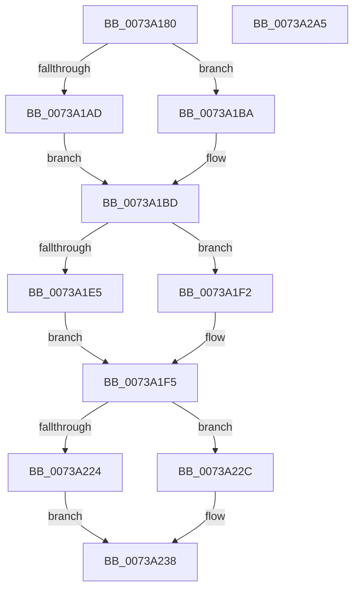

# PnprLogFailureEvent

- RVA: `0x0073A180`–`0x0073A2A6` (길이 `294` bytes)
- VA: `0x000000014073A180`
- 실행 섹션: `PAGE`
- PDB 이름 있음: `예`; PDB Function 태그: `아니요`
- unwind 정보 RVA: `0x0006CFB4`
- 디코드: `69`개 명령, `294/294` bytes 표시
- 미해석 바이트: `0` (있으면 어셈블리에 `.byte`로 보존)

> 이 문서는 커널 이미지의 기계어와 PDB 기호를 분석해 생성했습니다. 4번과 5번은 함수 원형과 자료형을 바이너리 사용 방식에서 추정한 C 해석이며 원본 소스 복구 결과는 아닙니다.

## 1. Dependencies

- 직접 호출 지점: **2**; 고유 호출 대상: **2**
- 직접 호출자로 확인된 함수: **1**
- RIP 상대 이미지 참조: **4**

### Outgoing calls
- `0x0073A28B` → [EtwWrite](../../text/41/EtwWrite_function_0041C720.md) (function, `0x0041C720`)
- `0x0073A297` → [_security_check_cookie](../../text/6A/_security_check_cookie_function_006AC640.md) (function, `0x006AC640`)

### Direct callers
- [PnpReplacePartitionUnit](PnpReplacePartitionUnit_function_00738550.md) at `0x00738ED1`

### Static image references
- `0x0073A192` → RVA `0x00E0A740` (`.data`; read)
- `0x0073A209` → RVA `0x00F8AC38` (`.data`; read)
- `0x0073A23B` → RVA `0x00026EB0` (`.rdata`; read)
- `0x0073A249` → RVA `0x00E662D8` (`.data`; read)

## 2. Other-region calls and transfers

- 다른 실행 섹션으로 향하는 call: **2**
  - `0x0073A28B` → [EtwWrite](../../text/41/EtwWrite_function_0041C720.md) (`PAGE` → `.text`)
  - `0x0073A297` → [_security_check_cookie](../../text/6A/_security_check_cookie_function_006AC640.md) (`PAGE` → `.text`)
- 별도 외부 분기/꼬리 이동을 확인하지 못했습니다.

## 3. Assembly (complete function range)

```asm
0073A180  44 89 44 24 18                  mov dword ptr [rsp + 0x18], r8d
0073A185  55                              push rbp
0073A186  48 8D 6C 24 A9                  lea rbp, [rsp - 0x57]
0073A18B  48 81 EC C0 00 00 00            sub rsp, 0xc0
0073A192  48 8B 05 A7 05 6D 00            mov rax, qword ptr [rip + 0x6d05a7]
0073A199  48 33 C4                        xor rax, rsp
0073A19C  48 89 45 47                     mov qword ptr [rbp + 0x47], rax
0073A1A0  45 33 C0                        xor r8d, r8d
0073A1A3  66 44 89 45 C7                  mov word ptr [rbp - 0x39], r8w
0073A1A8  48 85 C9                        test rcx, rcx
0073A1AB  74 0D                           je 0x14073a1ba
0073A1AD  48 8B 81 38 01 00 00            mov rax, qword ptr [rcx + 0x138]
0073A1B4  48 8B 40 28                     mov rax, qword ptr [rax + 0x28]
0073A1B8  EB 03                           jmp 0x14073a1bd
0073A1BA  49 8B C0                        mov rax, r8
0073A1BD  0F B7 48 28                     movzx ecx, word ptr [rax + 0x28]
0073A1C1  48 8B 40 30                     mov rax, qword ptr [rax + 0x30]
0073A1C5  48 89 45 D7                     mov qword ptr [rbp - 0x29], rax
0073A1C9  48 8D 45 C7                     lea rax, [rbp - 0x39]
0073A1CD  48 89 45 E7                     mov qword ptr [rbp - 0x19], rax
0073A1D1  89 4D DF                        mov dword ptr [rbp - 0x21], ecx
0073A1D4  44 89 45 E3                     mov dword ptr [rbp - 0x1d], r8d
0073A1D8  48 C7 45 EF 02 00 00 00         mov qword ptr [rbp - 0x11], 2
0073A1E0  48 85 D2                        test rdx, rdx
0073A1E3  74 0D                           je 0x14073a1f2
0073A1E5  48 8B 82 38 01 00 00            mov rax, qword ptr [rdx + 0x138]
0073A1EC  48 8B 40 28                     mov rax, qword ptr [rax + 0x28]
0073A1F0  EB 03                           jmp 0x14073a1f5
0073A1F2  49 8B C0                        mov rax, r8
0073A1F5  0F B7 48 28                     movzx ecx, word ptr [rax + 0x28]
0073A1F9  48 8B 40 30                     mov rax, qword ptr [rax + 0x30]
0073A1FD  48 89 45 F7                     mov qword ptr [rbp - 9], rax
0073A201  48 8D 45 C7                     lea rax, [rbp - 0x39]
0073A205  48 89 45 07                     mov qword ptr [rbp + 7], rax
0073A209  48 8B 05 28 0A 85 00            mov rax, qword ptr [rip + 0x850a28]
0073A210  89 4D FF                        mov dword ptr [rbp - 1], ecx
0073A213  44 89 45 03                     mov dword ptr [rbp + 3], r8d
0073A217  48 C7 45 0F 02 00 00 00         mov qword ptr [rbp + 0xf], 2
0073A21F  48 85 C0                        test rax, rax
0073A222  75 08                           jne 0x14073a22c
0073A224  8D 48 01                        lea ecx, [rax + 1]
0073A227  41 8B C0                        mov eax, r8d
0073A22A  EB 0C                           jmp 0x14073a238
0073A22C  8B 88 0C 82 00 00               mov ecx, dword ptr [rax + 0x820c]
0073A232  8B 80 08 82 00 00               mov eax, dword ptr [rax + 0x8208]
0073A238  89 45 CB                        mov dword ptr [rbp - 0x35], eax
0073A23B  48 8D 15 6E CC 8E FF            lea rdx, [rip - 0x713392]
0073A242  48 8D 45 77                     lea rax, [rbp + 0x77]
0073A246  89 4D CF                        mov dword ptr [rbp - 0x31], ecx
0073A249  48 8B 0D 88 C0 72 00            mov rcx, qword ptr [rip + 0x72c088]
0073A250  41 B9 07 00 00 00               mov r9d, 7
0073A256  48 89 45 17                     mov qword ptr [rbp + 0x17], rax
0073A25A  48 8D 45 CB                     lea rax, [rbp - 0x35]
0073A25E  48 89 45 27                     mov qword ptr [rbp + 0x27], rax
0073A262  48 8D 45 CF                     lea rax, [rbp - 0x31]
0073A266  48 89 45 37                     mov qword ptr [rbp + 0x37], rax
0073A26A  48 8D 45 D7                     lea rax, [rbp - 0x29]
0073A26E  48 89 44 24 20                  mov qword ptr [rsp + 0x20], rax
0073A273  48 C7 45 1F 04 00 00 00         mov qword ptr [rbp + 0x1f], 4
0073A27B  48 C7 45 2F 04 00 00 00         mov qword ptr [rbp + 0x2f], 4
0073A283  48 C7 45 3F 04 00 00 00         mov qword ptr [rbp + 0x3f], 4
0073A28B  E8 90 24 CE FF                  call 0x14041c720
0073A290  48 8B 4D 47                     mov rcx, qword ptr [rbp + 0x47]
0073A294  48 33 CC                        xor rcx, rsp
0073A297  E8 A4 23 F7 FF                  call 0x1406ac640
0073A29C  48 81 C4 C0 00 00 00            add rsp, 0xc0
0073A2A3  5D                              pop rbp
0073A2A4  C3                              ret
0073A2A5  CC                              int3
```

## 4. C-style interpretation (structured pseudocode)

```c
__int64 __fastcall PnprLogFailureEvent(__int64 a1, __int64 a2, int a3)
{
    __int64 result;
    __int64 v_rsp;
    unsigned __int64 v_stack_m18;
    unsigned __int64 v_stack_m20;
    unsigned __int64 v_stack_m28;
    unsigned __int64 v_stack_m30;
    unsigned __int64 v_stack_m38;
    unsigned __int64 v_stack_m40;
    unsigned __int64 v_stack_m48;
    unsigned __int64 v_stack_m50;
    unsigned __int64 v_stack_m58;
    unsigned int v_stack_m5C;
    unsigned __int64 v_stack_m5F;
    unsigned int v_stack_m60;
    unsigned __int64 v_stack_m68;
    unsigned __int64 v_stack_m70;
    unsigned __int64 v_stack_m78;
    unsigned int v_stack_m7C;
    unsigned int v_stack_m80;
    unsigned __int64 v_stack_m88;
    unsigned int v_stack_m90;
    unsigned int v_stack_m94;
    unsigned __int16 v_stack_m98;
    unsigned __int64 v_stack_mA8;
    unsigned int v_stack_p18;

    v_stack_p18 = a3;
    v_rsp = (v_rsp) - (192);
    result = (*(unsigned __int64 *)(v_rip + 7144871)) ^ (v_rsp);
    v_stack_m18 = result;
    a3 = 0;
    v_stack_m98 = 0;
    if (a1 == 0) goto loc_0073A1BA;
    goto loc_0073A1BD;
loc_0073A1BA:
loc_0073A1BD:
    v_stack_m88 = *(unsigned __int64 *)(0 + 48);
    v_stack_m78 = v_stack_m98;
    v_stack_m80 = (unsigned int)(*(unsigned __int16 *)(0 + 40));
    v_stack_m7C = 0;
    v_stack_m70 = 2;
    if (a2 == 0) goto loc_0073A1F2;
    goto loc_0073A1F5;
loc_0073A1F2:
loc_0073A1F5:
    v_stack_m68 = *(unsigned __int64 *)(0 + 48);
    v_stack_m58 = v_stack_m98;
    v_stack_m60 = (unsigned int)(*(unsigned __int16 *)(0 + 40));
    v_stack_m5C = 0;
    v_stack_m50 = 2;
    if (*(unsigned __int64 *)(v_rip + 8718888) != 0) goto loc_0073A22C;
    goto loc_0073A238;
loc_0073A22C:
loc_0073A238:
    v_stack_m94 = (unsigned int)((unsigned int)(*(unsigned int *)(0 + 33288)));
    v_stack_m90 = (unsigned int)((unsigned int)(*(unsigned int *)(0 + 33292)));
    v_stack_m48 = v_stack_p18;
    v_stack_m38 = v_stack_m94;
    v_stack_m28 = v_stack_m90;
    v_stack_mA8 = v_stack_m88;
    v_stack_m40 = 4;
    v_stack_m30 = 4;
    v_stack_m20 = 4;
    result = EtwWrite(*(unsigned __int64 *)(v_rip + 7520392), v_rip - 7418770, a3, 7);
    a1 = (v_stack_m18) ^ (v_rsp);
    result = _security_check_cookie(a1, v_rip - 7418770, a3, 7);
    v_rsp = (v_rsp) + (192);
    return result;
}
```

## 5. (Beta) C Style

```c
int64_t PnprLogFailureEvent(int64_t Arg1, int64_t Arg2, int32_t Arg3)
{
    int64_t result;
    int64_t local_rsp;
    uint64_t v_stack_m18;
    uint64_t v_stack_m20;
    uint64_t v_stack_m28;
    uint64_t v_stack_m30;
    uint64_t v_stack_m38;
    uint64_t v_stack_m40;
    uint64_t v_stack_m48;
    uint64_t v_stack_m50;
    uint64_t v_stack_m58;
    uint32_t v_stack_m5C;
    uint64_t v_stack_m5F;
    uint32_t v_stack_m60;
    uint64_t v_stack_m68;
    uint64_t v_stack_m70;
    uint64_t v_stack_m78;
    uint32_t v_stack_m7C;
    uint32_t v_stack_m80;
    uint64_t v_stack_m88;
    uint32_t v_stack_m90;
    uint32_t v_stack_m94;
    uint16_t v_stack_m98;
    uint64_t v_stack_mA8;
    uint32_t v_stack_p18;

    v_stack_p18 = Arg3;
    local_rsp = (local_rsp) - (192);
    result = (*(uint64_t *)(v_rip + 0x6D05A7)) ^ (local_rsp);
    v_stack_m18 = result;
    Arg3 = 0;
    v_stack_m98 = 0;
    if (Arg1 == 0) goto loc_0073A1BA;
    goto loc_0073A1BD;
loc_0073A1BA:
loc_0073A1BD:
    v_stack_m88 = *(uint64_t *)(0 + 0x30);
    v_stack_m78 = v_stack_m98;
    v_stack_m80 = (uint32_t)(*(uint16_t *)(0 + 0x28));
    v_stack_m7C = 0;
    v_stack_m70 = 2;
    if (Arg2 == 0) goto loc_0073A1F2;
    goto loc_0073A1F5;
loc_0073A1F2:
loc_0073A1F5:
    v_stack_m68 = *(uint64_t *)(0 + 0x30);
    v_stack_m58 = v_stack_m98;
    v_stack_m60 = (uint32_t)(*(uint16_t *)(0 + 0x28));
    v_stack_m5C = 0;
    v_stack_m50 = 2;
    if (*(uint64_t *)(v_rip + 0x850A28) != 0) goto loc_0073A22C;
    goto loc_0073A238;
loc_0073A22C:
loc_0073A238:
    v_stack_m94 = (uint32_t)((uint32_t)(*(uint32_t *)(0 + 0x8208)));
    v_stack_m90 = (uint32_t)((uint32_t)(*(uint32_t *)(0 + 0x820C)));
    v_stack_m48 = v_stack_p18;
    v_stack_m38 = v_stack_m94;
    v_stack_m28 = v_stack_m90;
    v_stack_mA8 = v_stack_m88;
    v_stack_m40 = 4;
    v_stack_m30 = 4;
    v_stack_m20 = 4;
    result = EtwWrite(*(uint64_t *)(v_rip + 0x72C088), v_rip - 7418770, Arg3, 7);
    Arg1 = (v_stack_m18) ^ (local_rsp);
    result = _security_check_cookie(Arg1, v_rip - 7418770, Arg3, 7);
    local_rsp = (local_rsp) + (192);
    return result;
}
```

## 6. Execution-region graph

[열기: 2D/3D 그래프와 함수 탐색 컨트롤 패널](../../../control-panel.html?section=page&rva=0x0073A180&view=graph)

- 2D 그래프는 위에서 아래로 흐르고, 3D 그래프는 빈 공간을 드래그해 회전합니다. Shift+드래그는 이동, 휠은 확대·축소, 함수 노드 선택은 대상 보고서 이동입니다.

### Static fallback


