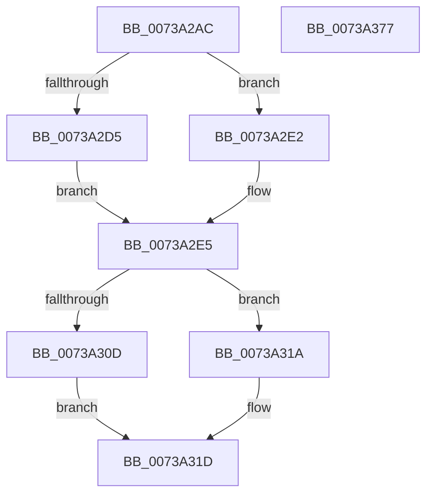

# PnprLogStartEvent

- RVA: `0x0073A2AC`–`0x0073A378` (길이 `204` bytes)
- VA: `0x000000014073A2AC`
- 실행 섹션: `PAGE`
- PDB 이름 있음: `예`; PDB Function 태그: `아니요`
- unwind 정보 RVA: `0x000BD7A0`
- 디코드: `49`개 명령, `204/204` bytes 표시
- 미해석 바이트: `0` (있으면 어셈블리에 `.byte`로 보존)

> 이 문서는 커널 이미지의 기계어와 PDB 기호를 분석해 생성했습니다. 4번과 5번은 함수 원형과 자료형을 바이너리 사용 방식에서 추정한 C 해석이며 원본 소스 복구 결과는 아닙니다.

## 1. Dependencies

- 직접 호출 지점: **2**; 고유 호출 대상: **2**
- 직접 호출자로 확인된 함수: **1**
- RIP 상대 이미지 참조: **3**

### Outgoing calls
- `0x0073A35D` → [EtwWrite](../../text/41/EtwWrite_function_0041C720.md) (function, `0x0041C720`)
- `0x0073A369` → [_security_check_cookie](../../text/6A/_security_check_cookie_function_006AC640.md) (function, `0x006AC640`)

### Direct callers
- [PnpReplacePartitionUnit](PnpReplacePartitionUnit_function_00738550.md) at `0x0073864E`

### Static image references
- `0x0073A2BA` → RVA `0x00E0A740` (`.data`; read)
- `0x0073A321` → RVA `0x00026ED0` (`.rdata`; read)
- `0x0073A345` → RVA `0x00E662D8` (`.data`; read)

## 2. Other-region calls and transfers

- 다른 실행 섹션으로 향하는 call: **2**
  - `0x0073A35D` → [EtwWrite](../../text/41/EtwWrite_function_0041C720.md) (`PAGE` → `.text`)
  - `0x0073A369` → [_security_check_cookie](../../text/6A/_security_check_cookie_function_006AC640.md) (`PAGE` → `.text`)
- 별도 외부 분기/꼬리 이동을 확인하지 못했습니다.

## 3. Assembly (complete function range)

```asm
0073A2AC  40 55                           push rbp
0073A2AE  48 8D 6C 24 A9                  lea rbp, [rsp - 0x57]
0073A2B3  48 81 EC 90 00 00 00            sub rsp, 0x90
0073A2BA  48 8B 05 7F 04 6D 00            mov rax, qword ptr [rip + 0x6d047f]
0073A2C1  48 33 C4                        xor rax, rsp
0073A2C4  48 89 45 47                     mov qword ptr [rbp + 0x47], rax
0073A2C8  45 33 C0                        xor r8d, r8d
0073A2CB  66 44 89 45 F7                  mov word ptr [rbp - 9], r8w
0073A2D0  48 85 C9                        test rcx, rcx
0073A2D3  74 0D                           je 0x14073a2e2
0073A2D5  48 8B 81 38 01 00 00            mov rax, qword ptr [rcx + 0x138]
0073A2DC  48 8B 40 28                     mov rax, qword ptr [rax + 0x28]
0073A2E0  EB 03                           jmp 0x14073a2e5
0073A2E2  49 8B C0                        mov rax, r8
0073A2E5  0F B7 48 28                     movzx ecx, word ptr [rax + 0x28]
0073A2E9  48 8B 40 30                     mov rax, qword ptr [rax + 0x30]
0073A2ED  48 89 45 07                     mov qword ptr [rbp + 7], rax
0073A2F1  48 8D 45 F7                     lea rax, [rbp - 9]
0073A2F5  48 89 45 17                     mov qword ptr [rbp + 0x17], rax
0073A2F9  89 4D 0F                        mov dword ptr [rbp + 0xf], ecx
0073A2FC  44 89 45 13                     mov dword ptr [rbp + 0x13], r8d
0073A300  48 C7 45 1F 02 00 00 00         mov qword ptr [rbp + 0x1f], 2
0073A308  48 85 D2                        test rdx, rdx
0073A30B  74 0D                           je 0x14073a31a
0073A30D  48 8B 82 38 01 00 00            mov rax, qword ptr [rdx + 0x138]
0073A314  48 8B 40 28                     mov rax, qword ptr [rax + 0x28]
0073A318  EB 03                           jmp 0x14073a31d
0073A31A  49 8B C0                        mov rax, r8
0073A31D  0F B7 48 28                     movzx ecx, word ptr [rax + 0x28]
0073A321  48 8D 15 A8 CB 8E FF            lea rdx, [rip - 0x713458]
0073A328  48 8B 40 30                     mov rax, qword ptr [rax + 0x30]
0073A32C  41 B9 04 00 00 00               mov r9d, 4
0073A332  48 89 45 27                     mov qword ptr [rbp + 0x27], rax
0073A336  48 8D 45 F7                     lea rax, [rbp - 9]
0073A33A  48 89 45 37                     mov qword ptr [rbp + 0x37], rax
0073A33E  48 8D 45 07                     lea rax, [rbp + 7]
0073A342  89 4D 2F                        mov dword ptr [rbp + 0x2f], ecx
0073A345  48 8B 0D 8C BF 72 00            mov rcx, qword ptr [rip + 0x72bf8c]
0073A34C  48 89 44 24 20                  mov qword ptr [rsp + 0x20], rax
0073A351  44 89 45 33                     mov dword ptr [rbp + 0x33], r8d
0073A355  48 C7 45 3F 02 00 00 00         mov qword ptr [rbp + 0x3f], 2
0073A35D  E8 BE 23 CE FF                  call 0x14041c720
0073A362  48 8B 4D 47                     mov rcx, qword ptr [rbp + 0x47]
0073A366  48 33 CC                        xor rcx, rsp
0073A369  E8 D2 22 F7 FF                  call 0x1406ac640
0073A36E  48 81 C4 90 00 00 00            add rsp, 0x90
0073A375  5D                              pop rbp
0073A376  C3                              ret
0073A377  CC                              int3
```

## 4. C-style interpretation (structured pseudocode)

```c
__int64 __fastcall PnprLogStartEvent(__int64 a1, __int64 a2, int a3)
{
    __int64 result;
    __int64 v_rsp;
    unsigned __int64 v_stack_m18;
    unsigned __int64 v_stack_m20;
    unsigned __int64 v_stack_m28;
    unsigned int v_stack_m2C;
    unsigned int v_stack_m30;
    unsigned __int64 v_stack_m38;
    unsigned __int64 v_stack_m40;
    unsigned __int64 v_stack_m48;
    unsigned int v_stack_m4C;
    unsigned int v_stack_m50;
    unsigned __int64 v_stack_m58;
    unsigned __int64 v_stack_m5F;
    unsigned __int16 v_stack_m68;
    unsigned __int64 v_stack_m78;

    v_rsp = (v_rsp) - (144);
    result = (*(unsigned __int64 *)(v_rip + 7144575)) ^ (v_rsp);
    v_stack_m18 = result;
    a3 = 0;
    v_stack_m68 = 0;
    if (a1 == 0) goto loc_0073A2E2;
    goto loc_0073A2E5;
loc_0073A2E2:
loc_0073A2E5:
    v_stack_m58 = *(unsigned __int64 *)(0 + 48);
    v_stack_m48 = v_stack_m68;
    v_stack_m50 = (unsigned int)(*(unsigned __int16 *)(0 + 40));
    v_stack_m4C = 0;
    v_stack_m40 = 2;
    if (a2 == 0) goto loc_0073A31A;
    goto loc_0073A31D;
loc_0073A31A:
loc_0073A31D:
    v_stack_m38 = *(unsigned __int64 *)(0 + 48);
    v_stack_m28 = v_stack_m68;
    v_stack_m30 = (unsigned int)(*(unsigned __int16 *)(0 + 40));
    v_stack_m78 = v_stack_m58;
    v_stack_m2C = 0;
    v_stack_m20 = 2;
    result = EtwWrite(*(unsigned __int64 *)(v_rip + 7520140), v_rip - 7418968, a3, 4);
    a1 = (v_stack_m18) ^ (v_rsp);
    result = _security_check_cookie(a1, v_rip - 7418968, a3, 4);
    v_rsp = (v_rsp) + (144);
    return result;
}
```

## 5. (Beta) C Style

```c
int64_t PnprLogStartEvent(int64_t Arg1, int64_t Arg2, int32_t Arg3)
{
    int64_t result;
    int64_t local_rsp;
    uint64_t v_stack_m18;
    uint64_t v_stack_m20;
    uint64_t v_stack_m28;
    uint32_t v_stack_m2C;
    uint32_t v_stack_m30;
    uint64_t v_stack_m38;
    uint64_t v_stack_m40;
    uint64_t v_stack_m48;
    uint32_t v_stack_m4C;
    uint32_t v_stack_m50;
    uint64_t v_stack_m58;
    uint64_t v_stack_m5F;
    uint16_t v_stack_m68;
    uint64_t v_stack_m78;

    local_rsp = (local_rsp) - (144);
    result = (*(uint64_t *)(v_rip + 0x6D047F)) ^ (local_rsp);
    v_stack_m18 = result;
    Arg3 = 0;
    v_stack_m68 = 0;
    if (Arg1 == 0) goto loc_0073A2E2;
    goto loc_0073A2E5;
loc_0073A2E2:
loc_0073A2E5:
    v_stack_m58 = *(uint64_t *)(0 + 0x30);
    v_stack_m48 = v_stack_m68;
    v_stack_m50 = (uint32_t)(*(uint16_t *)(0 + 0x28));
    v_stack_m4C = 0;
    v_stack_m40 = 2;
    if (Arg2 == 0) goto loc_0073A31A;
    goto loc_0073A31D;
loc_0073A31A:
loc_0073A31D:
    v_stack_m38 = *(uint64_t *)(0 + 0x30);
    v_stack_m28 = v_stack_m68;
    v_stack_m30 = (uint32_t)(*(uint16_t *)(0 + 0x28));
    v_stack_m78 = v_stack_m58;
    v_stack_m2C = 0;
    v_stack_m20 = 2;
    result = EtwWrite(*(uint64_t *)(v_rip + 0x72BF8C), v_rip - 7418968, Arg3, 4);
    Arg1 = (v_stack_m18) ^ (local_rsp);
    result = _security_check_cookie(Arg1, v_rip - 7418968, Arg3, 4);
    local_rsp = (local_rsp) + (144);
    return result;
}
```

## 6. Execution-region graph

[열기: 2D/3D 그래프와 함수 탐색 컨트롤 패널](../../../control-panel.html?section=page&rva=0x0073A2AC&view=graph)

- 2D 그래프는 위에서 아래로 흐르고, 3D 그래프는 빈 공간을 드래그해 회전합니다. Shift+드래그는 이동, 휠은 확대·축소, 함수 노드 선택은 대상 보고서 이동입니다.

### Static fallback


