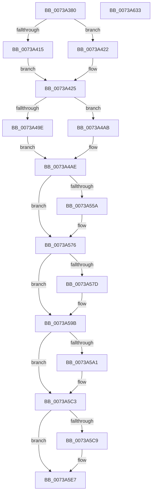

# PnprLogSuccessEvent

- RVA: `0x0073A380`–`0x0073A634` (길이 `692` bytes)
- VA: `0x000000014073A380`
- 실행 섹션: `PAGE`
- PDB 이름 있음: `예`; PDB Function 태그: `아니요`
- unwind 정보 RVA: `0x000C8DC8`
- 디코드: `160`개 명령, `692/692` bytes 표시
- 미해석 바이트: `0` (있으면 어셈블리에 `.byte`로 보존)

> 이 문서는 커널 이미지의 기계어와 PDB 기호를 분석해 생성했습니다. 4번과 5번은 함수 원형과 자료형을 바이너리 사용 방식에서 추정한 C 해석이며 원본 소스 복구 결과는 아닙니다.

## 1. Dependencies

- 직접 호출 지점: **2**; 고유 호출 대상: **2**
- 직접 호출자로 확인된 함수: **1**
- RIP 상대 이미지 참조: **4**

### Outgoing calls
- `0x0073A602` → [EtwWrite](../../text/41/EtwWrite_function_0041C720.md) (function, `0x0041C720`)
- `0x0073A611` → [_security_check_cookie](../../text/6A/_security_check_cookie_function_006AC640.md) (function, `0x006AC640`)

### Direct callers
- [PnpReplacePartitionUnit](PnpReplacePartitionUnit_function_00738550.md) at `0x00738EC0`

### Static image references
- `0x0073A3A2` → RVA `0x00E0A740` (`.data`; read)
- `0x0073A3B3` → RVA `0x00F8AC38` (`.data`; read)
- `0x0073A5E7` → RVA `0x00E662D8` (`.data`; read)
- `0x0073A5FB` → RVA `0x00027788` (`.rdata`; read)

## 2. Other-region calls and transfers

- 다른 실행 섹션으로 향하는 call: **2**
  - `0x0073A602` → [EtwWrite](../../text/41/EtwWrite_function_0041C720.md) (`PAGE` → `.text`)
  - `0x0073A611` → [_security_check_cookie](../../text/6A/_security_check_cookie_function_006AC640.md) (`PAGE` → `.text`)
- 별도 외부 분기/꼬리 이동을 확인하지 못했습니다.

## 3. Assembly (complete function range)

```asm
0073A380  48 8B C4                        mov rax, rsp
0073A383  48 89 58 08                     mov qword ptr [rax + 8], rbx
0073A387  48 89 70 10                     mov qword ptr [rax + 0x10], rsi
0073A38B  48 89 78 18                     mov qword ptr [rax + 0x18], rdi
0073A38F  55                              push rbp
0073A390  41 56                           push r14
0073A392  41 57                           push r15
0073A394  48 8D A8 58 FF FF FF            lea rbp, [rax - 0xa8]
0073A39B  48 81 EC 90 01 00 00            sub rsp, 0x190
0073A3A2  48 8B 05 97 03 6D 00            mov rax, qword ptr [rip + 0x6d0397]
0073A3A9  48 33 C4                        xor rax, rsp
0073A3AC  48 89 85 80 00 00 00            mov qword ptr [rbp + 0x80], rax
0073A3B3  4C 8B 05 7E 08 85 00            mov r8, qword ptr [rip + 0x85087e]
0073A3BA  45 33 FF                        xor r15d, r15d
0073A3BD  66 44 89 7C 24 30               mov word ptr [rsp + 0x30], r15w
0073A3C3  41 8B 80 40 82 00 00            mov eax, dword ptr [r8 + 0x8240]
0073A3CA  41 8B 90 34 82 00 00            mov edx, dword ptr [r8 + 0x8234]
0073A3D1  41 8B 88 38 82 00 00            mov ecx, dword ptr [r8 + 0x8238]
0073A3D8  89 44 24 34                     mov dword ptr [rsp + 0x34], eax
0073A3DC  8B C2                           mov eax, edx
0073A3DE  41 2B 80 30 82 00 00            sub eax, dword ptr [r8 + 0x8230]
0073A3E5  89 44 24 38                     mov dword ptr [rsp + 0x38], eax
0073A3E9  8B C1                           mov eax, ecx
0073A3EB  2B C2                           sub eax, edx
0073A3ED  49 8B 50 10                     mov rdx, qword ptr [r8 + 0x10]
0073A3F1  89 44 24 3C                     mov dword ptr [rsp + 0x3c], eax
0073A3F5  41 8B 80 3C 82 00 00            mov eax, dword ptr [r8 + 0x823c]
0073A3FC  2B C1                           sub eax, ecx
0073A3FE  89 44 24 40                     mov dword ptr [rsp + 0x40], eax
0073A402  48 8B 02                        mov rax, qword ptr [rdx]
0073A405  48 8B 08                        mov rcx, qword ptr [rax]
0073A408  49 8B 00                        mov rax, qword ptr [r8]
0073A40B  48 89 4C 24 48                  mov qword ptr [rsp + 0x48], rcx
0073A410  48 85 C0                        test rax, rax
0073A413  74 0D                           je 0x14073a422
0073A415  48 8B 80 38 01 00 00            mov rax, qword ptr [rax + 0x138]
0073A41C  48 8B 40 28                     mov rax, qword ptr [rax + 0x28]
0073A420  EB 03                           jmp 0x14073a425
0073A422  49 8B C7                        mov rax, r15
0073A425  0F B7 48 28                     movzx ecx, word ptr [rax + 0x28]
0073A429  48 8D 7A 10                     lea rdi, [rdx + 0x10]
0073A42D  48 8B 40 30                     mov rax, qword ptr [rax + 0x30]
0073A431  4D 8B 50 18                     mov r10, qword ptr [r8 + 0x18]
0073A435  48 89 44 24 50                  mov qword ptr [rsp + 0x50], rax
0073A43A  48 8D 44 24 30                  lea rax, [rsp + 0x30]
0073A43F  48 89 44 24 60                  mov qword ptr [rsp + 0x60], rax
0073A444  48 8D 44 24 48                  lea rax, [rsp + 0x48]
0073A449  48 89 44 24 70                  mov qword ptr [rsp + 0x70], rax
0073A44E  49 8D 42 08                     lea rax, [r10 + 8]
0073A452  89 4C 24 58                     mov dword ptr [rsp + 0x58], ecx
0073A456  48 89 45 A0                     mov qword ptr [rbp - 0x60], rax
0073A45A  4D 8D 5A 04                     lea r11, [r10 + 4]
0073A45E  49 8B 40 20                     mov rax, qword ptr [r8 + 0x20]
0073A462  44 89 7C 24 5C                  mov dword ptr [rsp + 0x5c], r15d
0073A467  48 C7 44 24 68 02 00 00 00      mov qword ptr [rsp + 0x68], 2
0073A470  48 C7 44 24 78 08 00 00 00      mov qword ptr [rsp + 0x78], 8
0073A479  48 89 7D 80                     mov qword ptr [rbp - 0x80], rdi
0073A47D  48 C7 45 88 04 00 00 00         mov qword ptr [rbp - 0x78], 4
0073A485  4C 89 5D 90                     mov qword ptr [rbp - 0x70], r11
0073A489  48 C7 45 98 04 00 00 00         mov qword ptr [rbp - 0x68], 4
0073A491  48 C7 45 A8 08 00 00 00         mov qword ptr [rbp - 0x58], 8
0073A499  48 85 C0                        test rax, rax
0073A49C  74 0D                           je 0x14073a4ab
0073A49E  48 8B 80 38 01 00 00            mov rax, qword ptr [rax + 0x138]
0073A4A5  48 8B 40 28                     mov rax, qword ptr [rax + 0x28]
0073A4A9  EB 03                           jmp 0x14073a4ae
0073A4AB  49 8B C7                        mov rax, r15
0073A4AE  0F B7 48 28                     movzx ecx, word ptr [rax + 0x28]
0073A4B2  41 B9 0F 00 00 00               mov r9d, 0xf
0073A4B8  48 8B 40 30                     mov rax, qword ptr [rax + 0x30]
0073A4BC  4D 8B 70 30                     mov r14, qword ptr [r8 + 0x30]
0073A4C0  4D 8B 40 38                     mov r8, qword ptr [r8 + 0x38]
0073A4C4  48 89 45 B0                     mov qword ptr [rbp - 0x50], rax
0073A4C8  48 8D 44 24 30                  lea rax, [rsp + 0x30]
0073A4CD  48 89 45 C0                     mov qword ptr [rbp - 0x40], rax
0073A4D1  49 8D 5E 10                     lea rbx, [r14 + 0x10]
0073A4D5  89 4D B8                        mov dword ptr [rbp - 0x48], ecx
0073A4D8  49 8D 40 08                     lea rax, [r8 + 8]
0073A4DC  44 89 7D BC                     mov dword ptr [rbp - 0x44], r15d
0073A4E0  48 89 45 F0                     mov qword ptr [rbp - 0x10], rax
0073A4E4  49 8D 70 04                     lea rsi, [r8 + 4]
0073A4E8  48 8D 44 24 34                  lea rax, [rsp + 0x34]
0073A4ED  48 C7 45 C8 02 00 00 00         mov qword ptr [rbp - 0x38], 2
0073A4F5  48 89 45 00                     mov qword ptr [rbp], rax
0073A4F9  48 8D 44 24 38                  lea rax, [rsp + 0x38]
0073A4FE  48 89 45 10                     mov qword ptr [rbp + 0x10], rax
0073A502  48 8D 44 24 3C                  lea rax, [rsp + 0x3c]
0073A507  48 89 45 20                     mov qword ptr [rbp + 0x20], rax
0073A50B  48 8D 44 24 40                  lea rax, [rsp + 0x40]
0073A510  48 89 45 30                     mov qword ptr [rbp + 0x30], rax
0073A514  48 89 5D D0                     mov qword ptr [rbp - 0x30], rbx
0073A518  48 C7 45 D8 04 00 00 00         mov qword ptr [rbp - 0x28], 4
0073A520  48 89 75 E0                     mov qword ptr [rbp - 0x20], rsi
0073A524  48 C7 45 E8 04 00 00 00         mov qword ptr [rbp - 0x18], 4
0073A52C  48 C7 45 F8 08 00 00 00         mov qword ptr [rbp - 8], 8
0073A534  48 C7 45 08 04 00 00 00         mov qword ptr [rbp + 8], 4
0073A53C  48 C7 45 18 04 00 00 00         mov qword ptr [rbp + 0x18], 4
0073A544  48 C7 45 28 04 00 00 00         mov qword ptr [rbp + 0x28], 4
0073A54C  48 C7 45 38 04 00 00 00         mov qword ptr [rbp + 0x38], 4
0073A554  8B 0F                           mov ecx, dword ptr [rdi]
0073A556  85 C9                           test ecx, ecx
0073A558  74 1C                           je 0x14073a576
0073A55A  48 8D 42 14                     lea rax, [rdx + 0x14]
0073A55E  44 89 7D 4C                     mov dword ptr [rbp + 0x4c], r15d
0073A562  48 89 45 40                     mov qword ptr [rbp + 0x40], rax
0073A566  41 B9 10 00 00 00               mov r9d, 0x10
0073A56C  8D 04 8D 00 00 00 00            lea eax, [rcx*4]
0073A573  89 45 48                        mov dword ptr [rbp + 0x48], eax
0073A576  41 8B 13                        mov edx, dword ptr [r11]
0073A579  85 D2                           test edx, edx
0073A57B  74 1E                           je 0x14073a59b
0073A57D  41 8B C9                        mov ecx, r9d
0073A580  49 8D 42 10                     lea rax, [r10 + 0x10]
0073A584  48 03 C9                        add rcx, rcx
0073A587  C1 E2 04                        shl edx, 4
0073A58A  41 FF C1                        inc r9d
0073A58D  48 89 44 CC 50                  mov qword ptr [rsp + rcx*8 + 0x50], rax
0073A592  89 54 CC 58                     mov dword ptr [rsp + rcx*8 + 0x58], edx
0073A596  44 89 7C CC 5C                  mov dword ptr [rsp + rcx*8 + 0x5c], r15d
0073A59B  8B 13                           mov edx, dword ptr [rbx]
0073A59D  85 D2                           test edx, edx
0073A59F  74 22                           je 0x14073a5c3
0073A5A1  41 8B C9                        mov ecx, r9d
0073A5A4  49 8D 46 14                     lea rax, [r14 + 0x14]
0073A5A8  48 03 C9                        add rcx, rcx
0073A5AB  41 FF C1                        inc r9d
0073A5AE  48 89 44 CC 50                  mov qword ptr [rsp + rcx*8 + 0x50], rax
0073A5B3  8D 04 95 00 00 00 00            lea eax, [rdx*4]
0073A5BA  89 44 CC 58                     mov dword ptr [rsp + rcx*8 + 0x58], eax
0073A5BE  44 89 7C CC 5C                  mov dword ptr [rsp + rcx*8 + 0x5c], r15d
0073A5C3  8B 16                           mov edx, dword ptr [rsi]
0073A5C5  85 D2                           test edx, edx
0073A5C7  74 1E                           je 0x14073a5e7
0073A5C9  41 8B C9                        mov ecx, r9d
0073A5CC  49 8D 40 10                     lea rax, [r8 + 0x10]
0073A5D0  48 03 C9                        add rcx, rcx
0073A5D3  C1 E2 04                        shl edx, 4
0073A5D6  41 FF C1                        inc r9d
0073A5D9  48 89 44 CC 50                  mov qword ptr [rsp + rcx*8 + 0x50], rax
0073A5DE  89 54 CC 58                     mov dword ptr [rsp + rcx*8 + 0x58], edx
0073A5E2  44 89 7C CC 5C                  mov dword ptr [rsp + rcx*8 + 0x5c], r15d
0073A5E7  48 8B 0D EA BC 72 00            mov rcx, qword ptr [rip + 0x72bcea]
0073A5EE  48 8D 44 24 50                  lea rax, [rsp + 0x50]
0073A5F3  45 33 C0                        xor r8d, r8d
0073A5F6  48 89 44 24 20                  mov qword ptr [rsp + 0x20], rax
0073A5FB  48 8D 15 86 D1 8E FF            lea rdx, [rip - 0x712e7a]
0073A602  E8 19 21 CE FF                  call 0x14041c720
0073A607  48 8B 8D 80 00 00 00            mov rcx, qword ptr [rbp + 0x80]
0073A60E  48 33 CC                        xor rcx, rsp
0073A611  E8 2A 20 F7 FF                  call 0x1406ac640
0073A616  4C 8D 9C 24 90 01 00 00         lea r11, [rsp + 0x190]
0073A61E  49 8B 5B 20                     mov rbx, qword ptr [r11 + 0x20]
0073A622  49 8B 73 28                     mov rsi, qword ptr [r11 + 0x28]
0073A626  49 8B 7B 30                     mov rdi, qword ptr [r11 + 0x30]
0073A62A  49 8B E3                        mov rsp, r11
0073A62D  41 5F                           pop r15
0073A62F  41 5E                           pop r14
0073A631  5D                              pop rbp
0073A632  C3                              ret
0073A633  CC                              int3
```

## 4. C-style interpretation (structured pseudocode)

```c
__int64 __fastcall PnprLogSuccessEvent(void)
{
    __int64 result;
    __int64 v_r15;
    __int64 v_rsp;
    unsigned __int64 v_stack_m130;
    unsigned __int64 v_stack_m138;
    unsigned __int64 v_stack_m140;
    unsigned __int64 v_stack_m148;
    unsigned int v_stack_m14C;
    unsigned int v_stack_m150;
    unsigned __int64 v_stack_m158;
    unsigned __int64 v_stack_m160;
    unsigned int v_stack_m168;
    unsigned int v_stack_m16C;
    unsigned int v_stack_m170;
    unsigned int v_stack_m174;
    unsigned __int16 v_stack_m178;
    unsigned __int64 v_stack_m18;
    unsigned __int64 v_stack_m188;

    *(unsigned __int64 *)(v_rsp + 8) = v_rbx;
    *(unsigned __int64 *)(v_rsp + 16) = v_rsi;
    *(unsigned __int64 *)(v_rsp + 24) = v_rdi;
    v_rsp = (v_rsp) - (400);
    result = (*(unsigned __int64 *)(v_rip + 7144343)) ^ (v_rsp);
    *(unsigned __int64 *)(v_rsp - 168 + 128) = result;
    v_r15 = 0;
    v_stack_m178 = 0;
    v_stack_m174 = (unsigned int)((unsigned int)(*(unsigned int *)(*(unsigned __int64 *)(v_rip + 8718462) + 33344)));
    result = (unsigned int)(((unsigned int)((unsigned int)((unsigned int)(*(unsigned int *)(*(unsigned __int64 *)(v_rip + 8718462) + 33332))))) - (*(unsigned int *)(*(unsigned __int64 *)(v_rip + 8718462) + 33328)));
    v_stack_m170 = (unsigned int)(result);
    result = (unsigned int)(((unsigned int)((unsigned int)((unsigned int)(*(unsigned int *)(*(unsigned __int64 *)(v_rip + 8718462) + 33336))))) - ((unsigned int)((unsigned int)(*(unsigned int *)(*(unsigned __int64 *)(v_rip + 8718462) + 33332)))));
    v_stack_m16C = (unsigned int)(result);
    result = (unsigned int)(((unsigned int)(*(unsigned int *)(*(unsigned __int64 *)(v_rip + 8718462) + 33340))) - ((unsigned int)((unsigned int)(*(unsigned int *)(*(unsigned __int64 *)(v_rip + 8718462) + 33336)))));
    v_stack_m168 = (unsigned int)(result);
    v_stack_m160 = *(unsigned __int64 *)(*(unsigned __int64 *)(*(unsigned __int64 *)(*(unsigned __int64 *)(v_rip + 8718462) + 16)));
    if (*(unsigned __int64 *)(*(unsigned __int64 *)(v_rip + 8718462)) == 0) goto loc_0073A422;
    goto loc_0073A425;
loc_0073A422:
loc_0073A425:
    v_stack_m158 = *(unsigned __int64 *)(0 + 48);
    v_stack_m148 = v_stack_m178;
    v_stack_m138 = v_stack_m160;
    v_stack_m150 = (unsigned int)(*(unsigned __int16 *)(0 + 40));
    *(unsigned __int64 *)(v_rsp - 168 - 96) = *(unsigned __int64 *)(*(unsigned __int64 *)(v_rip + 8718462) + 24) + 8;
    v_stack_m14C = 0;
    v_stack_m140 = 2;
    v_stack_m130 = 8;
    *(unsigned __int64 *)(v_rsp - 168 - 128) = *(unsigned __int64 *)(*(unsigned __int64 *)(v_rip + 8718462) + 16) + 16;
    *(unsigned __int64 *)(v_rsp - 168 - 120) = 4;
    *(unsigned __int64 *)(v_rsp - 168 - 112) = *(unsigned __int64 *)(*(unsigned __int64 *)(v_rip + 8718462) + 24) + 4;
    *(unsigned __int64 *)(v_rsp - 168 - 104) = 4;
    *(unsigned __int64 *)(v_rsp - 168 - 88) = 8;
    if (*(unsigned __int64 *)(*(unsigned __int64 *)(v_rip + 8718462) + 32) == 0) goto loc_0073A4AB;
    goto loc_0073A4AE;
loc_0073A4AB:
loc_0073A4AE:
    *(unsigned __int64 *)(v_rsp - 168 - 80) = *(unsigned __int64 *)(0 + 48);
    *(unsigned __int64 *)(v_rsp - 168 - 64) = v_stack_m178;
    *(unsigned int *)(v_rsp - 168 - 72) = (unsigned int)(*(unsigned __int16 *)(0 + 40));
    *(unsigned int *)(v_rsp - 168 - 68) = 0;
    *(unsigned __int64 *)(v_rsp - 168 - 16) = *(unsigned __int64 *)(*(unsigned __int64 *)(v_rip + 8718462) + 56) + 8;
    *(unsigned __int64 *)(v_rsp - 168 - 56) = 2;
    *(unsigned __int64 *)(v_rsp - 168) = v_stack_m174;
    *(unsigned __int64 *)(v_rsp - 168 + 16) = v_stack_m170;
    *(unsigned __int64 *)(v_rsp - 168 + 32) = v_stack_m16C;
    *(unsigned __int64 *)(v_rsp - 168 + 48) = v_stack_m168;
    *(unsigned __int64 *)(v_rsp - 168 - 48) = *(unsigned __int64 *)(*(unsigned __int64 *)(v_rip + 8718462) + 48) + 16;
    *(unsigned __int64 *)(v_rsp - 168 - 40) = 4;
    *(unsigned __int64 *)(v_rsp - 168 - 32) = *(unsigned __int64 *)(*(unsigned __int64 *)(v_rip + 8718462) + 56) + 4;
    *(unsigned __int64 *)(v_rsp - 168 - 24) = 4;
    *(unsigned __int64 *)(v_rsp - 168 - 8) = 8;
    *(unsigned __int64 *)(v_rsp - 168 + 8) = 4;
    *(unsigned __int64 *)(v_rsp - 168 + 24) = 4;
    *(unsigned __int64 *)(v_rsp - 168 + 40) = 4;
    *(unsigned __int64 *)(v_rsp - 168 + 56) = 4;
    result = v_stack_m168;
    if ((unsigned int)((unsigned int)(*(unsigned int *)(*(unsigned __int64 *)(*(unsigned __int64 *)(v_rip + 8718462) + 16) + 16))) != 0) {
        result = *(unsigned __int64 *)(*(unsigned __int64 *)(v_rip + 8718462) + 16) + 20;
        *(unsigned int *)(v_rsp - 168 + 76) = 0;
        *(unsigned __int64 *)(v_rsp - 168 + 64) = result;
        a4 = 16;
        result = (unsigned int)(*(unsigned int *)(*(unsigned __int64 *)(*(unsigned __int64 *)(v_rip + 8718462) + 16) + 16)) * 4;
        *(unsigned int *)(v_rsp - 168 + 72) = (unsigned int)(result);
    }
    if ((unsigned int)((unsigned int)(*(unsigned int *)(*(unsigned __int64 *)(*(unsigned __int64 *)(v_rip + 8718462) + 24) + 4))) != 0) {
        a1 = (unsigned int)(a4);
        result = *(unsigned __int64 *)(*(unsigned __int64 *)(v_rip + 8718462) + 24) + 16;
        a1 = (a1) + (a1);
        a2 = (unsigned int)(((unsigned int)(*(unsigned int *)(*(unsigned __int64 *)(*(unsigned __int64 *)(v_rip + 8718462) + 24) + 4))) << (4));
        a4 = (unsigned int)((a4) + 1);
        *(unsigned __int64 *)(v_rsp + a1 * 8 + 80) = result;
        *(unsigned int *)(v_rsp + a1 * 8 + 88) = (unsigned int)(a2);
        *(unsigned int *)(v_rsp + a1 * 8 + 92) = 0;
    }
    if ((unsigned int)((unsigned int)(*(unsigned int *)(*(unsigned __int64 *)(*(unsigned __int64 *)(v_rip + 8718462) + 48) + 16))) != 0) {
        a1 = (unsigned int)(a4);
        result = *(unsigned __int64 *)(*(unsigned __int64 *)(v_rip + 8718462) + 48) + 20;
        a1 = (a1) + (a1);
        a4 = (unsigned int)((a4) + 1);
        *(unsigned __int64 *)(v_rsp + a1 * 8 + 80) = result;
        result = (unsigned int)(*(unsigned int *)(*(unsigned __int64 *)(*(unsigned __int64 *)(v_rip + 8718462) + 48) + 16)) * 4;
        *(unsigned int *)(v_rsp + a1 * 8 + 88) = (unsigned int)(result);
        *(unsigned int *)(v_rsp + a1 * 8 + 92) = 0;
    }
    if ((unsigned int)((unsigned int)(*(unsigned int *)(*(unsigned __int64 *)(*(unsigned __int64 *)(v_rip + 8718462) + 56) + 4))) != 0) {
        a1 = (unsigned int)(a4);
        result = *(unsigned __int64 *)(*(unsigned __int64 *)(v_rip + 8718462) + 56) + 16;
        a1 = (a1) + (a1);
        a2 = (unsigned int)(((unsigned int)(*(unsigned int *)(*(unsigned __int64 *)(*(unsigned __int64 *)(v_rip + 8718462) + 56) + 4))) << (4));
        a4 = (unsigned int)((a4) + 1);
        *(unsigned __int64 *)(v_rsp + a1 * 8 + 80) = result;
        *(unsigned int *)(v_rsp + a1 * 8 + 88) = (unsigned int)(a2);
        *(unsigned int *)(v_rsp + a1 * 8 + 92) = 0;
    }
    a3 = 0;
    v_stack_m188 = v_stack_m158;
    result = EtwWrite(*(unsigned __int64 *)(v_rip + 7519466), v_rip - 7417466, a3, a4);
    a1 = (*(unsigned __int64 *)(v_rsp - 168 + 128)) ^ (v_rsp);
    result = _security_check_cookie(a1, v_rip - 7417466, a3, a4);
    return result;
}
```

## 5. (Beta) C Style

```c
void PnprLogSuccessEvent(void)
{
    int64_t result;
    int64_t local_r15;
    int64_t local_rsp;
    uint64_t v_stack_m130;
    uint64_t v_stack_m138;
    uint64_t v_stack_m140;
    uint64_t v_stack_m148;
    uint32_t v_stack_m14C;
    uint32_t v_stack_m150;
    uint64_t v_stack_m158;
    uint64_t v_stack_m160;
    uint32_t v_stack_m168;
    uint32_t v_stack_m16C;
    uint32_t v_stack_m170;
    uint32_t v_stack_m174;
    uint16_t v_stack_m178;
    uint64_t v_stack_m18;
    uint64_t v_stack_m188;

    *(uint64_t *)(local_rsp + 0x8) = local_rbx;
    *(uint64_t *)(local_rsp + 0x10) = local_rsi;
    *(uint64_t *)(local_rsp + 0x18) = local_rdi;
    local_rsp = (local_rsp) - (400);
    result = (*(uint64_t *)(v_rip + 0x6D0397)) ^ (local_rsp);
    *(uint64_t *)(local_rsp - 0xA8 + 0x80) = result;
    local_r15 = 0;
    v_stack_m178 = 0;
    v_stack_m174 = (uint32_t)((uint32_t)(*(uint32_t *)(*(uint64_t *)(v_rip + 0x85087E) + 0x8240)));
    result = (uint32_t)(((uint32_t)((uint32_t)((uint32_t)(*(uint32_t *)(*(uint64_t *)(v_rip + 0x85087E) + 0x8234))))) - (*(uint32_t *)(*(uint64_t *)(v_rip + 0x85087E) + 0x8230)));
    v_stack_m170 = (uint32_t)(result);
    result = (uint32_t)(((uint32_t)((uint32_t)((uint32_t)(*(uint32_t *)(*(uint64_t *)(v_rip + 0x85087E) + 0x8238))))) - ((uint32_t)((uint32_t)(*(uint32_t *)(*(uint64_t *)(v_rip + 0x85087E) + 0x8234)))));
    v_stack_m16C = (uint32_t)(result);
    result = (uint32_t)(((uint32_t)(*(uint32_t *)(*(uint64_t *)(v_rip + 0x85087E) + 0x823C))) - ((uint32_t)((uint32_t)(*(uint32_t *)(*(uint64_t *)(v_rip + 0x85087E) + 0x8238)))));
    v_stack_m168 = (uint32_t)(result);
    v_stack_m160 = *(uint64_t *)(*(uint64_t *)(*(uint64_t *)(*(uint64_t *)(v_rip + 0x85087E) + 0x10)));
    if (*(uint64_t *)(*(uint64_t *)(v_rip + 0x85087E)) == 0) goto loc_0073A422;
    goto loc_0073A425;
loc_0073A422:
loc_0073A425:
    v_stack_m158 = *(uint64_t *)(0 + 0x30);
    v_stack_m148 = v_stack_m178;
    v_stack_m138 = v_stack_m160;
    v_stack_m150 = (uint32_t)(*(uint16_t *)(0 + 0x28));
    *(uint64_t *)(local_rsp - 0xA8 - 0x60) = *(uint64_t *)(*(uint64_t *)(v_rip + 0x85087E) + 0x18) + 8;
    v_stack_m14C = 0;
    v_stack_m140 = 2;
    v_stack_m130 = 8;
    *(uint64_t *)(local_rsp - 0xA8 - 0x80) = *(uint64_t *)(*(uint64_t *)(v_rip + 0x85087E) + 0x10) + 16;
    *(uint64_t *)(local_rsp - 0xA8 - 0x78) = 4;
    *(uint64_t *)(local_rsp - 0xA8 - 0x70) = *(uint64_t *)(*(uint64_t *)(v_rip + 0x85087E) + 0x18) + 4;
    *(uint64_t *)(local_rsp - 0xA8 - 0x68) = 4;
    *(uint64_t *)(local_rsp - 0xA8 - 0x58) = 8;
    if (*(uint64_t *)(*(uint64_t *)(v_rip + 0x85087E) + 0x20) == 0) goto loc_0073A4AB;
    goto loc_0073A4AE;
loc_0073A4AB:
loc_0073A4AE:
    *(uint64_t *)(local_rsp - 0xA8 - 0x50) = *(uint64_t *)(0 + 0x30);
    *(uint64_t *)(local_rsp - 0xA8 - 0x40) = v_stack_m178;
    *(uint32_t *)(local_rsp - 0xA8 - 0x48) = (uint32_t)(*(uint16_t *)(0 + 0x28));
    *(uint32_t *)(local_rsp - 0xA8 - 0x44) = 0;
    *(uint64_t *)(local_rsp - 0xA8 - 0x10) = *(uint64_t *)(*(uint64_t *)(v_rip + 0x85087E) + 0x38) + 8;
    *(uint64_t *)(local_rsp - 0xA8 - 0x38) = 2;
    *(uint64_t *)(local_rsp - 0xA8) = v_stack_m174;
    *(uint64_t *)(local_rsp - 0xA8 + 0x10) = v_stack_m170;
    *(uint64_t *)(local_rsp - 0xA8 + 0x20) = v_stack_m16C;
    *(uint64_t *)(local_rsp - 0xA8 + 0x30) = v_stack_m168;
    *(uint64_t *)(local_rsp - 0xA8 - 0x30) = *(uint64_t *)(*(uint64_t *)(v_rip + 0x85087E) + 0x30) + 16;
    *(uint64_t *)(local_rsp - 0xA8 - 0x28) = 4;
    *(uint64_t *)(local_rsp - 0xA8 - 0x20) = *(uint64_t *)(*(uint64_t *)(v_rip + 0x85087E) + 0x38) + 4;
    *(uint64_t *)(local_rsp - 0xA8 - 0x18) = 4;
    *(uint64_t *)(local_rsp - 0xA8 - 0x8) = 8;
    *(uint64_t *)(local_rsp - 0xA8 + 0x8) = 4;
    *(uint64_t *)(local_rsp - 0xA8 + 0x18) = 4;
    *(uint64_t *)(local_rsp - 0xA8 + 0x28) = 4;
    *(uint64_t *)(local_rsp - 0xA8 + 0x38) = 4;
    result = v_stack_m168;
    if ((uint32_t)((uint32_t)(*(uint32_t *)(*(uint64_t *)(*(uint64_t *)(v_rip + 0x85087E) + 0x10) + 0x10))) != 0) {
        result = *(uint64_t *)(*(uint64_t *)(v_rip + 0x85087E) + 0x10) + 20;
        *(uint32_t *)(local_rsp - 0xA8 + 0x4C) = 0;
        *(uint64_t *)(local_rsp - 0xA8 + 0x40) = result;
        a4 = 16;
        result = (uint32_t)(*(uint32_t *)(*(uint64_t *)(*(uint64_t *)(v_rip + 0x85087E) + 0x10) + 0x10)) * 4;
        *(uint32_t *)(local_rsp - 0xA8 + 0x48) = (uint32_t)(result);
    }
    if ((uint32_t)((uint32_t)(*(uint32_t *)(*(uint64_t *)(*(uint64_t *)(v_rip + 0x85087E) + 0x18) + 0x4))) != 0) {
        a1 = (uint32_t)(a4);
        result = *(uint64_t *)(*(uint64_t *)(v_rip + 0x85087E) + 0x18) + 16;
        a1 = (a1) + (a1);
        a2 = (uint32_t)(((uint32_t)(*(uint32_t *)(*(uint64_t *)(*(uint64_t *)(v_rip + 0x85087E) + 0x18) + 0x4))) << (4));
        a4 = (uint32_t)((a4) + 1);
        *(uint64_t *)(local_rsp + a1 * 8 + 0x50) = result;
        *(uint32_t *)(local_rsp + a1 * 8 + 0x58) = (uint32_t)(a2);
        *(uint32_t *)(local_rsp + a1 * 8 + 0x5C) = 0;
    }
    if ((uint32_t)((uint32_t)(*(uint32_t *)(*(uint64_t *)(*(uint64_t *)(v_rip + 0x85087E) + 0x30) + 0x10))) != 0) {
        a1 = (uint32_t)(a4);
        result = *(uint64_t *)(*(uint64_t *)(v_rip + 0x85087E) + 0x30) + 20;
        a1 = (a1) + (a1);
        a4 = (uint32_t)((a4) + 1);
        *(uint64_t *)(local_rsp + a1 * 8 + 0x50) = result;
        result = (uint32_t)(*(uint32_t *)(*(uint64_t *)(*(uint64_t *)(v_rip + 0x85087E) + 0x30) + 0x10)) * 4;
        *(uint32_t *)(local_rsp + a1 * 8 + 0x58) = (uint32_t)(result);
        *(uint32_t *)(local_rsp + a1 * 8 + 0x5C) = 0;
    }
    if ((uint32_t)((uint32_t)(*(uint32_t *)(*(uint64_t *)(*(uint64_t *)(v_rip + 0x85087E) + 0x38) + 0x4))) != 0) {
        a1 = (uint32_t)(a4);
        result = *(uint64_t *)(*(uint64_t *)(v_rip + 0x85087E) + 0x38) + 16;
        a1 = (a1) + (a1);
        a2 = (uint32_t)(((uint32_t)(*(uint32_t *)(*(uint64_t *)(*(uint64_t *)(v_rip + 0x85087E) + 0x38) + 0x4))) << (4));
        a4 = (uint32_t)((a4) + 1);
        *(uint64_t *)(local_rsp + a1 * 8 + 0x50) = result;
        *(uint32_t *)(local_rsp + a1 * 8 + 0x58) = (uint32_t)(a2);
        *(uint32_t *)(local_rsp + a1 * 8 + 0x5C) = 0;
    }
    a3 = 0;
    v_stack_m188 = v_stack_m158;
    result = EtwWrite(*(uint64_t *)(v_rip + 0x72BCEA), v_rip - 7417466, a3, a4);
    a1 = (*(uint64_t *)(local_rsp - 0xA8 + 0x80)) ^ (local_rsp);
    result = _security_check_cookie(a1, v_rip - 7417466, a3, a4);
    return result;
}
```

## 6. Execution-region graph

[열기: 2D/3D 그래프와 함수 탐색 컨트롤 패널](../../../control-panel.html?section=page&rva=0x0073A380&view=graph)

- 2D 그래프는 위에서 아래로 흐르고, 3D 그래프는 빈 공간을 드래그해 회전합니다. Shift+드래그는 이동, 휠은 확대·축소, 함수 노드 선택은 대상 보고서 이동입니다.

### Static fallback


