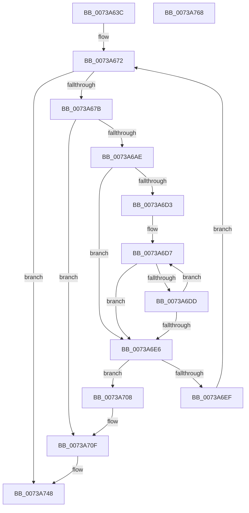

# PnprMmAddRange

- RVA: `0x0073A63C`–`0x0073A769` (길이 `301` bytes)
- VA: `0x000000014073A63C`
- 실행 섹션: `PAGE`
- PDB 이름 있음: `예`; PDB Function 태그: `아니요`
- unwind 정보 RVA: `0x00075C18`
- 디코드: `84`개 명령, `301/301` bytes 표시
- 미해석 바이트: `0` (있으면 어셈블리에 `.byte`로 보존)

> 이 문서는 커널 이미지의 기계어와 PDB 기호를 분석해 생성했습니다. 4번과 5번은 함수 원형과 자료형을 바이너리 사용 방식에서 추정한 C 해석이며 원본 소스 복구 결과는 아닙니다.

## 1. Dependencies

- 직접 호출 지점: **2**; 고유 호출 대상: **2**
- 직접 호출자로 확인된 함수: **1**
- RIP 상대 이미지 참조: **1**

### Outgoing calls
- `0x0073A6A1` → [ExAllocatePool2](../../poolcode/B8/ExAllocatePool2_function_00B820F0.md) (function, `0x00B820F0`)
- `0x0073A6C5` → [RtlSetAllBits](../../text/36/RtlSetAllBits_function_00362490.md) (function, `0x00362490`)

### Direct callers
- [PnprMmConstruct](PnprMmConstruct_function_0073A770.md) at `0x0073A7AF`

### Static image references
- `0x0073A70F` → RVA `0x00F8AC38` (`.data`; read)

## 2. Other-region calls and transfers

- 다른 실행 섹션으로 향하는 call: **2**
  - `0x0073A6A1` → [ExAllocatePool2](../../poolcode/B8/ExAllocatePool2_function_00B820F0.md) (`PAGE` → `POOLCODE`)
  - `0x0073A6C5` → [RtlSetAllBits](../../text/36/RtlSetAllBits_function_00362490.md) (`PAGE` → `.text`)
- 별도 외부 분기/꼬리 이동을 확인하지 못했습니다.

## 3. Assembly (complete function range)

```asm
0073A63C  48 89 5C 24 08                  mov qword ptr [rsp + 8], rbx
0073A641  48 89 6C 24 10                  mov qword ptr [rsp + 0x10], rbp
0073A646  48 89 74 24 18                  mov qword ptr [rsp + 0x18], rsi
0073A64B  57                              push rdi
0073A64C  41 54                           push r12
0073A64E  41 55                           push r13
0073A650  41 56                           push r14
0073A652  41 57                           push r15
0073A654  48 83 EC 20                     sub rsp, 0x20
0073A658  48 8B F2                        mov rsi, rdx
0073A65B  49 8B F8                        mov rdi, r8
0073A65E  48 C1 EE 0C                     shr rsi, 0xc
0073A662  45 33 FF                        xor r15d, r15d
0073A665  48 C1 EF 0C                     shr rdi, 0xc
0073A669  4C 8B F1                        mov r14, rcx
0073A66C  41 BD 00 00 00 80               mov r13d, 0x80000000
0073A672  48 85 FF                        test rdi, rdi
0073A675  0F 84 CD 00 00 00               je 0x14073a748
0073A67B  49 3B FD                        cmp rdi, r13
0073A67E  48 8B EF                        mov rbp, rdi
0073A681  B9 40 00 00 00                  mov ecx, 0x40
0073A686  41 B8 50 6E 70 52               mov r8d, 0x52706e50
0073A68C  49 0F 47 ED                     cmova rbp, r13
0073A690  44 8D 65 20                     lea r12d, [rbp + 0x20]
0073A694  41 83 E4 E0                     and r12d, 0xffffffe0
0073A698  41 8B D4                        mov edx, r12d
0073A69B  C1 EA 03                        shr edx, 3
0073A69E  83 C2 30                        add edx, 0x30
0073A6A1  E8 4A 7A 44 00                  call 0x140b820f0
0073A6A6  48 8B D8                        mov rbx, rax
0073A6A9  48 85 C0                        test rax, rax
0073A6AC  74 61                           je 0x14073a70f
0073A6AE  48 89 70 10                     mov qword ptr [rax + 0x10], rsi
0073A6B2  48 8D 48 20                     lea rcx, [rax + 0x20]
0073A6B6  48 89 68 18                     mov qword ptr [rax + 0x18], rbp
0073A6BA  48 83 C0 30                     add rax, 0x30
0073A6BE  48 89 41 08                     mov qword ptr [rcx + 8], rax
0073A6C2  44 89 21                        mov dword ptr [rcx], r12d
0073A6C5  E8 C6 7D C2 FF                  call 0x140362490
0073A6CA  49 8B 46 08                     mov rax, qword ptr [r14 + 8]
0073A6CE  49 3B C6                        cmp rax, r14
0073A6D1  74 13                           je 0x14073a6e6
0073A6D3  48 8B 4B 10                     mov rcx, qword ptr [rbx + 0x10]
0073A6D7  48 39 48 10                     cmp qword ptr [rax + 0x10], rcx
0073A6DB  72 09                           jb 0x14073a6e6
0073A6DD  48 8B 40 08                     mov rax, qword ptr [rax + 8]
0073A6E1  49 3B C6                        cmp rax, r14
0073A6E4  75 F1                           jne 0x14073a6d7
0073A6E6  48 8B 08                        mov rcx, qword ptr [rax]
0073A6E9  48 39 41 08                     cmp qword ptr [rcx + 8], rax
0073A6ED  75 19                           jne 0x14073a708
0073A6EF  48 89 0B                        mov qword ptr [rbx], rcx
0073A6F2  48 03 F5                        add rsi, rbp
0073A6F5  48 89 43 08                     mov qword ptr [rbx + 8], rax
0073A6F9  48 2B FD                        sub rdi, rbp
0073A6FC  48 89 59 08                     mov qword ptr [rcx + 8], rbx
0073A700  48 89 18                        mov qword ptr [rax], rbx
0073A703  E9 6A FF FF FF                  jmp 0x14073a672
0073A708  B9 03 00 00 00                  mov ecx, 3
0073A70D  CD 29                           int 0x29
0073A70F  48 8B 15 22 05 85 00            mov rdx, qword ptr [rip + 0x850522]
0073A716  B8 16 11 00 00                  mov eax, 0x1116
0073A71B  41 BF 9A 00 00 C0               mov r15d, 0xc000009a
0073A721  8B 8A 08 82 00 00               mov ecx, dword ptr [rdx + 0x8208]
0073A727  85 C9                           test ecx, ecx
0073A729  0F 44 C8                        cmove ecx, eax
0073A72C  B8 0A 00 00 00                  mov eax, 0xa
0073A731  89 8A 08 82 00 00               mov dword ptr [rdx + 0x8208], ecx
0073A737  8B 8A 0C 82 00 00               mov ecx, dword ptr [rdx + 0x820c]
0073A73D  85 C9                           test ecx, ecx
0073A73F  0F 44 C8                        cmove ecx, eax
0073A742  89 8A 0C 82 00 00               mov dword ptr [rdx + 0x820c], ecx
0073A748  48 8B 5C 24 50                  mov rbx, qword ptr [rsp + 0x50]
0073A74D  41 8B C7                        mov eax, r15d
0073A750  48 8B 6C 24 58                  mov rbp, qword ptr [rsp + 0x58]
0073A755  48 8B 74 24 60                  mov rsi, qword ptr [rsp + 0x60]
0073A75A  48 83 C4 20                     add rsp, 0x20
0073A75E  41 5F                           pop r15
0073A760  41 5E                           pop r14
0073A762  41 5D                           pop r13
0073A764  41 5C                           pop r12
0073A766  5F                              pop rdi
0073A767  C3                              ret
0073A768  CC                              int3
```

## 4. C-style interpretation (structured pseudocode)

```c
__int64 __fastcall PnprMmAddRange(__int64 a1, __int64 a2, __int64 a3)
{
    __int64 result;
    __int64 v_r12;
    __int64 v_r15;
    __int64 v_rbp;
    __int64 v_rdi;
    __int64 v_rsi;
    __int64 v_rsp;
    unsigned __int64 v_stack_p10;
    unsigned __int64 v_stack_p18;
    unsigned __int64 v_stack_p8;

    v_stack_p8 = v_rbx;
    v_stack_p10 = v_rbp;
    v_stack_p18 = v_rsi;
    v_rsp = (v_rsp) - (32);
    v_rsi = (a2) >> (12);
    v_r15 = 0;
    v_rdi = (a3) >> (12);
loc_0073A672:
    if (v_rdi == 0) goto loc_0073A748;
    v_rbp = v_rdi;
    if (v_rdi > ((unsigned int)(0x80000000ULL))) { v_rbp = (unsigned int)(0x80000000ULL); }
    v_r12 = (unsigned int)((v_rbp + 32) & (0xFFFFFFE0ULL));
    a2 = (unsigned int)(((unsigned int)((unsigned int)(v_r12))) >> (3));
    a2 = (unsigned int)((a2) + (48));
    result = ExAllocatePool2(64, a2, (unsigned int)(0x52706E50ULL), a4);
    if (result == 0) goto loc_0073A70F;
    *(unsigned __int64 *)(result + 16) = v_rsi;
    *(unsigned __int64 *)(result + 24) = v_rbp;
    result = (result) + (48);
    *(unsigned __int64 *)(result + 32 + 8) = result;
    *(unsigned int *)(result + 32) = (unsigned int)(v_r12);
    result = RtlSetAllBits(result + 32, a2, (unsigned int)(0x52706E50ULL), a4);
    if ((*(unsigned __int64 *)(a1 + 8)) == a1) goto loc_0073A6E6;
loc_0073A6D7:
    if ((*(unsigned __int64 *)(*(unsigned __int64 *)(a1 + 8) + 16)) < (*(unsigned __int64 *)(result + 16))) goto loc_0073A6E6;
    if ((*(unsigned __int64 *)(*(unsigned __int64 *)(a1 + 8) + 8)) != a1) goto loc_0073A6D7;
loc_0073A6E6:
    if ((*(unsigned __int64 *)(*(unsigned __int64 *)(*(unsigned __int64 *)(*(unsigned __int64 *)(a1 + 8) + 8)) + 8)) != (*(unsigned __int64 *)(*(unsigned __int64 *)(a1 + 8) + 8))) goto loc_0073A708;
    *(unsigned __int64 *)(result) = *(unsigned __int64 *)(*(unsigned __int64 *)(*(unsigned __int64 *)(a1 + 8) + 8));
    v_rsi = (v_rsi) + (v_rbp);
    *(unsigned __int64 *)(result + 8) = *(unsigned __int64 *)(*(unsigned __int64 *)(a1 + 8) + 8);
    v_rdi = (v_rdi) - (v_rbp);
    *(unsigned __int64 *)(*(unsigned __int64 *)(*(unsigned __int64 *)(*(unsigned __int64 *)(a1 + 8) + 8)) + 8) = result;
    *(unsigned __int64 *)(*(unsigned __int64 *)(*(unsigned __int64 *)(a1 + 8) + 8)) = result;
    goto loc_0073A672;
loc_0073A708:
loc_0073A70F:
    a1 = (unsigned int)(*(unsigned int *)(*(unsigned __int64 *)(v_rip + 8717602) + 33288));
    if ((unsigned int)((unsigned int)(*(unsigned int *)(*(unsigned __int64 *)(v_rip + 8717602) + 33288))) == 0) { a1 = (unsigned int)((unsigned int)(0x1116ULL)); }
    *(unsigned int *)(*(unsigned __int64 *)(v_rip + 8717602) + 33288) = (unsigned int)(a1);
    a1 = (unsigned int)(*(unsigned int *)(*(unsigned __int64 *)(v_rip + 8717602) + 33292));
    if ((unsigned int)((unsigned int)(*(unsigned int *)(*(unsigned __int64 *)(v_rip + 8717602) + 33292))) == 0) { a1 = 10; }
    *(unsigned int *)(*(unsigned __int64 *)(v_rip + 8717602) + 33292) = (unsigned int)(a1);
loc_0073A748:
    v_rsp = (v_rsp) + (32);
    return (unsigned int)((unsigned int)((unsigned int)(0xC000009AULL)));
}
```

## 5. (Beta) C Style

```c
int64_t PnprMmAddRange(void *Arg1, int64_t Arg2, int64_t Arg3)
{
    uint8_t *arg1 = (uint8_t *)Arg1;

    int64_t result;
    int64_t local_r12;
    int64_t local_r15;
    int64_t local_rbp;
    int64_t local_rdi;
    int64_t local_rsi;
    int64_t local_rsp;
    uint64_t v_stack_p10;
    uint64_t v_stack_p18;
    uint64_t v_stack_p8;

    v_stack_p8 = local_rbx;
    v_stack_p10 = local_rbp;
    v_stack_p18 = local_rsi;
    local_rsp = (local_rsp) - (32);
    local_rsi = (Arg2) >> (12);
    local_r15 = 0;
    local_rdi = (Arg3) >> (12);
loc_0073A672:
    if (local_rdi == 0) goto loc_0073A748;
    local_rbp = local_rdi;
    if (local_rdi > ((uint32_t)(0x80000000ULL))) { local_rbp = (uint32_t)(0x80000000ULL); }
    local_r12 = (uint32_t)((local_rbp + 32) & (0xFFFFFFE0ULL));
    Arg2 = (uint32_t)(((uint32_t)((uint32_t)(local_r12))) >> (3));
    Arg2 = (uint32_t)((Arg2) + (48));
    result = ExAllocatePool2(64, Arg2, (uint32_t)(0x52706E50ULL), a4);
    if (result == 0) goto loc_0073A70F;
    *(uint64_t *)(result + 0x10) = local_rsi;
    *(uint64_t *)(result + 0x18) = local_rbp;
    result = (result) + (48);
    *(uint64_t *)(result + 0x20 + 0x8) = result;
    *(uint32_t *)(result + 0x20) = (uint32_t)(local_r12);
    result = RtlSetAllBits(result + 32, Arg2, (uint32_t)(0x52706E50ULL), a4);
    if ((*(uint64_t *)(arg1 + 0x8)) == Arg1) goto loc_0073A6E6;
loc_0073A6D7:
    if ((*(uint64_t *)(*(uint64_t *)(arg1 + 0x8) + 0x10)) < (*(uint64_t *)(result + 0x10))) goto loc_0073A6E6;
    if ((*(uint64_t *)(*(uint64_t *)(arg1 + 0x8) + 0x8)) != Arg1) goto loc_0073A6D7;
loc_0073A6E6:
    if ((*(uint64_t *)(*(uint64_t *)(*(uint64_t *)(*(uint64_t *)(arg1 + 0x8) + 0x8)) + 0x8)) != (*(uint64_t *)(*(uint64_t *)(arg1 + 0x8) + 0x8))) goto loc_0073A708;
    *(uint64_t *)(result) = *(uint64_t *)(*(uint64_t *)(*(uint64_t *)(arg1 + 0x8) + 0x8));
    local_rsi = (local_rsi) + (local_rbp);
    *(uint64_t *)(result + 0x8) = *(uint64_t *)(*(uint64_t *)(arg1 + 0x8) + 0x8);
    local_rdi = (local_rdi) - (local_rbp);
    *(uint64_t *)(*(uint64_t *)(*(uint64_t *)(*(uint64_t *)(arg1 + 0x8) + 0x8)) + 0x8) = result;
    *(uint64_t *)(*(uint64_t *)(*(uint64_t *)(arg1 + 0x8) + 0x8)) = result;
    goto loc_0073A672;
loc_0073A708:
loc_0073A70F:
    Arg1 = (uint32_t)(*(uint32_t *)(*(uint64_t *)(v_rip + 0x850522) + 0x8208));
    if ((uint32_t)((uint32_t)(*(uint32_t *)(*(uint64_t *)(v_rip + 0x850522) + 0x8208))) == 0) { Arg1 = (uint32_t)((uint32_t)(0x1116ULL)); }
    *(uint32_t *)(*(uint64_t *)(v_rip + 0x850522) + 0x8208) = (uint32_t)(Arg1);
    Arg1 = (uint32_t)(*(uint32_t *)(*(uint64_t *)(v_rip + 0x850522) + 0x820C));
    if ((uint32_t)((uint32_t)(*(uint32_t *)(*(uint64_t *)(v_rip + 0x850522) + 0x820C))) == 0) { Arg1 = 10; }
    *(uint32_t *)(*(uint64_t *)(v_rip + 0x850522) + 0x820C) = (uint32_t)(Arg1);
loc_0073A748:
    local_rsp = (local_rsp) + (32);
    return (uint32_t)((uint32_t)((uint32_t)(0xC000009AULL)));
}
```

### 관측된 메모리 오프셋

구조체 형식이 확인되지 않은 접근은 인자 기준의 오프셋으로만 기록했습니다.

| 기준 인자 | 오프셋 표현 | 폭 (bit) | 접근 |
|---|---:|---:|---|
| `Arg1` | `+ 0x8` | `64` | `R` |

## 6. Execution-region graph

[열기: 2D/3D 그래프와 함수 탐색 컨트롤 패널](../../../control-panel.html?section=page&rva=0x0073A63C&view=graph)

- 2D 그래프는 위에서 아래로 흐르고, 3D 그래프는 빈 공간을 드래그해 회전합니다. Shift+드래그는 이동, 휠은 확대·축소, 함수 노드 선택은 대상 보고서 이동입니다.

### Static fallback


