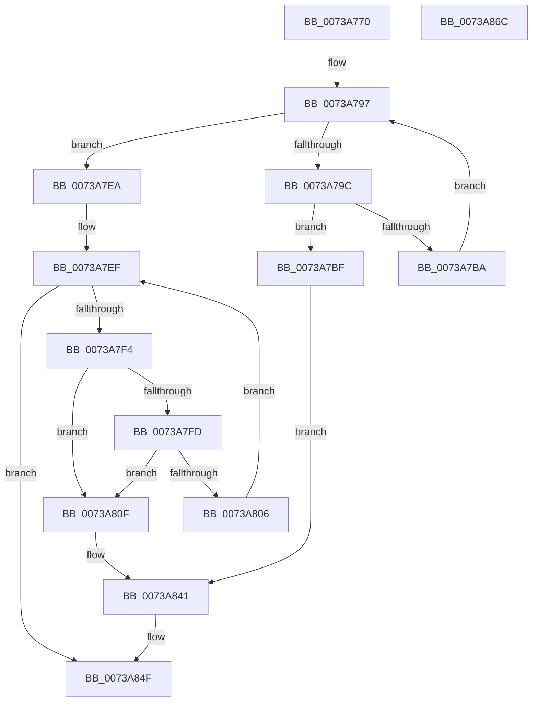

# PnprMmConstruct

- RVA: `0x0073A770`–`0x0073A86D` (길이 `253` bytes)
- VA: `0x000000014073A770`
- 실행 섹션: `PAGE`
- PDB 이름 있음: `예`; PDB Function 태그: `아니요`
- unwind 정보 RVA: `0x0005E6B4`
- 디코드: `71`개 명령, `253/253` bytes 표시
- 미해석 바이트: `0` (있으면 어셈블리에 `.byte`로 보존)

> 이 문서는 커널 이미지의 기계어와 PDB 기호를 분석해 생성했습니다. 4번과 5번은 함수 원형과 자료형을 바이너리 사용 방식에서 추정한 C 해석이며 원본 소스 복구 결과는 아닙니다.

## 1. Dependencies

- 직접 호출 지점: **2**; 고유 호출 대상: **2**
- 직접 호출자로 확인된 함수: **1**
- RIP 상대 이미지 참조: **1**

### Outgoing calls
- `0x0073A7AF` → [PnprMmAddRange](PnprMmAddRange_function_0073A63C.md) (function, `0x0073A63C`)
- `0x0073A84A` → [PnprMmFree](PnprMmFree_function_0073A874.md) (function, `0x0073A874`)

### Direct callers
- [PnpReplacePartitionUnit](PnpReplacePartitionUnit_function_00738550.md) at `0x00738C80`

### Static image references
- `0x0073A7BF` → RVA `0x00F8AC38` (`.data`; read)

## 2. Other-region calls and transfers

- 다른 실행 섹션으로 향하는 call: **0**
- 별도 외부 분기/꼬리 이동을 확인하지 못했습니다.

## 3. Assembly (complete function range)

```asm
0073A770  48 8B C4                        mov rax, rsp
0073A773  48 89 58 08                     mov qword ptr [rax + 8], rbx
0073A777  48 89 68 10                     mov qword ptr [rax + 0x10], rbp
0073A77B  48 89 70 18                     mov qword ptr [rax + 0x18], rsi
0073A77F  48 89 78 20                     mov qword ptr [rax + 0x20], rdi
0073A783  41 56                           push r14
0073A785  48 83 EC 20                     sub rsp, 0x20
0073A789  33 DB                           xor ebx, ebx
0073A78B  48 8B F2                        mov rsi, rdx
0073A78E  48 8B E9                        mov rbp, rcx
0073A791  33 FF                           xor edi, edi
0073A793  44 8D 73 01                     lea r14d, [rbx + 1]
0073A797  3B 7D 04                        cmp edi, dword ptr [rbp + 4]
0073A79A  73 4E                           jae 0x14073a7ea
0073A79C  44 8B C7                        mov r8d, edi
0073A79F  48 8B CE                        mov rcx, rsi
0073A7A2  4D 03 C0                        add r8, r8
0073A7A5  4A 8B 54 C5 10                  mov rdx, qword ptr [rbp + r8*8 + 0x10]
0073A7AA  4E 8B 44 C5 18                  mov r8, qword ptr [rbp + r8*8 + 0x18]
0073A7AF  E8 88 FE FF FF                  call 0x14073a63c
0073A7B4  8B D8                           mov ebx, eax
0073A7B6  85 C0                           test eax, eax
0073A7B8  78 05                           js 0x14073a7bf
0073A7BA  41 03 FE                        add edi, r14d
0073A7BD  EB D8                           jmp 0x14073a797
0073A7BF  48 8B 0D 72 04 85 00            mov rcx, qword ptr [rip + 0x850472]
0073A7C6  BA 98 11 00 00                  mov edx, 0x1198
0073A7CB  8B 81 08 82 00 00               mov eax, dword ptr [rcx + 0x8208]
0073A7D1  85 C0                           test eax, eax
0073A7D3  0F 44 C2                        cmove eax, edx
0073A7D6  89 81 08 82 00 00               mov dword ptr [rcx + 0x8208], eax
0073A7DC  8B 81 0C 82 00 00               mov eax, dword ptr [rcx + 0x820c]
0073A7E2  85 C0                           test eax, eax
0073A7E4  41 0F 44 C6                     cmove eax, r14d
0073A7E8  EB 57                           jmp 0x14073a841
0073A7EA  48 8B 06                        mov rax, qword ptr [rsi]
0073A7ED  33 D2                           xor edx, edx
0073A7EF  48 3B C6                        cmp rax, rsi
0073A7F2  74 5B                           je 0x14073a84f
0073A7F4  48 8B 48 18                     mov rcx, qword ptr [rax + 0x18]
0073A7F8  48 85 C9                        test rcx, rcx
0073A7FB  74 12                           je 0x14073a80f
0073A7FD  4C 8B 40 10                     mov r8, qword ptr [rax + 0x10]
0073A801  4C 3B C2                        cmp r8, rdx
0073A804  72 09                           jb 0x14073a80f
0073A806  48 8B 00                        mov rax, qword ptr [rax]
0073A809  49 8D 14 08                     lea rdx, [r8 + rcx]
0073A80D  EB E0                           jmp 0x14073a7ef
0073A80F  48 8B 0D 22 04 85 00            mov rcx, qword ptr [rip + 0x850422]
0073A816  BA AD 11 00 00                  mov edx, 0x11ad
0073A81B  BB 0D 00 00 C0                  mov ebx, 0xc000000d
0073A820  8B 81 08 82 00 00               mov eax, dword ptr [rcx + 0x8208]
0073A826  85 C0                           test eax, eax
0073A828  0F 44 C2                        cmove eax, edx
0073A82B  BA 06 00 00 00                  mov edx, 6
0073A830  89 81 08 82 00 00               mov dword ptr [rcx + 0x8208], eax
0073A836  8B 81 0C 82 00 00               mov eax, dword ptr [rcx + 0x820c]
0073A83C  85 C0                           test eax, eax
0073A83E  0F 44 C2                        cmove eax, edx
0073A841  89 81 0C 82 00 00               mov dword ptr [rcx + 0x820c], eax
0073A847  48 8B CE                        mov rcx, rsi
0073A84A  E8 25 00 00 00                  call 0x14073a874
0073A84F  48 8B 6C 24 38                  mov rbp, qword ptr [rsp + 0x38]
0073A854  8B C3                           mov eax, ebx
0073A856  48 8B 5C 24 30                  mov rbx, qword ptr [rsp + 0x30]
0073A85B  48 8B 74 24 40                  mov rsi, qword ptr [rsp + 0x40]
0073A860  48 8B 7C 24 48                  mov rdi, qword ptr [rsp + 0x48]
0073A865  48 83 C4 20                     add rsp, 0x20
0073A869  41 5E                           pop r14
0073A86B  C3                              ret
0073A86C  CC                              int3
```

## 4. C-style interpretation (structured pseudocode)

```c
__int64 __fastcall PnprMmConstruct(__int64 a1, __int64 a2)
{
    __int64 result;
    __int64 v_rbx;
    __int64 v_rdi;
    __int64 v_rsp;
    unsigned __int64 v_stack_p10;
    unsigned __int64 v_stack_p18;
    unsigned __int64 v_stack_p20;
    unsigned __int64 v_stack_p8;

    *(unsigned __int64 *)(v_rsp + 8) = v_rbx;
    *(unsigned __int64 *)(v_rsp + 16) = v_rbp;
    *(unsigned __int64 *)(v_rsp + 24) = v_rsi;
    *(unsigned __int64 *)(v_rsp + 32) = v_rdi;
    v_rsp = (v_rsp) - (32);
    v_rbx = 0;
    v_rdi = 0;
loc_0073A797:
    if (0 >= (*(unsigned int *)(a1 + 4))) goto loc_0073A7EA;
    a3 = (0) + (0);
    result = PnprMmAddRange(a2, *(unsigned __int64 *)(a1 + a3 * 8 + 16), *(unsigned __int64 *)(a1 + a3 * 8 + 24), a4);
    if (sign_flag) goto loc_0073A7BF;
    v_rdi = (unsigned int)((v_rdi) + ((unsigned int)(v_rbx + 1)));
    goto loc_0073A797;
loc_0073A7BF:
    result = (unsigned int)(*(unsigned int *)(*(unsigned __int64 *)(v_rip + 8717426) + 33288));
    if ((unsigned int)((unsigned int)(*(unsigned int *)(*(unsigned __int64 *)(v_rip + 8717426) + 33288))) == 0) { result = (unsigned int)((unsigned int)(0x1198ULL)); }
    *(unsigned int *)(*(unsigned __int64 *)(v_rip + 8717426) + 33288) = (unsigned int)(result);
    result = (unsigned int)(*(unsigned int *)(*(unsigned __int64 *)(v_rip + 8717426) + 33292));
    if ((unsigned int)((unsigned int)(*(unsigned int *)(*(unsigned __int64 *)(v_rip + 8717426) + 33292))) == 0) { result = (unsigned int)(v_rbx + 1); }
    goto loc_0073A841;
loc_0073A7EA:
    a2 = 0;
loc_0073A7EF:
    if ((*(unsigned __int64 *)(a2)) == 0) goto loc_0073A84F;
    if (*(unsigned __int64 *)(*(unsigned __int64 *)(a2) + 24) == 0) goto loc_0073A80F;
    if ((*(unsigned __int64 *)(*(unsigned __int64 *)(a2) + 16)) < 0) goto loc_0073A80F;
    goto loc_0073A7EF;
loc_0073A80F:
    result = (unsigned int)(*(unsigned int *)(*(unsigned __int64 *)(v_rip + 8717346) + 33288));
    if ((unsigned int)((unsigned int)(*(unsigned int *)(*(unsigned __int64 *)(v_rip + 8717346) + 33288))) == 0) { result = (unsigned int)((unsigned int)(0x11ADULL)); }
    *(unsigned int *)(*(unsigned __int64 *)(v_rip + 8717346) + 33288) = (unsigned int)(result);
    result = (unsigned int)(*(unsigned int *)(*(unsigned __int64 *)(v_rip + 8717346) + 33292));
    if ((unsigned int)((unsigned int)(*(unsigned int *)(*(unsigned __int64 *)(v_rip + 8717346) + 33292))) == 0) { result = 6; }
loc_0073A841:
    *(unsigned int *)(*(unsigned __int64 *)(v_rip + 8717346) + 33292) = (unsigned int)(result);
    result = PnprMmFree(0, 6, *(unsigned __int64 *)(*(unsigned __int64 *)(a2) + 16), a4);
loc_0073A84F:
    v_rsp = (v_rsp) + (32);
    return (unsigned int)((unsigned int)((unsigned int)(0xC000000DULL)));
}
```

## 5. (Beta) C Style

```c
int64_t PnprMmConstruct(void *Arg1, void *Arg2)
{
    uint8_t *arg1 = (uint8_t *)Arg1;
    uint8_t *arg2 = (uint8_t *)Arg2;

    int64_t result;
    int64_t local_rbx;
    int64_t local_rdi;
    int64_t local_rsp;
    uint64_t v_stack_p10;
    uint64_t v_stack_p18;
    uint64_t v_stack_p20;
    uint64_t v_stack_p8;

    *(uint64_t *)(local_rsp + 0x8) = local_rbx;
    *(uint64_t *)(local_rsp + 0x10) = local_rbp;
    *(uint64_t *)(local_rsp + 0x18) = local_rsi;
    *(uint64_t *)(local_rsp + 0x20) = local_rdi;
    local_rsp = (local_rsp) - (32);
    local_rbx = 0;
    local_rdi = 0;
loc_0073A797:
    if (0 >= (*(uint32_t *)(arg1 + 0x4))) goto loc_0073A7EA;
    a3 = (0) + (0);
    result = PnprMmAddRange(Arg2, *(uint64_t *)(arg1 + a3 * 8 + 0x10), *(uint64_t *)(arg1 + a3 * 8 + 0x18), a4);
    if (sign_flag) goto loc_0073A7BF;
    local_rdi = (uint32_t)((local_rdi) + ((uint32_t)(local_rbx + 1)));
    goto loc_0073A797;
loc_0073A7BF:
    result = (uint32_t)(*(uint32_t *)(*(uint64_t *)(v_rip + 0x850472) + 0x8208));
    if ((uint32_t)((uint32_t)(*(uint32_t *)(*(uint64_t *)(v_rip + 0x850472) + 0x8208))) == 0) { result = (uint32_t)((uint32_t)(0x1198ULL)); }
    *(uint32_t *)(*(uint64_t *)(v_rip + 0x850472) + 0x8208) = (uint32_t)(result);
    result = (uint32_t)(*(uint32_t *)(*(uint64_t *)(v_rip + 0x850472) + 0x820C));
    if ((uint32_t)((uint32_t)(*(uint32_t *)(*(uint64_t *)(v_rip + 0x850472) + 0x820C))) == 0) { result = (uint32_t)(local_rbx + 1); }
    goto loc_0073A841;
loc_0073A7EA:
    Arg2 = 0;
loc_0073A7EF:
    if ((*(uint64_t *)(arg2)) == 0) goto loc_0073A84F;
    if (*(uint64_t *)(*(uint64_t *)(arg2) + 0x18) == 0) goto loc_0073A80F;
    if ((*(uint64_t *)(*(uint64_t *)(arg2) + 0x10)) < 0) goto loc_0073A80F;
    goto loc_0073A7EF;
loc_0073A80F:
    result = (uint32_t)(*(uint32_t *)(*(uint64_t *)(v_rip + 0x850422) + 0x8208));
    if ((uint32_t)((uint32_t)(*(uint32_t *)(*(uint64_t *)(v_rip + 0x850422) + 0x8208))) == 0) { result = (uint32_t)((uint32_t)(0x11ADULL)); }
    *(uint32_t *)(*(uint64_t *)(v_rip + 0x850422) + 0x8208) = (uint32_t)(result);
    result = (uint32_t)(*(uint32_t *)(*(uint64_t *)(v_rip + 0x850422) + 0x820C));
    if ((uint32_t)((uint32_t)(*(uint32_t *)(*(uint64_t *)(v_rip + 0x850422) + 0x820C))) == 0) { result = 6; }
loc_0073A841:
    *(uint32_t *)(*(uint64_t *)(v_rip + 0x850422) + 0x820C) = (uint32_t)(result);
    result = PnprMmFree(0, 6, *(uint64_t *)(*(uint64_t *)(arg2) + 0x10), a4);
loc_0073A84F:
    local_rsp = (local_rsp) + (32);
    return (uint32_t)((uint32_t)((uint32_t)(0xC000000DULL)));
}
```

### 관측된 메모리 오프셋

구조체 형식이 확인되지 않은 접근은 인자 기준의 오프셋으로만 기록했습니다.

| 기준 인자 | 오프셋 표현 | 폭 (bit) | 접근 |
|---|---:|---:|---|
| `Arg1` | `+ 0x4` | `32` | `R` |
| `Arg1` | `+ 0x10 + r8*8` | `64` | `R` |
| `Arg1` | `+ 0x18 + r8*8` | `64` | `R` |
| `Arg2` | `+ 0x0` | `64` | `R` |

## 6. Execution-region graph

[열기: 2D/3D 그래프와 함수 탐색 컨트롤 패널](../../../control-panel.html?section=page&rva=0x0073A770&view=graph)

- 2D 그래프는 위에서 아래로 흐르고, 3D 그래프는 빈 공간을 드래그해 회전합니다. Shift+드래그는 이동, 휠은 확대·축소, 함수 노드 선택은 대상 보고서 이동입니다.

### Static fallback


