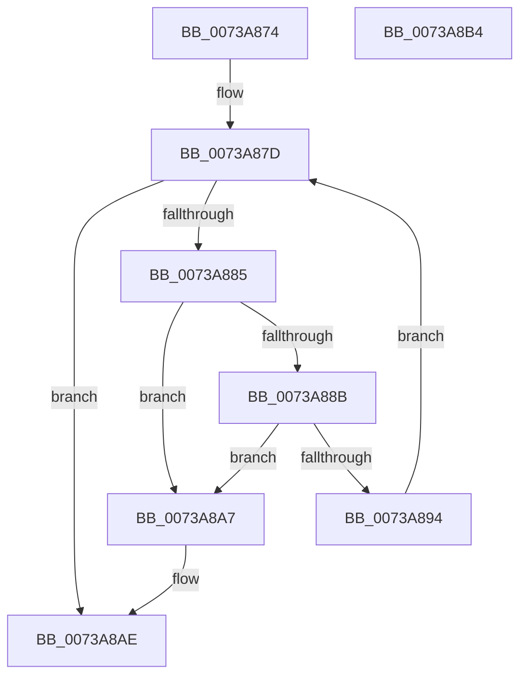

# PnprMmFree

- RVA: `0x0073A874`–`0x0073A8B5` (길이 `65` bytes)
- VA: `0x000000014073A874`
- 실행 섹션: `PAGE`
- PDB 이름 있음: `예`; PDB Function 태그: `아니요`
- unwind 정보 RVA: `0x0005CF00`
- 디코드: `22`개 명령, `65/65` bytes 표시
- 미해석 바이트: `0` (있으면 어셈블리에 `.byte`로 보존)

> 이 문서는 커널 이미지의 기계어와 PDB 기호를 분석해 생성했습니다. 4번과 5번은 함수 원형과 자료형을 바이너리 사용 방식에서 추정한 C 해석이며 원본 소스 복구 결과는 아닙니다.

## 1. Dependencies

- 직접 호출 지점: **1**; 고유 호출 대상: **1**
- 직접 호출자로 확인된 함수: **2**
- RIP 상대 이미지 참조: **0**

### Outgoing calls
- `0x0073A8A0` → [ExFreePoolWithTag](../../poolcode/B8/ExFreePoolWithTag_function_00B82870.md) (function, `0x00B82870`)

### Direct callers
- [PnpReplacePartitionUnit](PnpReplacePartitionUnit_function_00738550.md) at `0x00738F6E`
- [PnprMmConstruct](PnprMmConstruct_function_0073A770.md) at `0x0073A84A`

### Static image references
- 디코드된 RIP-relative 메모리 참조가 없습니다.

## 2. Other-region calls and transfers

- 다른 실행 섹션으로 향하는 call: **1**
  - `0x0073A8A0` → [ExFreePoolWithTag](../../poolcode/B8/ExFreePoolWithTag_function_00B82870.md) (`PAGE` → `POOLCODE`)
- 별도 외부 분기/꼬리 이동을 확인하지 못했습니다.

## 3. Assembly (complete function range)

```asm
0073A874  40 53                           push rbx
0073A876  48 83 EC 20                     sub rsp, 0x20
0073A87A  48 8B D9                        mov rbx, rcx
0073A87D  48 8B 0B                        mov rcx, qword ptr [rbx]
0073A880  48 3B CB                        cmp rcx, rbx
0073A883  74 29                           je 0x14073a8ae
0073A885  48 39 59 08                     cmp qword ptr [rcx + 8], rbx
0073A889  75 1C                           jne 0x14073a8a7
0073A88B  48 8B 01                        mov rax, qword ptr [rcx]
0073A88E  48 39 48 08                     cmp qword ptr [rax + 8], rcx
0073A892  75 13                           jne 0x14073a8a7
0073A894  48 89 03                        mov qword ptr [rbx], rax
0073A897  BA 50 6E 70 52                  mov edx, 0x52706e50
0073A89C  48 89 58 08                     mov qword ptr [rax + 8], rbx
0073A8A0  E8 CB 7F 44 00                  call 0x140b82870
0073A8A5  EB D6                           jmp 0x14073a87d
0073A8A7  B9 03 00 00 00                  mov ecx, 3
0073A8AC  CD 29                           int 0x29
0073A8AE  48 83 C4 20                     add rsp, 0x20
0073A8B2  5B                              pop rbx
0073A8B3  C3                              ret
0073A8B4  CC                              int3
```

## 4. C-style interpretation (structured pseudocode)

```c
__int64 __fastcall PnprMmFree(__int64 a1)
{
    __int64 result;
    __int64 v_rsp;

    v_rsp = (v_rsp) - (32);
loc_0073A87D:
    if ((*(unsigned __int64 *)(a1)) == a1) goto loc_0073A8AE;
    if ((*(unsigned __int64 *)(*(unsigned __int64 *)(a1) + 8)) != a1) goto loc_0073A8A7;
    if ((*(unsigned __int64 *)(*(unsigned __int64 *)(*(unsigned __int64 *)(a1)) + 8)) != (*(unsigned __int64 *)(a1))) goto loc_0073A8A7;
    *(unsigned __int64 *)(a1) = *(unsigned __int64 *)(*(unsigned __int64 *)(a1));
    *(unsigned __int64 *)(*(unsigned __int64 *)(*(unsigned __int64 *)(a1)) + 8) = a1;
    result = ExFreePoolWithTag(*(unsigned __int64 *)(a1), (unsigned int)(0x52706E50ULL), a3, a4);
    goto loc_0073A87D;
loc_0073A8A7:
loc_0073A8AE:
    v_rsp = (v_rsp) + (32);
    return result;
}
```

## 5. (Beta) C Style

```c
int64_t PnprMmFree(void *Arg1)
{
    uint8_t *arg1 = (uint8_t *)Arg1;

    int64_t result;
    int64_t local_rsp;

    local_rsp = (local_rsp) - (32);
loc_0073A87D:
    if ((*(uint64_t *)(arg1)) == Arg1) goto loc_0073A8AE;
    if ((*(uint64_t *)(*(uint64_t *)(arg1) + 0x8)) != Arg1) goto loc_0073A8A7;
    if ((*(uint64_t *)(*(uint64_t *)(*(uint64_t *)(arg1)) + 0x8)) != (*(uint64_t *)(arg1))) goto loc_0073A8A7;
    *(uint64_t *)(arg1) = *(uint64_t *)(*(uint64_t *)(arg1));
    *(void **)(*(uint64_t *)(*(uint64_t *)(arg1)) + 0x8) = Arg1;
    result = ExFreePoolWithTag(*(uint64_t *)(arg1), (uint32_t)(0x52706E50ULL), a3, a4);
    goto loc_0073A87D;
loc_0073A8A7:
loc_0073A8AE:
    local_rsp = (local_rsp) + (32);
    return result;
}
```

### 관측된 메모리 오프셋

구조체 형식이 확인되지 않은 접근은 인자 기준의 오프셋으로만 기록했습니다.

| 기준 인자 | 오프셋 표현 | 폭 (bit) | 접근 |
|---|---:|---:|---|
| `Arg1` | `+ 0x0` | `64` | `R` |
| `Arg1` | `+ 0x0` | `64` | `W` |

## 6. Execution-region graph

[열기: 2D/3D 그래프와 함수 탐색 컨트롤 패널](../../../control-panel.html?section=page&rva=0x0073A874&view=graph)

- 2D 그래프는 위에서 아래로 흐르고, 3D 그래프는 빈 공간을 드래그해 회전합니다. Shift+드래그는 이동, 휠은 확대·축소, 함수 노드 선택은 대상 보고서 이동입니다.

### Static fallback


