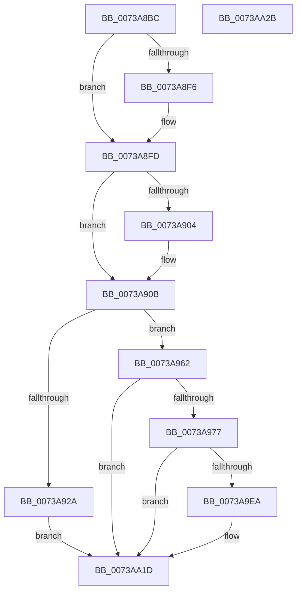

# PnprReplaceStart

- RVA: `0x0073A8BC`–`0x0073AA2C` (길이 `368` bytes)
- VA: `0x000000014073A8BC`
- 실행 섹션: `PAGE`
- PDB 이름 있음: `예`; PDB Function 태그: `아니요`
- unwind 정보 RVA: `0x000718C0`
- 디코드: `89`개 명령, `368/368` bytes 표시
- 미해석 바이트: `0` (있으면 어셈블리에 `.byte`로 보존)

> 이 문서는 커널 이미지의 기계어와 PDB 기호를 분석해 생성했습니다. 4번과 5번은 함수 원형과 자료형을 바이너리 사용 방식에서 추정한 C 해석이며 원본 소스 복구 결과는 아닙니다.

## 1. Dependencies

- 직접 호출 지점: **3**; 고유 호출 대상: **2**
- 직접 호출자로 확인된 함수: **1**
- RIP 상대 이미지 참조: **3**

### Outgoing calls
- `0x0073A91E` → [guard_dispatch_icall](../../text/6B/guard_dispatch_icall_function_006BAAD0.md) (function, `0x006BAAD0`)
- `0x0073A980` → [memset](../../text/6C/memset_function_006C6C40.md) (function, `0x006C6C40`)
- `0x0073A9DE` → [guard_dispatch_icall](../../text/6B/guard_dispatch_icall_function_006BAAD0.md) (function, `0x006BAAD0`)

### Direct callers
- [PnprInitiateReplaceOperation](../../pagelk/B6/PnprInitiateReplaceOperation_function_00B64034.md) at `0x00B64147`

### Static image references
- `0x0073A8C8` → RVA `0x00F8AC38` (`.data`; read)
- `0x0073A90B` → RVA `0x00E008D8` (`.data`; read)
- `0x0073A9CC` → RVA `0x00B64590` (`PnprMapTargetSparePhysicalPages`; read)

## 2. Other-region calls and transfers

- 다른 실행 섹션으로 향하는 call: **3**
  - `0x0073A91E` → [guard_dispatch_icall](../../text/6B/guard_dispatch_icall_function_006BAAD0.md) (`PAGE` → `.text`)
  - `0x0073A980` → [memset](../../text/6C/memset_function_006C6C40.md) (`PAGE` → `.text`)
  - `0x0073A9DE` → [guard_dispatch_icall](../../text/6B/guard_dispatch_icall_function_006BAAD0.md) (`PAGE` → `.text`)
- 별도 외부 분기/꼬리 이동을 확인하지 못했습니다.

## 3. Assembly (complete function range)

```asm
0073A8BC  4C 8B DC                        mov r11, rsp
0073A8BF  49 89 5B 08                     mov qword ptr [r11 + 8], rbx
0073A8C3  57                              push rdi
0073A8C4  48 83 EC 40                     sub rsp, 0x40
0073A8C8  48 8B 15 69 03 85 00            mov rdx, qword ptr [rip + 0x850369]
0073A8CF  49 83 63 D8 00                  and qword ptr [r11 - 0x28], 0
0073A8D4  48 8B 42 10                     mov rax, qword ptr [rdx + 0x10]
0073A8D8  48 8D 7A 48                     lea rdi, [rdx + 0x48]
0073A8DC  49 89 43 E0                     mov qword ptr [r11 - 0x20], rax
0073A8E0  48 8B 42 30                     mov rax, qword ptr [rdx + 0x30]
0073A8E4  49 89 43 E8                     mov qword ptr [r11 - 0x18], rax
0073A8E8  8B 82 B0 81 00 00               mov eax, dword ptr [rdx + 0x81b0]
0073A8EE  8B 4C 24 20                     mov ecx, dword ptr [rsp + 0x20]
0073A8F2  A8 02                           test al, 2
0073A8F4  74 07                           je 0x14073a8fd
0073A8F6  83 C9 01                        or ecx, 1
0073A8F9  89 4C 24 20                     mov dword ptr [rsp + 0x20], ecx
0073A8FD  8B 42 40                        mov eax, dword ptr [rdx + 0x40]
0073A900  A8 20                           test al, 0x20
0073A902  74 07                           je 0x14073a90b
0073A904  83 C9 02                        or ecx, 2
0073A907  89 4C 24 20                     mov dword ptr [rsp + 0x20], ecx
0073A90B  48 8B 05 C6 5F 6C 00            mov rax, qword ptr [rip + 0x6c5fc6]
0073A912  48 8D 4C 24 20                  lea rcx, [rsp + 0x20]
0073A917  48 81 C2 98 81 00 00            add rdx, 0x8198
0073A91E  E8 AD 01 F8 FF                  call 0x1406baad0
0073A923  44 8B C0                        mov r8d, eax
0073A926  85 C0                           test eax, eax
0073A928  79 38                           jns 0x14073a962
0073A92A  48 8B 15 07 03 85 00            mov rdx, qword ptr [rip + 0x850307]
0073A931  B8 B0 0A 00 00                  mov eax, 0xab0
0073A936  8B 8A 08 82 00 00               mov ecx, dword ptr [rdx + 0x8208]
0073A93C  85 C9                           test ecx, ecx
0073A93E  0F 44 C8                        cmove ecx, eax
0073A941  8B 82 0C 82 00 00               mov eax, dword ptr [rdx + 0x820c]
0073A947  89 8A 08 82 00 00               mov dword ptr [rdx + 0x8208], ecx
0073A94D  85 C0                           test eax, eax
0073A94F  B9 06 00 00 00                  mov ecx, 6
0073A954  0F 44 C1                        cmove eax, ecx
0073A957  89 82 0C 82 00 00               mov dword ptr [rdx + 0x820c], eax
0073A95D  E9 BB 00 00 00                  jmp 0x14073aa1d
0073A962  48 8B 1D CF 02 85 00            mov rbx, qword ptr [rip + 0x8502cf]
0073A969  48 8B 43 18                     mov rax, qword ptr [rbx + 0x18]
0073A96D  83 78 04 00                     cmp dword ptr [rax + 4], 0
0073A971  0F 84 A6 00 00 00               je 0x14073aa1d
0073A977  33 D2                           xor edx, edx
0073A979  48 8B CF                        mov rcx, rdi
0073A97C  44 8D 42 40                     lea r8d, [rdx + 0x40]
0073A980  E8 BB C2 F8 FF                  call 0x1406c6c40
0073A985  C7 07 40 00 00 00               mov dword ptr [rdi], 0x40
0073A98B  48 8D 93 A0 81 00 00            lea rdx, [rbx + 0x81a0]
0073A992  C7 47 04 02 00 00 00            mov dword ptr [rdi + 4], 2
0073A999  48 8B CF                        mov rcx, rdi
0073A99C  48 8B 43 08                     mov rax, qword ptr [rbx + 8]
0073A9A0  48 89 47 08                     mov qword ptr [rdi + 8], rax
0073A9A4  48 8B 43 28                     mov rax, qword ptr [rbx + 0x28]
0073A9A8  48 89 47 10                     mov qword ptr [rdi + 0x10], rax
0073A9AC  48 8B 43 10                     mov rax, qword ptr [rbx + 0x10]
0073A9B0  48 89 47 18                     mov qword ptr [rdi + 0x18], rax
0073A9B4  48 8B 43 30                     mov rax, qword ptr [rbx + 0x30]
0073A9B8  48 89 47 20                     mov qword ptr [rdi + 0x20], rax
0073A9BC  48 8B 43 18                     mov rax, qword ptr [rbx + 0x18]
0073A9C0  48 89 47 28                     mov qword ptr [rdi + 0x28], rax
0073A9C4  48 8B 43 38                     mov rax, qword ptr [rbx + 0x38]
0073A9C8  48 89 47 30                     mov qword ptr [rdi + 0x30], rax
0073A9CC  48 8D 05 BD 9B 42 00            lea rax, [rip + 0x429bbd]
0073A9D3  48 89 47 38                     mov qword ptr [rdi + 0x38], rax
0073A9D7  48 8B 83 C0 81 00 00            mov rax, qword ptr [rbx + 0x81c0]
0073A9DE  E8 ED 00 F8 FF                  call 0x1406baad0
0073A9E3  44 8B C0                        mov r8d, eax
0073A9E6  85 C0                           test eax, eax
0073A9E8  79 33                           jns 0x14073aa1d
0073A9EA  48 8B 0D 47 02 85 00            mov rcx, qword ptr [rip + 0x850247]
0073A9F1  BA CA 0A 00 00                  mov edx, 0xaca
0073A9F6  8B 81 08 82 00 00               mov eax, dword ptr [rcx + 0x8208]
0073A9FC  85 C0                           test eax, eax
0073A9FE  0F 44 C2                        cmove eax, edx
0073AA01  BA 08 00 00 00                  mov edx, 8
0073AA06  89 81 08 82 00 00               mov dword ptr [rcx + 0x8208], eax
0073AA0C  8B 81 0C 82 00 00               mov eax, dword ptr [rcx + 0x820c]
0073AA12  85 C0                           test eax, eax
0073AA14  0F 44 C2                        cmove eax, edx
0073AA17  89 81 0C 82 00 00               mov dword ptr [rcx + 0x820c], eax
0073AA1D  48 8B 5C 24 50                  mov rbx, qword ptr [rsp + 0x50]
0073AA22  41 8B C0                        mov eax, r8d
0073AA25  48 83 C4 40                     add rsp, 0x40
0073AA29  5F                              pop rdi
0073AA2A  C3                              ret
0073AA2B  CC                              int3
```

## 4. C-style interpretation (structured pseudocode)

```c
__int64 __fastcall PnprReplaceStart(void)
{
    __int64 result;
    __int64 v_rsp;
    unsigned int v_stack_m28;
    unsigned __int64 v_stack_p8;

    *(unsigned __int64 *)(v_rsp + 8) = v_rbx;
    v_rsp = (v_rsp) - (64);
    *(unsigned __int64 *)(v_rsp - 32) = *(unsigned __int64 *)(*(unsigned __int64 *)(v_rip + 8717161) + 16);
    *(unsigned __int64 *)(v_rsp - 24) = *(unsigned __int64 *)(*(unsigned __int64 *)(v_rip + 8717161) + 48);
    if ((((unsigned __int8)((unsigned int)(*(unsigned int *)(*(unsigned __int64 *)(v_rip + 8717161) + 33200)))) & (2)) != 0) {
        a1 = (unsigned int)(((unsigned int)(v_stack_m28)) | (1));
        v_stack_m28 = (unsigned int)(a1);
    }
    if ((((unsigned __int8)((unsigned int)(*(unsigned int *)(*(unsigned __int64 *)(v_rip + 8717161) + 64)))) & (32)) != 0) {
        a1 = (unsigned int)((a1) | (2));
        v_stack_m28 = (unsigned int)(a1);
    }
    a2 = (*(unsigned __int64 *)(v_rip + 8717161)) + (0x8198ULL);
    result = guard_dispatch_icall(v_stack_m28, a2, a3, a4);
    if (!sign_flag) goto loc_0073A962;
    a1 = (unsigned int)(*(unsigned int *)(*(unsigned __int64 *)(v_rip + 8717063) + 33288));
    if ((unsigned int)((unsigned int)(*(unsigned int *)(*(unsigned __int64 *)(v_rip + 8717063) + 33288))) == 0) { a1 = (unsigned int)((unsigned int)(0xAB0ULL)); }
    *(unsigned int *)(*(unsigned __int64 *)(v_rip + 8717063) + 33288) = (unsigned int)(a1);
    result = (unsigned int)(*(unsigned int *)(*(unsigned __int64 *)(v_rip + 8717063) + 33292));
    if ((unsigned int)((unsigned int)(*(unsigned int *)(*(unsigned __int64 *)(v_rip + 8717063) + 33292))) == 0) { result = 6; }
    *(unsigned int *)(*(unsigned __int64 *)(v_rip + 8717063) + 33292) = (unsigned int)(result);
    goto loc_0073AA1D;
loc_0073A962:
    if ((*(unsigned int *)(*(unsigned __int64 *)(*(unsigned __int64 *)(v_rip + 8717007) + 24) + 4)) == 0) goto loc_0073AA1D;
    a2 = 0;
    result = memset(*(unsigned __int64 *)(v_rip + 8717161) + 72, a2, a2 + 64, a4);
    *(unsigned int *)(*(unsigned __int64 *)(v_rip + 8717161) + 72) = 64;
    *(unsigned int *)(*(unsigned __int64 *)(v_rip + 8717161) + 72 + 4) = 2;
    *(unsigned __int64 *)(*(unsigned __int64 *)(v_rip + 8717161) + 72 + 8) = *(unsigned __int64 *)(*(unsigned __int64 *)(v_rip + 8717007) + 8);
    *(unsigned __int64 *)(*(unsigned __int64 *)(v_rip + 8717161) + 72 + 16) = *(unsigned __int64 *)(*(unsigned __int64 *)(v_rip + 8717007) + 40);
    *(unsigned __int64 *)(*(unsigned __int64 *)(v_rip + 8717161) + 72 + 24) = *(unsigned __int64 *)(*(unsigned __int64 *)(v_rip + 8717007) + 16);
    *(unsigned __int64 *)(*(unsigned __int64 *)(v_rip + 8717161) + 72 + 32) = *(unsigned __int64 *)(*(unsigned __int64 *)(v_rip + 8717007) + 48);
    *(unsigned __int64 *)(*(unsigned __int64 *)(v_rip + 8717161) + 72 + 40) = *(unsigned __int64 *)(*(unsigned __int64 *)(v_rip + 8717007) + 24);
    *(unsigned __int64 *)(*(unsigned __int64 *)(v_rip + 8717161) + 72 + 48) = *(unsigned __int64 *)(*(unsigned __int64 *)(v_rip + 8717007) + 56);
    *(unsigned __int64 *)(*(unsigned __int64 *)(v_rip + 8717161) + 72 + 56) = v_rip + 4365245;
    result = guard_dispatch_icall(*(unsigned __int64 *)(v_rip + 8717161) + 72, *(unsigned __int64 *)(v_rip + 8717007) + 33184, a2 + 64, a4);
    if (sign_flag) {
        a1 = *(unsigned __int64 *)(v_rip + 8716871);
        a2 = 0xACAULL;
        result = *(unsigned int *)(a1 + 33288);
        if ((unsigned int)(result) == 0) { result = (unsigned int)(a2); }
        a2 = 8;
        *(unsigned int *)(a1 + 33288) = (unsigned int)(result);
        result = *(unsigned int *)(a1 + 33292);
        if ((unsigned int)(result) == 0) { result = (unsigned int)(a2); }
        *(unsigned int *)(a1 + 33292) = (unsigned int)(result);
    }
    v_rsp = (v_rsp) + (64);
    return (unsigned int)((unsigned int)((unsigned int)((unsigned int)(result))));
}
```

## 5. (Beta) C Style

```c
void PnprReplaceStart(void)
{
    int64_t result;
    int64_t local_rsp;
    uint32_t v_stack_m28;
    uint64_t v_stack_p8;

    *(uint64_t *)(local_rsp + 0x8) = local_rbx;
    local_rsp = (local_rsp) - (64);
    *(uint64_t *)(local_rsp - 0x20) = *(uint64_t *)(*(uint64_t *)(v_rip + 0x850369) + 0x10);
    *(uint64_t *)(local_rsp - 0x18) = *(uint64_t *)(*(uint64_t *)(v_rip + 0x850369) + 0x30);
    if ((((uint8_t)((uint32_t)(*(uint32_t *)(*(uint64_t *)(v_rip + 0x850369) + 0x81B0)))) & (2)) != 0) {
        a1 = (uint32_t)(((uint32_t)(v_stack_m28)) | (1));
        v_stack_m28 = (uint32_t)(a1);
    }
    if ((((uint8_t)((uint32_t)(*(uint32_t *)(*(uint64_t *)(v_rip + 0x850369) + 0x40)))) & (32)) != 0) {
        a1 = (uint32_t)((a1) | (2));
        v_stack_m28 = (uint32_t)(a1);
    }
    a2 = (*(uint64_t *)(v_rip + 0x850369)) + (0x8198ULL);
    result = guard_dispatch_icall(v_stack_m28, a2, a3, a4);
    if (!sign_flag) goto loc_0073A962;
    a1 = (uint32_t)(*(uint32_t *)(*(uint64_t *)(v_rip + 0x850307) + 0x8208));
    if ((uint32_t)((uint32_t)(*(uint32_t *)(*(uint64_t *)(v_rip + 0x850307) + 0x8208))) == 0) { a1 = (uint32_t)((uint32_t)(0xAB0ULL)); }
    *(uint32_t *)(*(uint64_t *)(v_rip + 0x850307) + 0x8208) = (uint32_t)(a1);
    result = (uint32_t)(*(uint32_t *)(*(uint64_t *)(v_rip + 0x850307) + 0x820C));
    if ((uint32_t)((uint32_t)(*(uint32_t *)(*(uint64_t *)(v_rip + 0x850307) + 0x820C))) == 0) { result = 6; }
    *(uint32_t *)(*(uint64_t *)(v_rip + 0x850307) + 0x820C) = (uint32_t)(result);
    goto loc_0073AA1D;
loc_0073A962:
    if ((*(uint32_t *)(*(uint64_t *)(*(uint64_t *)(v_rip + 0x8502CF) + 0x18) + 0x4)) == 0) goto loc_0073AA1D;
    a2 = 0;
    result = memset(*(uint64_t *)(v_rip + 0x850369) + 72, a2, a2 + 64, a4);
    *(uint32_t *)(*(uint64_t *)(v_rip + 0x850369) + 0x48) = 64;
    *(uint32_t *)(*(uint64_t *)(v_rip + 0x850369) + 0x48 + 0x4) = 2;
    *(uint64_t *)(*(uint64_t *)(v_rip + 0x850369) + 0x48 + 0x8) = *(uint64_t *)(*(uint64_t *)(v_rip + 0x8502CF) + 0x8);
    *(uint64_t *)(*(uint64_t *)(v_rip + 0x850369) + 0x48 + 0x10) = *(uint64_t *)(*(uint64_t *)(v_rip + 0x8502CF) + 0x28);
    *(uint64_t *)(*(uint64_t *)(v_rip + 0x850369) + 0x48 + 0x18) = *(uint64_t *)(*(uint64_t *)(v_rip + 0x8502CF) + 0x10);
    *(uint64_t *)(*(uint64_t *)(v_rip + 0x850369) + 0x48 + 0x20) = *(uint64_t *)(*(uint64_t *)(v_rip + 0x8502CF) + 0x30);
    *(uint64_t *)(*(uint64_t *)(v_rip + 0x850369) + 0x48 + 0x28) = *(uint64_t *)(*(uint64_t *)(v_rip + 0x8502CF) + 0x18);
    *(uint64_t *)(*(uint64_t *)(v_rip + 0x850369) + 0x48 + 0x30) = *(uint64_t *)(*(uint64_t *)(v_rip + 0x8502CF) + 0x38);
    *(uint64_t *)(*(uint64_t *)(v_rip + 0x850369) + 0x48 + 0x38) = v_rip + 4365245;
    result = guard_dispatch_icall(*(uint64_t *)(v_rip + 0x850369) + 72, *(uint64_t *)(v_rip + 0x8502CF) + 33184, a2 + 64, a4);
    if (sign_flag) {
        a1 = *(uint64_t *)(v_rip + 0x850247);
        a2 = 0xACAULL;
        result = *(uint32_t *)(a1 + 0x8208);
        if ((uint32_t)(result) == 0) { result = (uint32_t)(a2); }
        a2 = 8;
        *(uint32_t *)(a1 + 0x8208) = (uint32_t)(result);
        result = *(uint32_t *)(a1 + 0x820C);
        if ((uint32_t)(result) == 0) { result = (uint32_t)(a2); }
        *(uint32_t *)(a1 + 0x820C) = (uint32_t)(result);
    }
    local_rsp = (local_rsp) + (64);
    return (uint32_t)((uint32_t)((uint32_t)((uint32_t)(result))));
}
```

## 6. Execution-region graph

[열기: 2D/3D 그래프와 함수 탐색 컨트롤 패널](../../../control-panel.html?section=page&rva=0x0073A8BC&view=graph)

- 2D 그래프는 위에서 아래로 흐르고, 3D 그래프는 빈 공간을 드래그해 회전합니다. Shift+드래그는 이동, 휠은 확대·축소, 함수 노드 선택은 대상 보고서 이동입니다.

### Static fallback


