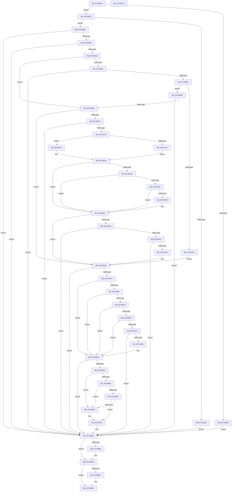

# PpDevCfgProcessDeviceClass

- RVA: `0x00736824`–`0x00736C25` (길이 `1,025` bytes)
- VA: `0x0000000140736824`
- 실행 섹션: `PAGE`
- PDB 이름 있음: `예`; PDB Function 태그: `아니요`
- unwind 정보 RVA: `0x000BCB44`
- 디코드: `255`개 명령, `1,025/1,025` bytes 표시
- 미해석 바이트: `0` (있으면 어셈블리에 `.byte`로 보존)

> 이 문서는 커널 이미지의 기계어와 PDB 기호를 분석해 생성했습니다. 4번과 5번은 함수 원형과 자료형을 바이너리 사용 방식에서 추정한 C 해석이며 원본 소스 복구 결과는 아닙니다.

## 1. Dependencies

- 직접 호출 지점: **18**; 고유 호출 대상: **16**
- 직접 호출자로 확인된 함수: **1**
- RIP 상대 이미지 참조: **6**

### Outgoing calls
- `0x00736862` → [memset](../../text/6C/memset_function_006C6C40.md) (function, `0x006C6C40`)
- `0x007368DE` → [PiDevCfgInitDeviceContext](../97/PiDevCfgInitDeviceContext_function_00977518.md) (function, `0x00977518`)
- `0x0073693B` → [PiDevCfgQueryObjectProperties](../97/PiDevCfgQueryObjectProperties_function_0097776C.md) (function, `0x0097776C`)
- `0x0073695B` → [RtlStringFromGUIDEx](../91/RtlStringFromGUIDEx_function_00915450.md) (function, `0x00915450`)
- `0x00736993` → [PnpOpenObjectRegKey](../8E/PnpOpenObjectRegKey_function_008E15E8.md) (function, `0x008E15E8`)
- `0x00736A07` → [PiDevCfgQueryObjectProperties](../97/PiDevCfgQueryObjectProperties_function_0097776C.md) (function, `0x0097776C`)
- `0x00736A50` → [PiDevCfgGetDeviceClassDriverConfigurable](PiDevCfgGetDeviceClassDriverConfigurable_function_00733504.md) (function, `0x00733504`)
- `0x00736A8B` → [IopOpenRegistryKeyEx](../A5/IopOpenRegistryKeyEx_function_00A51B44.md) (function, `0x00A51B44`)
- `0x00736AC5` → [PiDevCfgConfigureDeviceKeys](../96/PiDevCfgConfigureDeviceKeys_function_00964BA8.md) (function, `0x00964BA8`)
- `0x00736AEE` → [PiDevCfgConfigureDeviceLocation](../AA/PiDevCfgConfigureDeviceLocation_function_00AA88C0.md) (function, `0x00AA88C0`)
- `0x00736B2A` → [PiDevCfgGetDeviceClassConfigFlags](../AC/PiDevCfgGetDeviceClassConfigFlags_function_00AC7248.md) (function, `0x00AC7248`)
- `0x00736B86` → [CmGetDeviceRegProp](../8E/CmGetDeviceRegProp_function_008ED870.md) (function, `0x008ED870`)
- `0x00736BC0` → [PiDevCfgSetDeviceRegProp](../96/PiDevCfgSetDeviceRegProp_function_009635C0.md) (function, `0x009635C0`)
- `0x00736BC9` → [RtlFreeAnsiString](../9C/RtlFreeAnsiString_function_009C0800.md) (function, `0x009C0800`)
- `0x00736BD8` → [ZwClose](../../text/6A/ZwClose_function_006AD2B0.md) (function, `0x006AD2B0`)
- `0x00736BE7` → [ZwClose](../../text/6A/ZwClose_function_006AD2B0.md) (function, `0x006AD2B0`)
- `0x00736BF0` → [PiDevCfgFreeDeviceContext](../70/PiDevCfgFreeDeviceContext_function_00704A00.md) (function, `0x00704A00`)
- `0x00736BFE` → [_security_check_cookie](../../text/6A/_security_check_cookie_function_006AC640.md) (function, `0x006AC640`)

### Direct callers
- [PiConfigureDevice](../72/PiConfigureDevice_function_0072D38C.md) at `0x0072D405`

### Static image references
- `0x00736847` → RVA `0x00E0A740` (`.data`; read)
- `0x00736872` → RVA `0x00FD8054` (`PAGEDATA`; read)
- `0x007368F1` → RVA `0x00011688` (`.rdata`; read)
- `0x00736973` → RVA `0x00E66398` (`.data`; read)
- `0x007369C1` → RVA `0x00014410` (`.rdata`; read)
- `0x00736A6A` → RVA `0x00AFE850` (` ?? ::NNGAKEGL::`string'`; read)

## 2. Other-region calls and transfers

- 다른 실행 섹션으로 향하는 call: **4**
  - `0x00736862` → [memset](../../text/6C/memset_function_006C6C40.md) (`PAGE` → `.text`)
  - `0x00736BD8` → [ZwClose](../../text/6A/ZwClose_function_006AD2B0.md) (`PAGE` → `.text`)
  - `0x00736BE7` → [ZwClose](../../text/6A/ZwClose_function_006AD2B0.md) (`PAGE` → `.text`)
  - `0x00736BFE` → [_security_check_cookie](../../text/6A/_security_check_cookie_function_006AC640.md) (`PAGE` → `.text`)
- 별도 외부 분기/꼬리 이동을 확인하지 못했습니다.

## 3. Assembly (complete function range)

```asm
00736824  48 8B C4                        mov rax, rsp
00736827  48 89 58 10                     mov qword ptr [rax + 0x10], rbx
0073682B  48 89 70 18                     mov qword ptr [rax + 0x18], rsi
0073682F  48 89 78 20                     mov qword ptr [rax + 0x20], rdi
00736833  55                              push rbp
00736834  41 54                           push r12
00736836  41 55                           push r13
00736838  41 56                           push r14
0073683A  41 57                           push r15
0073683C  48 8D 68 A8                     lea rbp, [rax - 0x58]
00736840  48 81 EC 30 01 00 00            sub rsp, 0x130
00736847  48 8B 05 F2 3E 6D 00            mov rax, qword ptr [rip + 0x6d3ef2]
0073684E  48 33 C4                        xor rax, rsp
00736851  48 89 45 20                     mov qword ptr [rbp + 0x20], rax
00736855  33 D2                           xor edx, edx
00736857  4C 8B F9                        mov r15, rcx
0073685A  48 8D 4D B0                     lea rcx, [rbp - 0x50]
0073685E  44 8D 42 58                     lea r8d, [rdx + 0x58]
00736862  E8 D9 03 F9 FF                  call 0x1406c6c40
00736867  45 33 ED                        xor r13d, r13d
0073686A  C7 44 24 58 01 00 00 00         mov dword ptr [rsp + 0x58], 1
00736872  44 39 2D DB 17 8A 00            cmp dword ptr [rip + 0x8a17db], r13d
00736879  0F 57 C0                        xorps xmm0, xmm0
0073687C  0F 57 C9                        xorps xmm1, xmm1
0073687F  4C 89 6C 24 50                  mov qword ptr [rsp + 0x50], r13
00736884  0F 11 45 A0                     movups xmmword ptr [rbp - 0x60], xmm0
00736888  4C 89 6C 24 60                  mov qword ptr [rsp + 0x60], r13
0073688D  41 8B F5                        mov esi, r13d
00736890  0F 11 4D 10                     movups xmmword ptr [rbp + 0x10], xmm1
00736894  4C 89 6D 90                     mov qword ptr [rbp - 0x70], r13
00736898  41 8B FD                        mov edi, r13d
0073689B  4C 89 6D 98                     mov qword ptr [rbp - 0x68], r13
0073689F  45 8B F5                        mov r14d, r13d
007368A2  44 88 6C 24 40                  mov byte ptr [rsp + 0x40], r13b
007368A7  44 88 6C 24 41                  mov byte ptr [rsp + 0x41], r13b
007368AC  44 89 6C 24 44                  mov dword ptr [rsp + 0x44], r13d
007368B1  44 89 6C 24 48                  mov dword ptr [rsp + 0x48], r13d
007368B6  44 89 6C 24 4C                  mov dword ptr [rsp + 0x4c], r13d
007368BB  75 08                           jne 0x1407368c5
007368BD  41 8B DD                        mov ebx, r13d
007368C0  E9 00 03 00 00                  jmp 0x140736bc5
007368C5  49 8B 4F 30                     mov rcx, qword ptr [r15 + 0x30]
007368C9  48 85 C9                        test rcx, rcx
007368CC  75 0A                           jne 0x1407368d8
007368CE  BB 10 00 00 C0                  mov ebx, 0xc0000010
007368D3  E9 ED 02 00 00                  jmp 0x140736bc5
007368D8  4C 8D 45 B0                     lea r8, [rbp - 0x50]
007368DC  33 D2                           xor edx, edx
007368DE  E8 35 0C 24 00                  call 0x140977518
007368E3  8B D8                           mov ebx, eax
007368E5  85 C0                           test eax, eax
007368E7  0F 88 D8 02 00 00               js 0x140736bc5
007368ED  4C 8B 65 C0                     mov r12, qword ptr [rbp - 0x40]
007368F1  48 8D 05 90 AD 8D FF            lea rax, [rip - 0x725270]
007368F8  49 8B 57 30                     mov rdx, qword ptr [r15 + 0x30]
007368FC  B9 01 00 00 00                  mov ecx, 1
00736901  48 89 44 24 68                  mov qword ptr [rsp + 0x68], rax
00736906  4D 8B CC                        mov r9, r12
00736909  48 8D 45 10                     lea rax, [rbp + 0x10]
0073690D  89 4C 24 28                     mov dword ptr [rsp + 0x28], ecx
00736911  48 89 44 24 78                  mov qword ptr [rsp + 0x78], rax
00736916  44 8B C1                        mov r8d, ecx
00736919  48 8D 44 24 68                  lea rax, [rsp + 0x68]
0073691E  48 C7 44 24 70 0D 00 00 00      mov qword ptr [rsp + 0x70], 0xd
00736927  48 89 44 24 20                  mov qword ptr [rsp + 0x20], rax
0073692C  4C 89 6D 84                     mov qword ptr [rbp - 0x7c], r13
00736930  44 89 6D 8C                     mov dword ptr [rbp - 0x74], r13d
00736934  C7 45 80 10 00 00 00            mov dword ptr [rbp - 0x80], 0x10
0073693B  E8 2C 0E 24 00                  call 0x14097776c
00736940  8B D8                           mov ebx, eax
00736942  85 C0                           test eax, eax
00736944  0F 88 7B 02 00 00               js 0x140736bc5
0073694A  44 39 6D 88                     cmp dword ptr [rbp - 0x78], r13d
0073694E  7C 63                           jl 0x1407369b3
00736950  41 B0 01                        mov r8b, 1
00736953  48 8D 55 90                     lea rdx, [rbp - 0x70]
00736957  48 8D 4D 10                     lea rcx, [rbp + 0x10]
0073695B  E8 F0 EA 1D 00                  call 0x140915450
00736960  8B D8                           mov ebx, eax
00736962  85 C0                           test eax, eax
00736964  0F 88 5B 02 00 00               js 0x140736bc5
0073696A  48 8B 75 98                     mov rsi, qword ptr [rbp - 0x68]
0073696E  48 8D 44 24 50                  lea rax, [rsp + 0x50]
00736973  48 8B 0D 1E FA 72 00            mov rcx, qword ptr [rip + 0x72fa1e]
0073697A  48 8B D6                        mov rdx, rsi
0073697D  48 89 44 24 28                  mov qword ptr [rsp + 0x28], rax
00736982  41 B9 19 00 02 00               mov r9d, 0x20019
00736988  41 B8 02 00 00 00               mov r8d, 2
0073698E  44 88 6C 24 20                  mov byte ptr [rsp + 0x20], r13b
00736993  E8 50 AC 1A 00                  call 0x1408e15e8
00736998  8B D8                           mov ebx, eax
0073699A  3D 34 00 00 C0                  cmp eax, 0xc0000034
0073699F  75 0A                           jne 0x1407369ab
007369A1  4C 89 6C 24 50                  mov qword ptr [rsp + 0x50], r13
007369A6  E9 32 01 00 00                  jmp 0x140736add
007369AB  85 C0                           test eax, eax
007369AD  0F 88 12 02 00 00               js 0x140736bc5
007369B3  4C 8B 4C 24 50                  mov r9, qword ptr [rsp + 0x50]
007369B8  4D 85 C9                        test r9, r9
007369BB  0F 84 1C 01 00 00               je 0x140736add
007369C1  48 8D 05 48 DA 8D FF            lea rax, [rip - 0x7225b8]
007369C8  48 C7 44 24 70 11 00 00 00      mov qword ptr [rsp + 0x70], 0x11
007369D1  48 89 44 24 68                  mov qword ptr [rsp + 0x68], rax
007369D6  41 B8 02 00 00 00               mov r8d, 2
007369DC  48 8D 44 24 40                  lea rax, [rsp + 0x40]
007369E1  4C 89 6D 84                     mov qword ptr [rbp - 0x7c], r13
007369E5  48 89 44 24 78                  mov qword ptr [rsp + 0x78], rax
007369EA  48 8B D6                        mov rdx, rsi
007369ED  B8 01 00 00 00                  mov eax, 1
007369F2  44 89 6D 8C                     mov dword ptr [rbp - 0x74], r13d
007369F6  89 44 24 28                     mov dword ptr [rsp + 0x28], eax
007369FA  89 45 80                        mov dword ptr [rbp - 0x80], eax
007369FD  48 8D 44 24 68                  lea rax, [rsp + 0x68]
00736A02  48 89 44 24 20                  mov qword ptr [rsp + 0x20], rax
00736A07  E8 60 0D 24 00                  call 0x14097776c
00736A0C  8B D8                           mov ebx, eax
00736A0E  85 C0                           test eax, eax
00736A10  0F 88 AF 01 00 00               js 0x140736bc5
00736A16  44 39 6D 88                     cmp dword ptr [rbp - 0x78], r13d
00736A1A  7D 09                           jge 0x140736a25
00736A1C  41 8A C5                        mov al, r13b
00736A1F  88 44 24 40                     mov byte ptr [rsp + 0x40], al
00736A23  EB 04                           jmp 0x140736a29
00736A25  8A 44 24 40                     mov al, byte ptr [rsp + 0x40]
00736A29  84 C0                           test al, al
00736A2B  75 38                           jne 0x140736a65
00736A2D  4D 8B 47 30                     mov r8, qword ptr [r15 + 0x30]
00736A31  48 8D 44 24 41                  lea rax, [rsp + 0x41]
00736A36  48 8B 54 24 50                  mov rdx, qword ptr [rsp + 0x50]
00736A3B  4D 8B CC                        mov r9, r12
00736A3E  48 89 44 24 30                  mov qword ptr [rsp + 0x30], rax
00736A43  48 8B CE                        mov rcx, rsi
00736A46  4C 89 6C 24 28                  mov qword ptr [rsp + 0x28], r13
00736A4B  4C 89 6C 24 20                  mov qword ptr [rsp + 0x20], r13
00736A50  E8 AF CA FF FF                  call 0x140733504
00736A55  85 C0                           test eax, eax
00736A57  78 0C                           js 0x140736a65
00736A59  44 38 6C 24 41                  cmp byte ptr [rsp + 0x41], r13b
00736A5E  74 05                           je 0x140736a65
00736A60  C6 44 24 40 FF                  mov byte ptr [rsp + 0x40], 0xff
00736A65  48 8B 54 24 50                  mov rdx, qword ptr [rsp + 0x50]
00736A6A  48 8D 05 DF 7D 3C 00            lea rax, [rip + 0x3c7ddf]
00736A71  41 B9 19 00 02 00               mov r9d, 0x20019
00736A77  48 89 45 A8                     mov qword ptr [rbp - 0x58], rax
00736A7B  4C 8D 45 A0                     lea r8, [rbp - 0x60]
00736A7F  C7 45 A0 1A 00 1C 00            mov dword ptr [rbp - 0x60], 0x1c001a
00736A86  48 8D 4C 24 60                  lea rcx, [rsp + 0x60]
00736A8B  E8 B4 B0 31 00                  call 0x140a51b44
00736A90  8B D8                           mov ebx, eax
00736A92  3D 34 00 00 C0                  cmp eax, 0xc0000034
00736A97  74 44                           je 0x140736add
00736A99  85 C0                           test eax, eax
00736A9B  0F 88 24 01 00 00               js 0x140736bc5
00736AA1  4C 8B 44 24 60                  mov r8, qword ptr [rsp + 0x60]
00736AA6  48 8D 44 24 48                  lea rax, [rsp + 0x48]
00736AAB  48 89 44 24 28                  mov qword ptr [rsp + 0x28], rax
00736AB0  48 8D 55 B0                     lea rdx, [rbp - 0x50]
00736AB4  48 8D 44 24 44                  lea rax, [rsp + 0x44]
00736AB9  41 83 C9 FF                     or r9d, 0xffffffff
00736ABD  49 8B CF                        mov rcx, r15
00736AC0  48 89 44 24 20                  mov qword ptr [rsp + 0x20], rax
00736AC5  E8 DE E0 22 00                  call 0x140964ba8
00736ACA  8B D8                           mov ebx, eax
00736ACC  85 C0                           test eax, eax
00736ACE  0F 88 F1 00 00 00               js 0x140736bc5
00736AD4  8B 7C 24 44                     mov edi, dword ptr [rsp + 0x44]
00736AD8  44 8B 74 24 48                  mov r14d, dword ptr [rsp + 0x48]
00736ADD  4C 8D 4C 24 48                  lea r9, [rsp + 0x48]
00736AE2  49 8B CF                        mov rcx, r15
00736AE5  4C 8D 44 24 44                  lea r8, [rsp + 0x44]
00736AEA  48 8D 55 B0                     lea rdx, [rbp - 0x50]
00736AEE  E8 CD 1D 37 00                  call 0x140aa88c0
00736AF3  8B D8                           mov ebx, eax
00736AF5  85 C0                           test eax, eax
00736AF7  0F 88 C8 00 00 00               js 0x140736bc5
00736AFD  0B 7C 24 44                     or edi, dword ptr [rsp + 0x44]
00736B01  44 0B 74 24 48                  or r14d, dword ptr [rsp + 0x48]
00736B06  41 F6 C6 02                     test r14b, 2
00736B0A  75 31                           jne 0x140736b3d
00736B0C  80 7C 24 40 FF                  cmp byte ptr [rsp + 0x40], 0xff
00736B11  75 2A                           jne 0x140736b3d
00736B13  48 85 F6                        test rsi, rsi
00736B16  74 25                           je 0x140736b3d
00736B18  48 8B 54 24 50                  mov rdx, qword ptr [rsp + 0x50]
00736B1D  48 85 D2                        test rdx, rdx
00736B20  74 1B                           je 0x140736b3d
00736B22  4C 8D 44 24 44                  lea r8, [rsp + 0x44]
00736B27  48 8B CE                        mov rcx, rsi
00736B2A  E8 19 07 39 00                  call 0x140ac7248
00736B2F  8B D8                           mov ebx, eax
00736B31  85 C0                           test eax, eax
00736B33  0F 88 8C 00 00 00               js 0x140736bc5
00736B39  0B 7C 24 44                     or edi, dword ptr [rsp + 0x44]
00736B3D  85 FF                           test edi, edi
00736B3F  0F 84 80 00 00 00               je 0x140736bc5
00736B45  49 8B 57 30                     mov rdx, qword ptr [r15 + 0x30]
00736B49  48 8D 44 24 4C                  lea rax, [rsp + 0x4c]
00736B4E  48 8B 0D 43 F8 72 00            mov rcx, qword ptr [rip + 0x72f843]
00736B55  BE 04 00 00 00                  mov esi, 4
00736B5A  44 89 6C 24 38                  mov dword ptr [rsp + 0x38], r13d
00736B5F  4D 8B C4                        mov r8, r12
00736B62  48 89 44 24 30                  mov qword ptr [rsp + 0x30], rax
00736B67  48 8D 44 24 44                  lea rax, [rsp + 0x44]
00736B6C  48 89 44 24 28                  mov qword ptr [rsp + 0x28], rax
00736B71  48 8D 44 24 58                  lea rax, [rsp + 0x58]
00736B76  44 8D 76 07                     lea r14d, [rsi + 7]
00736B7A  48 89 44 24 20                  mov qword ptr [rsp + 0x20], rax
00736B7F  45 8B CE                        mov r9d, r14d
00736B82  89 74 24 4C                     mov dword ptr [rsp + 0x4c], esi
00736B86  E8 E5 6C 1B 00                  call 0x1408ed870
00736B8B  85 C0                           test eax, eax
00736B8D  78 10                           js 0x140736b9f
00736B8F  39 74 24 58                     cmp dword ptr [rsp + 0x58], esi
00736B93  75 0A                           jne 0x140736b9f
00736B95  8B 44 24 44                     mov eax, dword ptr [rsp + 0x44]
00736B99  39 74 24 4C                     cmp dword ptr [rsp + 0x4c], esi
00736B9D  74 03                           je 0x140736ba2
00736B9F  41 8B C5                        mov eax, r13d
00736BA2  0B C7                           or eax, edi
00736BA4  89 74 24 28                     mov dword ptr [rsp + 0x28], esi
00736BA8  89 44 24 44                     mov dword ptr [rsp + 0x44], eax
00736BAC  48 8D 55 B0                     lea rdx, [rbp - 0x50]
00736BB0  48 8D 44 24 44                  lea rax, [rsp + 0x44]
00736BB5  44 8B CE                        mov r9d, esi
00736BB8  45 8B C6                        mov r8d, r14d
00736BBB  48 89 44 24 20                  mov qword ptr [rsp + 0x20], rax
00736BC0  E8 FB C9 22 00                  call 0x1409635c0
00736BC5  48 8D 4D 90                     lea rcx, [rbp - 0x70]
00736BC9  E8 32 9C 28 00                  call 0x1409c0800
00736BCE  48 8B 4C 24 60                  mov rcx, qword ptr [rsp + 0x60]
00736BD3  48 85 C9                        test rcx, rcx
00736BD6  74 05                           je 0x140736bdd
00736BD8  E8 D3 66 F7 FF                  call 0x1406ad2b0
00736BDD  48 8B 4C 24 50                  mov rcx, qword ptr [rsp + 0x50]
00736BE2  48 85 C9                        test rcx, rcx
00736BE5  74 05                           je 0x140736bec
00736BE7  E8 C4 66 F7 FF                  call 0x1406ad2b0
00736BEC  48 8D 4D B0                     lea rcx, [rbp - 0x50]
00736BF0  E8 0B DE FC FF                  call 0x140704a00
00736BF5  8B C3                           mov eax, ebx
00736BF7  48 8B 4D 20                     mov rcx, qword ptr [rbp + 0x20]
00736BFB  48 33 CC                        xor rcx, rsp
00736BFE  E8 3D 5A F7 FF                  call 0x1406ac640
00736C03  4C 8D 9C 24 30 01 00 00         lea r11, [rsp + 0x130]
00736C0B  49 8B 5B 38                     mov rbx, qword ptr [r11 + 0x38]
00736C0F  49 8B 73 40                     mov rsi, qword ptr [r11 + 0x40]
00736C13  49 8B 7B 48                     mov rdi, qword ptr [r11 + 0x48]
00736C17  49 8B E3                        mov rsp, r11
00736C1A  41 5F                           pop r15
00736C1C  41 5E                           pop r14
00736C1E  41 5D                           pop r13
00736C20  41 5C                           pop r12
00736C22  5D                              pop rbp
00736C23  C3                              ret
00736C24  CC                              int3
```

## 4. C-style interpretation (structured pseudocode)

```c
__int64 __fastcall PpDevCfgProcessDeviceClass(__int64 a1, int a2)
{
    __int64 result;
    __int64 v_r13;
    __int64 v_r14;
    __int64 v_rdi;
    __int64 v_rsp;
    unsigned int v_stack_m100;
    unsigned __int64 v_stack_m108;
    unsigned int v_stack_m10C;
    unsigned int v_stack_m110;
    unsigned int v_stack_m114;
    unsigned __int8 v_stack_m117;
    unsigned __int8 v_stack_m118;
    unsigned int v_stack_m120;
    unsigned __int64 v_stack_m128;
    unsigned int v_stack_m130;
    unsigned __int64 v_stack_m138;
    unsigned __int64 v_stack_m28;
    unsigned __int64 v_stack_mE0;
    unsigned __int64 v_stack_mE8;
    unsigned __int64 v_stack_mF0;
    unsigned __int64 v_stack_mF8;

    *(unsigned __int64 *)(v_rsp + 16) = v_rbx;
    *(unsigned __int64 *)(v_rsp + 24) = v_rsi;
    *(unsigned __int64 *)(v_rsp + 32) = v_rdi;
    v_rsp = (v_rsp) - (304);
    result = (*(unsigned __int64 *)(v_rip + 7159538)) ^ (v_rsp);
    *(unsigned __int64 *)(v_rsp - 88 + 32) = result;
    a2 = 0;
    result = memset(v_rsp - 88 - 80, a2, a2 + 88, a4);
    v_r13 = 0;
    v_stack_m100 = 1;
    v_stack_m108 = 0;
    *(unsigned __int64 *)(v_rsp - 88 - 96) = v_xmm0;
    v_stack_mF8 = 0;
    *(unsigned __int64 *)(v_rsp - 88 + 16) = v_xmm1;
    *(unsigned __int64 *)(v_rsp - 88 - 112) = 0;
    *(unsigned __int64 *)(v_rsp - 88 - 104) = 0;
    v_stack_m118 = 0;
    v_stack_m117 = 0;
    v_stack_m114 = 0;
    v_stack_m110 = 0;
    v_stack_m10C = 0;
    if ((*(unsigned int *)(v_rip + 9050075)) != 0) goto loc_007368C5;
    goto loc_00736BC5;
loc_007368C5:
    if (*(unsigned __int64 *)(a1 + 48) != 0) goto loc_007368D8;
    goto loc_00736BC5;
loc_007368D8:
    a2 = 0;
    result = PiDevCfgInitDeviceContext(*(unsigned __int64 *)(a1 + 48), a2, v_rsp - 88 - 80, a4);
    if (sign_flag) goto loc_00736BC5;
    v_stack_mF0 = v_rip - 7492208;
    v_stack_m130 = 1;
    v_stack_mE0 = v_rsp - 88 + 16;
    v_stack_mE8 = 13;
    v_stack_m138 = v_stack_mF0;
    *(unsigned __int64 *)(v_rsp - 88 - 124) = 0;
    *(unsigned int *)(v_rsp - 88 - 116) = 0;
    *(unsigned int *)(v_rsp - 88 - 128) = 16;
    result = PiDevCfgQueryObjectProperties(1, *(unsigned __int64 *)(a1 + 48), 1, *(unsigned __int64 *)(v_rsp - 88 - 64));
    if (sign_flag) goto loc_00736BC5;
    if ((*(unsigned int *)(v_rsp - 88 - 120)) < 0) goto loc_007369B3;
    result = RtlStringFromGUIDEx(v_rsp - 88 + 16, v_rsp - 88 - 112, 1, *(unsigned __int64 *)(v_rsp - 88 - 64));
    if (sign_flag) goto loc_00736BC5;
    v_stack_m130 = v_stack_m108;
    v_stack_m138 = 0;
    result = PnpOpenObjectRegKey(*(unsigned __int64 *)(v_rip + 7535134), *(unsigned __int64 *)(v_rsp - 88 - 104), 2, (unsigned int)(0x20019ULL));
    if (((unsigned int)(result)) != 0xC0000034ULL) goto loc_007369AB;
    v_stack_m108 = 0;
    goto loc_00736ADD;
loc_007369AB:
    if (sign_flag) goto loc_00736BC5;
loc_007369B3:
    if (v_stack_m108 == 0) goto loc_00736ADD;
    v_stack_mE8 = 17;
    v_stack_mF0 = v_rip - 7480760;
    *(unsigned __int64 *)(v_rsp - 88 - 124) = 0;
    v_stack_mE0 = v_stack_m118;
    *(unsigned int *)(v_rsp - 88 - 116) = 0;
    v_stack_m130 = 1;
    *(unsigned int *)(v_rsp - 88 - 128) = 1;
    v_stack_m138 = v_stack_mF0;
    result = PiDevCfgQueryObjectProperties(*(unsigned __int64 *)(v_rip + 7535134), *(unsigned __int64 *)(v_rsp - 88 - 104), 2, v_stack_m108);
    if (sign_flag) goto loc_00736BC5;
    if ((*(unsigned int *)(v_rsp - 88 - 120)) >= 0) goto loc_00736A25;
    v_stack_m118 = 0;
    goto loc_00736A29;
loc_00736A25:
loc_00736A29:
    if ((unsigned __int8)(v_stack_m118) != 0) goto loc_00736A65;
    v_stack_m128 = v_stack_m117;
    v_stack_m130 = 0;
    v_stack_m138 = 0;
    result = PiDevCfgGetDeviceClassDriverConfigurable(*(unsigned __int64 *)(v_rsp - 88 - 104), v_stack_m108, *(unsigned __int64 *)(a1 + 48), *(unsigned __int64 *)(v_rsp - 88 - 64));
    if (sign_flag) goto loc_00736A65;
    if (v_stack_m117 != 0) {
        v_stack_m118 = 255;
    }
    *(unsigned __int64 *)(v_rsp - 88 - 88) = v_rip + 3964383;
    *(unsigned int *)(v_rsp - 88 - 96) = 0x1C001AULL;
    result = IopOpenRegistryKeyEx(v_stack_mF8, v_stack_m108, v_rsp - 88 - 96, (unsigned int)(0x20019ULL));
    if (((unsigned int)(result)) == 0xC0000034ULL) goto loc_00736ADD;
    if (sign_flag) goto loc_00736BC5;
    v_stack_m130 = v_stack_m110;
    a4 = (unsigned int)(((unsigned int)(0x20019ULL)) | (0xFFFFFFFFULL));
    v_stack_m138 = v_stack_m114;
    result = PiDevCfgConfigureDeviceKeys(a1, v_rsp - 88 - 80, v_stack_mF8, a4);
    if (sign_flag) goto loc_00736BC5;
loc_00736ADD:
    result = PiDevCfgConfigureDeviceLocation(a1, v_rsp - 88 - 80, v_stack_m114, v_stack_m110);
    if (sign_flag) goto loc_00736BC5;
    v_rdi = (unsigned int)(((unsigned int)(v_stack_m114)) | (v_stack_m114));
    v_r14 = (unsigned int)(((unsigned int)(v_stack_m110)) | (v_stack_m110));
    if ((((unsigned __int8)(v_r14)) & (2)) != 0) goto loc_00736B3D;
    if (v_stack_m118 != 255) goto loc_00736B3D;
    if (*(unsigned __int64 *)(v_rsp - 88 - 104) == 0) goto loc_00736B3D;
    if (v_stack_m108 == 0) goto loc_00736B3D;
    result = PiDevCfgGetDeviceClassConfigFlags(*(unsigned __int64 *)(v_rsp - 88 - 104), v_stack_m108, v_stack_m114, v_stack_m110);
    if (sign_flag) goto loc_00736BC5;
    v_rdi = (unsigned int)((v_rdi) | (v_stack_m114));
loc_00736B3D:
    if ((unsigned int)(v_rdi) == 0) goto loc_00736BC5;
    v_stack_m120 = 0;
    v_stack_m128 = v_stack_m10C;
    v_stack_m130 = v_stack_m114;
    v_stack_m138 = v_stack_m100;
    v_stack_m10C = 4;
    result = CmGetDeviceRegProp(*(unsigned __int64 *)(v_rip + 7534659), *(unsigned __int64 *)(a1 + 48), *(unsigned __int64 *)(v_rsp - 88 - 64), (unsigned int)((unsigned int)(4 + 7)));
    if (sign_flag) goto loc_00736B9F;
    if (v_stack_m100 != 4) goto loc_00736B9F;
    result = (unsigned int)(v_stack_m114);
    if (v_stack_m10C != 4) {
        result = 0;
    }
    result = (unsigned int)((result) | ((unsigned int)(v_rdi)));
    v_stack_m130 = 4;
    v_stack_m114 = (unsigned int)(result);
    v_stack_m138 = v_stack_m114;
    result = PiDevCfgSetDeviceRegProp(*(unsigned __int64 *)(v_rip + 7534659), v_rsp - 88 - 80, (unsigned int)((unsigned int)(4 + 7)), 4);
loc_00736BC5:
    result = RtlFreeAnsiString(v_rsp - 88 - 112, v_rsp - 88 - 80, (unsigned int)((unsigned int)(4 + 7)), 4);
    if (v_stack_mF8 != 0) {
        result = ZwClose(v_stack_mF8, v_rsp - 88 - 80, (unsigned int)((unsigned int)(4 + 7)), 4);
    }
    if (v_stack_m108 != 0) {
        result = ZwClose(v_stack_m108, v_rsp - 88 - 80, (unsigned int)((unsigned int)(4 + 7)), 4);
    }
    result = PiDevCfgFreeDeviceContext(v_rsp - 88 - 80, v_rsp - 88 - 80, (unsigned int)((unsigned int)(4 + 7)), 4);
    a1 = (*(unsigned __int64 *)(v_rsp - 88 + 32)) ^ (v_rsp);
    result = _security_check_cookie(a1, v_rsp - 88 - 80, (unsigned int)((unsigned int)(4 + 7)), 4);
    return result;
}
```

## 5. (Beta) C Style

```c
int64_t PpDevCfgProcessDeviceClass(void *Arg1, int32_t Arg2)
{
    uint8_t *arg1 = (uint8_t *)Arg1;

    int64_t result;
    int64_t local_r13;
    int64_t local_r14;
    int64_t local_rdi;
    int64_t local_rsp;
    uint32_t v_stack_m100;
    uint64_t v_stack_m108;
    uint32_t v_stack_m10C;
    uint32_t v_stack_m110;
    uint32_t v_stack_m114;
    uint8_t v_stack_m117;
    uint8_t v_stack_m118;
    uint32_t v_stack_m120;
    uint64_t v_stack_m128;
    uint32_t v_stack_m130;
    uint64_t v_stack_m138;
    uint64_t v_stack_m28;
    uint64_t v_stack_mE0;
    uint64_t v_stack_mE8;
    uint64_t v_stack_mF0;
    uint64_t v_stack_mF8;

    *(uint64_t *)(local_rsp + 0x10) = local_rbx;
    *(uint64_t *)(local_rsp + 0x18) = local_rsi;
    *(uint64_t *)(local_rsp + 0x20) = local_rdi;
    local_rsp = (local_rsp) - (304);
    result = (*(uint64_t *)(v_rip + 0x6D3EF2)) ^ (local_rsp);
    *(uint64_t *)(local_rsp - 0x58 + 0x20) = result;
    Arg2 = 0;
    result = memset(local_rsp - 88 - 80, Arg2, Arg2 + 88, a4);
    local_r13 = 0;
    v_stack_m100 = 1;
    v_stack_m108 = 0;
    *(uint64_t *)(local_rsp - 0x58 - 0x60) = v_xmm0;
    v_stack_mF8 = 0;
    *(uint64_t *)(local_rsp - 0x58 + 0x10) = v_xmm1;
    *(uint64_t *)(local_rsp - 0x58 - 0x70) = 0;
    *(uint64_t *)(local_rsp - 0x58 - 0x68) = 0;
    v_stack_m118 = 0;
    v_stack_m117 = 0;
    v_stack_m114 = 0;
    v_stack_m110 = 0;
    v_stack_m10C = 0;
    if ((*(uint32_t *)(v_rip + 0x8A17DB)) != 0) goto loc_007368C5;
    goto loc_00736BC5;
loc_007368C5:
    if (*(uint64_t *)(arg1 + 0x30) != 0) goto loc_007368D8;
    goto loc_00736BC5;
loc_007368D8:
    Arg2 = 0;
    result = PiDevCfgInitDeviceContext(*(uint64_t *)(arg1 + 0x30), Arg2, local_rsp - 88 - 80, a4);
    if (sign_flag) goto loc_00736BC5;
    v_stack_mF0 = v_rip - 7492208;
    v_stack_m130 = 1;
    v_stack_mE0 = local_rsp - 88 + 16;
    v_stack_mE8 = 13;
    v_stack_m138 = v_stack_mF0;
    *(uint64_t *)(local_rsp - 0x58 - 0x7C) = 0;
    *(uint32_t *)(local_rsp - 0x58 - 0x74) = 0;
    *(uint32_t *)(local_rsp - 0x58 - 0x80) = 16;
    result = PiDevCfgQueryObjectProperties(1, *(uint64_t *)(arg1 + 0x30), 1, *(uint64_t *)(local_rsp - 0x58 - 0x40));
    if (sign_flag) goto loc_00736BC5;
    if ((*(uint32_t *)(local_rsp - 0x58 - 0x78)) < 0) goto loc_007369B3;
    result = RtlStringFromGUIDEx(local_rsp - 88 + 16, local_rsp - 88 - 112, 1, *(uint64_t *)(local_rsp - 0x58 - 0x40));
    if (sign_flag) goto loc_00736BC5;
    v_stack_m130 = v_stack_m108;
    v_stack_m138 = 0;
    result = PnpOpenObjectRegKey(*(uint64_t *)(v_rip + 0x72FA1E), *(uint64_t *)(local_rsp - 0x58 - 0x68), 2, (uint32_t)(0x20019ULL));
    if (((uint32_t)(result)) != 0xC0000034ULL) goto loc_007369AB;
    v_stack_m108 = 0;
    goto loc_00736ADD;
loc_007369AB:
    if (sign_flag) goto loc_00736BC5;
loc_007369B3:
    if (v_stack_m108 == 0) goto loc_00736ADD;
    v_stack_mE8 = 17;
    v_stack_mF0 = v_rip - 7480760;
    *(uint64_t *)(local_rsp - 0x58 - 0x7C) = 0;
    v_stack_mE0 = v_stack_m118;
    *(uint32_t *)(local_rsp - 0x58 - 0x74) = 0;
    v_stack_m130 = 1;
    *(uint32_t *)(local_rsp - 0x58 - 0x80) = 1;
    v_stack_m138 = v_stack_mF0;
    result = PiDevCfgQueryObjectProperties(*(uint64_t *)(v_rip + 0x72FA1E), *(uint64_t *)(local_rsp - 0x58 - 0x68), 2, v_stack_m108);
    if (sign_flag) goto loc_00736BC5;
    if ((*(uint32_t *)(local_rsp - 0x58 - 0x78)) >= 0) goto loc_00736A25;
    v_stack_m118 = 0;
    goto loc_00736A29;
loc_00736A25:
loc_00736A29:
    if ((uint8_t)(v_stack_m118) != 0) goto loc_00736A65;
    v_stack_m128 = v_stack_m117;
    v_stack_m130 = 0;
    v_stack_m138 = 0;
    result = PiDevCfgGetDeviceClassDriverConfigurable(*(uint64_t *)(local_rsp - 0x58 - 0x68), v_stack_m108, *(uint64_t *)(arg1 + 0x30), *(uint64_t *)(local_rsp - 0x58 - 0x40));
    if (sign_flag) goto loc_00736A65;
    if (v_stack_m117 != 0) {
        v_stack_m118 = 255;
    }
    *(uint64_t *)(local_rsp - 0x58 - 0x58) = v_rip + 3964383;
    *(uint32_t *)(local_rsp - 0x58 - 0x60) = 0x1C001AULL;
    result = IopOpenRegistryKeyEx(v_stack_mF8, v_stack_m108, local_rsp - 88 - 96, (uint32_t)(0x20019ULL));
    if (((uint32_t)(result)) == 0xC0000034ULL) goto loc_00736ADD;
    if (sign_flag) goto loc_00736BC5;
    v_stack_m130 = v_stack_m110;
    a4 = (uint32_t)(((uint32_t)(0x20019ULL)) | (0xFFFFFFFFULL));
    v_stack_m138 = v_stack_m114;
    result = PiDevCfgConfigureDeviceKeys(Arg1, local_rsp - 88 - 80, v_stack_mF8, a4);
    if (sign_flag) goto loc_00736BC5;
loc_00736ADD:
    result = PiDevCfgConfigureDeviceLocation(Arg1, local_rsp - 88 - 80, v_stack_m114, v_stack_m110);
    if (sign_flag) goto loc_00736BC5;
    local_rdi = (uint32_t)(((uint32_t)(v_stack_m114)) | (v_stack_m114));
    local_r14 = (uint32_t)(((uint32_t)(v_stack_m110)) | (v_stack_m110));
    if ((((uint8_t)(local_r14)) & (2)) != 0) goto loc_00736B3D;
    if (v_stack_m118 != 255) goto loc_00736B3D;
    if (*(uint64_t *)(local_rsp - 0x58 - 0x68) == 0) goto loc_00736B3D;
    if (v_stack_m108 == 0) goto loc_00736B3D;
    result = PiDevCfgGetDeviceClassConfigFlags(*(uint64_t *)(local_rsp - 0x58 - 0x68), v_stack_m108, v_stack_m114, v_stack_m110);
    if (sign_flag) goto loc_00736BC5;
    local_rdi = (uint32_t)((local_rdi) | (v_stack_m114));
loc_00736B3D:
    if ((uint32_t)(local_rdi) == 0) goto loc_00736BC5;
    v_stack_m120 = 0;
    v_stack_m128 = v_stack_m10C;
    v_stack_m130 = v_stack_m114;
    v_stack_m138 = v_stack_m100;
    v_stack_m10C = 4;
    result = CmGetDeviceRegProp(*(uint64_t *)(v_rip + 0x72F843), *(uint64_t *)(arg1 + 0x30), *(uint64_t *)(local_rsp - 0x58 - 0x40), (uint32_t)((uint32_t)(4 + 7)));
    if (sign_flag) goto loc_00736B9F;
    if (v_stack_m100 != 4) goto loc_00736B9F;
    result = (uint32_t)(v_stack_m114);
    if (v_stack_m10C != 4) {
        result = 0;
    }
    result = (uint32_t)((result) | ((uint32_t)(local_rdi)));
    v_stack_m130 = 4;
    v_stack_m114 = (uint32_t)(result);
    v_stack_m138 = v_stack_m114;
    result = PiDevCfgSetDeviceRegProp(*(uint64_t *)(v_rip + 0x72F843), local_rsp - 88 - 80, (uint32_t)((uint32_t)(4 + 7)), 4);
loc_00736BC5:
    result = RtlFreeAnsiString(local_rsp - 88 - 112, local_rsp - 88 - 80, (uint32_t)((uint32_t)(4 + 7)), 4);
    if (v_stack_mF8 != 0) {
        result = ZwClose(v_stack_mF8, local_rsp - 88 - 80, (uint32_t)((uint32_t)(4 + 7)), 4);
    }
    if (v_stack_m108 != 0) {
        result = ZwClose(v_stack_m108, local_rsp - 88 - 80, (uint32_t)((uint32_t)(4 + 7)), 4);
    }
    result = PiDevCfgFreeDeviceContext(local_rsp - 88 - 80, local_rsp - 88 - 80, (uint32_t)((uint32_t)(4 + 7)), 4);
    Arg1 = (*(uint64_t *)(local_rsp - 0x58 + 0x20)) ^ (local_rsp);
    result = _security_check_cookie(Arg1, local_rsp - 88 - 80, (uint32_t)((uint32_t)(4 + 7)), 4);
    return result;
}
```

### 관측된 메모리 오프셋

구조체 형식이 확인되지 않은 접근은 인자 기준의 오프셋으로만 기록했습니다.

| 기준 인자 | 오프셋 표현 | 폭 (bit) | 접근 |
|---|---:|---:|---|
| `Arg1` | `+ 0x30` | `64` | `R` |

## 6. Execution-region graph

[열기: 2D/3D 그래프와 함수 탐색 컨트롤 패널](../../../control-panel.html?section=page&rva=0x00736824&view=graph)

- 2D 그래프는 위에서 아래로 흐르고, 3D 그래프는 빈 공간을 드래그해 회전합니다. Shift+드래그는 이동, 휠은 확대·축소, 함수 노드 선택은 대상 보고서 이동입니다.

### Static fallback


