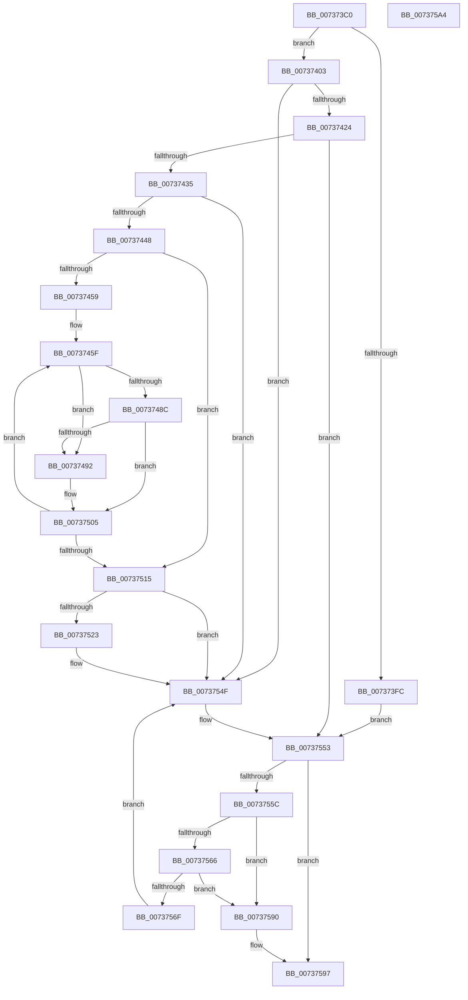

# PpDevCfgProcessDevices

- RVA: `0x007373C0`–`0x007375A5` (길이 `485` bytes)
- VA: `0x00000001407373C0`
- 실행 섹션: `PAGE`
- PDB 이름 있음: `예`; PDB Function 태그: `아니요`
- unwind 정보 RVA: `0x000C8D44`
- 디코드: `127`개 명령, `485/485` bytes 표시
- 미해석 바이트: `0` (있으면 어셈블리에 `.byte`로 보존)

> 이 문서는 커널 이미지의 기계어와 PDB 기호를 분석해 생성했습니다. 4번과 5번은 함수 원형과 자료형을 바이너리 사용 방식에서 추정한 C 해석이며 원본 소스 복구 결과는 아닙니다.

## 1. Dependencies

- 직접 호출 지점: **14**; 고유 호출 대상: **14**
- 직접 호출자로 확인된 함수: **1**
- RIP 상대 이미지 참조: **5**

### Outgoing calls
- `0x00737415` → [PipForDeviceNodeSubtree](../A5/PipForDeviceNodeSubtree_function_00A51920.md) (function, `0x00A51920`)
- `0x00737439` → [PiPnpRtlBeginOperation](../8E/PiPnpRtlBeginOperation_function_008E033C.md) (function, `0x008E033C`)
- `0x00737483` → [CmGetDeviceStatus](../9D/CmGetDeviceStatus_function_009D154C.md) (function, `0x009D154C`)
- `0x00737497` → [PpDevNodeLockTree](../A1/PpDevNodeLockTree_function_00A19310.md) (function, `0x00A19310`)
- `0x007374B7` → [ExAcquireResourceExclusiveLite](../../text/21/ExAcquireResourceExclusiveLite_function_00214E20.md) (function, `0x00214E20`)
- `0x007374C8` → [PpDeviceRegistration](../A0/PpDeviceRegistration_function_00A079D4.md) (function, `0x00A079D4`)
- `0x007374DB` → [CmDeleteDevice](../82/CmDeleteDevice_function_00829BB8.md) (function, `0x00829BB8`)
- `0x007374F1` → [ExReleaseResourceLite](../../text/25/ExReleaseResourceLite_function_0025FA10.md) (function, `0x0025FA10`)
- `0x007374F6` → [KeLeaveCriticalRegion](../../text/25/KeLeaveCriticalRegion_function_0025D8B0.md) (function, `0x0025D8B0`)
- `0x00737500` → [PpDevNodeUnlockTree](../A2/PpDevNodeUnlockTree_function_00A21290.md) (function, `0x00A21290`)
- `0x00737519` → [PiPnpRtlEndOperation](../8E/PiPnpRtlEndOperation_function_008E0518.md) (function, `0x008E0518`)
- `0x0073754A` → [PnpRequestDeviceAction](../../text/47/PnpRequestDeviceAction_function_00477FF8.md) (function, `0x00477FF8`)
- `0x0073757F` → [RtlFreeAnsiString](../9C/RtlFreeAnsiString_function_009C0800.md) (function, `0x009C0800`)
- `0x00737589` → [ExFreePoolWithTag](../../poolcode/B8/ExFreePoolWithTag_function_00B82870.md) (function, `0x00B82870`)

### Direct callers
- [PnpBootPhaseComplete](../72/PnpBootPhaseComplete_function_00723A44.md) at `0x00723B2D`

### Static image references
- `0x007373EE` → RVA `0x00FD8054` (`PAGEDATA`; read)
- `0x00737403` → RVA `0x00F8C438` (`.data`; read)
- `0x0073740E` → RVA `0x00734080` (`PiDevCfgProcessDeviceCallback`; read)
- `0x00737467` → RVA `0x00E66398` (`.data`; read)
- `0x007374A5` → RVA `0x00F8C600` (`.data`; read)

## 2. Other-region calls and transfers

- 다른 실행 섹션으로 향하는 call: **5**
  - `0x007374B7` → [ExAcquireResourceExclusiveLite](../../text/21/ExAcquireResourceExclusiveLite_function_00214E20.md) (`PAGE` → `.text`)
  - `0x007374F1` → [ExReleaseResourceLite](../../text/25/ExReleaseResourceLite_function_0025FA10.md) (`PAGE` → `.text`)
  - `0x007374F6` → [KeLeaveCriticalRegion](../../text/25/KeLeaveCriticalRegion_function_0025D8B0.md) (`PAGE` → `.text`)
  - `0x0073754A` → [PnpRequestDeviceAction](../../text/47/PnpRequestDeviceAction_function_00477FF8.md) (`PAGE` → `.text`)
  - `0x00737589` → [ExFreePoolWithTag](../../poolcode/B8/ExFreePoolWithTag_function_00B82870.md) (`PAGE` → `POOLCODE`)
- 별도 외부 분기/꼬리 이동을 확인하지 못했습니다.

## 3. Assembly (complete function range)

```asm
007373C0  40 55                           push rbp
007373C2  53                              push rbx
007373C3  56                              push rsi
007373C4  57                              push rdi
007373C5  41 54                           push r12
007373C7  48 8B EC                        mov rbp, rsp
007373CA  48 83 EC 50                     sub rsp, 0x50
007373CE  48 83 65 48 00                  and qword ptr [rbp + 0x48], 0
007373D3  48 8D 45 F0                     lea rax, [rbp - 0x10]
007373D7  83 65 30 00                     and dword ptr [rbp + 0x30], 0
007373DB  48 8D 5D F0                     lea rbx, [rbp - 0x10]
007373DF  83 65 40 00                     and dword ptr [rbp + 0x40], 0
007373E3  40 32 F6                        xor sil, sil
007373E6  83 65 38 00                     and dword ptr [rbp + 0x38], 0
007373EA  48 89 45 F8                     mov qword ptr [rbp - 8], rax
007373EE  8B 05 60 0C 8A 00               mov eax, dword ptr [rip + 0x8a0c60]
007373F4  48 89 5D F0                     mov qword ptr [rbp - 0x10], rbx
007373F8  A8 02                           test al, 2
007373FA  75 07                           jne 0x140737403
007373FC  33 FF                           xor edi, edi
007373FE  E9 50 01 00 00                  jmp 0x140737553
00737403  48 8B 0D 2E 50 85 00            mov rcx, qword ptr [rip + 0x85502e]
0073740A  4C 8D 45 F0                     lea r8, [rbp - 0x10]
0073740E  48 8D 15 6B CC FF FF            lea rdx, [rip - 0x3395]
00737415  E8 06 A5 31 00                  call 0x140a51920
0073741A  8B F8                           mov edi, eax
0073741C  85 C0                           test eax, eax
0073741E  0F 88 2B 01 00 00               js 0x14073754f
00737424  48 8B 5D F0                     mov rbx, qword ptr [rbp - 0x10]
00737428  48 8D 45 F0                     lea rax, [rbp - 0x10]
0073742C  48 3B D8                        cmp rbx, rax
0073742F  0F 84 1E 01 00 00               je 0x140737553
00737435  48 8D 4D 48                     lea rcx, [rbp + 0x48]
00737439  E8 FE 8E 1A 00                  call 0x1408e033c
0073743E  8B F8                           mov edi, eax
00737440  85 C0                           test eax, eax
00737442  0F 88 07 01 00 00               js 0x14073754f
00737448  48 8B 5D F0                     mov rbx, qword ptr [rbp - 0x10]
0073744C  48 8D 45 F0                     lea rax, [rbp - 0x10]
00737450  48 3B D8                        cmp rbx, rax
00737453  0F 84 BC 00 00 00               je 0x140737515
00737459  41 BC 01 00 00 00               mov r12d, 1
0073745F  48 8B 53 18                     mov rdx, qword ptr [rbx + 0x18]
00737463  48 8D 45 38                     lea rax, [rbp + 0x38]
00737467  48 8B 0D 2A EF 72 00            mov rcx, qword ptr [rip + 0x72ef2a]
0073746E  4C 8D 4D 30                     lea r9, [rbp + 0x30]
00737472  48 89 44 24 28                  mov qword ptr [rsp + 0x28], rax
00737477  45 33 C0                        xor r8d, r8d
0073747A  48 8D 45 40                     lea rax, [rbp + 0x40]
0073747E  48 89 44 24 20                  mov qword ptr [rsp + 0x20], rax
00737483  E8 C4 A0 29 00                  call 0x1409d154c
00737488  85 C0                           test eax, eax
0073748A  78 06                           js 0x140737492
0073748C  F6 45 30 02                     test byte ptr [rbp + 0x30], 2
00737490  75 73                           jne 0x140737505
00737492  B9 03 00 00 00                  mov ecx, 3
00737497  E8 74 1E 2E 00                  call 0x140a19310
0073749C  65 48 8B 04 25 88 01 00 00      mov rax, qword ptr gs:[0x188]
007374A5  48 8D 0D 54 51 85 00            lea rcx, [rip + 0x855154]
007374AC  41 8A D4                        mov dl, r12b
007374AF  66 FF 88 E4 01 00 00            dec word ptr [rax + 0x1e4]
007374B6  90                              nop
007374B7  E8 64 D9 AD FF                  call 0x140214e20
007374BC  48 8D 4B 10                     lea rcx, [rbx + 0x10]
007374C0  45 8A CC                        mov r9b, r12b
007374C3  45 33 C0                        xor r8d, r8d
007374C6  33 D2                           xor edx, edx
007374C8  E8 07 05 2D 00                  call 0x140a079d4
007374CD  48 8B 53 18                     mov rdx, qword ptr [rbx + 0x18]
007374D1  45 33 C0                        xor r8d, r8d
007374D4  48 8B 0D BD EE 72 00            mov rcx, qword ptr [rip + 0x72eebd]
007374DB  E8 D8 26 0F 00                  call 0x140829bb8
007374E0  85 C0                           test eax, eax
007374E2  40 0F B6 F6                     movzx esi, sil
007374E6  48 8D 0D 13 51 85 00            lea rcx, [rip + 0x855113]
007374ED  41 0F 49 F4                     cmovns esi, r12d
007374F1  E8 1A 85 B2 FF                  call 0x14025fa10
007374F6  E8 B5 63 B2 FF                  call 0x14025d8b0
007374FB  B9 03 00 00 00                  mov ecx, 3
00737500  E8 8B 9D 2E 00                  call 0x140a21290
00737505  48 8B 1B                        mov rbx, qword ptr [rbx]
00737508  48 8D 45 F0                     lea rax, [rbp - 0x10]
0073750C  48 3B D8                        cmp rbx, rax
0073750F  0F 85 4A FF FF FF               jne 0x14073745f
00737515  48 8B 4D 48                     mov rcx, qword ptr [rbp + 0x48]
00737519  E8 FA 8F 1A 00                  call 0x1408e0518
0073751E  40 84 F6                        test sil, sil
00737521  74 2C                           je 0x14073754f
00737523  48 83 64 24 30 00               and qword ptr [rsp + 0x30], 0
00737529  45 33 C9                        xor r9d, r9d
0073752C  48 8B 0D 05 4F 85 00            mov rcx, qword ptr [rip + 0x854f05]
00737533  45 33 C0                        xor r8d, r8d
00737536  48 83 64 24 28 00               and qword ptr [rsp + 0x28], 0
0073753C  48 83 64 24 20 00               and qword ptr [rsp + 0x20], 0
00737542  41 8D 51 08                     lea edx, [r9 + 8]
00737546  48 8B 49 20                     mov rcx, qword ptr [rcx + 0x20]
0073754A  E8 A9 0A D4 FF                  call 0x140477ff8
0073754F  48 8B 5D F0                     mov rbx, qword ptr [rbp - 0x10]
00737553  48 8D 45 F0                     lea rax, [rbp - 0x10]
00737557  48 3B D8                        cmp rbx, rax
0073755A  74 3B                           je 0x140737597
0073755C  48 8D 45 F0                     lea rax, [rbp - 0x10]
00737560  48 39 43 08                     cmp qword ptr [rbx + 8], rax
00737564  75 2A                           jne 0x140737590
00737566  48 8B 03                        mov rax, qword ptr [rbx]
00737569  48 39 58 08                     cmp qword ptr [rax + 8], rbx
0073756D  75 21                           jne 0x140737590
0073756F  48 8D 4D F0                     lea rcx, [rbp - 0x10]
00737573  48 89 45 F0                     mov qword ptr [rbp - 0x10], rax
00737577  48 89 48 08                     mov qword ptr [rax + 8], rcx
0073757B  48 8D 4B 10                     lea rcx, [rbx + 0x10]
0073757F  E8 7C 92 28 00                  call 0x1409c0800
00737584  33 D2                           xor edx, edx
00737586  48 8B CB                        mov rcx, rbx
00737589  E8 E2 B2 44 00                  call 0x140b82870
0073758E  EB BF                           jmp 0x14073754f
00737590  B9 03 00 00 00                  mov ecx, 3
00737595  CD 29                           int 0x29
00737597  8B C7                           mov eax, edi
00737599  48 83 C4 50                     add rsp, 0x50
0073759D  41 5C                           pop r12
0073759F  5F                              pop rdi
007375A0  5E                              pop rsi
007375A1  5B                              pop rbx
007375A2  5D                              pop rbp
007375A3  C3                              ret
007375A4  CC                              int3
```

## 4. C-style interpretation (structured pseudocode)

```c
__int64 __fastcall PpDevCfgProcessDevices(void)
{
    __int64 result;
    __int64 v_rdi;
    __int64 v_rsi;
    __int64 v_rsp;
    unsigned __int64 v_stack_m30;
    unsigned __int64 v_stack_m38;
    unsigned __int64 v_stack_m48;
    unsigned __int64 v_stack_m50;
    unsigned __int64 v_stack_m58;
    unsigned int v_stack_p10;
    unsigned int v_stack_p18;
    unsigned __int64 v_stack_p20;
    unsigned int v_stack_p8;

    v_rsp = (v_rsp) - (80);
    v_rsi = 0;
    v_stack_m30 = v_stack_m38;
    v_stack_m38 = v_stack_m38;
    if ((((unsigned __int8)((unsigned int)(*(unsigned int *)(v_rip + 9047136)))) & (2)) != 0) goto loc_00737403;
    v_rdi = 0;
    goto loc_00737553;
loc_00737403:
    result = PipForDeviceNodeSubtree(*(unsigned __int64 *)(v_rip + 8736814), v_rip - 13205, v_stack_m38, a4);
    if (sign_flag) goto loc_0073754F;
    if (v_stack_m38 == v_stack_m38) goto loc_00737553;
    result = PiPnpRtlBeginOperation(v_stack_p20, v_rip - 13205, v_stack_m38, a4);
    if (sign_flag) goto loc_0073754F;
    if (v_stack_m38 == v_stack_m38) goto loc_00737515;
loc_0073745F:
    v_stack_m50 = v_stack_p10;
    a3 = 0;
    v_stack_m58 = v_stack_p18;
    result = CmGetDeviceStatus(*(unsigned __int64 *)(v_rip + 7532330), *(unsigned __int64 *)(v_stack_m38 + 24), a3, v_stack_p8);
    if (sign_flag) goto loc_00737492;
    if (((v_stack_p8) & (2)) == 0) {
        a1 = 3;
        result = PpDevNodeLockTree(a1, *(unsigned __int64 *)(v_stack_m38 + 24), a3, v_stack_p8);
        result = *(unsigned __int64 *)(gs_base + (0 + 392));
        a1 = v_rip + 8737108;
        a2 = 1;
        result = ExAcquireResourceExclusiveLite(a1, a2, a3, v_stack_p8);
        a1 = v_stack_m38 + 16;
        a4 = 1;
        a3 = 0;
        a2 = 0;
        result = PpDeviceRegistration(a1, a2, a3, a4);
        a2 = *(unsigned __int64 *)(v_stack_m38 + 24);
        a3 = 0;
        a1 = *(unsigned __int64 *)(v_rip + 7532221);
        result = CmDeleteDevice(a1, a2, a3, a4);
        v_rsi = 0;
        a1 = v_rip + 8737043;
        if (!sign_flag) { v_rsi = 1; }
        result = ExReleaseResourceLite(a1, a2, a3, a4);
        result = KeLeaveCriticalRegion(a1, a2, a3, a4);
        a1 = 3;
        result = PpDevNodeUnlockTree(a1, a2, a3, a4);
    }
    if ((*(unsigned __int64 *)(v_stack_m38)) != v_stack_m38) goto loc_0073745F;
loc_00737515:
    result = PiPnpRtlEndOperation(v_stack_p20, a2, a3, a4);
    if ((unsigned __int8)(v_rsi) != 0) {
        a4 = 0;
        a1 = *(unsigned __int64 *)(v_rip + 8736517);
        a3 = 0;
        a2 = a4 + 8;
        a1 = *(unsigned __int64 *)(a1 + 32);
        result = PnpRequestDeviceAction(a1, a2, a3, a4);
    }
loc_00737553:
    if (v_stack_m38 == v_stack_m38) goto loc_00737597;
    if ((*(unsigned __int64 *)(v_stack_m38 + 8)) != v_stack_m38) goto loc_00737590;
    if ((*(unsigned __int64 *)(*(unsigned __int64 *)(v_stack_m38) + 8)) != v_stack_m38) goto loc_00737590;
    v_stack_m38 = *(unsigned __int64 *)(v_stack_m38);
    *(unsigned __int64 *)(*(unsigned __int64 *)(v_stack_m38) + 8) = v_stack_m38;
    result = RtlFreeAnsiString(v_stack_m38 + 16, a2, a3, a4);
    a2 = 0;
    result = ExFreePoolWithTag(v_stack_m38, a2, a3, a4);
    goto loc_0073754F;
loc_00737590:
loc_00737597:
    v_rsp = (v_rsp) + (80);
    return (unsigned int)((unsigned int)((unsigned int)((unsigned int)(result))));
}
```

## 5. (Beta) C Style

```c
void PpDevCfgProcessDevices(void)
{
    int64_t result;
    int64_t local_rdi;
    int64_t local_rsi;
    int64_t local_rsp;
    uint64_t v_stack_m30;
    uint64_t v_stack_m38;
    uint64_t v_stack_m48;
    uint64_t v_stack_m50;
    uint64_t v_stack_m58;
    uint32_t v_stack_p10;
    uint32_t v_stack_p18;
    uint64_t v_stack_p20;
    uint32_t v_stack_p8;

    local_rsp = (local_rsp) - (80);
    local_rsi = 0;
    v_stack_m30 = v_stack_m38;
    v_stack_m38 = v_stack_m38;
    if ((((uint8_t)((uint32_t)(*(uint32_t *)(v_rip + 0x8A0C60)))) & (2)) != 0) goto loc_00737403;
    local_rdi = 0;
    goto loc_00737553;
loc_00737403:
    result = PipForDeviceNodeSubtree(*(uint64_t *)(v_rip + 0x85502E), v_rip - 13205, v_stack_m38, a4);
    if (sign_flag) goto loc_0073754F;
    if (v_stack_m38 == v_stack_m38) goto loc_00737553;
    result = PiPnpRtlBeginOperation(v_stack_p20, v_rip - 13205, v_stack_m38, a4);
    if (sign_flag) goto loc_0073754F;
    if (v_stack_m38 == v_stack_m38) goto loc_00737515;
loc_0073745F:
    v_stack_m50 = v_stack_p10;
    a3 = 0;
    v_stack_m58 = v_stack_p18;
    result = CmGetDeviceStatus(*(uint64_t *)(v_rip + 0x72EF2A), *(uint64_t *)(v_stack_m38 + 0x18), a3, v_stack_p8);
    if (sign_flag) goto loc_00737492;
    if (((v_stack_p8) & (2)) == 0) {
        a1 = 3;
        result = PpDevNodeLockTree(a1, *(uint64_t *)(v_stack_m38 + 0x18), a3, v_stack_p8);
        result = *(uint64_t *)(gs_base + (0 + 0x188));
        a1 = v_rip + 8737108;
        a2 = 1;
        result = ExAcquireResourceExclusiveLite(a1, a2, a3, v_stack_p8);
        a1 = v_stack_m38 + 16;
        a4 = 1;
        a3 = 0;
        a2 = 0;
        result = PpDeviceRegistration(a1, a2, a3, a4);
        a2 = *(uint64_t *)(v_stack_m38 + 0x18);
        a3 = 0;
        a1 = *(uint64_t *)(v_rip + 0x72EEBD);
        result = CmDeleteDevice(a1, a2, a3, a4);
        local_rsi = 0;
        a1 = v_rip + 8737043;
        if (!sign_flag) { local_rsi = 1; }
        result = ExReleaseResourceLite(a1, a2, a3, a4);
        result = KeLeaveCriticalRegion(a1, a2, a3, a4);
        a1 = 3;
        result = PpDevNodeUnlockTree(a1, a2, a3, a4);
    }
    if ((*(uint64_t *)(v_stack_m38)) != v_stack_m38) goto loc_0073745F;
loc_00737515:
    result = PiPnpRtlEndOperation(v_stack_p20, a2, a3, a4);
    if ((uint8_t)(local_rsi) != 0) {
        a4 = 0;
        a1 = *(uint64_t *)(v_rip + 0x854F05);
        a3 = 0;
        a2 = a4 + 8;
        a1 = *(uint64_t *)(a1 + 0x20);
        result = PnpRequestDeviceAction(a1, a2, a3, a4);
    }
loc_00737553:
    if (v_stack_m38 == v_stack_m38) goto loc_00737597;
    if ((*(uint64_t *)(v_stack_m38 + 0x8)) != v_stack_m38) goto loc_00737590;
    if ((*(uint64_t *)(*(uint64_t *)(v_stack_m38) + 0x8)) != v_stack_m38) goto loc_00737590;
    v_stack_m38 = *(uint64_t *)(v_stack_m38);
    *(uint64_t *)(*(uint64_t *)(v_stack_m38) + 0x8) = v_stack_m38;
    result = RtlFreeAnsiString(v_stack_m38 + 16, a2, a3, a4);
    a2 = 0;
    result = ExFreePoolWithTag(v_stack_m38, a2, a3, a4);
    goto loc_0073754F;
loc_00737590:
loc_00737597:
    local_rsp = (local_rsp) + (80);
    return (uint32_t)((uint32_t)((uint32_t)((uint32_t)(result))));
}
```

## 6. Execution-region graph

[열기: 2D/3D 그래프와 함수 탐색 컨트롤 패널](../../../control-panel.html?section=page&rva=0x007373C0&view=graph)

- 2D 그래프는 위에서 아래로 흐르고, 3D 그래프는 빈 공간을 드래그해 회전합니다. Shift+드래그는 이동, 휠은 확대·축소, 함수 노드 선택은 대상 보고서 이동입니다.

### Static fallback


