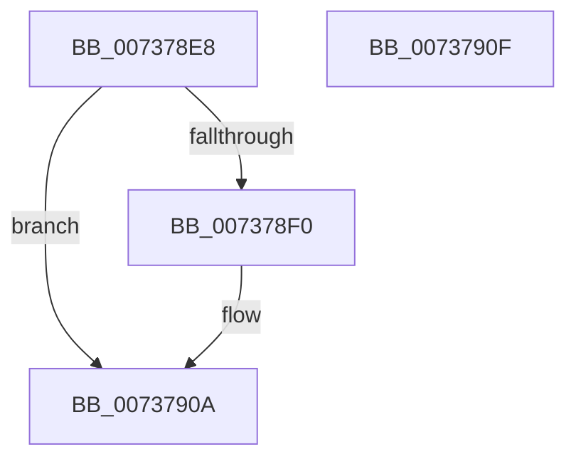

# PpProfileBeginHardwareProfileTransition

- RVA: `0x007378E8`–`0x00737910` (길이 `40` bytes)
- VA: `0x00000001407378E8`
- 실행 섹션: `PAGE`
- PDB 이름 있음: `예`; PDB Function 태그: `아니요`
- unwind 정보 RVA: `0x0005D2F4`
- 디코드: `12`개 명령, `40/40` bytes 표시
- 미해석 바이트: `0` (있으면 어셈블리에 `.byte`로 보존)

> 이 문서는 커널 이미지의 기계어와 PDB 기호를 분석해 생성했습니다. 4번과 5번은 함수 원형과 자료형을 바이너리 사용 방식에서 추정한 C 해석이며 원본 소스 복구 결과는 아닙니다.

## 1. Dependencies

- 직접 호출 지점: **1**; 고유 호출 대상: **1**
- 직접 호출자로 확인된 함수: **2**
- RIP 상대 이미지 참조: **1**

### Outgoing calls
- `0x00737905` → [KeWaitForSingleObject](../../text/20/KeWaitForSingleObject_function_0020E6B0.md) (function, `0x0020E6B0`)

### Direct callers
- [PipProcessStartPhase1](../8F/PipProcessStartPhase1_function_008FE1F8.md) at `0x008FE2CA`
- [PnpProcessQueryRemoveAndEject](../A0/PnpProcessQueryRemoveAndEject_function_00A05170.md) at `0x00A055D8`

### Static image references
- `0x007378F6` → RVA `0x00F8AD00` (`.data`; read)

## 2. Other-region calls and transfers

- 다른 실행 섹션으로 향하는 call: **1**
  - `0x00737905` → [KeWaitForSingleObject](../../text/20/KeWaitForSingleObject_function_0020E6B0.md) (`PAGE` → `.text`)
- 별도 외부 분기/꼬리 이동을 확인하지 못했습니다.

## 3. Assembly (complete function range)

```asm
007378E8  48 83 EC 38                     sub rsp, 0x38
007378EC  84 C9                           test cl, cl
007378EE  75 1A                           jne 0x14073790a
007378F0  48 83 64 24 20 00               and qword ptr [rsp + 0x20], 0
007378F6  48 8D 0D 03 34 85 00            lea rcx, [rip + 0x853403]
007378FD  45 33 C9                        xor r9d, r9d
00737900  45 33 C0                        xor r8d, r8d
00737903  33 D2                           xor edx, edx
00737905  E8 A6 6D AD FF                  call 0x14020e6b0
0073790A  48 83 C4 38                     add rsp, 0x38
0073790E  C3                              ret
0073790F  CC                              int3
```

## 4. C-style interpretation (structured pseudocode)

```c
__int64 __fastcall PpProfileBeginHardwareProfileTransition(unsigned __int8 a1, int a2, int a3, int a4)
{
    __int64 result;
    __int64 v_rsp;
    unsigned __int64 v_stack_m18;

    v_rsp = (v_rsp) - (56);
    if (a1 == 0) {
        a1 = v_rip + 8729603;
        a4 = 0;
        a3 = 0;
        a2 = 0;
        result = KeWaitForSingleObject(a1, a2, a3, a4);
    }
    v_rsp = (v_rsp) + (56);
    return result;
}
```

## 5. (Beta) C Style

```c
int64_t PpProfileBeginHardwareProfileTransition(uint8_t Arg1, int32_t Arg2, int32_t Arg3, int32_t Arg4)
{
    int64_t result;
    int64_t local_rsp;
    uint64_t v_stack_m18;

    local_rsp = (local_rsp) - (56);
    if (Arg1 == 0) {
        Arg1 = v_rip + 8729603;
        Arg4 = 0;
        Arg3 = 0;
        Arg2 = 0;
        result = KeWaitForSingleObject(Arg1, Arg2, Arg3, Arg4);
    }
    local_rsp = (local_rsp) + (56);
    return result;
}
```

## 6. Execution-region graph

[열기: 2D/3D 그래프와 함수 탐색 컨트롤 패널](../../../control-panel.html?section=page&rva=0x007378E8&view=graph)

- 2D 그래프는 위에서 아래로 흐르고, 3D 그래프는 빈 공간을 드래그해 회전합니다. Shift+드래그는 이동, 휠은 확대·축소, 함수 노드 선택은 대상 보고서 이동입니다.

### Static fallback


