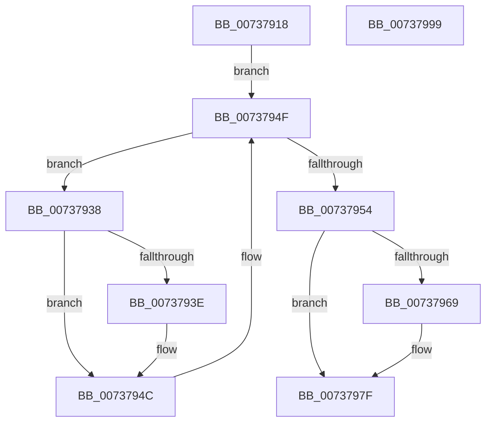

# PpProfileCancelHardwareProfileTransition

- RVA: `0x00737918`–`0x0073799A` (길이 `130` bytes)
- VA: `0x0000000140737918`
- 실행 섹션: `PAGE`
- PDB 이름 있음: `예`; PDB Function 태그: `아니요`
- unwind 정보 RVA: `0x0005C788`
- 디코드: `30`개 명령, `130/130` bytes 표시
- 미해석 바이트: `0` (있으면 어셈블리에 `.byte`로 보존)

> 이 문서는 커널 이미지의 기계어와 PDB 기호를 분석해 생성했습니다. 4번과 5번은 함수 원형과 자료형을 바이너리 사용 방식에서 추정한 C 해석이며 원본 소스 복구 결과는 아닙니다.

## 1. Dependencies

- 직접 호출 지점: **4**; 고유 호출 대상: **4**
- 직접 호출자로 확인된 함수: **3**
- RIP 상대 이미지 참조: **6**

### Outgoing calls
- `0x00737923` → [ExAcquireFastMutex](../../text/20/ExAcquireFastMutex_function_0020E5A0.md) (function, `0x0020E5A0`)
- `0x0073795B` → [ExReleaseFastMutex](../../text/25/ExReleaseFastMutex_function_002519C0.md) (function, `0x002519C0`)
- `0x0073797A` → [PnpRequestHwProfileChangeNotification](../72/PnpRequestHwProfileChangeNotification_function_00729E78.md) (function, `0x00729E78`)
- `0x0073798F` → [KeReleaseSemaphore](../../text/39/KeReleaseSemaphore_function_00397080.md) (function, `0x00397080`)

### Direct callers
- [PnpProcessQueryRemoveAndEject](../A0/PnpProcessQueryRemoveAndEject_function_00A05170.md) at `0x00A05643`
- [sub_00B26024](../B2/Unknown_function_00B26024.md) at `0x00B26024`
- [sub_00B33FE8](../B3/Unknown_function_00B33FE8.md) at `0x00B34099`
- [sub_00B33FE8](../B3/Unknown_function_00B33FE8.md) at `0x00B34138`
- [sub_00B33FE8](../B3/Unknown_function_00B33FE8.md) at `0x00B3414E`

### Static image references
- `0x0073791C` → RVA `0x00F8ACA0` (`.data`; read)
- `0x00737928` → RVA `0x00F8ACE0` (`.data`; read)
- `0x0073793E` → RVA `0x00F8ACF0` (`.data`; read/write)
- `0x00737960` → RVA `0x00F8ACF4` (`.data`; read)
- `0x0073796C` → RVA `0x000240B8` (`.rdata`; read)
- `0x00737982` → RVA `0x00F8AD00` (`.data`; read)

## 2. Other-region calls and transfers

- 다른 실행 섹션으로 향하는 call: **3**
  - `0x00737923` → [ExAcquireFastMutex](../../text/20/ExAcquireFastMutex_function_0020E5A0.md) (`PAGE` → `.text`)
  - `0x0073795B` → [ExReleaseFastMutex](../../text/25/ExReleaseFastMutex_function_002519C0.md) (`PAGE` → `.text`)
  - `0x0073798F` → [KeReleaseSemaphore](../../text/39/KeReleaseSemaphore_function_00397080.md) (`PAGE` → `.text`)
- 별도 외부 분기/꼬리 이동을 확인하지 못했습니다.

## 3. Assembly (complete function range)

```asm
00737918  48 83 EC 28                     sub rsp, 0x28
0073791C  48 8D 0D 7D 33 85 00            lea rcx, [rip + 0x85337d]
00737923  E8 78 6C AD FF                  call 0x14020e5a0
00737928  48 8B 05 B1 33 85 00            mov rax, qword ptr [rip + 0x8533b1]
0073792F  48 8D 0D AA 33 85 00            lea rcx, [rip + 0x8533aa]
00737936  EB 17                           jmp 0x14073794f
00737938  83 78 F8 01                     cmp dword ptr [rax - 8], 1
0073793C  74 0E                           je 0x14073794c
0073793E  F0 FF 0D AB 33 85 00            lock dec dword ptr [rip + 0x8533ab]
00737945  C7 40 F8 01 00 00 00            mov dword ptr [rax - 8], 1
0073794C  48 8B 00                        mov rax, qword ptr [rax]
0073794F  48 3B C1                        cmp rax, rcx
00737952  75 E4                           jne 0x140737938
00737954  48 8D 0D 45 33 85 00            lea rcx, [rip + 0x853345]
0073795B  E8 60 A0 B1 FF                  call 0x1402519c0
00737960  80 3D 8D 33 85 00 00            cmp byte ptr [rip + 0x85338d], 0
00737967  74 16                           je 0x14073797f
00737969  45 33 C9                        xor r9d, r9d
0073796C  48 8D 0D 45 C7 8E FF            lea rcx, [rip - 0x7138bb]
00737973  45 33 C0                        xor r8d, r8d
00737976  41 8D 51 02                     lea edx, [r9 + 2]
0073797A  E8 F9 24 FF FF                  call 0x140729e78
0073797F  45 33 C9                        xor r9d, r9d
00737982  48 8D 0D 77 33 85 00            lea rcx, [rip + 0x853377]
00737989  33 D2                           xor edx, edx
0073798B  45 8D 41 01                     lea r8d, [r9 + 1]
0073798F  E8 EC F6 C5 FF                  call 0x140397080
00737994  48 83 C4 28                     add rsp, 0x28
00737998  C3                              ret
00737999  CC                              int3
```

## 4. C-style interpretation (structured pseudocode)

```c
__int64 __fastcall PpProfileCancelHardwareProfileTransition(__int64 a1, __int64 a2, int a3, int a4)
{
    __int64 result;
    __int64 v_rsp;

    v_rsp = (v_rsp) - (40);
    result = ExAcquireFastMutex(v_rip + 8729469, a2, a3, a4);
    goto loc_0073794F;
loc_00737938:
    if ((*(unsigned int *)(*(unsigned __int64 *)(v_rip + 8729521) - 8)) != 1) {
        *(unsigned int *)(*(unsigned __int64 *)(v_rip + 8729521) - 8) = 1;
    }
loc_0073794F:
    if ((*(unsigned __int64 *)(*(unsigned __int64 *)(v_rip + 8729521))) != (v_rip + 8729514)) goto loc_00737938;
    result = ExReleaseFastMutex(v_rip + 8729413, a2, a3, a4);
    if ((*(unsigned __int8 *)(v_rip + 8729485)) != 0) {
        a4 = 0;
        a1 = v_rip - 7420091;
        a3 = 0;
        a2 = a4 + 2;
        result = PnpRequestHwProfileChangeNotification(a1, a2, a3, a4);
    }
    a4 = 0;
    a2 = 0;
    result = KeReleaseSemaphore(v_rip + 8729463, a2, a4 + 1, a4);
    v_rsp = (v_rsp) + (40);
    return result;
}
```

## 5. (Beta) C Style

```c
int64_t PpProfileCancelHardwareProfileTransition(int64_t Arg1, int64_t Arg2, int32_t Arg3, int32_t Arg4)
{
    int64_t result;
    int64_t local_rsp;

    local_rsp = (local_rsp) - (40);
    result = ExAcquireFastMutex(v_rip + 8729469, Arg2, Arg3, Arg4);
    goto loc_0073794F;
loc_00737938:
    if ((*(uint32_t *)(*(uint64_t *)(v_rip + 0x8533B1) - 0x8)) != 1) {
        *(uint32_t *)(*(uint64_t *)(v_rip + 0x8533B1) - 0x8) = 1;
    }
loc_0073794F:
    if ((*(uint64_t *)(*(uint64_t *)(v_rip + 0x8533B1))) != (v_rip + 8729514)) goto loc_00737938;
    result = ExReleaseFastMutex(v_rip + 8729413, Arg2, Arg3, Arg4);
    if ((*(uint8_t *)(v_rip + 0x85338D)) != 0) {
        Arg4 = 0;
        Arg1 = v_rip - 7420091;
        Arg3 = 0;
        Arg2 = Arg4 + 2;
        result = PnpRequestHwProfileChangeNotification(Arg1, Arg2, Arg3, Arg4);
    }
    Arg4 = 0;
    Arg2 = 0;
    result = KeReleaseSemaphore(v_rip + 8729463, Arg2, Arg4 + 1, Arg4);
    local_rsp = (local_rsp) + (40);
    return result;
}
```

## 6. Execution-region graph

[열기: 2D/3D 그래프와 함수 탐색 컨트롤 패널](../../../control-panel.html?section=page&rva=0x00737918&view=graph)

- 2D 그래프는 위에서 아래로 흐르고, 3D 그래프는 빈 공간을 드래그해 회전합니다. Shift+드래그는 이동, 휠은 확대·축소, 함수 노드 선택은 대상 보고서 이동입니다.

### Static fallback


