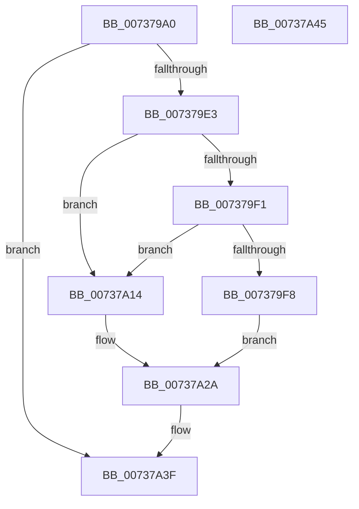

# PpProfileCancelTransitioningDock

- RVA: `0x007379A0`–`0x00737A46` (길이 `166` bytes)
- VA: `0x00000001407379A0`
- 실행 섹션: `PAGE`
- PDB 이름 있음: `예`; PDB Function 태그: `아니요`
- unwind 정보 RVA: `0x0008A2E0`
- 디코드: `41`개 명령, `166/166` bytes 표시
- 미해석 바이트: `0` (있으면 어셈블리에 `.byte`로 보존)

> 이 문서는 커널 이미지의 기계어와 PDB 기호를 분석해 생성했습니다. 4번과 5번은 함수 원형과 자료형을 바이너리 사용 방식에서 추정한 C 해석이며 원본 소스 복구 결과는 아닙니다.

## 1. Dependencies

- 직접 호출 지점: **7**; 고유 호출 대상: **6**
- 직접 호출자로 확인된 함수: **2**
- RIP 상대 이미지 참조: **5**

### Outgoing calls
- `0x007379B8` → [ExAcquireFastMutex](../../text/20/ExAcquireFastMutex_function_0020E5A0.md) (function, `0x0020E5A0`)
- `0x007379D9` → [ExReleaseFastMutex](../../text/25/ExReleaseFastMutex_function_002519C0.md) (function, `0x002519C0`)
- `0x007379E8` → [PnpProfileUpdateHardwareProfile](PnpProfileUpdateHardwareProfile_function_0073773C.md) (function, `0x0073773C`)
- `0x00737A08` → [PnpRequestHwProfileChangeNotification](../72/PnpRequestHwProfileChangeNotification_function_00729E78.md) (function, `0x00729E78`)
- `0x00737A0D` → [PiProfileUpdateDeviceTree](PiProfileUpdateDeviceTree_function_007375D8.md) (function, `0x007375D8`)
- `0x00737A25` → [PnpRequestHwProfileChangeNotification](../72/PnpRequestHwProfileChangeNotification_function_00729E78.md) (function, `0x00729E78`)
- `0x00737A3A` → [KeReleaseSemaphore](../../text/39/KeReleaseSemaphore_function_00397080.md) (function, `0x00397080`)

### Direct callers
- [PipProcessEnumeratedChildDevice](../8F/PipProcessEnumeratedChildDevice_function_008FBF4C.md) at `0x008FC00D`
- [PiProcessNewDeviceNode](../A2/PiProcessNewDeviceNode_function_00A28F20.md) at `0x00A290BB`

### Static image references
- `0x007379B1` → RVA `0x00F8ACA0` (`.data`; read)
- `0x007379CA` → RVA `0x00F8ACF0` (`.data`; read/write)
- `0x00737A01` → RVA `0x00024178` (`.rdata`; read)
- `0x00737A17` → RVA `0x000240B8` (`.rdata`; read)
- `0x00737A2D` → RVA `0x00F8AD00` (`.data`; read)

## 2. Other-region calls and transfers

- 다른 실행 섹션으로 향하는 call: **3**
  - `0x007379B8` → [ExAcquireFastMutex](../../text/20/ExAcquireFastMutex_function_0020E5A0.md) (`PAGE` → `.text`)
  - `0x007379D9` → [ExReleaseFastMutex](../../text/25/ExReleaseFastMutex_function_002519C0.md) (`PAGE` → `.text`)
  - `0x00737A3A` → [KeReleaseSemaphore](../../text/39/KeReleaseSemaphore_function_00397080.md) (`PAGE` → `.text`)
- 별도 외부 분기/꼬리 이동을 확인하지 못했습니다.

## 3. Assembly (complete function range)

```asm
007379A0  89 54 24 10                     mov dword ptr [rsp + 0x10], edx
007379A4  53                              push rbx
007379A5  48 83 EC 20                     sub rsp, 0x20
007379A9  48 8B D9                        mov rbx, rcx
007379AC  C6 44 24 38 00                  mov byte ptr [rsp + 0x38], 0
007379B1  48 8D 0D E8 32 85 00            lea rcx, [rip + 0x8532e8]
007379B8  E8 E3 6B AD FF                  call 0x14020e5a0
007379BD  C7 83 38 02 00 00 01 00 00 00   mov dword ptr [rbx + 0x238], 1
007379C7  83 CB FF                        or ebx, 0xffffffff
007379CA  F0 0F C1 1D 1E 33 85 00         lock xadd dword ptr [rip + 0x85331e], ebx
007379D2  48 8D 0D C7 32 85 00            lea rcx, [rip + 0x8532c7]
007379D9  E8 E2 9F B1 FF                  call 0x1402519c0
007379DE  83 FB 01                        cmp ebx, 1
007379E1  75 5C                           jne 0x140737a3f
007379E3  48 8D 4C 24 38                  lea rcx, [rsp + 0x38]
007379E8  E8 4F FD FF FF                  call 0x14073773c
007379ED  85 C0                           test eax, eax
007379EF  78 23                           js 0x140737a14
007379F1  80 7C 24 38 00                  cmp byte ptr [rsp + 0x38], 0
007379F6  74 1C                           je 0x140737a14
007379F8  45 33 C9                        xor r9d, r9d
007379FB  8D 53 01                        lea edx, [rbx + 1]
007379FE  45 33 C0                        xor r8d, r8d
00737A01  48 8D 0D 70 C7 8E FF            lea rcx, [rip - 0x713890]
00737A08  E8 6B 24 FF FF                  call 0x140729e78
00737A0D  E8 C6 FB FF FF                  call 0x1407375d8
00737A12  EB 16                           jmp 0x140737a2a
00737A14  45 33 C9                        xor r9d, r9d
00737A17  48 8D 0D 9A C6 8E FF            lea rcx, [rip - 0x713966]
00737A1E  45 33 C0                        xor r8d, r8d
00737A21  41 8D 51 02                     lea edx, [r9 + 2]
00737A25  E8 4E 24 FF FF                  call 0x140729e78
00737A2A  45 33 C9                        xor r9d, r9d
00737A2D  48 8D 0D CC 32 85 00            lea rcx, [rip + 0x8532cc]
00737A34  33 D2                           xor edx, edx
00737A36  45 8D 41 01                     lea r8d, [r9 + 1]
00737A3A  E8 41 F6 C5 FF                  call 0x140397080
00737A3F  48 83 C4 20                     add rsp, 0x20
00737A43  5B                              pop rbx
00737A44  C3                              ret
00737A45  CC                              int3
```

## 4. C-style interpretation (structured pseudocode)

```c
__int64 __fastcall PpProfileCancelTransitioningDock(__int64 a1, int a2, int a3, int a4)
{
    __int64 result;
    __int64 v_rbx;
    __int64 v_rsp;
    unsigned int v_stack_p10;

    v_stack_p10 = a2;
    v_rsp = (v_rsp) - (32);
    v_stack_p10 = 0;
    result = ExAcquireFastMutex(v_rip + 8729320, a2, a3, a4);
    *(unsigned int *)(a1 + 568) = 1;
    v_rbx = (unsigned int)((a1) | (0xFFFFFFFFULL));
    result = ExReleaseFastMutex(v_rip + 8729287, a2, a3, a4);
    if (((unsigned int)(v_rbx)) != 1) goto loc_00737A3F;
    result = PnpProfileUpdateHardwareProfile(v_stack_p10, a2, a3, a4);
    if (sign_flag) goto loc_00737A14;
    if (v_stack_p10 == 0) goto loc_00737A14;
    a4 = 0;
    a3 = 0;
    result = PnpRequestHwProfileChangeNotification(v_rip - 7420048, v_rbx + 1, a3, a4);
    result = PiProfileUpdateDeviceTree(v_rip - 7420048, v_rbx + 1, a3, a4);
    goto loc_00737A2A;
loc_00737A14:
    a4 = 0;
    a3 = 0;
    result = PnpRequestHwProfileChangeNotification(v_rip - 7420262, a4 + 2, a3, a4);
loc_00737A2A:
    a4 = 0;
    a2 = 0;
    result = KeReleaseSemaphore(v_rip + 8729292, a2, a4 + 1, a4);
loc_00737A3F:
    v_rsp = (v_rsp) + (32);
    return result;
}
```

## 5. (Beta) C Style

```c
int64_t PpProfileCancelTransitioningDock(void *Arg1, int32_t Arg2, int32_t Arg3, int32_t Arg4)
{
    uint8_t *arg1 = (uint8_t *)Arg1;

    int64_t result;
    int64_t local_rbx;
    int64_t local_rsp;
    uint32_t v_stack_p10;

    v_stack_p10 = Arg2;
    local_rsp = (local_rsp) - (32);
    v_stack_p10 = 0;
    result = ExAcquireFastMutex(v_rip + 8729320, Arg2, Arg3, Arg4);
    *(uint32_t *)(arg1 + 0x238) = 1;
    local_rbx = (uint32_t)((Arg1) | (0xFFFFFFFFULL));
    result = ExReleaseFastMutex(v_rip + 8729287, Arg2, Arg3, Arg4);
    if (((uint32_t)(local_rbx)) != 1) goto loc_00737A3F;
    result = PnpProfileUpdateHardwareProfile(v_stack_p10, Arg2, Arg3, Arg4);
    if (sign_flag) goto loc_00737A14;
    if (v_stack_p10 == 0) goto loc_00737A14;
    Arg4 = 0;
    Arg3 = 0;
    result = PnpRequestHwProfileChangeNotification(v_rip - 7420048, local_rbx + 1, Arg3, Arg4);
    result = PiProfileUpdateDeviceTree(v_rip - 7420048, local_rbx + 1, Arg3, Arg4);
    goto loc_00737A2A;
loc_00737A14:
    Arg4 = 0;
    Arg3 = 0;
    result = PnpRequestHwProfileChangeNotification(v_rip - 7420262, Arg4 + 2, Arg3, Arg4);
loc_00737A2A:
    Arg4 = 0;
    Arg2 = 0;
    result = KeReleaseSemaphore(v_rip + 8729292, Arg2, Arg4 + 1, Arg4);
loc_00737A3F:
    local_rsp = (local_rsp) + (32);
    return result;
}
```

### 관측된 메모리 오프셋

구조체 형식이 확인되지 않은 접근은 인자 기준의 오프셋으로만 기록했습니다.

| 기준 인자 | 오프셋 표현 | 폭 (bit) | 접근 |
|---|---:|---:|---|
| `Arg1` | `+ 0x238` | `32` | `W` |

## 6. Execution-region graph

[열기: 2D/3D 그래프와 함수 탐색 컨트롤 패널](../../../control-panel.html?section=page&rva=0x007379A0&view=graph)

- 2D 그래프는 위에서 아래로 흐르고, 3D 그래프는 빈 공간을 드래그해 회전합니다. Shift+드래그는 이동, 휠은 확대·축소, 함수 노드 선택은 대상 보고서 이동입니다.

### Static fallback


